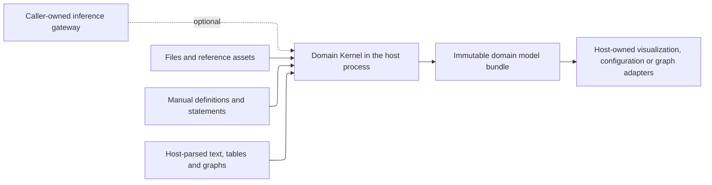
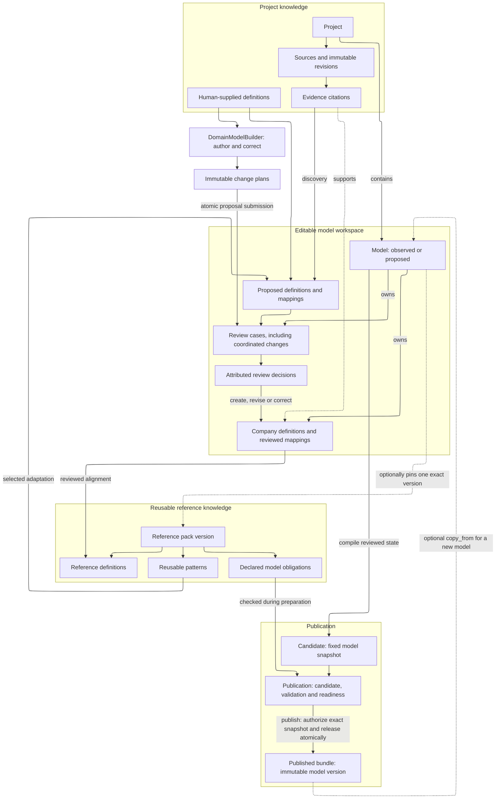
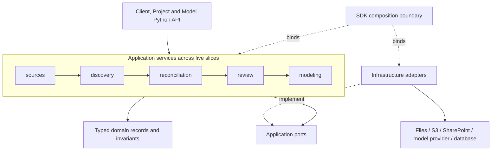
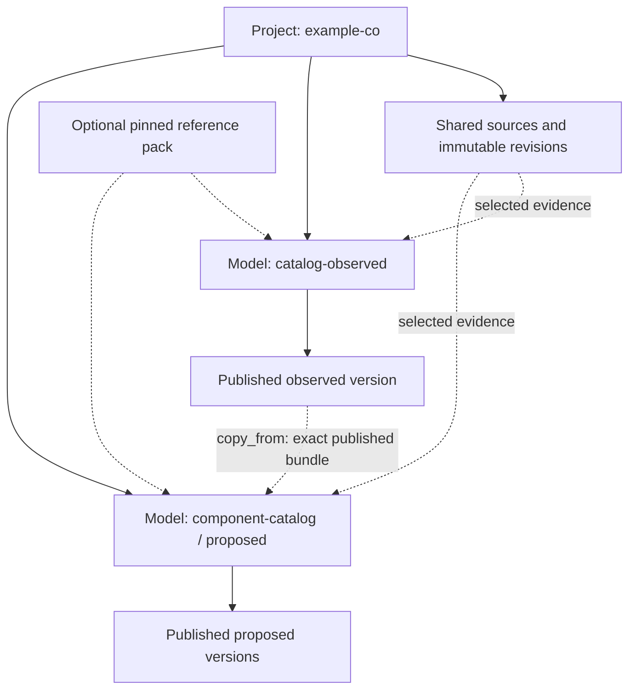
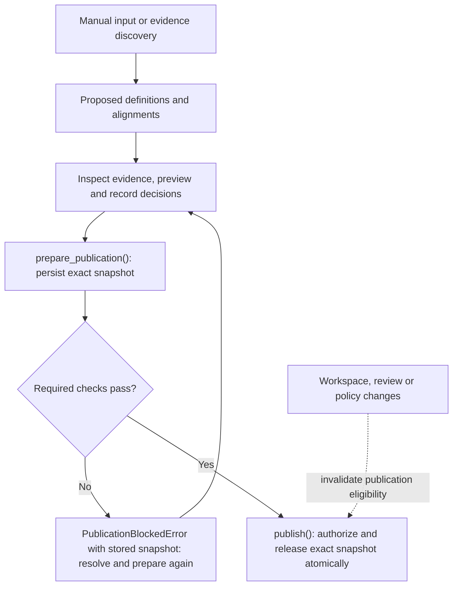
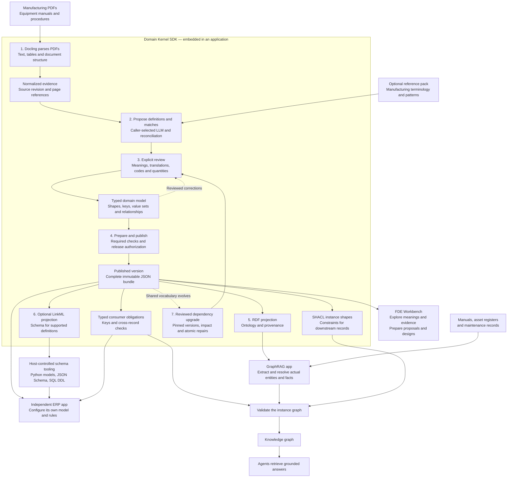
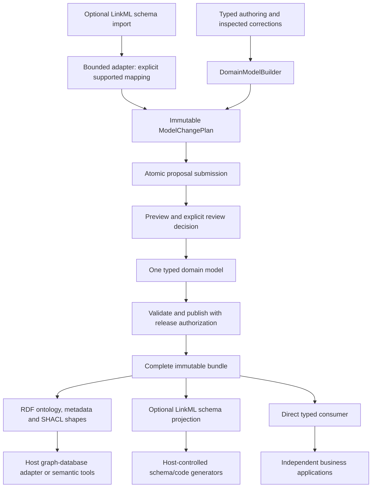
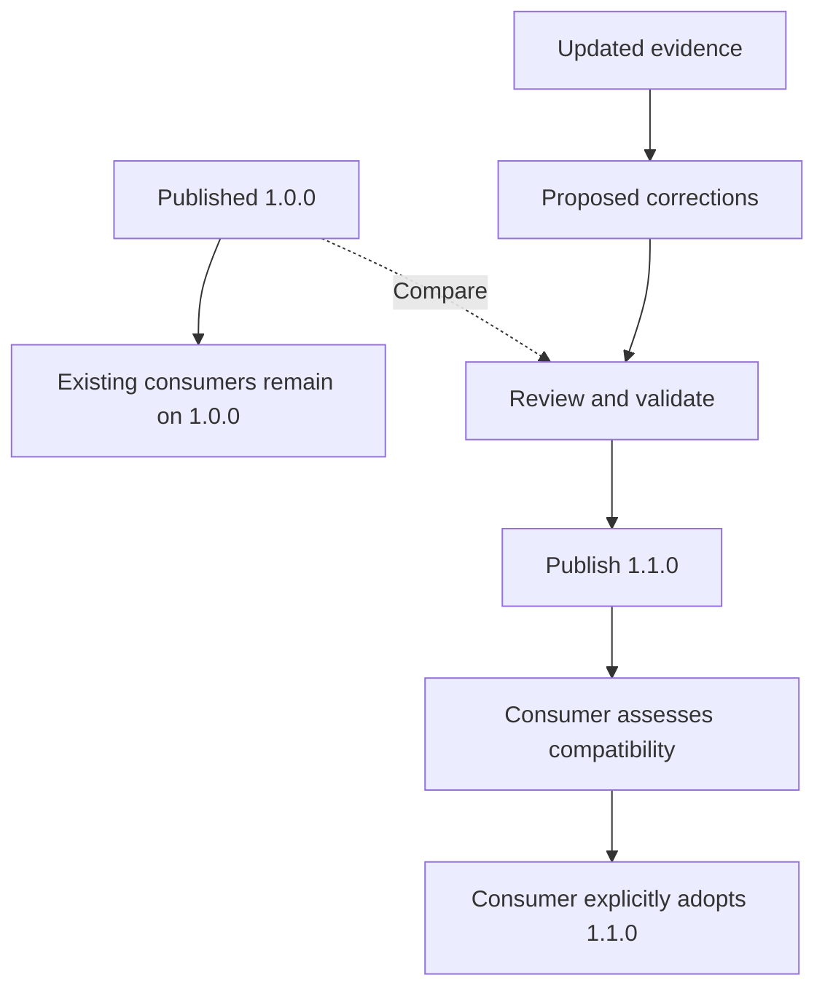
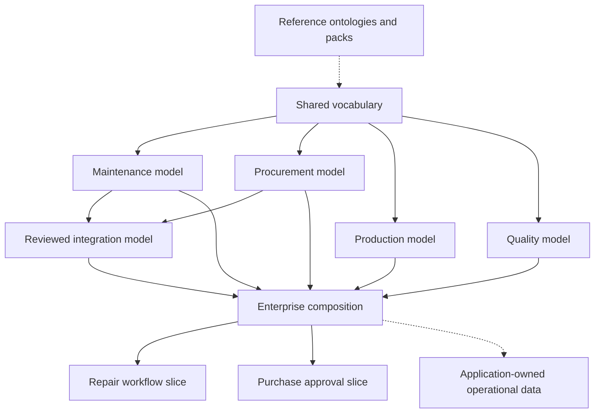
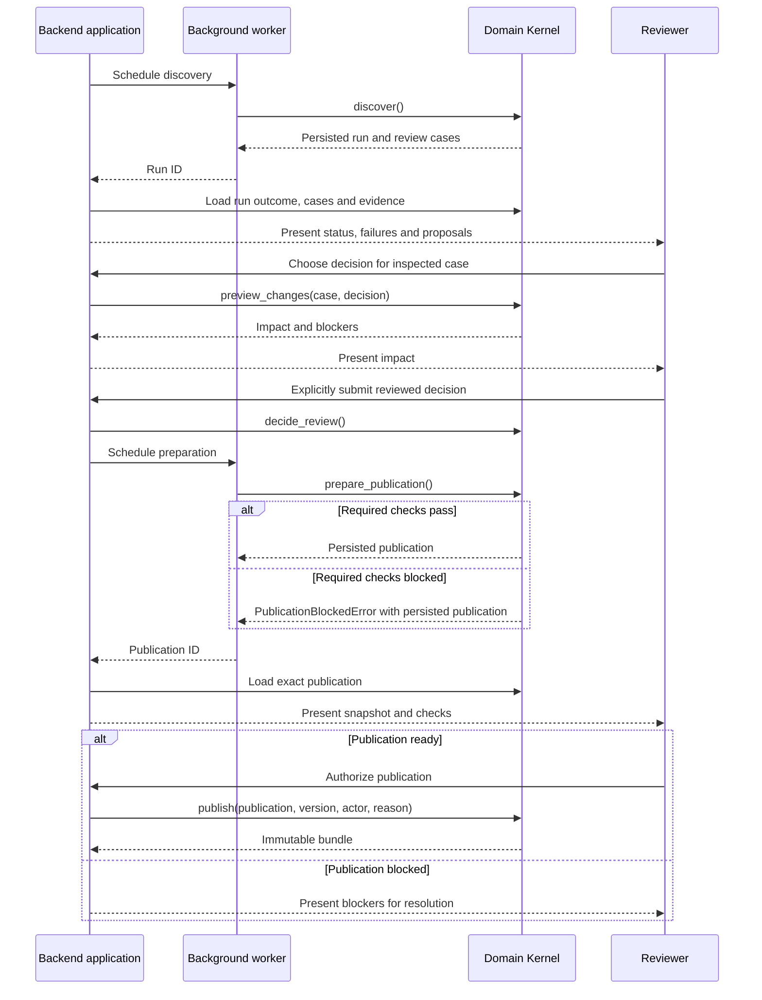

# Domain Kernel Architecture

Business knowledge is often fragmented across documents, spreadsheets, reference standards, and the people who understand it. Different sources may describe the same concept in different ways, making it difficult for applications to establish consistent definitions, relationships, and business rules.

**Domain Kernel is an embeddable Python SDK that transforms this knowledge into consistent, validated, and versioned business domain models with traceable provenance.**

The SDK supports both manual modelling and evidence-assisted discovery. It helps identify and reconcile ambiguous definitions, validate relationships and constraints, and record human review decisions. Models can be corrected and refined without losing their history or modifying previously published versions.

The result is a **portable, machine-readable domain model** describing business concepts, relationships, constraints, processes, and decisions. Applications can use these definitions to inform their own data structures and behaviour, while retaining responsibility for execution and operational data.

## About This Document

This document is the **canonical reference for Domain Kernel's architecture**, defining its product scope, expected behaviour, and integration boundaries.

Two supporting documents provide additional detail:

- [SDK_REQUIREMENTS.md](SDK_REQUIREMENTS.md) — Detailed usage scenarios and workflows.
- [INTERFACES.md](INTERFACES.md) — Proposed API signatures, types, and contracts.

Both elaborate on this architecture without introducing additional product scope.

## Quickstart: Create, Review, and Publish a Model

This example walks through the complete modelling lifecycle: **define business concepts, review their meanings, publish a versioned model, and share it with other applications.**

We'll create a simple component catalog containing two concepts, `Component` and `Supplier`, connected by a many-to-many relationship.

> [!NOTE]
> **Implementation status:** The API shown below is a proposed design contract, not yet a runnable SDK.

### Prerequisites

The example uses unused project and model names. With no explicit database setting,
the SDK initializes default SQLite on the first database operation. No reference
pack or inference gateway is required. Explicit database configurations follow the
[database setup contract](#database-initialization).

For the later independent discovery/host-parsed recipes, select the corresponding
[startup configuration](#configure-the-sdk-in-python) before creating the client,
then reuse that client and its handles throughout that journey.

The examples use explicit keyword arguments. In notebooks, use top-level `await`; in scripts, run asynchronous operations inside an async function. Standalone expressions indicate values to inspect.

### 1. Define Your Domain Model

Start by creating a project and model, then define the business concepts and their relationship.

```python
from domain_kernel import (
    Accept,
    Client,
    DomainModelBuilder,
    ModelKind,
    RelationshipCardinality,
)

client = Client()
project = await client.create_project(actor="user:catalog-owner", display_name="Example Co")
model = await project.create_model(
    actor="user:catalog-owner",
    display_name="Component Catalog",
    description="Component types, suppliers and inventory terms for purchasing and manufacturing.",
    kind=ModelKind.PROPOSED,
)

builder = DomainModelBuilder(model_info=model.info)

component_id = builder.add_concept(
    display_name="Component",
    meaning="A purchased or manufactured catalog item type.",
    aliases=["Part"],
)

supplier_id = builder.add_concept(
    display_name="Supplier",
    meaning="An organization that supplies catalog components.",
)

builder.add_relationship(
    display_name="Supplies",
    meaning="A supplier can supply several component types, each from several suppliers.",
    source=supplier_id,
    target=component_id,
    cardinality=RelationshipCardinality.many_to_many(),
)
```

The builder creates a proposed set of definitions. Nothing has been accepted or published yet.

**Reference knowledge is optional.** The `reference_pack` parameter defaults to `None`. You can supply a reference pack to reuse existing knowledge, modelling patterns, and declared checks.

Core integrity, evidence, and review rules apply regardless of whether a reference pack is used. New models do not contain predefined company-specific definitions.

### 2. Review the Proposed Changes

Build the plan locally, submit it for review, and preview the intended decision:

```python
plan = builder.build_change_plan(reason="Establish the catalog meanings with its owner.")

case = await model.propose_change_plan(actor="user:catalog-owner", plan=plan)

case.proposed_changes
case.definitions

decision = Accept(
    reason="Reviewed these meanings, scope and relationship.",
)

impact = await model.preview_changes(
    case=case,
    decision=decision,
)

impact.definition_changes
impact.compatibility
impact.blockers
impact.affected_case_ids
impact.invalidated_decision_ids
```

The reviewer can now inspect the proposed definitions, relationships, and their combined impact before deciding whether to accept them.

**Previewing a review does not apply the changes.** An explicit decision is required.

Once the reviewer is satisfied, record their decision:

```python
receipt = await model.decide_review(
    case=case,
    decision=decision,
    actor="user:catalog-owner",  # Verified by the host application.
)

receipt.decision_id
receipt.workspace_revision
```

This records the review decision and its associated identity. The host application is responsible for verifying the actor.

Both review methods take the inspected `case`, carrying its identity, scope and
version. The SDK checks it against stored state and never silently substitutes a
newer case. Preview applies nothing; decision application rechecks atomically.

As an alternative to acceptance, reject a still-pending case:

```python
from domain_kernel import Reject

rejection = Reject(reason="The proposed changes need revision before acceptance.")
rejection_impact = await model.preview_changes(case=case, decision=rejection)
case.generated_member_case_ids
rejection_impact.affected_case_ids

# After inspecting this alternative outcome; do not also execute the acceptance branch.
receipt = await model.decide_review(
    case=case,
    decision=rejection,
    actor="user:catalog-owner",
)
```

Rejecting this plan also rejects all proposals it generated. Pre-existing pending
cases explicitly included in a plan instead return to pending, with new versions.
No proposed changes are applied and all history is preserved. To revise rejected
work, inspect current state and submit a new plan; replaying the old plan does not reopen it.

### 3. Validate and Publish the Model

Prepare the model for publication. The call succeeds only when its required checks pass:

```python
publication = await model.prepare_publication(actor="user:catalog-owner")
```

If required integrity, evidence, or review checks fail, `prepare_publication()` raises `PublicationBlockedError`. Its `publication` property carries the complete persisted snapshot, including `blockers`, `checks`, and validation results, for inspection by the host application.

Once the model is ready and the snapshot has been inspected, publish it:

```python
bundle = await model.publish(
    publication=publication,
    version="1.0.0",
    actor="user:catalog-owner",
    reason="Release the reviewed initial catalog model.",
)
```

The result is an **immutable, versioned domain model** that can be shared independently of the application that created it.

### 4. Share the Model with Other Applications

Published models can be serialized into portable JSON bundles and transferred using any transport mechanism supported by your application. `serialize()` returns canonical UTF-8 JSON bytes; `deserialize()` validates the payload and returns an immutable bundle.

```python
from domain_kernel import DomainModelBundle

# Serialize a published model
payload = bundle.serialize()

# Deserialize and validate
received = DomainModelBundle.deserialize(payload=payload)

# Access the model
print(received.model_version)
print(received.content.definitions)
```

Consuming applications can load and validate the bundle **without access to the producing application's database, SDK client, evidence readers, or AI inference gateway**.

### What You've Built

You now have a reviewed and published domain model that defines two business concepts and the relationship between them, including the decisions behind their approval.

The model describes **business definitions, not operational records**. It does not store supplier accounts, inventory balances, or purchase orders.

Applications such as FDE Workbench, ERP systems, and GraphRAG can independently consume the published model, create their own models, and decide how to apply its definitions within their respective systems.

<a id="grow-the-model-step-by-step"></a>

## Build on the Quickstart

The following examples build on the quickstart, introducing more advanced modelling capabilities one step at a time.

Each example is an **independent workflow** with its own inputs, review requirements, and compatibility boundaries. They are not intended to run as one continuous script.

Before starting another editing workflow on the same model, complete or cancel any pending review cases. Publishing a new version does not modify previously published bundles, including the quickstart's immutable `bundle`.

### What You'll Learn

| Stage | Capability | Detailed reference |
|---|---|---|
| 1. Fields and corrections | Add typed attributes and review changes to existing definitions | [Business shapes](#business-data-shapes-and-terminology), [Coordinated corrections](#compose-corrections-without-copying-unchanged-fields) |
| 2. Business vocabulary and quantities | Define reusable value sets and precise measurement types | [Quantity patterns](#quantity-and-association-patterns) |
| 3. Evidence and discovery | Discover proposed meanings from documents using optional AI | [Supply knowledge](#4-supply-business-knowledge), [Discovery](#5-discover-and-reconcile-meanings) |
| 4. Portability | Check compatibility before exporting a published model | [Projection assessment](#assess-a-projection-before-exporting) |
| 5. Reuse and evolution | Copy published models into new designs and manage dependencies | [Model evolution](#9-evolve-models-safely) |
| 6. Enterprise and formal semantics | Compose models, select workflow views, and apply formal reasoning | [Model composition](#domain-modules-enterprise-compositions-and-workflow-views), [Reasoning](#semantic-links-inheritance-and-reasoning-capabilities) |

### 1. Add a Field Through a Reviewed Correction

Start with the `Component` concept created in the quickstart. We'll add a required catalog code without losing the definition's existing attributes, metadata, or evidence.

First, retrieve the current definition and create a change set:

```python
from domain_kernel import (
    AttributeDefinition,
    DomainModelBuilder,
)

model = await project.get_model(name=model.info.name)
component = await model.get_concept(name="component")

builder = DomainModelBuilder(model_info=model.info)
```

Next, use the typed string factory to add the new attribute while preserving the existing attributes and keys:

```python
catalog_code = AttributeDefinition.string(
    display_name="Catalog code",
    required=True,
)
builder.add_attribute(concept=component, attribute=catalog_code)
```

The string factory generates the attribute ID and stable `catalog-code` name. The builder preserves existing fields, keys, metadata and evidence.

Submit the proposed change and preview its impact:

```python
field_plan = builder.build_change_plan(reason="Require an explicit catalog code.")

field_case = await model.propose_change_plan(
    actor="user:catalog-owner",
    plan=field_plan,
)

field_decision = Accept(
    reason="Reviewed the catalog-code requirement and its impact.",
)

field_impact = await model.preview_changes(
    case=field_case,
    decision=field_decision,
)

field_case.proposed_changes
field_impact.definition_changes
field_impact.blockers
```

**Review is required before applying the change.** Once the reviewer has inspected the proposal, use the quickstart's `decide_review()` method with `field_case` and `field_decision`.

If accepted, prepare and publish a new model version.

The same approach supports correcting previously accepted interpretations without losing their history. Multiple related corrections can also be grouped into one change set and reviewed atomically.

### 2. Define Reusable Business Vocabulary and Quantities

Domain Kernel supports reusable business definitions, including controlled vocabularies and typed quantities.

This example creates an independent maintenance model with a defined set of work-order statuses.

#### Define a Controlled Vocabulary

Start by creating a new model and defining a value set:

```python
from domain_kernel import (
    BusinessCode,
    LabelText,
    MeaningText,
    ValueSetMember,
    ValueSetMembership,
)

maintenance = await project.create_model(
    actor="user:model-editor",
    display_name="Maintenance",
    description="Maintenance assets, work orders, business vocabulary and measurements.",
    kind=ModelKind.PROPOSED,
)

business = DomainModelBuilder(model_info=maintenance.info)

status_id = business.add_value_set(
    display_name="MaintenanceStatus",
    meaning="The permitted maintenance work-order states.",
    membership=ValueSetMembership.CLOSED,
    members=[
        ValueSetMember(
            code=BusinessCode(value="planned"),
            label=LabelText(value="Planned"),
            meaning=MeaningText(value="Scheduled but not started."),
        ),
        ValueSetMember(
            code=BusinessCode(value="completed"),
            label=LabelText(value="Completed"),
            meaning=MeaningText(value="The assigned work has finished."),
        ),
    ],
)
```

A **closed value set** accepts only its explicitly defined codes.

For vocabularies where listed values are examples rather than an exhaustive list, use `ValueSetMembership.OPEN`. This allows other valid strings that are not included in the value set.

#### Use the Vocabulary in a Concept

Now define a `WorkOrder` concept with a required `Status` attribute referencing the value set:

```python
work_order_id = business.add_concept(
    display_name="WorkOrder",
    meaning="An instruction to perform maintenance work.",
    attributes=[
        AttributeDefinition.value_set(
            display_name="Status",
            value_set=status_id,
            required=True,
        ),
    ],
)

business_plan = business.build_change_plan(reason="Establish the work-order vocabulary.")

business_case = await maintenance.propose_change_plan(
    actor="user:model-editor",
    plan=business_plan,
)

# Inspect, preview, and explicitly accept before publication.
```

The value-set factory returns an ordinary `AttributeDefinition` with `ValueSetType(value_set=status_id)`. It references the value set without creating or copying it; the full constructor remains available.

As with the quickstart, the proposed definitions must be reviewed and accepted before preparing and publishing the model.

#### Advanced: Define a Typed Quantity

Domain Kernel can also represent measurements with explicit units and quantity meanings.

This example explicitly creates a reusable unit and a closed unit value set. No ontology is required; optional ontology references retain their exact materialized source pins.

Start this new change plan only after completing the previous review.

```python
maintenance = await project.get_model(name=maintenance.info.name)
quantities = DomainModelBuilder(model_info=maintenance.info)

bar_id = quantities.add_unit(
    display_name="Bar",
    meaning="The bar pressure unit used in our maintenance measurements.",
    symbol="bar",
)
pressure_units = quantities.add_value_set(
    display_name="Pressure units",
    meaning="The permitted units for maintenance pressure measurements.",
    membership=ValueSetMembership.CLOSED,
    members=[
        ValueSetMember(
            code=BusinessCode(value="bar"),
            label=LabelText(value="Bar"),
            meaning=MeaningText(value="A pressure measurement expressed in bar."),
            unit=bar_id,
        ),
    ],
)

pressure_id = quantities.add_quantity(
    display_name="Pressure",
    meaning="A pressure magnitude expressed in a declared unit.",
    units=pressure_units,
)
test_pressure_id = quantities.add_quantity(
    display_name="Test pressure",
    meaning="The pressure applied during an equipment test.",
    units=pressure_units,
)

quantity_plan = quantities.build_change_plan(reason="Make pressure values unambiguous.")

quantity_case = await maintenance.propose_change_plan(
    actor="user:model-editor",
    plan=quantity_plan,
)

# Review explicitly before accepting or publishing.
```

The quantity helper creates a structured value containing a required decimal `magnitude`, a required `unit`, and their typed quantity binding. Omitting `quantity_kind` leaves its external ontology reference as `None`; the quantity definition supplies the local meaning. Both quantities reuse the same unit set.

After acceptance, `maintenance.get_unit(name="bar")` retrieves the typed unit snapshot. Its generated ID and stable name survive display-label changes. `add_unit(ontology_term=...)` and `add_quantity(quantity_kind=...)` can additionally bind supplied ontology terms without implicit downloads or formal equivalence.

**This defines a measurement type, not actual measurements or automatic unit conversions.** The helper does not download or automatically adopt ontology resources.

You can extend these definitions with decimal constraints, compound keys, translations, and acceptance checks.

See the [complete manufacturing recipe](SDK_REQUIREMENTS.md#author-business-shapes-terminology-and-model-checks) for a more detailed example.

### 3. Discover Domain Knowledge from Documents

Domain Kernel can use documents and AI-assisted discovery to propose new definitions and relationships.

Return to the component catalog after completing its pending reviews.

This example assumes the host application has:

- Configured the SDK state database.
- Registered an `inputs` reader and Docling parser.
- Installed the optional documents adapter.
- Supplied the caller-owned gateway through `ClientConfiguration.model_gateway` when creating the original client.

See [Configure and Create a Model Workspace](#3-configure-and-create-a-model-workspace) for the individual configuration steps.

#### Ingest a Document

Reuse the original `client`, `project` and `model`. Ingest a catalog manual as source evidence:

```python
from domain_kernel import CaseStatus, PDF, ReaderLocation

manual = await project.ingest_source(
    actor="user:model-editor",
    source=PDF(
        location=ReaderLocation(
            reader="inputs",
            path="catalog-manual.pdf",
        ),
    ),
    display_name="Catalog manual",
)
```

#### Discover and Review Proposed Meanings

Run discovery against the ingested document:

```python
run = await model.discover(
    actor="user:model-editor",
    sources=[manual.revision],
)

pending = await model.list_review_cases(
    run_id=run.id,
    status=CaseStatus.PENDING,
    limit=50,
)

pending
```

During discovery:

1. **Docling** prepares and structures the source evidence.
2. **The inference gateway** proposes business concepts, definitions, and relationships.
3. **Domain Kernel** applies deterministic validation rules and preserves source provenance.

Discovery produces proposals, not approved definitions.

Review the suggested mappings and ambiguous meanings, correct any errors, and follow the same prepare and publish lifecycle used in the quickstart.

For an end-to-end example involving PDFs, ontology terms, and application-owned operational data, see the [Manufacturing Walkthrough](#manufacturing-walkthrough-from-pdfs-to-a-reviewed-model).

### 4. Check Compatibility Before Exporting

Domain Kernel supports exporting published models into formats such as JSON Schema, RDF/SHACL, and LinkML.

Because these formats represent different subsets of domain knowledge, **export assesses compatibility before writing**. Applications can also assess explicitly to display findings in advance.

This example uses the quickstart's immutable `bundle`. Any subsequent draft changes have no effect on it.

#### Assess the Target Format

Select a JSON Schema projection and evaluate its compatibility:

```python
from domain_kernel import (
    Iri,
    JsonSchemaProjectionRequest,
)

# Read from this published snapshot, independently of subsequent draft edits.
component = bundle.get_concept(name="component")
schema_request = JsonSchemaProjectionRequest(
    root=component,
    base_iri=Iri(value="https://example.org/domains/"),
)

assessment = bundle.assess_projection(
    request=schema_request,
)
```

Assessment works directly with the published bundle and does not require a client, database, or artifact store.

The returned `ProjectionAssessment` exposes named properties:

- `assessment.exportable`: whether the selected projection can be generated.
- `assessment.findings`: which semantics are supported or unsupported.
- `assessment.consumer_obligations`: which constraints the consuming application must enforce.

**An exportable projection is not necessarily a complete representation of the model.** For example, JSON Schema may not enforce cross-record keys or reference resolution, leaving those responsibilities to the consuming application.

Unsupported essential semantics block projection and produce a typed next step.

#### Export the Model

Export the bundle using the same typed request. Explicit assessment is optional; export raises `ProjectionBlockedError` with `error.assessment` when the projection is not exportable, before writing an artifact.

The model supplies configured storage, scope validation and audit attribution. This step assumes the application has configured an `artifacts` store.

```python
schema_artifact = await model.export(
    actor="user:model-editor",
    bundle=bundle,
    request=schema_request,
    store="artifacts",
    path="models/catalog-1.0.0.schema.json",
)
```

For other formats, use `RdfProjectionRequest` or `LinkmlProjectionRequest` with the same `bundle.assess_projection()` method.

See the [Projection Contract](#assess-a-projection-before-exporting) for supported semantics and limitations.

The complete JSON bundle remains the authoritative format for lossless model exchange.

### 5. Evolve Models Without Changing Published Versions

Published models are immutable, but they can serve as the foundation for new designs.

Create an independent model by copying the quickstart's published bundle:

```python
# Create an independent model from this exact published version.
next_design = await project.create_model(
    actor="user:model-editor",
    display_name="Catalog Next Design",
    description="Proposed evolution of component types and supplier relationships in the catalog.",
    kind=ModelKind.PROPOSED,
    copy_from=bundle,
)

print(f"Created {next_design.info.display_name} ({next_design.info.name})")
```

`copy_from` creates editable local definitions with new IDs and preserves their origin in the exact source publication. The new model follows its own review and publication lifecycle.

Domain Kernel distinguishes between two forms of reuse:

- **Copying** with `copy_from` creates independent, editable definitions.
- **Dependencies** reference shared definitions from an exact published version.

Neither automatically follows upstream changes.

When upgrading dependencies, changes must be explicitly reviewed. This includes any necessary remappings or local repairs, while preserving local identities and previous publications.

See [Reviewed Dependency Upgrades](#reviewed-dependency-upgrades) for the complete process.

### 6. Compose Enterprise Models and Apply Formal Semantics

Larger applications often need knowledge from multiple business domains.

For example, a maintenance workflow might depend on concepts defined independently in maintenance and procurement models.

Rather than combining everything into one model, Domain Kernel supports **explicit composition of separately published domain models**.

#### Compose Models and Select Workflow Views

Keep models scoped to coherent business areas, publish them independently, and compose their exact published versions when needed.

You can then select a workflow-specific view containing the definitions relevant to a particular use case.

See [Compose Domain Models and Select a Workflow View](SDK_REQUIREMENTS.md#compose-domain-models-and-select-a-workflow-view) for the complete example.

A workflow slice is **read-only**. It does not create a new approval boundary or guarantee that omitted formal semantics are irrelevant.

#### Use Ontologies and Formal Reasoning

When a domain requires formal semantics, Domain Kernel supports explicit adoption of pinned ontology modules and selection of the necessary reasoning capabilities.

These are distinct concerns:

- **Original-term provenance** preserves the identity and origin of reused ontology terms.
- **Formal inheritance** represents relationships defined by the adopted ontology.
- **SHACL validation** checks supported semantic constraints.
- **OWL reasoning** derives conclusions from supported formal axioms.

Optional adapters report whether a requested operation is supported, unsupported, or incomplete.

Importantly, **matching names do not imply equivalent meanings**. Domain Kernel does not automatically import ontologies, infer equivalence, or merge models across an enterprise.

See [Original Ontology Terms, Formal Modules, and Reasoning](SDK_REQUIREMENTS.md#original-ontology-terms-formal-modules-and-reasoning) for the full workflow.

<a id="detailed-reference"></a>

## Architecture Reference

The following chapters provide a detailed reference for Domain Kernel's architecture, covering its core concepts, component responsibilities, integration contracts, and advanced workflows.

Each chapter includes focused examples with their own prerequisites. **Examples are independent and are not intended to run sequentially.**

If you're new to Domain Kernel, start with the guided examples above. Use this reference when you need a deeper understanding of specific capabilities or greater control over their implementation.

For complete API signatures and type definitions, see [INTERFACES.md](INTERFACES.md).

### Contents

1. [The Problem Domain Kernel Solves](#1-the-problem-domain-kernel-solves)
2. [Architecture and Ownership](#2-architecture-and-ownership)
3. [Configure and Create a Model Workspace](#3-configure-and-create-a-model-workspace)
4. [Supply Business Knowledge](#4-supply-business-knowledge)
5. [Discover and Reconcile Meanings](#5-discover-and-reconcile-meanings)
6. [Use Reference Knowledge and Richer Definitions](#6-use-reference-knowledge-and-richer-definitions)
7. [Review, Validate and Publish](#7-review-validate-and-publish)
8. [Consume the Published Model](#8-consume-the-published-model)
9. [Evolve Models Safely](#9-evolve-models-safely)
10. [Use Notebooks and Backend Applications](#10-use-notebooks-and-backend-applications)
11. [Storage, Reliability and Extension Points](#11-storage-reliability-and-extension-points)
12. [Guarantees, Limits and Reference Map](#12-guarantees-limits-and-reference-map)

### Additional Guides

For practical examples of more advanced workflows:

- **[Domain Kernel Tour](#the-legislative-domain-model-notebook-journey)** — Planned primary notebook for teaching and product acceptance, following a developer building a reusable legislative domain model for AI in recruitment.
- **[Manufacturing Walkthrough](#manufacturing-walkthrough-from-pdfs-to-a-reviewed-model)** — Follow the complete journey from source documents to a reviewed and published domain model.
- **[Domain Modules and Views](#domain-modules-enterprise-compositions-and-workflow-views)** — Learn how to compose independently managed domain models and select views for specific workflows.

## 1. The Problem Domain Kernel Solves

Business knowledge is rarely documented consistently across an organization.

Consider a manufacturer with a component spreadsheet, a purchasing policy, and a catalog owner who understands how product identifiers work.

The spreadsheet uses `Part`, the policy refers to `Component`, and another document uses `Part` to describe an individual serialized physical unit.

These terms may look interchangeable, but they represent potentially different business concepts. Treating them as equivalent without review could introduce errors into downstream applications.

**Domain Kernel makes business meanings explicit, traceable, and reviewable.**

| Business question | How Domain Kernel addresses it | Why it matters |
|---|---|---|
| What does "Component" mean? | Records a definition with a stable identity, meaning, model ownership, aliases, and revision history | Applications rely on consistent definitions rather than ambiguous labels |
| Where did the definition come from? | Links definitions to evidence from specific source revisions and locations | Reviewers can verify the supporting information |
| Does "Part" mean the same thing? | Records an approved mapping or maintains separate definitions | Similar terminology does not automatically merge distinct concepts |
| How does a supplier relate to a component? | Defines a typed relationship with explicit endpoints and cardinality | Applications can use the relationship as structured domain knowledge |
| What remains unresolved? | Tracks review cases, publication blockers, and optional open questions | Reviewers and consumers can understand outstanding issues and qualifications |
| What has changed? | Compares pinned model versions or publication candidates | Applications can assess changes before adopting a new version |

### Domain Definitions vs. Operational Data

Domain Kernel distinguishes between **what something means** and **individual instances of that thing**.

For example:

- **Domain definition:** `Component` describes a business concept, its attributes, relationships, and constraints.
- **Operational data:** `C-123`, its current stock balance, and its supplier's latest price describe specific business records.

Source data can provide evidence for a domain definition, but Domain Kernel does not manage inventory, populate instance graphs, or deduplicate operational records.

Instead, it produces a **portable, traceable contract** containing business concepts, relationships, constraints, descriptive processes, and decisions.

Whether models are created manually or discovered from evidence, they follow the same modelling, review, and publication principles.

## 2. Architecture and Ownership

Domain Kernel is an **embeddable Python SDK**, designed to run directly within your application's process.

Applications can use the complete SDK to create and manage domain models, or consume published bundles without running the modelling components.

No dedicated Domain Kernel server, shared application database, frontend, or workflow service is required.



### Independent Applications, Shared Contracts

Domain Kernel is designed to support multiple applications without coupling their infrastructure or deployment lifecycles.

For example, FDE Workbench, ERP systems, and Inframeld GraphRAG can each:

- Embed Domain Kernel independently.
- Create and maintain their own domain models.
- Publish and consume their own model bundles.
- Integrate published definitions into their application-specific workflows.

These applications do not require a shared workspace, direct Workbench-to-ERP handoff, or deployment dependency.

Their development sequence may reflect a broader product roadmap, but **it does not define a required data flow or integration architecture**.

### Conceptual Model and Lifecycle

Domain Kernel separates reusable reference knowledge, project evidence, editable domain models, and immutable publications.

Each application can independently manage this lifecycle.

The main components are:

| Component | Responsibility |
|---|---|
| **Reference Pack** | Provides versioned business definitions, reusable modelling patterns, and declared validation obligations |
| **Project** | Organizes source knowledge and domain models |
| **Sources and Evidence** | Preserve source revisions and traceable evidence citations |
| **Model Workspace** | Maintains editable company-specific definitions, mappings, and proposed changes |
| **Review Cases** | Capture proposed changes and explicit, attributed human decisions |
| **Publication** | Validates a fixed model snapshot, evaluates readiness, and records approval |
| **Published Bundle** | Preserves an immutable, versioned representation of the approved domain model |

Review decisions determine whether proposed changes are accepted or corrected. They are distinct from the **descriptive business decisions** represented within the domain model itself.

The following diagram illustrates how these components interact:



### Reference Packs and Model Independence

A model can optionally reference **one exact version of a reference pack**.

Reference packs provide reusable definitions, modelling patterns, and validation obligations, but are not required for manual modelling or evidence-assisted discovery.

Changing a reference pack requires an explicit, reviewed proposal. A successful change can attach, replace, or remove the reference pack associated with the editable model.

Previously published bundles remain unchanged, preserving the exact reference knowledge used when each version was approved.

<a id="five-slices-one-model-contract"></a>

### Five Architectural Slices, One Model Contract

Domain Kernel is organized into **five architectural slices**, each responsible for a distinct part of the modelling lifecycle.

Together, they transform source knowledge into reviewed, validated, and published domain models while maintaining a consistent model contract.

| Slice | Responsibility | Main output |
|---|---|---|
| `sources` | Acquire inputs, track source revisions, and preserve supporting evidence | Sources, revisions, and citations |
| `discovery` | Identify proposed business concepts and meanings from selected evidence | Proposals with traceable provenance |
| `reconciliation` | Compare definitions within a model and against its pinned reference pack | Alignment proposals and identified conflicts |
| `review` | Record attributed, typed decisions with concurrency checks | Review history and approved changes |
| `modeling` | Manage models, reference packs, definitions, validation, readiness, and publication | Immutable model bundles and projections |

### Internal Architecture

Each slice follows the same layered structure, separating public interfaces, application orchestration, domain logic, and infrastructure concerns.

| Layer | Responsibility |
|---|---|
| `api/` | Defines public Python interfaces and contracts; does not expose a web server |
| `application/` | Coordinates use cases and interactions between components |
| `domain/` | Contains domain records, business rules, and invariants using the Python standard library |
| `infrastructure/` | Implements ports for external providers, parsing, persistence, and storage |

Domain objects and pure domain policies own invariants and permitted transitions.
Immutable definitions, decisions and publication snapshots are valid domain values;
they do not need mutation methods. Application services load the required state,
invoke domain behavior and commit its effects. Repositories enforce storage,
uniqueness and compare-and-swap guarantees, without deciding business outcomes.
These domain rules must be testable with captured values and no database or adapters.

The following diagram illustrates how these layers interact:



The arrows between services illustrate the **evidence-assisted modelling workflow**, not a mandatory execution sequence.

Manual proposals enter through modelling and review, while standalone bundle consumers bypass the modelling workflow entirely.

Cross-slice operations use short transaction boundaries, and domain objects never perform external provider I/O.

### Package Structure

The SDK's source code follows this organization:

```text
src/domain_kernel/
├── __init__.py              # Public exports
├── py.typed
├── client.py
├── project.py
├── configuration.py
├── diagnostics.py          # Redacted configuration inspection records
├── authoring.py            # Pure typed DomainModelBuilder
├── interchange.py          # Standalone optional standards adapters
├── bundles.py              # Independent bundle consumption
├── reference_packs.py      # Reference-pack value exports
├── notebook.py             # Optional inspection utilities
├── _composition.py
├── _settings.py
├── _database.py
├── errors.py
├── _shared/
│   ├── domain/
│   └── application/
├── sources/                # Each of these five slices contains:
├── discovery/              #   api/
├── reconciliation/         #   application/
├── review/                 #   domain/
└── modeling/               #   infrastructure/
```

Component and layer directories use **implicit namespace packages**, while the package root retains `__init__.py` and the PEP 561 `py.typed` marker.

Pydantic is used to validate configuration and data at system boundaries without introducing it as a dependency of the domain model.

Optional integrations and their dependencies remain isolated in named extras, keeping the core SDK lightweight.

<a id="what-belongs-to-an-application"></a>

### Application Responsibilities

Domain Kernel manages the **integrity, traceability, review, and publication of business domain models**. Applications remain responsible for how those models are presented, executed, and integrated into operational systems.

This separation allows the SDK to be embedded into different applications without imposing a shared infrastructure or workflow.

| Domain Kernel owns | Host or consuming application owns |
|---|---|
| Scoped domain definitions, evidence links, and model decisions | Authentication, authorization, and verification of business authority |
| Discovery, reconciliation, and persisted operation progress | Queues, scheduling, HTTP endpoints, notifications, and review interfaces |
| Model integrity and scoped publication readiness | Business choices, applicability judgments, and operational acceptance |
| Portable, immutable, versioned bundles | Bundle transport, consumer version selection, and runtime configuration |
| Descriptive business processes and decisions | Workflow execution, transactions, application rules, and migrations |
| Source parsing and parsed-source contracts | RAG chunking, indexing, retrieval, instance graphs, and entity resolution |

For example, an **FDE Workbench** might provide engagement management, interviews, collaboration, and documentation around Domain Kernel.

An ERP or GraphRAG application can use the same SDK independently, without implementing those Workbench-specific capabilities.

## 3. Configure and Create a Model Workspace

The quickstart introduced the `example-co/component-catalog` workspace and published its initial version, `1.0.0`.

The following examples build on that workspace where appropriate. Other scenarios explicitly create independent models or clients.

**These are architecture recipes, not a single executable script.** When following them, account for existing project and model names, and complete any pending review workflows before introducing additional changes.

<a id="flat-public-api"></a>

### Scoped Handles and Direct Operations

Domain Kernel exposes a **strongly typed Python API** through three scoped handles: `Client`, `Project`, and `Model`.

Each handle provides direct access to operations within its scope, keeping the API predictable and easy to navigate.

| Handle | Available operations |
|---|---|
| `Client` | `create_project`, `get_project`, `list_projects`, `get_reference_pack`, `list_reference_packs`, `inspect_configuration` |
| `Project` | `create_model`, `get_model`, `list_models`, `ingest_source`, `ingest_sources`, `ingest_source_revision`, `get_source`, `list_sources`, `profile_source`, `copy_source_original`, `get_source_revision`, `list_source_revisions`, `get_evidence` |
| `Model` | Definition management, discovery, reconciliation, review, validation, and publication |

#### Model Operations

The `Model` handle groups its operations by capability while exposing them as direct methods.

| Capability | Methods |
|---|---|
| Definitions | `get_definition`, `get_unit`, `list_definitions`, `get_definition_history`, `propose_definition`, `propose_definition_revision`, `propose_definition_retirement`, `propose_definition_restoration`, `propose_pattern` |
| Changes and review | `propose_change_plan`, `propose_change_set`, `get_review_case`, `list_review_cases`, `iter_review_cases`, `preview_changes`, `decide_review`, `reopen_review_case`, `get_review_history` |
| Discovery and reconciliation | `discover`, `extract_proposals`, `propose_alignment`, `get_alignment`, `get_discovery_run`, `list_discovery_runs`, `resume_discovery` |
| Evolution and publication | `propose_reference_pack_change`, `prepare_publication`, `compile`, `get_candidate`, `validate`, `diff`, `publish`, `export`, `get_version`, `list_versions`, `get_publication`, `list_publications` |
| Audit history | `project.get_audit_history`, `model.get_audit_history` |

Method names identify their action and resource. For example, `get_definition` retrieves a definition, while `decide_review` records a review decision. Publication operations use `prepare_publication` and `publish`.

Some related operations have distinct responsibilities:

- **`extract_proposals`** produces a discovery draft; `propose_alignment` reconciles it.
- **`discover`** orchestrates evidence acquisition, extraction, and reconciliation.
- **`propose_change_plan`** submits a builder-generated plan; `propose_change_set` groups existing review cases.

Each operation has a single public method name, with no aliases or grouped service properties. Methods use keyword-only parameters and concrete return types to support IDE completion and static type checking.

Properties such as `model.info`, `model.scope`, `case.definitions`, and `bundle.content.definitions` remain ordinary typed values. Bundle serialization methods and the separate validation, schema, composition, and interoperability helpers retain their roles; `DomainModelBuilder` handles additions and corrections through one authoring API.

#### Implementation Boundaries

Public handles are **thin application façades**, delegating operations to their owning services.

Definition, review, discovery, reconciliation, source, and catalog services remain independently responsible for their respective domains. Cross-slice changes execute within a single application transaction rather than chaining public API calls.

Case-local transitions belong to `ReviewCase`; pure review-domain policies decide
coordinated acceptance/rejection, member release, correction and dependent re-review.
The application supplies captured state and persists the resulting effects atomically;
repositories do not independently reinterpret those decisions.

All applicable operations preserve their contracts for asynchronous I/O, pagination, scoped idempotency, optimistic concurrency, and explicit review.

Await persistence-facing methods on `Client`, `Project` and `Model`: creation, lookups, lists, previews, comparisons, review, publication and export. Both SQLite and PostgreSQL use this contract. Builders, decision constructors, loaded snapshot getters/properties and in-memory serialization/projection remain synchronous. Handle properties such as `model.info` expose loaded snapshots without hidden queries; use an async lookup to reload current state. Client construction and configuration loading remain synchronous startup operations without database access. `inspect_configuration()` is synchronous and performs no I/O; `iter_review_cases()` returns a lazy async iterator whose reads happen during iteration.

**Approved definitions cannot be mutated directly, and no operation implicitly accepts changes or publishes models.**

### Defaults and Python Type Conventions

Domain Kernel favors explicit intent without unnecessary configuration.

Optional creation capabilities default to `None`, while optional collections default to empty. Edit operations use `UNSET` to distinguish an omitted field from an explicit replacement.

#### Default Values

| Input | Default behavior |
|---|---|
| Project/model/source creation names | Supply `display_name` to generate `name`, optionally override `name`, or supply `name` alone; at least one is required |
| `Client.config` | `None` loads `domain-kernel.toml` from the captured working directory if present, otherwise uses fresh `ClientConfiguration` defaults; omitted database settings initialize default SQLite lazily, while explicit settings/injected transactions retain setup responsibility |
| `ClientConfiguration.model_gateway`, `Client.integrations`, reference catalog | Absent unless explicitly configured; the gateway is supplied at startup and required only by inference-dependent operations |
| `Project.create_model.reference_pack` | `None` means no reference pack, even when copying a model that has one |
| `Project.create_model.copy_from` | `None` creates a model without copying; otherwise supply a published `DomainModelBundle` |
| Dependencies, aliases, evidence, pattern bindings | Empty collections unless explicitly supplied |
| Reference-pack metadata | Empty exclusions, experimental maturity, and supported `1.0` semantic mapping; identity, applicability, provenance, and license remain required |
| Imported patterns | No patterns selected; `obligation_ids` must be explicitly provided, even when empty |
| Model kind, actor on every durable action, required decision/release reason, publication version, concurrency guards | Always required to avoid inventing meaning, authority, or target versions |
| Optional `idempotency_key` | Omit for a fresh SDK-generated invocation identity; retain a caller key across retries. Documented plan-ID and manifest-child defaults remain stable |
| Existing model reference-pack changes | Target must be explicit; `reference_pack=None` requests reviewed removal, while omission never removes the current pack |

These defaults apply to authoring inputs. Persisted snapshots retain their complete state, including explicit nullable fields, to ensure reproducibility.

#### Collections and Revisions

Across the SDK, public methods, factories and record/configuration constructors accept typed `Sequence[T]` collection inputs. Callers may pass lists or tuples; examples use lists. Construction or capture validates every element and immediately copies the sequence into an immutable tuple, including nested collection sequences. Later mutation of a caller's list cannot alter a record, builder draft or built plan.

Record fields may be annotated as the read-only `Sequence[T]` interface so their constructors accept both forms; the captured runtime value is always a tuple. Fixed-position records such as `(output_id, value)` pairs remain tuples. Optional collection defaults remain `()` in signatures, never mutable `[]` defaults. Sequence inputs preserve order and reject unordered sets or one-shot iterators; callers materialize these deliberately.

Strings and byte sequences cannot substitute for collections:

```python
aliases = "Part"  # Invalid
aliases = ["Part"]  # Valid
```

Validation and copying complete before the value is retained; invalid inputs never partially mutate SDK state. Frozen dataclasses alone do not freeze a supplied list: their construction validation must perform this snapshot step. Frozen configuration models follow the same rule.

**Full-replacement revisions do not inherit omitted collections.** Callers must explicitly preserve existing evidence, aliases, or other values they want to retain. An omitted collection means empty, not unchanged.

#### Enums and Literal Types

Closed choices use named `StrEnum` members with stable wire representations, including:

- `ModelKind.PROPOSED`
- `DataType.DECIMAL`
- `CollectionKind.SET`
- `CaseStatus.PENDING`

The same convention applies to formats, statuses, and semantic categories.

Definition bodies use fixed `Literal` enum members such as `Literal[DefinitionKind.CONCEPT]`, with `DefinitionKind` defined as a `StrEnum`. Their wire values remain strings such as `"concept"`. Other fixed record discriminators retain their single-value `Literal` tags.

[StrEnum](https://docs.python.org/3.13/library/enum.html#enum.StrEnum) provides reusable named values; [Literal](https://docs.python.org/3.13/library/typing.html#typing.Literal) restricts fields to specific values.

#### Strongly Typed Identifiers

Resource identities use distinct, immutable value objects to prevent accidental interchange.

Examples include `DefinitionId`, `ReviewCaseId`, `PublicationId`, and `ReferenceDefinitionId`.

SDK results already return these types, so callers can pass them directly. When reconstructing an identifier from external data:

```python
case_id = ReviewCaseId(value=received_case_id)

case = await model.get_review_case(
    case_id=case_id,
)

# Obtain its string representation for transport.
transport_id = case_id.value
```

Constructors validate identifier spelling. Repositories independently verify existence, scope, revision, and authority.

Additional rules apply:

- `ContentHash` and `SourceRevisionId` validate SHA-256 spelling.
- `PageCursor` is an opaque, query-bound pagination token, not a resource identifier.
- `ReadinessCheck.resource_labels` contains display text, not lookup identifiers.
- Local keys must be unique and reference-closed within their containing body.
- Extension identifiers must resolve to supported capabilities.

Human-readable names, prose, version labels, provider model names, host actor identifiers, decision-local expression keys, diagnostic labels, and extensible registry identifiers remain strings where no closed vocabulary exists.

#### Typed Business Values

Business shapes, localized terminology, dependency changes, and acceptance checks use **immutable nominal value objects, closed unions, and enums**.

Python callers must use the declared types rather than raw primitives, including:

`AttributeId`, `KeyId`, `BusinessCode`, `Count`, `LanguageTag`, `LabelText`, and `MeaningText`.

Their constructors enforce invariants, while underlying scalar values remain available for serialization.

This approach strengthens type safety without unnecessarily converting existing prose parameters into enums or wrapping arbitrary transport bytes.

For example, `RelationshipCardinality.many_to_one()` returns a value object with explicit bounds rather than an ambiguous string category or duplicated cardinality information.

All examples use explicit keyword arguments.

#### Reference Integrity

Company domain graphs reference definitions through `DefinitionId` or pinned dependency references.

Reference-pack graphs use `ReferenceDefinitionId`.

Both contexts share compatible definition-body contracts, but validators reject references belonging to the wrong context.

#### Runtime and Wire Validation

Python APIs require their declared types, including nominal identifiers and enum members.

Boundary validators enforce these requirements at runtime, checking types and bounds without silent coercion. Type annotations alone are not considered sufficient validation.

Configuration and wire codecs convert recognized strings into their corresponding typed identifiers and enums, rejecting unknown values.

**Serialized representations remain simple:** IDs and enums appear as ordinary JSON strings without additional wrapper objects.

#### Decision-Table Values

Decision-table outputs use `DecisionValue(value=...)` and support:

- `str`, `bool`, and `int`
- `Decimal`, provided the value is finite
- `date`
- Timezone-aware `datetime`

`DataType` is derived from the supplied value, preventing inconsistencies between the declared type and its lexical representation.

Floating-point and null outputs are not supported in the initial contract.

For portable serialization, supported values are encoded as exact, tagged lexical strings.

### Typed Configuration

Domain Kernel uses **explicit, strongly typed configuration** for storage, source readers, parsing, and processing policies.

Every `ClientConfiguration` field has a default. Override only the settings needed for the application's readers, output stores, or other capabilities.

#### Configure the SDK in Python

For local manual modeling, load the conventional configuration file when present, otherwise use the defaults:

```python
from domain_kernel import Client

client = Client()
```

Configuration selection is predictable:

| Call | Behavior |
|---|---|
| `Client()` or `Client(config=None)` | Load `domain-kernel.toml` from the captured process working directory; use fresh defaults only when that file is absent |
| `Client(config="config/production.toml")` | Load that exact file; `Path` inputs are also supported, and a missing file is an error |
| `Client(config=ClientConfiguration(...))` | Use the supplied object and its defaults, without discovering or merging files |

Discovery checks only the working directory, not a Git root, parent directories or global configuration. An invalid, unreadable or non-file configuration path raises `ConfigurationError`; it never triggers fallback to defaults. Use `Client(config=ClientConfiguration())` to select built-in defaults explicitly.

Defaults include SQLite at `.domain-kernel/state.sqlite3`, an `inputs` reader rooted at `.`, and an `artifacts` store at `.domain-kernel/artifacts`. Python paths resolve against the captured working directory unless `base_dir` is supplied. A `.env` file is loaded only when selected through `env_file`. Omitting `database` selects lazy default-SQLite setup; explicitly supplied database settings remain operator-managed.

For inference-dependent discovery with Python configuration, supply the host-created gateway at startup and reuse the client. This object-based configuration bypasses file discovery:

```python
from domain_kernel import Client, ClientConfiguration

client = Client(
    config=ClientConfiguration(
        model_gateway=gateway,
    ),
)
```

The gateway and reference-pack catalog default to `None`. Parser settings can be omitted: the format default is selected on use, and its optional adapter dependencies must already be installed. Originals, extracted text and evidence excerpts are not retained automatically. Processing, source-selection, inference and publication policies also have defaults; their fields and limits are listed in [INTERFACES.md](INTERFACES.md).

The following alternative startup configuration overrides the input directories and
reference-pack catalog, plus optional integrations. The project and model already
exist; `gateway` and `parsed_source_resolver` are caller-owned integrations, or
`None` when unused. Choose this startup when following those advanced recipes.

```python
from domain_kernel import Client, ClientConfiguration, ClientIntegrations, ParsedSourceProvider
from domain_kernel.configuration import (
    FilesystemReader,
    ReferencePackCatalog,
)

inputs = FilesystemReader(
    name="inputs",
    root="./data",
)

references = FilesystemReader(
    name="references",
    root="./reference-packs",
)

configuration = ClientConfiguration(
    model_gateway=gateway,
    readers=[inputs, references],
    reference_packs=ReferencePackCatalog(
        reader=references,
    ),
)

integrations = (
    ClientIntegrations(
        parsed_source_providers=[
            ParsedSourceProvider(name="content-platform", resolver=parsed_source_resolver),
        ],
    )
    if parsed_source_resolver is not None
    else None
)
# Reuse this configured client and its handles for subsequent operations.
client = Client(config=configuration, integrations=integrations)

project = await client.get_project(name="example-co")
model = await project.get_model(name="component-catalog")
```

Python configuration composes provider-specific objects directly. For example, S3 readers accept AWS credentials, while SharePoint readers accept supported Microsoft Entra credentials.

Reader and store names provide stable identifiers for serialized references. Python credentials do not require a separate string-based registry.

#### Configure the SDK with TOML

For file-based configuration, Domain Kernel supports TOML using the same underlying configuration model.

This alternative illustrates a PostgreSQL deployment with an explicit environment-variable reference:

```toml
schema_version = 1
env_file = ".env"

[database]
type = "postgresql"
dsn = { env = "DK_DATABASE_DSN" }

[readers.inputs]
type = "filesystem"
root = "./data"
```

Load `domain-kernel.toml` and attach the host-created gateway at startup:

```python
configuration = ClientConfiguration.from_toml(
    model_gateway=gateway,
)
client = Client(config=configuration, integrations=integrations)
```

`from_toml()` defaults to `path="domain-kernel.toml"` and accepts an explicit path for other locations. It is always strict: a missing, unreadable or invalid file raises `ConfigurationError`, even when the path is omitted. `Client()` discovers the conventional file when no gateway is needed; `Client(config="config/production.toml")` selects a specific file strictly. TOML contains only settings; a `model_gateway` entry is rejected rather than interpreted as a provider name or import path. The classmethod validates the file and preserves its directory as `base_dir`; environment secrets are resolved later by `Client`.

The remaining local examples continue to use SQLite.

See the [complete configuration reference](SDK_REQUIREMENTS.md#complete-domain-kerneltoml) for S3, SharePoint, reference-pack readers, artifact stores, and processing policies.

#### Inspect Effective Configuration

```python
configuration_report = client.inspect_configuration()
configuration_report  # Redacted, bounded notebook inspection of captured settings.
```

This synchronous method returns a detached `ConfigurationReport`: configuration
origin/file, resolved base directory, database initialization mode, allowlisted
setting summaries and configured integration names. It performs no file/database
reads, connection probes, inference or adapter imports. It reports configuration,
not runtime health or a guarantee that an optional dependency is installed. Secrets,
DSNs and credential/provider objects are excluded, including from representations.
Capture origin and whether `database` was explicitly supplied before normalizing
defaults; preserve that metadata through `from_toml()` and client snapshots.

#### Configuration Validation and Security

Configuration uses strict, immutable Pydantic models that reject unknown fields and validate cross-references.

`model_gateway` is the runtime-only exception to serializable configuration: it accepts a caller-owned `ModelGateway` instance or `None`, and is omitted from dumps, generated JSON schemas, representations and sanitized diagnostics. Serialized input cannot supply it. The SDK retains the exact instance without copying, constructing or closing it. Provider/model/authentication remain host-owned; `inference` configures SDK timeout and retry policies.

Pydantic Settings provides controlled settings sources. Only explicitly declared `Env` references are resolved, in this order:

1. The process environment.
2. The selected `.env` file.
3. An error if the value cannot be resolved.

There is no automatic parent-directory search or implicit environment-variable interpolation. Deployments using only process environment variables can omit `env_file`.

Path resolution is also explicit:

- **TOML:** Relative configuration-file paths resolve against the captured working directory; paths inside the file resolve against its directory.
- **Python:** Paths use `base_dir`, defaulting to the captured working directory.

Secrets remain private and redacted.

#### Client Initialization

Before binding adapters, `Client` loads the selected configuration once, validates and copies the settings while retaining the exact `model_gateway` reference. Later file edits or working-directory changes do not reload settings or rebase paths. Neither later configuration edits nor gateway replacement can reconfigure existing handles. The live gateway is never serialized into a bundle or policy fingerprint; serializable inference policies and actual model-response provenance retain their normal records.

**Constructing a client does not perform operational setup.** In particular, it does not:

- Create projects or initialize or migrate database schemas.
- Acquire source documents.
- Invoke AI inference.

Missing explicitly selected adapters produce errors. Remote authentication occurs when the corresponding adapter is used, and only inference-dependent operations require an inference gateway.
### Projects, Models, and Reference Packs

Domain Kernel organizes business knowledge into **projects and independently managed models**.

A project provides a shared namespace for source documents and named models. Each model maintains its own definitions, discovery runs, review state, and published versions.

`ModelKind` distinguishes two kinds of model:

- **Observed models** describe how a business currently operates, based on available evidence.
- **Proposed models** describe intended or future business behavior.

Approving a proposed model does not make it an observed model. A proposed design can copy a published observed model using `copy_from=bundle`.



#### Reference Packs and Model Independence

Reference packs are optional. When selected, they provide pinned reference definitions and declared validation obligations.

Without a reference pack:

- Core validation and source-to-model reconciliation still apply.
- Model-to-reference reconciliation is skipped.
- Active reference alignments and reference dispositions remain empty.
- Accepting a company definition does not create a synthetic reference disposition.

Source revisions belong to the project, while models are scoped to both project and model. **Sharing evidence does not mean sharing interpretations**: each model independently determines what its sources mean.

Model copies require an explicit published bundle; dependencies require exact published-version pins. See [Chapter 9: Evolve Models Safely](#9-evolve-models-safely).

#### Project and Model Names

Projects and models have a human-readable `display_name` and a stable lookup `name`.
`ProjectId` and `ModelId` remain their permanent identities. Display names accept
non-blank Unicode text and need not be unique. Names must fully match
`[a-z][a-z0-9]*(?:-[a-z0-9]+)*`: lowercase ASCII words or numbers separated by single
hyphens, beginning with a letter.

Creation accepts `display_name`, an optional explicit `name`, or `name` alone.
Without `name`, derive it once by lowercasing the display name, replacing runs of
whitespace or ASCII punctuation with `-`, and trimming leading/trailing hyphens.
If the result does not match the name format, require an explicit `name`; no
transliteration or fallback name is invented. Explicit names are validated unchanged.
With `name` alone, the display name is that exact string. Empty supplied names and
empty or whitespace-only display names fail.

Project names are unique within the SDK catalog; model names are unique within
their project. Duplicate names raise `ProjectAlreadyExistsError` or
`ModelAlreadyExistsError`, including concurrent creation attempts. Creation never
adds a suffix or silently retrieves an existing resource. Reopen it with
`get_project(name=...)` or `get_model(name=...)`. Changing a display name does not
regenerate the lookup name or ID, and previously published snapshots remain unchanged.

Model creation also requires a non-blank `description`: the business area represented,
its intended use, and relevant inclusions or exclusions. `ModelInfo` exposes this
description; discovery and reconciliation receive it as model context, and published
snapshots preserve it. It is descriptive context, not an executable constraint.
Definitions express their meaning and any specific qualifications in `meaning`;
they do not copy or override the model description and have no `scope_text` field.
`ModelScope` continues to identify project/model ownership. Statement `context` and
review-question scope text describe their own evidence or review context and remain separate.

#### Definition Names and Lookups

Every model-owned definition has an SDK-generated permanent `id`, a stable lookup
`name`, and a human-readable `display_name`. Creation uses the same name generation,
validation and optional override rules as projects and models. These rules apply to
concepts, relationships, value sets, units and every other top-level definition kind.
Display labels may repeat; lookup names are unique across all definition kinds in
one model. Other models can reuse the same names. Attributes and keys use the same
generated ID and naming convention within their owning definition.

Authored additions reserve names atomically on submission. Duplicate names raise
`DefinitionAlreadyExistsError`, without suffixing, merging or returning an existing
definition. Reserved names remain attached to their identities after removal;
restoration reuses that identity and name. Edits preserve names and IDs even when
display labels change. Snapshots, bundles and history retain both naming fields.

Rejecting a creation that was never approved releases its pending name reservation,
so a revised proposal can use that name with a new ID. The rejected proposal and ID
remain in history; names of approved or removed definitions remain reserved.

`get_definition()` accepts exactly one of `name` or `definition_id`. Typed getters
`get_concept()`, `get_relationship()` and `get_unit()` accept `name` or their corresponding
ID parameter (`concept_id`, `relationship_id`, `unit_id`) and return typed immutable snapshots. `get_concept()` returns `Concept`,
the definition record with direct `attributes`, `keys`, `get_attribute()` and
`get_key()` read conveniences. It retains the same stored body and wire format;
callers need no `.body` traversal or kind assertions. An explicit `revision` selects history;
otherwise they return the current revision, including a removed definition for restoration.
Lookup is exact and local to the owning model; aliases, display labels and dependency
names are never silently searched. Cross-model references retain explicit version pins.

`bundle.get_concept(name=...)` or `bundle.get_concept(concept_id=...)` reads the
corresponding `Concept` synchronously from that published snapshot, including its
removed definitions. It performs no I/O and accepts no historical `revision` selector.
Missing definitions and wrong kinds raise `DefinitionNotFoundError` and
`DefinitionKindMismatchError`, respectively; projection roots must be active.

Repeated evidence occurrences and competing discovery proposals may share labels
and provisional candidate names. They do not independently reserve catalog names.
Review must resolve them to an existing identity or an explicitly named new one
before establishing a definition. Reference packs and external ontologies retain
their original namespaces and identities; adapting them into a model follows the
local naming rules. Model boundaries follow business meaning, ownership and change
lifecycle, not naming collisions alone.

## 4. Supply Business Knowledge

Domain Kernel supports multiple ways to provide business knowledge, from structured files and documents to manually authored definitions and attributed statements.

Regardless of the input method, **source evidence remains distinct from approved domain definitions**.

### Files and Citations

With the configured readers and required parser extras installed, ingest source files into the project's shared catalog.

```python
from domain_kernel import PDF, Excel, ReaderLocation

# Register a source and its first revision; path uses the configured "inputs" reader.
components = await project.ingest_source(
    actor="user:model-editor",
    source=Excel(path="components.xlsx"),
    display_name="Components",
)

# ReaderLocation spells out the same reader choice, whether local or remote.
policy = await project.ingest_source(
    actor="user:model-editor",
    source=PDF(
        location=ReaderLocation(
            reader="inputs",
            path="catalog-policy.pdf",
        ),
    ),
    display_name="Catalog policy",
)

# Inspect this exact revision's tables, column types and possible identifier columns.
# Profiling may parse the file; it does not use AI to interpret business meanings
# or create domain definitions. Inferred types and key candidates need review.
source_profile = await project.profile_source(
    actor="user:model-editor",
    revision=components.revision,
)

for table in source_profile.tables:
    print(f"{table.name}: {table.row_count} rows")
    for column in table.columns:
        # These describe the source data, not approved attribute or key constraints.
        print(
            f"  {column.name}: {column.inferred_type.value}, "
            f"nullable={column.nullable}, "
            f"identifier_candidate={column.identifier_candidate}"
        )

# Inspect reported issues alongside the inferred structure.
for issue in source_profile.issues:
    print(f"{issue.severity.value}: {issue.code} — {issue.message}")
```

CSV files, Word documents and ontology resources are demonstrated in the [batch-ingestion example](#batch-ingestion-and-folder-selection).

The `path` parameter is shorthand for the configured `inputs` reader, whether local or remote.

#### Source Names and Revisions

Sources follow the [project/model naming rules](#project-and-model-names): an SDK-generated
permanent `SourceId`, a human-readable `display_name`, and a stable `name` generated
from that label unless explicitly overridden. Supplying `name` alone is also supported.
Names are unique within the project's source catalog, independently of model names;
display labels may repeat. Names are catalog labels, not file locators; IDs are independent of both. Explicit
inputs supply naming intent; folder expansion applies the initial naming rule below.

`ingest_source()` creates a logical source and its first revision. Duplicate names
raise `SourceAlreadyExistsError`, including concurrent creation; there is no suffixing
or implicit update. `get_source(name=...)` or `get_source(source_id=...)` requires
exactly one selector and returns the stored source. Missing sources raise
`SourceNotFoundError`; foreign IDs raise `ScopeMismatchError`.

Use `ingest_source_revision(source_id=..., source=...)` for changed content under an
existing source. Its ID and names remain unchanged even if the file location changes.
Changing a display label never regenerates the stable name or ID. Revision hashes
exclude catalog naming metadata: identical bytes or canonical captured payloads under
the same source reuse the same revision, while processing fingerprints remain separate.
Existing revision provenance is immutable; reacquisition cannot overwrite it.

Individual ingestion commands require an actor and support scoped idempotency. A matching
retry returns its recorded result before duplicate-name checks or re-reading input;
changed request content under the same key conflicts. New source/revision metadata,
audit and the operation outcome commit together, with unique-name and source-version
guards. Failed ingestion leaves no partially accepted source/revision. Provider I/O
and explicit retention follow the existing external-write recovery rules.

#### Batch Ingestion and Folder Selection

`ingest_sources()` accepts a list of `SourceInput` and `SourceFolder` selections.
`SourceInput` groups the single-source naming, descriptor, retention and retry arguments;
bare file descriptors are not batch entries. The batch actor applies to every item.
A folder expands into separate sources, not one combined document.
Configure the readers once on the existing client. This independent
example assumes `local`, `sharepoint` and `s3` readers and the required parser extras:

```python
from domain_kernel import (
    CSV,
    PDF,
    Ontology,
    OntologyFormat,
    ReaderLocation,
    SourceFolder,
    SourceInput,
    Word,
)

# Inherit the configured concurrency and file-selection limits.
batch = await project.ingest_sources(
    actor="user:model-editor",
    sources=[
        # Pair each file descriptor with a display name; the SDK generates its name and ID.
        SourceInput(
            display_name="Suppliers",
            source=CSV(location=ReaderLocation(reader="local", path="suppliers.csv")),
        ),
        SourceInput(
            display_name="Catalog rules",
            source=Word(location=ReaderLocation(reader="local", path="catalog-rules.docx")),
        ),
        SourceInput(
            display_name="Company terms",
            source=Ontology(
                location=ReaderLocation(reader="local", path="company-terms.ttl"),
                format=OntologyFormat.TURTLE,  # Explicit syntax; Turtle is also the default.
            ),
        ),
        SourceInput(
            display_name="Installation guide",
            source=PDF(location=ReaderLocation(reader="local", path="installation.pdf")),
        ),
        # Each file in this folder and its descendants becomes a separate source.
        SourceFolder(
            location=ReaderLocation(reader="sharepoint", path="Engineering"),
            recursive=True,
            name_prefix="engineering",
        ),
        SourceFolder(
            location=ReaderLocation(reader="local", path="policies"),
            recursive=False,  # Direct files only; skip child folders.
            name_prefix="policies",
        ),
        # Select matching S3 objects under this prefix, excluding archives and temporary files.
        SourceFolder(
            location=ReaderLocation(reader="s3", path="specifications"),
            recursive=True,
            include=["**/*.pdf", "**/*.docx"],
            exclude=["**/archive/**", "**/~$*"],
            name_prefix="specifications",
        ),
    ],
)

print(f"Ingested {len(batch.successes)} sources; {len(batch.failures)} failures.")

for failure in batch.failures:
    # Location identifies the file, or the folder whose listing failed.
    # Non-file inputs, such as attributed statements, have no file location.
    location = failure.location
    source_label = (
        f"{location.reader}:{location.path}" if location is not None else "Non-file input"
    )
    print(
        f"{source_label} — {failure.stage.value}: "
        f"{failure.message} "
        f"[code={failure.code}, retryable={failure.retryable}]"
    )

# Successful revisions remain available; the application decides whether to use partial evidence.
if batch.failures:
    print("Review the failures before deciding whether to continue.")
elif batch.revisions:
    print("All selected sources were ingested and are available for discovery.")
else:
    print("No sources were selected.")
```

`recursive=False` selects direct files only; `True` includes descendant folders.
Locations are reader-relative; `path="."` selects its configured root. S3 folders are
slash-delimited prefixes: `specifications/` must not match `specifications-old/`.
The same selection behavior applies to filesystem directories and SharePoint folders.
Do not follow filesystem symlinks or SharePoint shortcuts; report unsupported links.

Include/exclude patterns match case-sensitive, slash-separated paths relative to the
selected folder. `*` and `?` stay within a segment; a whole `**` segment matches zero or
more levels, including direct files. Empty include selects all files; exclusion wins.
Reject absolute/traversal patterns. Filtering never overrides `recursive=False`.
Known extensions select the descriptor/parser: PDF, DOCX, XLSX and CSV use their matching
descriptors; TTL, RDF, JSONLD and NT select explicit ontology formats. Dispatch ignores
extension case, while glob matching remains case-sensitive. Parsers validate actual
content; ambiguous/unsupported extensions or missing adapters produce per-file issues.
Exclude special files and supply them as explicit `SourceInput` entries for name
overrides, PDF pages, Excel sheets or other options.

Folder entries use the filename minus its final extension as `display_name`. Generate
`name` once from the optional validated `name_prefix` plus the relative path without its
final extension, using the shared slug rules. Thus `Pumps/Maintenance.pdf` under prefix
`engineering` becomes `engineering-pumps-maintenance`. IDs remain SDK-generated;
invalid names and collisions fail without suffixes. Equivalent overlapping selections
through the same reader/provider identity coalesce, linking their retry keys to one
outcome; conflicting names, options or provider pins fail. Moving files never renames
existing sources.

The call inherits `processing.max_concurrent_sources` and `source_selection.max_files`;
positive per-call overrides may lower, never exceed, those configured ceilings. A fixed
worker pool shares the client's capacity across concurrent batches and individual calls.
`SourceSelectionLimits` defaults to 1,000 selected files, 10,000 listing entries, 32
descendant levels and 60 seconds of enumeration. Listing budgets apply across the whole
call, including filtered entries; max_files counts selected files after deduplication,
including unsupported formats. Expand/check selections before reading contents. Limits
fail explicitly without silently accepting a truncated batch; provider I/O stays outside
database transactions. Empty folders are valid and produce no document outcomes.

`BatchIngestionResult.items` contains typed `IngestionSuccess`/`IngestionFailure` records;
`successes`, `failures` and `revisions` are immutable derived views; `revisions` contains
only successful items. Preserve caller order,
then relative-path order within folders, independently of completion timing. Each failure
identifies its input, optional file/folder location, sanitized issue, retryable flag and
`IngestionStage.LISTING`, `NAMING` or `INGESTION`. Read-only `message`, `code` and
`severity` properties delegate to the same `issue`; severity remains an `IssueSeverity`
enum. The full `issue` retains the structured diagnostic, including its path, without
duplicating serialized fields. A listing failure imports no files from
that incomplete folder; independent selections continue. Individual document failures
do not roll back successes. Invalid batch arguments fail preflight; cancellation and
fatal coordination failures propagate, retaining earlier durable commits.

Folder retry keys capture immutable manifests of resolved entries, naming/options,
provider identities/version tokens where available and stable per-file keys. Matching
retries reuse that selection; new arrivals require a new scan. A failed listing can be
retried until its first complete capture. Capture metadata, audit and its replay outcome
commit together before child ingestion; child commits remain independent and attributed.
Generated child keys preserve manifest guards even when retrying a subset. Explicit
SourceInput keys keep ordinary single-source replay semantics. Omission generates a
fresh internal invocation key, with no cross-call replay guarantee. Listings are not atomic snapshots of live folders: bytes
are hashed on acquisition, and available provider pins must be honored or fail.

Creation still rejects existing names; a new scan never silently updates/removes sources.
Use `ingest_source_revision()` for explicit updates. Inspect all batch failures before
choosing whether to discover from `batch.revisions`; ingestion never starts discovery.

#### Source Identity and Provenance

Domain Kernel tracks source identity, revisions, and evidence separately.

| Element | Purpose |
|---|---|
| Source ID | Permanent SDK-generated identity of a logical source in the project catalog |
| Source name / display name | Stable project-local lookup name and human-readable label |
| File revision digest | SHA-256 hash of the complete original file, even when only selected pages or sheets are parsed |
| Provider version / ETag | Records provider metadata without replacing the file digest |
| Processing fingerprint | Identifies parsing and extraction configuration independently of source identity |
| Evidence citation | References a specific revision and location, such as a cell range, document span, statement span, ontology location, or host locator |

Source profiling helps you inspect the structure of ingested files, such as spreadsheet sheets, columns, and data types. It may use parsing internally, but does not interpret or approve business meanings.

**Ingesting or profiling a source never automatically creates approved domain definitions.** Any proposed interpretations must pass through the normal review process.

When ingestion returns evidence citations, select one and retrieve its content explicitly:

```python
# components is the IngestedSource returned by the earlier workbook ingestion.
if components.evidence:
    # Select the first returned citation for this example; it identifies a revision and location.
    citation = components.evidence[0]
    evidence_content = await project.get_evidence(
        evidence=citation,
    )
    # The excerpt is loaded explicitly; the citation itself does not embed it.
    print(evidence_content.excerpt)
else:
    print("No evidence citations were returned for this source.")
```

`get_evidence()` returns `EvidenceContent`, containing the excerpt, its `evidence` citation and verified acquisition `origin`. Citations preserve references to supporting material but do not automatically embed excerpts or guarantee that the original source will remain accessible.

### Manual Definitions and Attributed Statements

Domain knowledge can also come directly from people.

The quickstart demonstrated manual definition authoring. When the reasoning behind a definition matters, Domain Kernel can preserve an **attributed statement** as evidence for subsequent proposals or discovery.

For example, a catalog owner might clarify how component identifiers work:

```python
from datetime import datetime, timezone

from domain_kernel import (
    Person,
    PersonId,
    Statement,
    StatementForm,
    StatementIntent,
)

# The host supplies the speaker's stable identity.
owner = Person(
    id=PersonId(value="person:catalog-owner"),
    name="Catalog owner",
    role="Catalog owner",
)

# The ingestion actor also records this statement unless recorded_by is supplied.
statement = await project.ingest_source(
    actor="user:model-editor",
    source=Statement(
        text="Component numbers identify catalog entries, not individual physical units.",
        speaker=owner,
        # When it was said; omit or use None if unknown. Ingestion time is recorded separately.
        stated_at=datetime(
            year=2026,
            month=11,
            day=1,
            tzinfo=timezone.utc,
        ),
        context="Component identifiers in Example Co's component catalog.",
        # Form and intent stay explicit; they describe the claim without verifying it.
        form=StatementForm.QUOTATION,
        intent=StatementIntent.ASSERTION,
    ),
    display_name="Component identifier meaning",
)
```

Statements preserve the speaker's identity and role separately from the person recording them. They also capture when and where the statement applies, whether it is a quotation or summary, and whether it represents an observation, proposal, or assertion.

`context` is required, non-blank text describing where the claim applies; it does not copy or override a model description. `form` and `intent` remain required choices.

Omitted or `None` `recorded_by` means the ingestion actor is recording the statement. Resolve it once from that operation's `actor` and persist the concrete identity; this applies to single-source, batch and source-revision ingestion. Supply `recorded_by` explicitly when someone else recorded it, as in the later confirmation example.

Omitted or `None` `stated_at` means the original statement time is unknown. A supplied timestamp must be timezone-aware. Never substitute the ingestion time: the SDK assigns `recorded_at` separately as audit metadata, and matching retries preserve the original attribution and timestamps.

The revision digest identifies the captured statement payload rather than an original document. It includes the resolved recorder, context and original statement time (canonical null when unknown); `recorded_at` remains outside the digest.

**Recording a statement preserves its provenance without validating its meaning.** Any domain definitions derived from it must still undergo review and approval.

<a id="already-parsed-evidence"></a>

### Host-Parsed Evidence

Applications with existing parsing pipelines can supply **preprocessed text, tables, and semantic data** directly to Domain Kernel, avoiding duplicate acquisition and parsing.

This example reuses the existing `project` and `client`. The startup configuration must include a `ParsedSourceProvider` named `content-platform` in `ClientIntegrations.parsed_source_providers`, with the host's `parsed_source_resolver`. `ParsedSourceOrigin.provider` selects that provider by its `name`; the resolver must reproduce the exact captured content under the application's access policies. Provider registration does not invoke retrieval.

```python
from domain_kernel import (
    ExternalLocation,
    ParsedSource,
    ParsedSourceOrigin,
    ParsedText,
)

# Reuse the project whose client was configured with the parsed-source provider at startup.
capture = await project.ingest_source(
    actor="user:model-editor",
    source=ParsedSource(
        origin=ParsedSourceOrigin(
            provider="content-platform",  # Matches ParsedSourceProvider.name.
            document_id="catalog-policy",
            document_revision="v7",
            captured_at=datetime.now(tz=timezone.utc),
        ),
        parts=[
            ParsedText(
                text="A supplier provides catalog components.",
                locator=ExternalLocation(key="section:suppliers"),
            ),
        ],
    ),
    display_name="Parsed catalog policy",
)
```

Other parsed inputs include `ParsedTable`, which represents columns, rows, and optional row locations, and `ParsedGraph`, which represents semantic statements.

#### Provenance and Content Integrity

Domain Kernel calculates a revision hash from the canonical parsed content, including upstream identity, revision, and locators. Acquisition timestamps are excluded.

Any original-file digest supplied by the host remains a host assertion. External locators are stable identifiers, not URLs that the SDK automatically accesses.

When evidence is requested later, the SDK retrieves retained content or invokes the configured resolver and verifies the capture digest.

**If the exact content cannot be recovered, access fails.** Default retention settings do not guarantee future replay.

This allows existing content platforms to provide evidence while retaining control over access and transport.

To use the captured evidence for discovery, pass `capture.revision` to the existing `model.discover(sources=[capture.revision], actor=...)`. Its client already has the same resolver and, when inference is required, the model gateway.

## 5. Discover and Reconcile Meanings

Domain Kernel uses selected evidence to propose business definitions and mappings within a model's scope.

**Discovery produces interpretations for review, not approved domain knowledge.** Confidence scores do not constitute approval.

AI-assisted discovery requires a host-provided `ModelGateway` configured once in `ClientConfiguration.model_gateway`. The existing project/model handles reuse it; supplying it does not trigger inference during manual operations. The application controls the inference provider and which information it receives.

### Run Discovery

This example continues the component catalog using the spreadsheet, policy document, and attributed statement captured earlier.

```python
from domain_kernel import CaseStatus, RunStatus

# Reuse the model from the original gateway-configured client.
# Only these exact source revisions participate in this discovery run.
run = await model.discover(
    actor="user:model-editor",
    sources=[
        components.revision,
        policy.revision,
        statement.revision,
    ],
)

print(f"Discovery {run.id.value}: {run.status.value}")

# Discovery can return useful proposals alongside source-specific failures.
for failure in run.failures:
    print(
        f"{failure.source_label} — {failure.severity.value}: "
        f"{failure.message} "
        f"[code={failure.code}, retryable={failure.retryable}]"
    )

if run.status in [
    RunStatus.PARTIALLY_FAILED,
    RunStatus.FAILED,
    RunStatus.CANCELLED,
]:
    print("Discovery is incomplete; inspect the outcome before continuing.")

# Use the default page size and retrieve pending cases from this run.
pending = await model.list_review_cases(
    run_id=run.id,
    status=CaseStatus.PENDING,
)
displayed_cases = 0

while True:
    for case in pending.items:
        displayed_cases += 1
        print(f"\nCase {case.id.value}: {case.kind.value}")
        print(f"  Reason: {case.reason}")

        # These are the definition snapshots provided for inspecting this case.
        for definition in case.definitions:
            print(f"  Definition: {definition.display_name} ({definition.name})")

        # Some cases ask for clarification rather than proposing a definition.
        if case.question is not None:
            print(f"  Question: {case.question.text}")

        # Citations remain references; excerpts require explicit evidence retrieval.
        print(f"  Evidence citations: {len(case.evidence)}")

    # Continue until every page has been inspected, retaining the same filters.
    if pending.next_cursor is None:
        break
    pending = await model.list_review_cases(
        run_id=run.id,
        status=CaseStatus.PENDING,
        cursor=pending.next_cursor,
    )

if displayed_cases:
    print(f"\nDisplayed {displayed_cases} pending review cases.")
else:
    # An empty review queue does not prove that discovery completed successfully.
    print("\nNo pending review cases were found for this run.")
```

The `discover()` operation accepts ingested `SourceRevision` records and coordinates verified evidence retrieval when needed, extraction, and reconciliation. Create a named source with `ingest_source()` or add content with `ingest_source_revision()` first; discovery never creates unnamed sources from file descriptors.

`run` is a `DiscoveryResult` snapshot. Its `failures` contain `DiscoveryFailure` records with direct read-only `message`, `code` and `severity` properties derived from the same structured `issue`; severity remains an `IssueSeverity` enum. Failures can coexist with pending cases, and an empty queue does not establish successful discovery. Inspect the outcome separately from review state; no inspection accepts a proposal.

For greater control, the same stages are available independently through `model.extract_proposals(source_revisions=...)` and `model.propose_alignment(discovery_id=...)`.


#### Focus discovery without changing its output contract

The model's `description` supplies persistent domain context. Per-run
`additional_instructions` adds a task-specific focus to the SDK's default prompt;
`prompt_override` replaces that prompt entirely and takes precedence over additional
instructions. Both are optional, keyword-only, non-blank strings when supplied, and
are available on `discover()` and `extract_proposals()`.

```python
# Keep the full captured legislation available; focus the meanings proposed for review.
run = await model.discover(
    actor="user:model-editor",
    sources=[legislation.revision],
    additional_instructions=(
        "Focus on AI used in recruitment and selection: intended purpose, provider "
        "and deployer responsibilities, documentation, data and oversight. Retain "
        "supporting definitions, cross-references, conditions and exceptions from "
        "elsewhere in the document. Do not determine any organisation's compliance."
    ),
)
print(run.prompt.effective_instructions)
```

For complete control over the instructions, use `prompt_override="..."` with the
same operation. If both arguments are supplied, only the override is used. With
neither, the SDK uses its versioned default. Evidence and model context remain
separate inputs. The SDK always supplies `ModelRequest.response_schema_json` and
validates responses against its fixed proposal contract; callers cannot replace
that contract through either prompt argument. Existing retry, failure and recovery
behavior is unchanged, with no silent fallback to the default prompt.

The immutable `run.prompt` / `draft.prompt` capture records supplied instructions,
the effective text, default version when used and response-schema version. Persist
that capture before inference, pin the exact prompt/schema/context in the processing
fingerprint and reuse it for retries/resume. A new prompt requires a new run; a
changed request under the same idempotency key conflicts even if the changed
additional instructions were ignored by an override.

This is semantic guidance, not a hard article filter or an extraction guarantee.
The notebook supplies the full original AI Act and focuses proposals on recruitment;
Article 13 is a worked example, supported by definitions and qualifications elsewhere.
Reviewed passage selections are an evaluation rubric, not a hidden input excerpt or
an exact expected list that every live inference run must reproduce. Inspect actual
proposals, supporting evidence and omissions before accepting them.

Discovery progress is persisted and can be inspected using `get_discovery_run()` and `list_discovery_runs()`.

Under the documented recovery rules, `resume_discovery()` can resume failed, partially failed, or cancelled runs.

**Discovery operations do not wait for human review.** Proposed changes remain pending until explicitly decided.

\<a id="two-separate-alignment-questions">\</a>

### Source Alignment and Reference Alignment

Domain Kernel distinguishes between two kinds of reconciliation:

| Alignment             | Question                                                                       | Possible resolution                                                                                          |
| --------------------- | ------------------------------------------------------------------------------ | ------------------------------------------------------------------------------------------------------------ |
| **Source → Model**    | Does a spreadsheet's "Part" refer to the approved company concept `Component`? | Map to an exact definition revision, accept a separate definition, or exclude the occurrence with a reason   |
| **Model → Reference** | How does the company's `Component` relate to a selected reference definition?  | Approve an explicit relationship or justified local extension, while satisfying applicable required coverage |

For a simple example, imagine a company that sells cars. Its document defines **Automobile** as a passenger car. Its model already defines **Car** with that meaning. A reference pack defines **Vehicle** more broadly, covering cars, motorcycles and trucks.

`source_case.same_as(definition=car, reason=...)` prepares the decision: **“Automobile in this document means our existing Car concept.”** On submission, it resolves this source occurrence without creating another concept or changing the document.

`reference_case.narrower_than(local_definition=car, reference_definition=vehicle, reason=...)` prepares a different judgment: **“Every Car is a Vehicle, but not every Vehicle is a Car.”**

| Example | Fits the company’s Car definition? | Fits the reference Vehicle definition? |
|---|---|---|
| Passenger car | Yes | Yes |
| Motorcycle | No | Yes |
| Truck | No | Yes |

“Narrower” describes the range of things included by the meaning, not confidence or quality. Direction is always local definition relative to reference definition: Car is narrower than Vehicle; Vehicle is broader than Car. The SDK retains two reviewed links: this source occurrence means Car, and Car has a narrower meaning than the reference Vehicle. The Car definition keeps its own identity and meaning.

These synchronous methods build typed decisions, not boolean answers or persisted changes. They do not infer or prove the relationship. Inspect with `await model.preview_changes(...)`, then submit separately with `await model.decide_review(...)`. Reference `same_as()` means equivalent business meaning; it does not merge identities or assert formal ontology equivalence.

Approved definitions and mappings can be reused when their context remains valid and compatible.

**Matching labels alone never establish equivalence.** For example, a source using "Part" to describe a serialized physical unit requires separate review, even if another source already uses "Part" as an alias for `Component`.

Interpretation depends on the model, its selected reference pack, and the relevant revisions.

#### Review a Proposed Alignment

After inspecting a source-alignment case and confirming that its meaning matches an existing definition, prepare an explicit mapping.

The `selected_case_id` must come from a review case selected by the host application, not inferred from a source label.

```python
# The host application selects this case from the review queue.
case = await model.get_review_case(
    case_id=selected_case_id,
)

# Look up the existing concept by its unique name within this model.
component = await model.get_concept(
    name="component",
)

# Capture the inspected definition's identity and revision automatically.
mapping = case.same_as(
    definition=component,
    reason="This source describes the existing Component concept.",
)

# Inspect the consequences without submitting the decision.
impact = await model.preview_changes(
    case=case,
    decision=mapping,
)

print(f"Previewed workspace revision: {impact.workspace_revision}")

# Mapping a source to an existing definition may leave definitions unchanged.
print(f"Definition changes: {len(impact.definition_changes)}")
for change in impact.definition_changes:
    print(f"  Change: {change.kind.value}")
    for definition in change.before:
        print(f"    Before: {definition.display_name}, revision {definition.revision}")
    for definition in change.after:
        print(f"    After: {definition.display_name}, revision {definition.revision}")

# Inspect how source proposals would map to model definitions.
print(f"Source alignment changes: {len(impact.source_alignment_changes)}")
for change in impact.source_alignment_changes:
    alignment = change.after
    if alignment is not None:
        print(f"  Proposal: {alignment.proposal_id.value}")
        print(f"  Disposition: {alignment.disposition.value}")
        if alignment.definition_id is not None:
            print(f"  Definition: {alignment.definition_id.value}")
            print(f"  Definition revision: {alignment.definition_revision}")
    elif change.before is not None:
        print(f"  Remove alignment for proposal: {change.before.proposal_id.value}")

print(f"Affected review cases: {len(impact.affected_case_ids)}")
for case_id in impact.affected_case_ids:
    print(f"  {case_id.value}")

print(f"Invalidated decisions: {len(impact.invalidated_decision_ids)}")
for decision_id in impact.invalidated_decision_ids:
    print(f"  {decision_id.value}")

if impact.blockers:
    print("This decision has blockers:")
    for blocker in impact.blockers:
        print(f"  {blocker.severity.value}: {blocker.message} [{blocker.code}]")
else:
    print("No blockers found in this preview. The decision has not been submitted.")
```

The preview allows the host to inspect the proposed change before submission. `case.same_as(definition=component, reason=...)` retains the immutable inspected snapshot in a typed source-meaning decision; the SDK derives its ID and revision and checks its scope, active status and exact content against stored state during preview/submission. Stale or modified targets fail rather than silently selecting a newer revision. Source alignment changes can occur without definition changes. Preview reserves nothing; submission is a separate `await model.decide_review(...)` action that rechecks current state.

Deterministic reconciliation, manual editing, compilation, and publication do not require an inference gateway. Inference-dependent operations without a configured gateway raise `MissingCapabilityError`.

## 6. Use Reference Knowledge and Richer Definitions

### Reference Packs and Reusable Patterns

A **reference pack** is a versioned collection of reusable business definitions, modelling patterns, and declared validation requirements.

Reference packs allow applications to build on established knowledge without automatically adopting it as company-specific truth.

The proposed API uses `ReferencePack`, with `client.get_reference_pack()` and `client.list_reference_packs()` for retrieval.

#### What's in a Reference Pack?

An illustrative **Procurement Reference Pack** might contain:

| Component                 | Example                                                               | How it is used                                                                          |
| ------------------------- | --------------------------------------------------------------------- | --------------------------------------------------------------------------------------- |
| Reference definitions     | Supplier, Purchase Order, and Order Line                              | Available for comparison, without automatic approval as company definitions             |
| Reusable patterns         | A purchase order issued to a supplier and containing order lines      | Selected patterns become editable proposals with local identities                       |
| Model obligations         | Require a supplier relationship within the declared procurement scope | Required checks block publication until satisfied                                       |
| Metadata and dependencies | Version, provenance, licences, source ontologies, and applicability   | Preserve the exact reference content and assumptions for inspection and reproducibility |

For example, a company might use the term "Vendor" and explicitly review how it relates to the reference pack's "Supplier".

The company's definition remains independent of the reference definition.

A glossary provides terminology, an ontology adds semantic structure, and a reference pack combines reusable knowledge with modelling patterns and explicit checks.

**A reference pack is not an executable workflow template.**

Core model integrity checks always apply, including when `reference_pack=None`. They do not depend on a special empty reference pack.

#### Apply a Reusable Pattern

This example assumes an approved reference catalog contains `example.catalog@1.0.0` and its `catalog-pattern`.

These are illustrative resources, not industry reference packs distributed with the SDK.

```python
from domain_kernel import ModelKind

reference_pack = await client.get_reference_pack(
    key="example.catalog",
    version="1.0.0",
)

# Exact name lookup within this already-loaded pack; no additional I/O.
pattern = reference_pack.get_pattern(
    name="catalog-pattern",
)

print(f"Pattern: {pattern.display_name}")
print(f"Description: {pattern.description}")
print(f"Pack applicability: {reference_pack.applicability}")

reference_model = await project.create_model(
    actor="user:model-editor",
    display_name="Reference Catalog",
    description="Company component catalog meanings adapted from selected reference knowledge.",
    kind=ModelKind.PROPOSED,
    reference_pack=reference_pack,
)

# Propose local definitions from the inspected pattern.
# The SDK generates their IDs and remaps references between them.
pattern_case = await reference_model.propose_pattern(
    actor="user:model-editor",
    pattern=pattern,
    reason="Adapt this selected reference graph to the company catalog.",
)

print(f"Review case: {pattern_case.id.value}")
print(f"Reason: {pattern_case.reason}")

for change in pattern_case.proposed_changes.changes:
    print(f"Change: {change.kind.value}")
    for definition in change.after:
        print(f"  {definition.display_name} ({definition.name})")
        print(f"  Meaning: {definition.meaning}")

# Inspect and review the proposal before accepting it.
```

Patterns follow the shared `display_name`, generated `name` (with an optional override), and independent generated `id` convention. Names are unique within a materialized reference pack; duplicates fail without suffixes. `get_pattern()` accepts exactly one of `name` or `pattern_id`, performs an exact synchronous lookup, and raises `PatternNotFoundError` when absent. Loaded pattern snapshots retain their containing pack pin; standalone authored patterns must first be composed into a pack before adoption.

`propose_pattern(pattern=...)` verifies the supplied snapshot's ID, exact content and originating pack pin against the model's selected pack, including version and content hash. It never silently switches packs or versions. Generated local IDs, model-local name uniqueness and retained provenance replace the adoption `namespace` parameter. Definition-name collisions fail atomically without automatic prefixes, suffixes or merging; reuse requires explicit mappings to existing definitions.

Pattern proposals create local identities and atomically remap internal references.

Optional `DefinitionBinding` values can connect reference nodes to exact revisions of existing company definitions.

The SDK validates scope and revisions, preserves upstream provenance, and submits the proposed graph through the standard review process.

#### Map or Extend Reference Definitions

Reference definitions remain read-only.

When a company needs a different meaning, it creates a local definition with its own identity, model ownership, rationale, and reviewed relationship to the reference.

Supported relationships include **equivalent, narrower, broader, related, and distinct**.

On a reference-alignment case, use the following synchronous methods with `local_definition`, `reference_definition` and `reason`. The SDK captures both inspected snapshots and the reference's exact containing-pack pin; preview/submission recheck them without substituting current content. These methods return typed reference decisions and select the corresponding stored relation without a caller-supplied `relation` argument.

| Method | Meaning of local definition relative to reference definition |
|---|---|
| `same_as()` | Equivalent business meaning |
| `narrower_than()` | Strictly smaller coverage: every local instance fits the reference, but the converse does not hold |
| `broader_than()` | Strictly larger coverage: every reference instance fits the local meaning, but the converse does not hold |
| `related_to()` | Related meanings, without asserting equivalence or inclusion |
| `distinct_from()` | Different meanings, without asserting that their coverage is disjoint |

The source form `same_as(definition=..., reason=...)` belongs to a source-alignment case. The reference form takes both definitions; mixed argument forms and incompatible case kinds fail explicitly.

Two possible review decisions are:

- A reference-case relationship method prepares a reviewed relationship to an existing reference concept.
- `ApproveLocalExtension` accepts a company-specific concept without a suitable reference definition.

In this Car/Vehicle illustration, `reference_case` is an inspected reference-alignment case, `car` is the local definition and `vehicle` is an inspected definition from the selected reference pack. The separate local-extension alternative uses `local_definition_id` from a compatible case where no suitable reference definition exists.

```python
from domain_kernel import ApproveLocalExtension

reference_mapping = reference_case.narrower_than(
    local_definition=car,
    reference_definition=vehicle,
    reason="Every Car is a Vehicle, but motorcycles and trucks are not Cars.",
)

local_extension = ApproveLocalExtension(
    definition_id=local_definition_id,
    reason="This documented company category has no suitable reference definition.",
)
```

These are **alternative decisions for compatible review cases**, submitted through `decide_review()`.

Approving a local extension resolves its specific alignment question, but does not satisfy unrelated required reference-pack obligations.

Similarly, excluding an occurrence or leaving an import undecided does not waive required coverage.

#### Reference Catalog Integrity

Reference packs are loaded only from explicitly configured, approved catalogs.

Versions and dependency hashes are pinned, and selected dependency content is materialized to preserve reproducibility.

Unknown resources fail explicitly. The SDK does not fall back to public downloads or automatically dereference ontology imports or JSON-LD contexts.

**Applications remain responsible for selecting reference standards and determining whether they are appropriate for their business domain.**

### Original Ontology Terms and Immutable Semantic Resources

Domain Kernel can reuse established ontologies instead of requiring every organization to define its business concepts from scratch.

An **ontology** is a structured description of concepts, relationships, and rules within a particular domain. Unlike a traditional glossary, which primarily explains terminology, an ontology can formally describe how concepts relate to one another and what conclusions can be drawn from those relationships.

For example, a manufacturing ontology might define:

- **Component** as a type of manufactured or purchased item.
- **Supplier** as an organization that provides components.
- **supplies** as a relationship between suppliers and components.
- **Pressure** as a measurable physical quantity with defined units.

Reusing this knowledge can improve consistency and interoperability. However, an external ontology may not reflect how a particular company uses those concepts.

**Domain Kernel therefore separates three operations: referencing external knowledge, reviewing its relationship to company definitions, and formally adopting its semantics.**

#### 1. Reference, Map, or Adopt an Ontology

Consider a manufacturer that wants to reuse an external ontology's definition of `Component`.

There are three distinct levels of reuse:

| Operation | What happens | Example |
|---|---|---|
| **Reference** | Preserve a term's original identity and source without accepting its meaning | Record that an external ontology defines `Component` |
| **Map** | Review and record how a company definition relates to an external term | Approve that the company's `Part` is narrower than the ontology's `Component` |
| **Adopt** | Explicitly include an ontology module and its formal axioms in the company's model | Adopt an ontology containing formal component classifications and relationships |

These operations are deliberately independent.

Referencing a term does not make it an approved company definition. Approving a mapping does not automatically import the external ontology's rules. Formal adoption requires a separate, reviewed decision.

This distinction prevents external assumptions from silently becoming part of a company's domain model.

#### 2. Understand RDF, OWL, and SKOS

Ontologies use established standards to represent knowledge in a machine-readable form.

| Standard | Purpose | Example |
|---|---|---|
| **RDF** | Represents knowledge as statements connecting subjects, predicates, and objects | Supplier A supplies Component B |
| **RDFS** | Adds basic vocabulary for classes, properties, and inheritance | Every specialized component is a component |
| **OWL** | Expresses richer logical relationships and constraints that supported reasoners can interpret | A relationship is transitive or two classes are disjoint |
| **SKOS** | Represents controlled vocabularies, classifications, and relationships between concepts | A category has a broader or narrower category |

RDF provides the underlying graph representation. RDFS and OWL add semantic meaning to that graph, while SKOS supports structured terminology and classification.

For example, an ontology might express that every `ElectricalComponent` is a `Component`.

An OWL reasoner could then recognize an electrical component as a component, even if that broader classification was not explicitly stated for an individual item.

Domain Kernel preserves these formal semantics when the relevant ontology is explicitly adopted. It does not attempt to reproduce the entire OWL language through custom domain-model types.

Complex constructs such as property chains, restrictions, enumerations, annotations, and individual axioms remain in their original ontology documents.

**RDF 1.1 is the initial supported semantic baseline.** RDF 1.2 features require an explicitly supported adapter or version and are never silently converted.

#### 3. Preserve Original Ontology Identities

Ontologies identify resources using **Internationalized Resource Identifiers (IRIs)**.

An IRI is similar to a URL, but its primary purpose here is to identify a resource unambiguously. It does not necessarily represent a location that should be downloaded.

Different IRIs identify different aspects of an ontology:

| Identifier | What it identifies |
|---|---|
| Document IRI | A particular retrieved representation of an ontology |
| Ontology IRI | The ontology itself |
| Version IRI | A specific ontology release, associated with an ontology IRI |
| Term IRI | An individual class, property, datatype, individual, or SKOS concept |

For example, an ontology might identify a `Component` class using an IRI such as `https://example.org/manufacturing#Component`.

This is an illustrative identifier, not a resource distributed with the SDK.

Domain Kernel uses two contracts to preserve these identities:

- `OntologyTermReference` records a term's original absolute IRI and entity kind.
- `OntologyDocumentPin` identifies its source document, exact byte hash, selected graph, and optional ontology and version IRIs.

A version IRI requires an ontology IRI. Anonymous ontologies do not need an invented ontology IRI, and namespace prefixes are only abbreviations.

`ReferenceDefinition.ontology_terms` stores zero or more original-term bindings. Locally authored reference definitions have none by default.

When reference packs are combined, the SDK preserves both the original ontology identities and the pack-to-pack lineage recorded in `ReferenceOrigin`.

**Original identifiers are never silently rewritten or treated as evidence of equivalence.**

In particular:

- IRIs retain their exact spelling, including case and trailing slashes.
- Upstream terms are not renamed into a company's namespace.
- Matching labels, IRIs, or source bytes do not merge company definitions or grant approval.
- Entity kinds remain explicit.

The final rule matters because OWL permits *punning*, where one IRI can appear in different entity roles. Sharing an IRI does not make those roles interchangeable.

#### 4. Load Ontologies Without Changing Their Meaning

An ontology may consist of multiple documents, including dependencies imported from other ontologies.

Domain Kernel represents an individual supplied resource as an `OntologyDocument`, containing its original bytes, declared syntax, and document pin.

The `load_ontology()` operation constructs an immutable `OntologyClosure`.

An **ontology closure** is the complete set of explicitly supplied ontology resources needed to interpret the selected root ontology, including its required imports.

For example, a manufacturing ontology might import a separate ontology defining measurement units. Both documents must be available before the complete closure can be constructed.

The SDK preserves:

- The complete supported RDF dataset.
- Original source bytes and resource identities.
- Literal datatypes and language tags.
- Blank-node identities and their scope.
- The selected graph and dependency relationships.

This preservation matters because two ontology documents may express equivalent RDF graphs while containing different bytes.

**Byte-for-byte identity and semantic equivalence are not the same thing.** Domain Kernel tracks exact resource content without claiming that different RDF serializations are graph-isomorphic.

##### Selecting an RDF Graph

An RDF dataset may contain a default graph and multiple named graphs.

A graph is a collection of RDF statements. Named graphs allow a document to organize statements into distinct, identified collections.

Domain Kernel requires an explicit selection for semantic processing:

- `ontology_graph=None` selects only the default graph.
- A supplied graph name selects that specific graph.
- A blank-node graph selector uses the parser's stable, document-scoped identifier.

Parsing preserves the complete dataset, but ontology headers, term declarations, and logical imports are interpreted only from the selected graph.

Other named graphs are not automatically combined.

Selecting different graphs from the same source bytes creates different semantic pins. Extraction and reasoning retain that selection in their input digests.

#### 5. Resolve Imports and Dependencies Explicitly

OWL ontologies can declare dependencies using `owl:imports`.

For example, a manufacturing ontology might import a units ontology that defines kilograms, meters, and other measurement concepts.

To interpret the manufacturing ontology completely, the SDK must resolve its reachable import closure.

Domain Kernel does not download these resources automatically.

Instead, the host application supplies approved documents, and the SDK resolves them using their exact document, ontology, or version IRIs.

The SDK records which import IRI selected each document and its content hash. Relative IRIs are resolved against the declared base or document IRI according to the source syntax, without network access.

**Semantic loading fails when a required resource cannot be resolved unambiguously.**

This includes missing imports or JSON-LD contexts, conflicting aliases, and mismatched content hashes.

There are no automatic network fallbacks, filename guesses, or lookups of the latest available version. The host can retrieve missing resources through approved readers and retry.

Different explicitly requested ontology versions may coexist. However, requesting an unversioned ontology IRI that could refer to multiple supplied versions fails.

The SDK preserves those versions without rewriting their terms, even if a reasoner later reports contradictions.

##### Import Cycles and Blank Nodes

OWL import cycles are valid. If ontology A imports B and B imports A, the SDK traverses each pinned document once to construct a finite closure.

Repeated imports reuse the same verified resource.

This differs from Domain Kernel's model dependencies, which must remain acyclic.

RDF also supports **blank nodes**, which represent resources without globally assigned IRIs.

Blank nodes retain their original dataset scope, including intentional sharing between named graphs in the same dataset. Unrelated documents never share blank-node identities.

Resource limits constrain closure size, document counts, parsing, and reasoning.

An unresolved ontology document may still be retained as source evidence, but cannot be treated as a complete closure for semantic processing.

#### 6. Understand Different Kinds of Semantic Links

Not every reference to another ontology or term imports its meaning.

| Construct | Meaning in Domain Kernel |
|---|---|
| External term reference | Preserves a term's identity and source without importing the complete ontology |
| `rdfs:seeAlso` / `rdfs:isDefinedBy` | Documentation and definition links without automatic retrieval or logical inclusion |
| SKOS mapping | Relates vocabulary concepts while preserving the mapping's actual symmetry and transitivity semantics |
| `owl:imports` | Declares a formal dependency requiring the complete reachable ontology closure |
| JSON-LD context | Supplies pinned syntax-expansion rules, not ontology axioms |
| LinkML import | Combines schemas under the separate LinkML mapping contract |

For example, a SKOS mapping between two concepts does not establish that they are identical OWL classes or individuals.

Similarly, a JSON-LD context may explain how abbreviated terms expand into IRIs without importing an ontology's logical rules.

These distinctions allow Domain Kernel to preserve external knowledge without assuming more semantic meaning than the source actually provides.

#### 7. Adopt Formal Ontology Modules Through Review

Loading an ontology makes its content available. It does not activate its axioms within a company model.

To adopt those axioms, Domain Kernel uses `OntologyModuleDefinition`.

This definition references an immutable ontology closure and enters the same proposal, preview, and decision lifecycle as other model changes.

For example, a manufacturer might:

1. Load an external manufacturing ontology.
2. Review its definitions and formal assumptions.
3. Approve a module containing the ontology's relevant formal content.
4. Create separately reviewed semantic links between company concepts and external terms.
5. Validate the resulting model using supported semantic capabilities.

Formal links become assertions in the company ontology, together with any required endpoint declarations.

A reviewed link to an external term does not itself import the term's source axioms. Only explicit module adoption activates the closure.

Replacing an adopted module creates a new definition revision and revalidates dependent semantic links.

`ReferencePack.ontologies` contains the materialized closures referenced by the pack's definitions.

Pack validation rejects conflicting source-pin content, unbound terms, and contradictory resource aliases. Composition deduplicates identical pins while preserving external IRIs and the original dependency graph.

Formal ontology documents are explicitly supplied semantic resources within the portable contract. Their inclusion does not authorize retaining unrelated client PDFs.

#### 8. Preserve Ontology Integrity in Published Models

Domain Kernel uses content hashes to ensure that referenced semantic resources remain reproducible.

When ontology resources are included in reference packs or published bundles, their original bytes are encoded using strict, standard padded base64. Decoding verifies their hashes.

An `OntologyClosure` hash covers its canonical typed representation, including:

- Original source bytes and document pins.
- Selected ontology graph.
- Parsed semantic records.
- Parser identity.
- Import and JSON-LD context bindings.

Only the closure's own root digest is excluded from its hash calculation.

Set-like collections are deduplicated and sorted by canonical record bytes, while blank nodes retain their source scope.

Composition and slice hashes use the same approach, excluding only their own digest and sorting exact model and definition references.

These are **representation-integrity hashes**, not proofs of RDF graph equivalence. Limits apply to both encoded and decoded resource sizes.

Structural bundle loading verifies records and hashes without running an ontology parser or reasoner.

Reasoning reports are validation results tied to a specific publication candidate. They contribute to the publication and bundle hashes, but not to the input candidate hash from which they were generated.

This prevents validation results from changing the identity of the input they validate.

### Authoring and Composing Reference Packs

A reference pack brings reusable domain knowledge together into a versioned package.

It can contain business definitions, modelling patterns, validation obligations, ontology resources, and dependencies on other packs.

For example, an organization might maintain separate reference packs for procurement, manufacturing, and maintenance.

A new project could combine these into a company-specific reference pack without modifying the originals.

**Reference-pack composition creates a new, independently versioned resource. It does not automatically merge equivalent concepts or inherit every obligation from its inputs.**

#### 1. Create or Combine Reference Packs

Reference packs can be authored without a `Client`, model database, or inference gateway.

Authors construct a `ReferencePackSpec` from typed definitions, patterns, obligations, and previously loaded packs, then call `ReferencePack.compose(spec=..., actor=..., reason=...)`.

The result is a `ReferencePackBuild`, containing:

- A composed reference pack when structural composition succeeds.
- Path-addressed `Issue` diagnostics explaining any problems.

Existing packs can be checked with `reference_pack.validate()`.

These checks verify declared structures and supported mapping capabilities. They do not judge whether the pack is suitable for a particular industry or whether its business assumptions are correct.

#### 2. Keep Imported Definitions Distinct

Consider combining procurement and maintenance reference packs that both define a concept called `Supplier`.

The matching label does not prove that the definitions have identical meanings.

Domain Kernel therefore gives every imported pack a unique namespace.

Each `ReferencePackImport` requires a namespace matching `[A-Za-z][A-Za-z0-9_-]*`.

Imported definition, pattern, and obligation IDs receive that namespace as a prefix:

```text
namespace + ":" + original_id.value
```

For example, the resulting identifiers might be:

```text
procurement:Supplier
maintenance:Supplier
```

These are illustrative identifiers.

This allows both definitions to coexist without collisions or automatic merging.

These composition namespaces remain distinct from pattern adoption, which takes no namespace. Imported pattern names and display names remain unchanged; duplicate pattern names in the composed pack fail validation and require an explicit authoring decision.

Body-local identifiers, such as attributes, roles, activities, flows, and condition or input IDs, retain their original local scope without a namespace prefix.

#### 3. Preserve Imported Content and Provenance

Composition materializes all reference definitions from each imported pack.

Selected patterns and obligations are copied into the new pack, with their typed references remapped into the destination namespace.

Each imported reference preserves its original pack pin and identifier through `ReferenceOrigin`.

The source packs remain unchanged.

Optional pattern selection defaults to empty, while obligation IDs must be explicitly selected.

Composition fails when it encounters unresolved problems such as:

- Namespace or identifier conflicts.
- References to missing definitions.
- Incompatible dependency pins.
- Unsupported required semantics.

The initial composer never infers equivalence or merges definitions simply because their labels match.

#### 4. Choose Which Obligations to Include

A reference-pack obligation is a declared modelling requirement.

For example, a procurement pack might require every purchase order to have a defined relationship to a supplier.

When composing packs, authors must explicitly select which obligations to import.

An empty selection imports none from that source. Selected obligations retain their requiredness and validator identity.

The composition manifest records:

- Which obligations were selected.
- Who authored the composition and why.
- Complete snapshots of omitted obligations, including their original requiredness and validator.

Preserving omitted obligations allows validation to reproduce warnings about required requirements that were intentionally excluded, even after the composed pack has been serialized and loaded again.

**A composed pack does not claim compliance with every source pack.**

Once a pack has been selected for a company model, its required obligations cannot be waived through ordinary model review.

Newly authored obligations must also be explicitly included in the composition specification.

#### 5. Remap References Without Changing Their Meaning

When definitions are imported into a new namespace, their internal references must remain consistent.

Domain Kernel remaps typed graph references deterministically.

For example, a procurement pattern referencing `Supplier` must continue to reference the intended imported supplier definition after composition.

However, the SDK does not rewrite arbitrary prose or embedded expressions through string substitution.

If an expression contains identifiers that need translation, composition requires a supported semantic mapper. Otherwise, it fails.

Ontology IRIs remain unchanged, blank nodes retain their import scope, and no external ontology or context is fetched automatically.

The composed pack contains its complete selected content and pinned dependency manifest.

Licences and provenance are preserved for host review. **The SDK does not determine legal licence compatibility or choose the most appropriate industry standard.**

#### 6. Serialize and Share Reference Packs

Reference packs have their own portable, versioned format.

| Property | Contract |
|---|---|
| Format | `domain-kernel.reference-pack` |
| Schema version | `1.0` |
| Serialize | `reference_pack.serialize()` |
| Deserialize | `ReferencePack.deserialize(payload=...)` |
| Inspect wire schema | `ReferencePack.get_json_schema(schema_version="1.0")` |

The format uses canonical hashes and resource limits. Unknown versions and invalid payloads fail explicitly.

Pattern IDs and names survive round trips. A loaded pattern's containing-pack pin is runtime context, excluded from embedded pattern bytes to avoid a self-referential hash; loading or composition attaches the verified containing pin to immutable pattern snapshots. Adoption request identity and provenance include that pin explicitly.

Host applications are responsible for transporting serialized packs to approved catalogs. Domain Kernel does not publish them directly to registries or marketplaces.

Catalog lookup and reference-pack authoring use the same codec.

These synchronous value operations require no client or I/O. Composition retains
the existing `ReferencePackBuild` result and diagnostics; serialization/deserialization
retain the existing hashes, limits and wire format. Codec/composer implementations
stay at the SDK boundary, with no standalone public aliases or optional-framework
imports in domain records.

#### 7. Publish Immutable Reference-Pack Versions

A published reference pack must remain reproducible.

The host's catalog publication process must enforce a simple rule:

**The same reference-pack key and version must always identify exactly the same content.**

Publishing an existing key and version is allowed only when the content hash matches.

Different content requires a new version.

This ensures that applications and domain models referencing a pinned pack can reliably recover the same definitions, patterns, obligations, and semantic resources over time.

### Adopting and Changing Reference Packs

Domain Kernel allows models to **adopt, replace, upgrade, or remove reference packs through explicit review**, without losing their existing definitions or publication history.

For example, a manufacturer might initially create a component catalog without a reference pack, later adopt an industry reference pack, and eventually upgrade to a newer version.

These changes affect which reference definitions and validation obligations apply to the model. They do not automatically rewrite company-specific meanings.

#### 1. Adopt Reference Knowledge

A reference pack can be selected when creating a model or introduced later.

Applications can also adopt reusable patterns incrementally through `propose_pattern()`. Existing company definitions can be bound to exact revisions, while company-specific differences remain explicit, reviewed definitions.

Reference packs contain reusable business knowledge, not application implementations.

For example, assignment methodologies, deployment architectures, and ERP installation or configuration templates remain application-owned assets. Their business-semantic definitions may be included as reference content.

#### 2. Change a Model's Reference Pack

A model can attach its first reference pack, replace its current pack or version, or remove the pack entirely.

These operations are supported both before and after the model's first publication, including when the current pack has unresolved publication blockers.

Changes begin with `model.propose_reference_pack_change()`, which creates a review case against an expected workspace revision.

The proposal identifies the exact target pack or explicitly requests its removal:

- **Attach:** Select a pack for a model that currently has none.
- **Replace or upgrade:** Select a different pack or version.
- **Remove:** Explicitly set `reference_pack=None`.

The `reference_pack` target is required and has no default. Requests that leave the selection unchanged, including `None` to `None`, are rejected.

The SDK materializes the exact target pack or its absence before review.

#### 3. Preview the Impact

Changing reference knowledge may affect existing definitions, mappings, and publication requirements.

Before accepting a change, Domain Kernel produces two records:

| Record | Purpose |
|---|---|
| `ReferencePackChange` | Captures the previous and proposed pack selections, including nullable values, and identifies added, removed, or modified obligations |
| `ReviewImpact` | Identifies affected definitions, invalidated interpretations, and resulting publication blockers |

The preview also identifies review cases that would become obsolete and any work requiring renewed review.

**A reference-pack change is a reviewed change to the model's scope, not a silent dependency update.**

Host applications remain responsible for authorizing who can make that decision.

#### 4. Apply the Change Without Losing Model History

Once approved, the change atomically updates the working model's reference-pack selection.

The SDK preserves:

- Company definition IDs and meanings.
- Source evidence and historical revisions.
- Pending authoring work.
- Previously published model versions.
- Review and change history.

Where reference metadata changes, the SDK appends new definition revisions rather than overwriting existing ones.

Old reference alignments are removed from current definitions but remain available in historical revisions and the applied-change audit.

**Published bundles and reference-pack assets remain immutable.** Changing a model's pack also does not upgrade its published dependency models.

#### 5. Reconcile Existing Definitions with the New Pack

When a new reference pack is selected, its definitions and obligations must be reviewed in the context of the existing company model.

New reference dispositions require explicit review. Matching terms or obligation names do not automatically inherit previous approvals.

When a pack is removed, Domain Kernel clears active reference alignments, reference dispositions, and pack-specific review requirements while preserving their history.

Existing source mappings may be retained or rebound only when deterministic checks confirm that their meanings, model ownership and interpretation context remain unchanged.

Ambiguous mappings and affected confirmations require renewed review.

Core integrity and evidence requirements continue to apply regardless of which pack is selected.

#### 6. Handle Existing Review Cases

Changing a reference pack may make some pending review questions irrelevant.

Domain Kernel tracks the origin of each review requirement using a typed `ReviewRequirement`.

Requirements can originate from:

- Core model integrity.
- Source evidence.
- An obligation belonging to an exact reference-pack version.

When a pack change is accepted, pending or deferred generated cases that depend **exclusively on the previous pack's requirements** become `superseded`.

For each superseded case:

- Its case version advances.
- `superseded_by_decision_id` identifies the decision responsible for the transition.
- Its unresolved questions are superseded without being answered or confirmed.
- The case remains in history but cannot be decided or reopened.

Previously resolved and reviewed cases remain unchanged. However, requirements originating from the old pack no longer affect current readiness or appear as current optional exceptions.

The new pack generates fresh review requirements where needed. **Matching obligation names do not transfer approval between packs.**

Cases involving core integrity, evidence requirements, or user-authored proposals remain active.

For cases containing both pack-specific and independent requirements, only the obsolete pack-specific requirements cease to apply. Independent gaps remain.

Publication readiness considers active core and evidence requirements together with those of the currently selected pack. Superseded old-pack-only cases are excluded.

#### 7. Preserve Pending Authoring Work

A reference-pack change does not automatically discard unfinished authoring proposals.

Pending authoring intent remains inspectable, although some proposals may need to be cancelled and recreated if their target definition revisions have changed.

The change preview and audit explicitly list superseded cases, discarded obligations, and remaining work.

This makes it possible to understand what was invalidated, what remains actionable, and why.

#### 8. Enforce Concurrency and Review Boundaries

Reference-pack changes use optimistic concurrency to prevent decisions against outdated model state.

Each change case is guarded by the workspace revision returned when it was created.

If another edit changes the workspace before acceptance, its guard becomes stale.
Acceptance fails; the caller can cancel with the current inspected case and propose
a new change against the current workspace.

Rejecting a pack-change proposal leaves the current reference pack unchanged.

Additional coordination rules apply:

- Only one reference-pack change case may be pending per model.
- Pending coordinated review groups must be cancelled or released before proposing a pack change.
- New coordinated groups cannot be created while a pack-change case is pending.
- Unresolved individual review cases may remain open.

These checks are transactional and do not require existing publication blockers to be resolved.

#### 9. Revalidate Before Publication

Accepting a reference-pack change invalidates previously prepared publications for subsequent publication.

The SDK rechecks outstanding cases against the new reference context and atomically commits the updated pack selection, audit history, and required re-review work.

Existing publication blockers do not prevent a pack-change proposal or its acceptance.

However, the target pack's required capabilities must be available, and its obligations must be satisfied before the next publication.

**Removing a pack-specific obligation does not mean that the obligation was satisfied.**

Instead, the SDK records its removal as an explicit, attributed change to the model's scope.

Core integrity and evidence requirements remain enforceable throughout.

#### 10. Choose Between Updating and Branching

Changing a reference pack updates the existing model's working state while preserving its publication history.

Alternatively, an application can use `create_model(copy_from=bundle, ...)` when it needs an independent observed or proposed design.

A separate model is no longer required simply to adopt or upgrade a reference pack.

In either approach, **reference-pack upgrades and newly available catalog content are never adopted automatically**.

<a id="build-a-domain-model-with-connected-definitions"></a>

### Author Connected Domain Definitions

Domain Kernel uses `DomainModelBuilder` to create connected business definitions, including concepts, attributes, relationships, processes, and rules.

For example, a manufacturer might define:

- **Item Type:** A catalog-level description of a product.
- **Physical Unit:** An individual instance of an item type.
- **Has Type:** A relationship connecting each physical unit to its item type.

Together, these definitions form a **domain graph**.

The graph describes business concepts and their relationships, not actual business records. Individual products, inventory balances, and transactions remain the responsibility of downstream applications.

**A domain graph does not require a graph database.** It simply represents connected definitions that applications can use for diagrams, ERP configuration, semantic graphs, data contracts, and other purposes.

#### 1. Build a Domain Graph

`DomainModelBuilder(model_info=...)` starts with an inspected `ModelInfo`, including the model description and workspace revision.

When continuing after earlier changes, reload the model through its owning `project` before starting a new builder. `model.info` is a loaded snapshot and accessing it performs no I/O. A newly created model already has a fresh snapshot. If another writer changes the workspace after loading, submission still rejects the stale plan; re-inspect and rebuild rather than changing an existing plan's revision. Retries of an already submitted plan reuse that same immutable plan.

It provides convenient methods for creating concepts, relationships, value sets, quantities, and processes. The `add_definition()` method supports all typed bodies, including decisions, rules, and specialized business shapes.

Pass inspected definitions directly to typed reference parameters such as relationship `source` and `target`. The builder records their exact snapshots automatically. New definitions can be referenced by the IDs returned by this builder; published dependencies retain explicit version pins.

`Has Type` describes a business connection from a physical unit to an item type. The earlier `narrower_than()` decision compares definition meanings. Here, `many_to_one()` means many physical units can share one item type. The display name `Has Type` generates the lookup name `has-type`.

For example, define two concepts and their relationship:

```python
from domain_kernel import (
    DomainModelBuilder,
    RelationshipCardinality,
)

# Reload the selected model before starting a new plan.
model = await project.get_model(name=model.info.name)
builder = DomainModelBuilder(model_info=model.info)

item_type_id = builder.add_concept(
    display_name="Item Type",
    meaning="A catalog-level description of an item.",
)

physical_unit_id = builder.add_concept(
    display_name="Physical Unit",
    meaning="An individual physical instance of an item type.",
)

builder.add_relationship(
    display_name="Has Type",
    meaning="A physical unit belongs to an item type.",
    source=physical_unit_id,
    target=item_type_id,
    # Many physical units can share the same item type.
    cardinality=RelationshipCardinality.many_to_one(),
)

plan = builder.build_change_plan(
    reason="Define catalog types separately from physical units.",
)

# Submit the completed plan for review; this does not accept its changes.
change_case = await model.propose_change_plan(
    actor="user:model-editor",
    plan=plan,
)

# Inspect change_case.members and preview the combined impact.
```

The builder creates ordinary typed `DefinitionBody` values rather than introducing a separate graph representation.

New definitions receive SDK-generated `DefinitionId` values. These IDs remain provisional until submission reserves them and review acceptance activates them.

They can be used immediately in the builder's typed reference fields.

#### 2. Build and Submit the Change Plan

The example above first builds the complete plan in memory, then submits it through a separate async call for review. Submission creates review work; acceptance remains an explicit later decision.

Calling `build_change_plan(reason=...)` validates the local structure and produces an immutable `ModelChangePlan`. The required `reason` explains why the changes are proposed and supplies the reason for newly authored operations.

Add methods return provisional IDs. Direct edit, remove and restore methods return
`None`. The builder has no separate editor or discard operation; construct a fresh
builder when revising an unsubmitted set of additions. Already built plans remain immutable.

The plan records:

- The target model and expected workspace revision.
- Bound snapshots of existing definitions.
- Proposed operations and their reasons.

**Building a plan does not change the model.** It performs no database, provider, parser, or network operations.

Repeated builds of an unchanged builder with the same reason return the same plan and ID. Editing the builder or changing the reason produces a new plan ID.

Empty or invalid plans raise `InvalidChangePlanError` with path-addressed diagnostics.

Submitting the plan performs additional repository-dependent checks, including definition existence, scope, and revision compatibility.

The plan is a proposal command, not a published model, persistent workspace, or external graph format.

#### 3. Preserve Definition and Reference Integrity

Builders use the SDK's existing typed domain contracts.

They do not introduce a separate modelling language, string-based reference syntax, or second editable model.

When a plan references existing definitions, pass their inspected objects directly. For references embedded as IDs inside raw definition bodies, attributes or value-set members, supply their snapshots through the same call's `referenced_definitions` parameter, including `add_value_set()` for existing unit references. The builder normalizes these objects into stored IDs and immutable plan bindings, without a separate registration call or hidden lookup.

Unchanged references from an inspected revision retain their workspace concurrency guard.

The SDK rejects references to undeclared drafts, definitions belonging to another model, or conflicting revisions. Published dependencies retain their qualified references.

Manual authoring requires neither an inference gateway nor a reference pack.

Lower-level proposal APIs remain available and follow the same validation and review requirements.

<a id="typed-conveniences-without-a-second-model"></a>

### Typed Authoring Helpers

Domain Kernel provides typed helpers for common modelling tasks, reducing boilerplate without introducing a separate domain representation.

Each helper produces an existing immutable definition type and follows the SDK's normal validation and review rules.

#### Available Helpers

| Helper | Result |
|---|---|
| `AttributeDefinition.string()` | An `AttributeDefinition` with `ScalarValueType(STRING)` |
| `AttributeDefinition.decimal()` | An `AttributeDefinition` with `ScalarValueType(DECIMAL)` and optional `DecimalFacets` |
| `AttributeDefinition.reference()` | An `AttributeDefinition` with `ConceptReferenceType` and an explicit typed target |
| `AttributeDefinition.value_set()` | An `AttributeDefinition` with `ValueSetType` and an explicit typed value-set reference |
| `required=True` | Requires the attribute field to be present; independent of its value or item count |
| `collection=CollectionKind.SET` / `.LIST` | Selects an unordered distinct collection or an ordered collection allowing duplicates |
| `min_items` / `max_items` | Typed size bounds for a present collection; defaults resolve to zero and unbounded |
| `DomainModelBuilder.add_unit()` | A reusable `UnitDefinition` with optional symbol and ontology reference; owning definition retains names, meaning and terminology |
| `DomainModelBuilder.add_value_set()` | A `ValueSetDefinition` with explicit membership and typed members |
| `DomainModelBuilder.add_quantity()` | A `StructuredValueDefinition` containing a required decimal magnitude, required unit reference, and `QuantityBinding` |
| `DomainModelBuilder.add_process()` | A `ProcessDefinition` containing named roles, activities, events, flows, gateways and conditions |

Attribute helpers accept `display_name`, optional `name`, presence, collection kind, item bounds, nullability, constraints, and terminology. They generate IDs using the same constructor contract.

Defaults remain optional, single-valued, and non-null.

**Helpers do not silently convert primitive values into domain types.** For example, strings are not automatically converted into identifier objects, and integers are not converted into typed counts.

#### Defining Quantities

The `add_quantity()` helper creates a structured measurement definition with two required, non-null fields:

- `magnitude`, named "Magnitude", containing an unfaceted decimal value.
- `unit`, named "Unit", referencing a closed unit value set.

It also creates the corresponding `QuantityBinding`.

For example, a pressure definition could describe a decimal magnitude associated with an explicitly declared unit.

The helper requires:

- A closed unit value set that is existing, planned, bound, or pinned.
- A code, label and meaning for each member, optionally referencing a reusable unit.
- Optional `quantity_kind` and unit ontology references; supplied terms must resolve in materialized resources.

It does not create units or unit sets, perform unit conversions, or automatically adopt external ontology semantics. `quantity_kind=None` retains a valid `QuantityBinding`.

The field names are fixed; their IDs are generated once and retained in the quantity
binding and repeated builds. For a different structure, use `add_definition()` with
a complete structured definition body.

Builder-local validation runs during `build_change_plan(reason=...)`. Reference resolution and resource-closure checks run during submission.

All helper-generated definitions follow the normal preview, acceptance, preparation, and publication lifecycle.

### Compose Corrections Without Copying Unchanged Fields

Domain models evolve as new evidence becomes available and interpretations are corrected.

For example, a catalog owner might clarify that a `Component` represents a catalog item type rather than an individual physical unit.

Domain Kernel provides `DomainModelBuilder` to make these corrections while preserving unchanged definitions, metadata, and evidence.

#### 1. Edit an Existing Definition

Start by retrieving the definition you want to change:

```python
from domain_kernel import DomainModelBuilder

model = await project.get_model(name=model.info.name)
component = await model.get_concept(name="component")

builder = DomainModelBuilder(model_info=model.info)

builder.edit_concept(
    concept=component,
    display_name="Component Type",
    meaning="A catalog item type, rather than an individual physical unit.",
)
```

`edit_concept()`, `edit_relationship()` and `edit_unit()` accept changes directly and
return `None`; `edit_definition()` covers other typed bodies. They preserve the
inspected identity, lookup name, revision guard and omitted fields. Units also have
typed `remove_unit()` and `restore_unit()` helpers over the same plan operations.

```python
# Reload the owning model before authoring against its current workspace revision.
maintenance = await project.get_model(name="maintenance")
bar = await maintenance.get_unit(name="bar")
unit_builder = DomainModelBuilder(model_info=maintenance.info)
unit_builder.edit_unit(
    unit=bar,
    meaning="The bar pressure unit used for declared maintenance measurements.",
)
unit_plan = unit_builder.build_change_plan(
    reason="Clarify the shared pressure unit's meaning.",
)
# Submit this plan and review it explicitly through the ordinary model API.
```

For common concepts, relationships and units, typed helpers cover lookup, addition,
editing, removal and restoration. Other bodies retain the generic definition
operations until a concrete workflow warrants a typed convenience; do not duplicate
the underlying rules. Unit edits never imply conversion or reinterpret stored data.

The typed `UNSET` default distinguishes omission from a supplied value. Explicit empty collections clear or replace their fields; `aliases=[]` removes all aliases. `None` is valid only for nullable fields. No untyped patch dictionary or nested editor is involved.

A no-effect edit produces no revision. Changing `display_name` does not regenerate `name` or the permanent ID.

#### 2. Build and Submit the Correction

Build the correction plan and submit it for review:

```python
correction_plan = builder.build_change_plan(
    reason="Clarify the catalog meaning while preserving its evidence."
)

correction_case = await model.propose_change_plan(
    actor="user:model-editor",
    plan=correction_plan,
)

# Preview and explicitly accept through the normal review lifecycle.
```

Inspect the proposed effects with `preview_changes()`; the change remains a proposal until accepted through `decide_review()`.

A plan with no remaining operations is invalid unless it contains a valid, non-noop dependency change.

#### 3. Coordinate Related Changes

`DomainModelBuilder` can combine multiple related operations into one reviewable change.

Supported operations include:

- Adding or revising definitions.
- Correcting selected source and reference mappings.
- Retiring or restoring definitions.
- Applying explicitly selected actions to pending review cases.
- Incorporating existing graph plans.

Use `remove_concept()` or `remove_relationship()` to propose removal from active
content, and `restore_concept()` or `restore_relationship()` to restore an inspected
removed definition. Generic `remove_definition()` and `restore_definition()` cover
other bodies. Removal uses the existing retirement lifecycle internally, preserving
history and published versions. `replacements` accepts inspected local definitions
or IDs already represented in the plan; it records lineage without redirecting
references. Dependent edits/removals remain explicit. Restore and edit the same
identity in separate reviewed changes.

Use `add_change_plan(plan=...)` to incorporate a graph plan while preserving its IDs, bindings, and individual reasons.

Combined plans must share the same model scope and expected workspace revision. Duplicate or contradictory edits are rejected.

This allows related changes to be reviewed and applied together rather than creating inconsistent intermediate model states.

#### 4. Correct Mappings and Pending Cases

Corrections to existing review cases require explicit actions.

`include_case()` incorporates an inspected pending case with a typed action.

`correct_mapping()` requires an inspected effective case and an explicit mapping, exclusion, or local-extension action.

Occurrence-specific source corrections also require nonempty proposal IDs.

Existing rules governing reopening and superseding review cases continue to apply.

When a mapping needs to reference a definition being created, revised, or restored in the same plan, use `MapToPlannedDefinition`.

At submission, the SDK resolves the definition's validated final snapshot into the typed source-meaning decision (`MapToDefinition`) returned by source-case `same_as()`, under the same atomic plan guards.

This avoids requiring callers to predict future revision numbers.

**The builder never guesses how to split or merge business concepts.**

Splits and merges require explicit selection of new meanings, affected source occurrences, dependent edits, and any definitions to retire.

Questions, confirmations, and reference-pack changes retain their separate review workflows.

#### 5. Submit Changes Atomically

Submitting a change plan is an atomic operation.

`propose_change_plan()` validates the complete prospective change and, in one transaction:

1. Creates new leaf review cases.
2. Reserves any included pending cases.
3. Creates a coordinated parent review case, recording which members this submission generated.

Newly authored operations become proposed member `Accept` actions.

These describe what accepting the parent would do. **They are not human approval.**

Every proposed member and intended action remains inspectable.

If submission fails, no new cases, reservations, or workspace changes are retained.

Successful submission advances the workspace revision once. The parent review case is guarded by that resulting revision.

#### 6. Prevent Stale or Conflicting Changes

Domain Kernel uses optimistic concurrency to prevent changes from being applied against outdated model state.

Target definition versions and review-case versions are checked during both submission and acceptance.

If the model changes unexpectedly, the operation fails.

**The SDK never silently rebases a stale proposal or retries it against a different meaning.**

The caller must inspect the current state and create a new plan.

Provisional definition IDs are reserved without modification. Collisions with existing identities or other plans are rejected.

#### 7. Guarantee Idempotent Submission

Every change plan has a unique ID tied to its canonical content and resulting parent review case within the model scope.

The plan ID acts as the default idempotency key. Callers may also supply an explicit key.

An explicit key adds a replay identity but cannot make the same plan ID represent different content.

The submission rules are:

- Repeating the same plan and payload returns the existing parent before checking the current workspace revision.
- Reusing a bound identity with different content produces a conflict.
- The repository enforces uniqueness of `(scope, plan_id)` transactionally.
- Concurrent identical submissions converge on one parent case.

If a concurrent transaction loses the uniqueness race, its provisional writes are rolled back before the stored parent is returned.

These guarantees prevent duplicate review cases and inconsistent changes when applications retry operations.

#### 8. Review, Accept, or Reject the Coordinated Change

Coordinated changes follow the SDK's normal preview and review lifecycle.

**Acceptance applies every member atomically.** Publication still requires a separate approval.

Rejecting the parent applies no proposed model changes. In one transaction it rejects
the parent and every member generated by that plan, and releases pre-existing
included cases back to pending with new versions. This also covers generated
correction cases and synthetic dependency-remapping proposals. Original effective
decisions remain unchanged when their proposed corrections are rejected.

`generated_member_case_ids` records immutable submission provenance, not a caller
policy switch. Unsubmitted plans merged into this plan retain the distinction
between generated operations and included pre-existing cases. Only generated cases
receive child rejection decisions; released cases retain their independent intent.
Rejecting never-approved creations releases their pending name reservations while
retaining their IDs and history. To propose revised content, create a fresh plan.

Cancellation requires a current inspected case and intact member reservations, even
when target or workspace guards are obsolete. Rejection never deletes audit history
or waives required model obligations, and no partial rejection/release is committed.

The parent retains the immutable change plan. Review decisions and portable decision
snapshots preserve `generated_member_case_ids`, `released_case_ids` and linked
parent/member decisions, so releases cannot be mistaken for rejected proposals.

Reference-pack changes and coordinated-group reservations remain mutually exclusive.

Plans that modify dependencies also follow the membership and rejection rules described in [Reviewed Dependency Upgrades](#reviewed-dependency-upgrades).

### Concepts, Relationships, and Constraints

Domain Kernel represents business knowledge through **typed definitions**. Each definition has an identity, meaning, model ownership, and structured body describing what it represents. Its meaning includes any definition-specific qualifications; the model description supplies the overall business context.

For example, a manufacturer might define:

- **Component:** A catalog item type with attributes such as a component number.
- **Supplier:** An organization that provides components.
- **Supplies:** A many-to-many relationship between suppliers and components.

These definitions describe the structure of the business domain, not individual suppliers, components, or transactions.

#### Define Concepts and Relationships

The following example creates a supplier concept with a required Supplier Number field and a relationship to the existing `Component` definition in one change plan.

```python
from domain_kernel import (
    AttributeDefinition,
    DomainModelBuilder,
    RelationshipCardinality,
)

# Start from a fresh model snapshot and inspect the existing concept.
model = await project.get_model(name=model.info.name)
component = await model.get_concept(name="component")

builder = DomainModelBuilder(model_info=model.info)

supplier_id = builder.add_concept(
    display_name="Supplier",
    meaning="An organization providing components.",
    attributes=[
        AttributeDefinition.string(
            display_name="Supplier Number",
            required=True,
        ),
    ],
)

builder.add_relationship(
    display_name="Supplies",
    meaning="A supplier provides a component.",
    source=supplier_id,
    target=component,
    # Each supplier can supply many components, and vice versa.
    cardinality=RelationshipCardinality.many_to_many(),
)

# Build both additions into one immutable plan.
plan = builder.build_change_plan(
    reason="Define suppliers and how they supply existing component types.",
)

# Submit the plan for review; acceptance remains a separate decision.
change_case = await model.propose_change_plan(
    actor="user:model-editor",
    plan=plan,
)
```

The builder references the new supplier by its generated ID and the existing component by its inspected snapshot. Both additions remain proposals until explicitly reviewed and accepted together.

`required=True` requires the Supplier Number field to be present; declaring it a unique business identifier additionally requires a key.

Before publication, relationship endpoints must resolve to the appropriate approved definitions.

To change an approved concept, use `builder.edit_concept()`; `propose_definition_revision()` also supports full replacement. The `EditDefinition` action can modify proposed content in a compatible pending review case, but cannot directly mutate an approved definition.

See [Chapter 9](#9-evolve-models-safely) for correction, revision, and retirement workflows.

#### Define Business Rules and Constraints

Domain Kernel distinguishes between describing a business rule and expressing a formally checkable constraint.

| Construct | Purpose |
|---|---|
| `RuleDefinition` | Records a business rule as a descriptive statement |
| `ConstraintDefinition` | Defines a constraint using an explicit language and expression |

For example, a purchasing policy might state that every purchase order must identify a supplier.

The rule can be documented as business knowledge. If its semantics are supported by a formal validator, the corresponding constraint can also be checked.

**Textual rules are not automatically executable.** Formal JSON Schema and SHACL validation require supported validators, and expressions are never evaluated as Python code.

### Processes and Business Decisions

Domain Kernel can describe **how business activities are organized and how decisions are intended to be made**.

These definitions help applications understand business processes without turning Domain Kernel into a workflow or decision execution engine.

#### Describe a Business Process

A process definition can contain:

- Activities and responsible roles.
- Start, end, and intermediate events.
- Flows connecting activities and events.
- Exclusive or parallel gateways.
- Conditions and exception paths.

For example, a catalog-entry review process might begin when an entry is submitted, assign an editor to check it, and end when the check is complete.

```python
from domain_kernel import (
    Activity,
    DomainModelBuilder,
    Event,
    EventKind,
    Flow,
    Role,
)

model = await project.get_model(name=model.info.name)
component = await model.get_concept(name="component")

editor = Role(
    display_name="Editor",
    meaning="Maintains catalog entries.",
)
submitted = Event(
    display_name="Entry Submitted",
    kind=EventKind.START,
)
check_entry = Activity(
    display_name="Check Component Entry",
    roles=[editor],
    # These reference the definitions of the information used and produced.
    inputs=[component],
    outputs=[component],
)
checked = Event(
    display_name="Entry Checked",
    kind=EventKind.END,
)

builder = DomainModelBuilder(model_info=model.info)
builder.add_process(
    display_name="Catalog Entry Review",
    meaning="An editor checks a submitted component entry before completion.",
    roles=[editor],
    activities=[check_entry],
    events=[submitted, checked],
    flows=[
        Flow(
            display_name="Begin Check",
            source=submitted,
            target=check_entry,
        ),
        Flow(
            display_name="Complete Check",
            source=check_entry,
            target=checked,
        ),
    ],
)
plan = builder.build_change_plan(
    reason="Describe the responsibilities and steps for reviewing catalog entries.",
)

# Submit the description for review; this does not execute the process.
process_case = await model.propose_change_plan(
    actor="user:model-editor",
    plan=plan,
)
```

Adding a process records a business definition: the roles involved, the activities,
the information they use and produce, and the order or conditions connecting them.
Here, the model says an Editor checks a submitted Component entry. It creates no
work item, assigns no person and changes no individual component record. The SDK
review accepts this description; actual catalog-entry reviews happen in the host.

Process parts use the same `display_name`/`name`/generated-ID convention as attributes
and keys, including optional name overrides. Their nominal IDs are `RoleId`,
`ActivityId`, `EventId`, `FlowId`, `GatewayId` and `ConditionId`. Roles, activities, events, flows,
gateways and conditions share one name namespace within their process. Duplicate
names or ID wire values fail without suffixes; another process can use the same names. The
process definition itself has a model-wide unique name. Constructors freeze lists
into tuples and generate IDs once; reuse retains IDs rather than regenerating them.

Direct role, endpoint and condition objects must match children explicitly included
in the process. Referencing an object does not insert it implicitly. Activity inputs,
outputs and optional decisions accept inspected model definitions or typed IDs/pins;
the builder captures inspected model revisions without I/O. Bare model IDs need a
planned definition or an explicit inspected binding, as in other builder methods.
Stored edges use IDs/pins, never embedded copies of model definitions. Model lookups
remain async; loaded process properties and child getters perform no I/O.

After this plan has been explicitly accepted, inspect the process by name:

```python
process = await model.get_process(name="catalog-entry-review")
editor = process.get_role(name="editor")
check_entry = process.get_activity(name="check-component-entry")
# Equivalent ID lookup within the inspected process revision.
same_activity = process.get_activity(activity_id=check_entry.id)
```

The Process view exposes direct roles/activities/events/flows/gateways/conditions
properties and matching get_* methods. Each getter takes exactly one name or typed
child ID, checks only this process revision, and raises ProcessPartNotFoundError for
missing children. Duplicate attachment raises ProcessPartAlreadyExistsError.
Generic add_definition(body=ProcessDefinition(...)) remains supported. Shared
Condition records follow the same naming/ID convention in business decisions;
condition input symbols and decision input/output keys retain their separate contracts.

The SDK validates references and the supported structural rules. It does not prove
arbitrary textual conditions, execute steps, send notifications or track job progress.
Complete bundles preserve child IDs/names and typed edges. Copies and pattern
adoption create new child IDs with the new owner and remap all local edges, while
preserving names. Supported projections preserve that structure or report
limitations/blockers. These changes
extend the unreleased schema/mapping drafts together, with new versions required for
incompatible changes to released formats. The host owns any operational workflow.

#### Describe Business Decisions

`BusinessDecisionDefinition` represents decisions using typed inputs, outputs, conditions, and rules.

It supports three decision-table hit policies:

| Policy | Meaning |
|---|---|
| `unique` | At most one rule may match |
| `first` | The first matching rule determines the result |
| `collect` | Results from matching rules are collected |

For example, a catalog validation decision might be described as:

| Condition | Result | Meaning |
|---|---|---|
| Component number is present | `valid` | The entry passes the identifier-presence check |
| Component number is absent | `invalid` | The entry requires an identifier before acceptance |

Each input and output is linked to a company definition, and conditions are represented explicitly.

Decision-table outputs use scalar literal values. Reference-valued outputs are outside the initial supported subset.

**These definitions describe intended decisions, not executed results.**

See the [process and decision recipe](SDK_REQUIREMENTS.md#8-reference-assets-baselines-and-model-structure) for the complete typed construction.

#### Validation and Execution Boundaries

Domain Kernel validates the structure of process and decision definitions.

Missing endpoints, roles, referenced definitions, or required branch conditions block publication readiness.

However, structural validation cannot establish whether arbitrary textual conditions are complete or mutually exclusive. Such guarantees require explicitly supported formal semantics.

The initial contract supports descriptive process and decision modelling, but does not provide:

- Complete BPMN or DMN round-trip compatibility.
- Workflow execution.
- Decision execution.

### Business Data Shapes and Terminology

Domain Kernel supports common business data structures without requiring developers to work directly with OWL or write opaque schema expressions.

These structures extend the existing domain definition graph and follow the same review and publication lifecycle.

**They define what business data should look like, not the operational records themselves.**

#### Core Data Types and Structures

| Construct | Purpose |
|---|---|
| **Attribute value types** | Define scalar values, concept references, value-set references, or embedded structured values |
| **Business vocabularies** | Define permitted or known business codes with stable identities and descriptions |
| **Reusable units** | Define named units once and reference them from multiple value sets and quantities; ontology bindings are optional |
| **Presence and collections** | Separate field presence (`required`) from `collection` kind and `min_items` / `max_items` |
| **Nullability** | Distinguish missing values from explicitly present null values |
| **Decimal constraints** | Limit significant and fractional digits without rounding or floating-point conversion |
| **Structured values** | Group reusable embedded fields without creating independent operational entities |
| **Business keys** | Declare combinations of fields that must uniquely identify records within an application's dataset |
| **Localized terminology** | Associate definitions with language-specific labels and descriptions |

Each construct has an explicit typed contract.

##### Attribute Types

Attributes use a discriminated union of supported value types:

- `ScalarValueType` for scalar values.
- `ConceptReferenceType` for references to business concepts.
- `ValueSetType` for controlled vocabularies.
- `StructuredValueType` for embedded structured values.

This prevents contradictory combinations of scalar types and reference targets.

References must resolve to compatible definition bodies, either within the model or through exact pinned dependencies.

##### Business Vocabularies

`ValueSetDefinition` defines a collection of business codes represented by `ValueSetMember`.

Each member has a stable `BusinessCode`, `LabelText` and `MeaningText`, with optional localized terminology. It may supply either an original `ontology_term` or a typed `unit` reference, but not both. Both may be omitted for locally described inline values.

Two membership modes are supported:

- **`CLOSED`:** Only explicitly listed codes are valid.
- **`OPEN`:** Listed codes document known values without excluding other valid strings.

These are business-domain vocabularies, not enums controlling SDK behavior.

##### Field Presence, Collections, and Nullability

Attributes use `required`, `collection`, `min_items`, and `max_items` directly.
`required` is an explicit boolean controlling whether the field must be present;
it is never inferred from item bounds.

| Collection kind | Behavior |
|---|---|
| `SINGLE` | One value when present; item bounds must be `None` |
| `SET` | Unordered collection of distinct values |
| `LIST` | Ordered collection that may contain duplicates |

Defaults are `required=False`, `collection=CollectionKind.SINGLE`, and null forbidden.
For `SET`/`LIST`, omitted or `None` `min_items` resolves to `Count(value=0)`;
`max_items=None` means unbounded. A finite maximum cannot be smaller than the minimum.
Explicit item bounds on `SINGLE` fail validation. Stored collection records always
contain the resolved typed minimum; single-valued records retain `None` for both item bounds.

Item bounds apply only when a collection field is present:

| `required` | `min_items` | Missing field | Present empty collection |
|---|---|---|---|
| `False` | `Count(value=0)` | Allowed | Allowed |
| `True` | `Count(value=0)` | Rejected | Allowed |
| `False` | `Count(value=1)` | Allowed | Rejected |
| `True` | `Count(value=1)` | Rejected | Rejected |

Nullability remains separate. A nullable `SINGLE` field may contain explicit `null`,
which satisfies presence even when `required=True`. Collection fields and their items
remain non-null. Required string fields do not implicitly reject an empty string.

Attribute edits preserve omitted values with `UNSET`. Explicit `min_items=None`
resets a collection minimum to zero; `max_items=None` removes its upper bound.
Switching to `SINGLE` requires explicitly clearing stored item bounds. Switching from
`SINGLE` to a collection resolves its inherited `None` bounds to zero/unbounded.
The SDK validates the combined final shape and preserves `required` unless edited.

Relationship participation remains separate: `RelationshipCardinality` retains
outgoing/incoming `CardinalityBounds` with typed `minimum` and `maximum` counts.

##### Decimal Constraints

`DecimalFacets`, `DecimalPrecision`, and `DecimalScale` define optional limits on significant and fractional digits of normalized decimal values.

The SDK does not automatically round values, convert binary floating-point numbers, or infer currency and measurement-unit semantics.

##### Structured Values

`StructuredValueDefinition` groups related fields into a reusable value structure.

For example, an address could contain a street, city, and postal code without being modelled as an independently identified business entity.

Structured values have no independent operational identity.

References to concepts remain references rather than embedded copies. Recursive embedding of structured values is rejected, although ordinary relationships between concepts may be recursive.

#### Business Keys and Uniqueness

Attributes and keys each have a generated permanent ID, stable lookup `name` and
editable `display_name`. Constructors accept `display_name` with an optional `name`
override, or `name` alone; they generate the ID once, before attachment to a concept.
Attribute names are unique within the owning definition; key names within its keys.
Duplicate names fail without suffixes. Keys reference the generated attribute IDs,
never guessed names or manually assigned identifiers. Codecs and revisions preserve
these identities; changing a display name does not regenerate the lookup name or ID.

Given a `manufacturing_model` containing the `machine` concept with the named
attributes and key, read its inspected snapshot directly:

```python
machine = await manufacturing_model.get_concept(name="machine")
asset_code = machine.get_attribute(name="asset-code")
identity = machine.get_key(name="site-asset-identity")
# Alternative exact lookups within the same inspected snapshot.
same_attribute = machine.get_attribute(attribute_id=asset_code.id)
same_key = machine.get_key(key_id=identity.id)
attributes = machine.attributes
keys = machine.keys
```

Each getter requires exactly one name or ID and searches only that inspected
revision, without I/O. Missing entries raise `AttributeNotFoundError` or
`KeyNotFoundError`. The returned records and collections are immutable.

`DomainModelBuilder.add_attribute/edit_attribute/remove_attribute` and
`add_key/edit_key/remove_key` take the owning inspected `concept`. Add methods take
a constructed record and return its ID; edit/remove methods take the inspected
child and return `None`. Edits accept changed fields directly and preserve omitted
fields. Supplied collections replace their contents; a key cannot have an empty
attribute list. See the [attribute and key recipe](SDK_REQUIREMENTS.md#edit-attributes-and-keys).

Child operations combine into one proposed concept revision and may accompany
disjoint concept metadata edits. Repeated or conflicting child writes, parent
removal/restoration, or whole-collection replacement of the same collection fail.
The final prospective concept must have valid keys and references: removing a field
requires explicit repair/removal of dependent keys, quantity bindings or other
references. Earlier revisions and published bundles remain intact; the inspected
object remains unchanged; retrieve a new snapshot after acceptance to see the changes.

`KeyDefinition` declares which attributes uniquely identify a business record within an application's dataset.

For example, an equipment identifier might be unique only within a site:

```text
(site, asset_code)
```

Together, these fields form a composite business key.

Keys use `KeyId` and `AttributeId` to reference one or more scalar, code, or reference attributes with `required=True`, `collection=CollectionKind.SINGLE`, and null forbidden.

**Declaring a key does not enforce uniqueness in operational data.**

The SDK records the requirement, while the consuming application must enforce it against its dataset.

A business key does not deduplicate records or establish OWL identity.

`ConsumerObligation` records identify the exact definitions, keys, and attributes that require host-side enforcement. These obligations are preserved in export manifests and individual artifact metadata.

Consumers must bind and enforce the obligations before claiming that their operational data conforms to the model.

Unsupported selected constraints still block projection when they cannot be represented or delegated appropriately.

In particular, business keys are never automatically translated into `owl:hasKey`.

#### Identity and Validation Rules

`AttributeId` and `KeyId` are stable identifiers within their owning definitions, not display names.

Business codes are similarly stable within their value sets. Changing a code is treated as removing one value and adding another, with corresponding compatibility implications.

Model integrity validation rejects:

- Duplicate business codes.
- Unresolved or incompatible type references.
- Invalid business-key attributes.
- Contradictory cardinality bounds.
- Cyclic embedding of structured values.

Referenced value sets, units and structured definitions participate in the same builder bindings, baseline remapping, dependency closure, slicing, diffing, correction, and retirement checks as other definitions. `ValueSetMember.unit` is a graph edge to an active `UnitDefinition`; unresolved, wrong-kind, foreign or stale references fail. Removing a referenced unit requires repairing its active references through review.

No reference pack, quantity pattern, or localized metadata is created implicitly.

#### Localized Business Terminology

Domain Kernel supports language-specific terminology without changing the underlying identity of a business concept.

For example, the same definition might have an English preferred label of "Supplier" and a Czech preferred label of "Dodavatel".

Localized terminology uses:

- `Terminology`
- `LocalizedLabel`
- `LocalizedDescription`
- `LanguageTag`

Labels may be preferred, alternative, or hidden. Language tags follow BCP 47.

`display_name`, `meaning`, and `aliases` remain untagged default display and prose fields. The stable lookup `name` is separate. Localized metadata is authored separately and never inferred automatically.

Each language may have at most one preferred label and one description. Identical text and language-tag pairs cannot carry conflicting label roles.

Language tags are compared case-insensitively and stored in canonical lowercase.

Validation checks their structure without downloading a language registry or assessing translation quality.

**A translated label does not change a concept's identity or establish semantic equivalence.**

Terminology changes follow the normal proposal and review lifecycle, with evidence retained on the owning definition.

Applications decide how to display translations and which fallback languages to use.

See [SKOS Lexical Labels](https://www.w3.org/TR/skos-reference/#labels) for the underlying terminology conventions.

#### Quantity and Association Patterns

Some business concepts require more structure than a single scalar value or binary relationship.

Domain Kernel supports these through existing typed definitions rather than introducing a separate modelling system.

##### Quantities and Units

A measurement such as pressure is not fully described by a decimal value alone.

For example, `250` is ambiguous without a unit and a defined quantity kind.

Domain Kernel represents measurements using a `StructuredValueDefinition` with a `QuantityBinding`.

The binding identifies:

- A required, non-null, single-valued decimal magnitude.
- A required, non-null, single-valued unit selected from a closed value set.
- An optional original ontology term identifying the quantity kind.

`UnitDefinition` is an independently reusable definition with the normal generated ID, stable name, display name, required meaning and optional terminology. Its body has an optional nonblank symbol and optional ontology term. Symbols need not be unique and never determine identity. Use `add_unit()` to author it, `get_unit()` to retrieve it, and the generic definition edit/remove/restore methods for its lifecycle.

A unit value-set member keeps its exact operational code, label and meaning. Its optional `unit` reference selects a reusable definition; otherwise it remains an inline unit. An inline member may carry its own `ontology_term`. Supplying both references is invalid: a referenced unit owns its external binding. Member labels may describe vocabulary-specific usage without changing that unit's identity.

With `quantity_kind=None`, the quantity definition itself describes the local measurement type and its `QuantityBinding` remains valid. Supplied quantity-kind and unit ontology references must identify individuals or SKOS concepts, with their entity kinds checked against materialized resources. Missing optional mappings do not trigger ontology lookup or a validation failure.

The core SDK validates the structure and provenance of these bindings.

**It does not infer whether the selected units are dimensionally compatible.** That requires an explicitly selected optional validator.

Similarly, referencing ontology terms does not automatically adopt their formal axioms.

This pattern can describe pressure, mass, temperature, and other quantities without treating bare decimal values as complete measurement contracts.

QUDT and UCUM integration, dimensional validation, and unit conversion tooling remain optional future capabilities.

The initial contract supports local units and quantities, optional manually supplied pinned ontology terms, and their normal review lifecycle without requiring a unit library.

Applications remain responsible for actual measurements, conversions, and rounding.

Monetary values require separate currency and accounting policies and are never implicitly treated as physical quantities.

##### Associations with Their Own Attributes

Some business relationships carry additional information.

For example, a bill of materials may connect a parent component to a child component while recording the required quantity and validity period.

Instead of modelling this as a simple binary relationship, Domain Kernel can represent a `BillOfMaterialLine` association concept.

The association uses ordinary concepts, attributes, and binary relationships.

**This does not introduce a hypergraph database or a separate relationship model.**

Domain Kernel defines the association type. The consuming application manages individual bill-of-material lines.

See the [W3C N-ary Relationship Pattern](https://www.w3.org/TR/swbp-n-aryRelations/) for the underlying modelling approach.

### Model Acceptance Checks

Domain Kernel supports **acceptance checks** to verify whether a domain model meets specific expectations before publication.

For example, a manufacturer might want to verify that:

- `Component` and `PhysicalUnit` are represented as distinct definitions.
- Every pressure measurement definition includes an explicit quantity and unit.
- The model adequately describes how component identifiers work.

The first two expectations can be checked automatically. The third requires human judgment.

Domain Kernel distinguishes between these cases rather than treating every reviewed statement as a successfully validated requirement.

#### Define Acceptance Checks

`AcceptanceCheckDefinition` records a named, reviewed expectation containing:

- A descriptive statement explaining what should be true.
- A requirement level of `REQUIRED` or `ADVISORY`.
- A typed predicate describing how the expectation is evaluated.

The initial SDK supports two executable predicates:

| Predicate | What it verifies | What it does not verify |
|---|---|---|
| `DistinctDefinitionsCheck` | Two resolved SDK definition identities are different | That the concepts are logically disjoint under OWL |
| `QuantityRequiredCheck` | A selected structured value has a valid quantity binding | That its units are dimensionally compatible or its measurements are correct |

These checks intentionally cover a limited set of guarantees.

For example, verifying that `Component` and `PhysicalUnit` have different definition IDs does not prove that their meanings can never overlap.

#### Record Expectations That Require Human Judgment

Some requirements cannot be evaluated using the SDK's supported predicates.

For example:

*Does the model accurately represent how the company distinguishes catalog items from physical inventory?*

`ManualCriterion` records this type of competency question or human review criterion.

Its machine evaluation result is always `UNKNOWN`.

**Approving the wording of a manual criterion does not mean the criterion has been satisfied.**

A required manual criterion blocks publication readiness until a reviewed revision either:

- Replaces it with a supported executable predicate.
- Explicitly reclassifies it as advisory.

Advisory checks with unknown or failing results remain visible in the published validation report.

The initial SDK does not introduce a separate human-attestation workflow or support arbitrary SPARQL queries as acceptance checks.

#### Evaluate Checks Before Publication

During validation, Domain Kernel produces one `AcceptanceCheckResult` for every active local acceptance check.

Each result is tied to the exact publication candidate and evaluator configuration through a candidate hash and evaluator fingerprint.

Five outcomes are supported:

| Result | Meaning |
|---|---|
| `PASS` | The expectation was successfully verified |
| `FAIL` | The check ran and the expectation was not satisfied |
| `UNKNOWN` | The available evaluation cannot determine whether the expectation is satisfied |
| `UNSUPPORTED` | The requested check cannot be evaluated using the available capabilities |
| `ERROR` | Evaluation failed |

**Only `PASS` satisfies a required acceptance check.**

Validation results are outputs of the evaluation process. They contribute to publication and bundle hashes, but not to the candidate hash used as their input.

Changes to model definitions, dependencies, or evaluator fingerprints require fresh preparation and evaluation.

Checks belonging to dependency models retain their original scope. They do not automatically become acceptance checks for the consuming model.

#### Extend Validation with Reference Packs

Reference packs can provide reusable acceptance checks as definitions or patterns.

These checks follow the same explicit adoption and review process as other reference knowledge. Applicable pack obligations determine which checks are required.

Applications can also provide custom model-wide validation through `SemanticValidator`.

The initial contract does not define a portable language for arbitrary validation queries.

This allows Domain Kernel to preserve and evaluate supported competency questions without claiming that structural consistency proves a model is complete or correct for every business purpose.

For further background, see [Ontology Development 101](https://protege.stanford.edu/publications/ontology_development/ontology101-noy-mcguinness.html) and [ROBOT's Ontology Verification](https://robot.obolibrary.org/verify).

### Supported Semantics and Consumer Contracts

Domain Kernel defines a **bounded set of modelling capabilities** that it can represent, validate, and publish consistently.

A domain model may contain richer source knowledge than the SDK can formally interpret. Preserving that knowledge does not mean every part of it is understood or validated.

For example, Domain Kernel can preserve an OWL ontology containing complex logical rules without necessarily having an adapter capable of reasoning over all those rules.

This distinction is important when exporting models to downstream applications.

#### What Domain Kernel Supports

The initial semantic contract includes the following capabilities:

| Construct | Supported capabilities | Limitations |
|---|---|---|
| **Concepts** | Scoped identities, meanings, aliases, localized terminology, revisions, and reviewed reference alignments | Similar labels or related reference meanings do not establish identity |
| **Attributes and values** | Typed scalars, references, value sets, structured values, field presence, collection kind/bounds, nullability, decimal constraints, keys, and quantity bindings | Export support varies by format. Consumers enforce cross-record obligations. Units and conversions are not inferred |
| **Relationships** | Binary typed endpoints with explicit cardinality bounds in both directions | Convenience factories default to zero minimums. Association concepts represent relationships with their own attributes. No native higher-arity edges |
| **Rules and constraints** | Descriptive rules and explicitly supported JSON Schema or SHACL constraints | Text is not executable. Validation does not enforce transactional invariants or validate operational records |
| **Processes and decisions** | Descriptive activities, flows, and decision-table structures | No workflow execution, complete BPMN/DMN compatibility, or proof of arbitrary conditions |
| **Ontologies** | Original source content, pinned term identities, reviewed formal modules, and typed semantic links | Interpretation and reasoning require explicitly supported adapters. Original documents remain preserved even when projections cannot represent all their semantics |
| **References** | Local definition IDs and exact version-qualified dependency references | No mutable sibling-model lookups or automatic flattening of identities |

Model acceptance checks follow the bounded contract described above.

Reference packs declare which semantic capabilities and validator versions they require.

Without a reference pack, the core `1.0` semantic-mapping contract still applies. Model integrity and semantic validation are never disabled simply because no pack is selected.

Supported formal constraints still require their corresponding validators.

Importing an ontology does not extend Domain Kernel's type system or automatically install a reasoner.

#### Handle Unsupported Semantics Explicitly

Not every concept or constraint found in a source document can be represented by the initial SDK.

For example, an imported ontology might contain a complex OWL restriction that the selected semantic adapter cannot evaluate.

Domain Kernel must preserve the distinction between:

- **Supported semantics:** Meaning that the SDK can represent and validate using declared capabilities.
- **Unsupported required semantics:** Meaning that is necessary for the selected model or validation contract but cannot be evaluated.
- **Optional unmapped semantics:** Source knowledge retained for traceability without claiming full interpretation.

Unsupported source constructs remain identifiable as evidence.

Mapping and validation operations return path-addressed `Issue` diagnostics with semantic codes rather than silently converting unsupported constructs into supported definitions.

**Unsupported required semantics block publication readiness.** Optional unmapped semantics remain visible as limitations.

An unsupported export target does not invalidate an otherwise valid domain model. It blocks publication only when the unsupported capability is required by a selected constraint, reference pack, or validator.

However, a requested projection must still fail if it cannot preserve the meanings required by that export contract.

Retaining RDF statements alone does not imply that the SDK understands or validates their semantics.

#### Export Models Without Losing Essential Meaning

Different applications and standards support different subsets of domain knowledge.

For example, JSON Schema can represent many data structures and constraints, while RDF/SHACL supports different semantic and validation capabilities.

Before exporting, Domain Kernel assesses whether the target format can represent the selected definitions and their required semantics.

Projection exporters record any omissions or limitations in `Artifact.projection_limits`.

If a target format cannot preserve an essential identity or required construct under its declared mapping, `model.export()` raises `ProjectionBlockedError`, an `UnsupportedCapabilityError` subclass carrying the full assessment.

This prevents an incomplete projection from being presented as a faithful representation of the original model.

The complete JSON bundle remains the authoritative format for preserving the full Domain Kernel contract.

#### Consumer Responsibilities

A published domain model describes business meaning and supported constraints. It does not automatically implement those constraints in a consuming application.

Consumers must:

- Interpret the model's typed definition bodies.
- Bind rules and graph schemas to exact definition IDs and pinned model versions.
- Declare which modelling capabilities their adapters support.
- Reject or explicitly expose unsupported constructs before activating the model.
- Enforce applicable operational constraints within their own systems.

For example, a model may define `Stock` and describe a rule preventing negative inventory balances.

**Domain Kernel defines the meaning and intended constraint. The ERP must enforce it against live inventory records and transactions.**

This separation allows applications to reuse consistent domain knowledge without coupling the SDK to their databases, execution engines, or business workflows.

## 7. Review, Validate, and Publish

Domain Kernel uses an explicit review and publication process to ensure that **only validated, approved domain models become published versions**.

Every proposed definition, mapping, or correction must be reviewed before it becomes part of the approved model.

Once the model is ready, the SDK creates a fixed snapshot, validates its contents, records publication approval, and publishes an immutable version.



The SDK records model decisions and their supporting evidence. Host applications remain responsible for task assignment, business-owner authentication, and operational policy decisions.

### Review Proposed Changes

Review cases capture proposed definitions, mappings, corrections, and unresolved questions.

A reviewer can inspect the evidence, preview the impact of a decision, and explicitly accept, correct, reject, or defer the proposal.

#### 1. Preview a Decision

Before applying a decision, call `preview_changes(case=case, decision=decision)` with
the inspected immutable `ReviewCase`. Both preview and decision application derive
the ID, scope and expected case version from that object and verify stored state.
Caller-modified content is not trusted and stale case versions fail explicitly.

The operation returns a `ReviewImpact` containing:

- The proposed `ChangeSet`.
- Definitions and review cases affected by the change.
- Decisions requiring renewed review.
- Resulting publication blockers.
- The inspected workspace revision.

`impact.definition_changes`, `impact.source_alignment_changes`,
`impact.reference_disposition_changes` and `impact.compatibility` are read-only
views of its existing `ChangeSet`, without I/O, copies or new serialized fields.
`model.preview_changes()` and `model.decide_review()` are the public preview and
submission operations. Case-local transition helpers are private; synchronous
factories such as `case.same_as()` remain public and only construct decisions.

For rejection, `affected_case_ids` includes rejected and released cases; the parent's
`generated_member_case_ids` identifies which members will be rejected with it.

**Previewing a decision does not apply or reserve any changes.**

This allows applications to show reviewers exactly what would change before asking them to confirm.

#### 2. Record the Review Decision

After inspecting the mapping proposed in Chapter 5, submit the decision using the
same inspected case:

```python
receipt = await model.decide_review(
    case=case,
    decision=mapping,
    actor="user:catalog-owner",
)

history = await model.get_review_history(
    case_id=case.id,
    limit=50,
)

print(f"Committed decision: {receipt.decision_id.value}")
print(f"Workspace revision: {receipt.workspace_revision}")
print(f"History records on this page: {len(history.items)}")

for record in history.items:
    print(f"Decision: {record.id.value} ({record.action.kind})")
    print(f"  Recorded by {record.actor} at {record.recorded_at.isoformat()}")
    print(f"  Reason: {record.action.reason}")

if history.next_cursor is not None:
    print("More history is available.")
    # Fetch the next page with cursor=history.next_cursor and the same case_id.
```

The SDK atomically rechecks the case, referenced definition revisions, and resulting impact before applying the decision.

Successful idempotent retries replay their stored receipt before stale-state checks;
changing a request under the same key is a conflict. Without a matching replay,
reload and reinspect a stale case before deciding. Passing a case object does not
replace the host application's authentication or authorization responsibilities.

If the underlying state has changed, the decision fails rather than overwriting newer work.

Creating a proposal or correction never applies its proposed effect.

Other pending cases require their own review decisions. For a coordinated plan, decide the parent case; its reserved members cannot be decided independently.

**Do not approve every discovered proposal simply to satisfy publication readiness.** Incorrect or unsupported interpretations should be corrected, rejected, or explicitly excluded.

#### Supported Review Decisions

Domain Kernel uses typed decisions to make review outcomes explicit.

| Reviewer intent | Decision construction |
|---|---|
| Accept a proposal or correct its definition | `Accept`, `EditDefinition` |
| Resolve a source meaning | `case.same_as(definition=..., reason=...)` |
| Relate local and reference meanings | `case.same_as(local_definition=..., reference_definition=..., reason=...)`, `narrower_than`, `broader_than`, `related_to`, `distinct_from` |
| Justify a local extension | `ApproveLocalExtension` |
| Reject a proposal or exclude something from scope | `Reject`, `Exclude` |
| Defer a question or record its answer | `Defer`, `AnswerQuestion` |
| Preserve a reviewed optional question | `KeepNonblockingQuestion` |
| Record a separately captured confirmation statement | `ConfirmStatement.from_statement(source=..., authority=..., reason=...)` |

Required gaps remain publication blockers.

A nonblocking question must include its scope, rationale, and attribution. It cannot waive required definitions, confirmations, or reference-pack obligations.

Similarly, **accepting a hypothesis does not establish it as a documented business fact**.

### Record Attributed Confirmations

Some business meanings require explicit confirmation from an appropriate person.

For example, a catalog owner might confirm that component numbers identify catalog entries rather than individual physical units.

Domain Kernel preserves this confirmation separately from the original statement, including who made it, how it was recorded, and what evidence supports it.

#### 1. Capture the Confirmation as Evidence

```python
from datetime import datetime, timezone

from domain_kernel import (
    Person,
    PersonId,
    Statement,
    StatementForm,
    StatementIntent,
)

# The host supplies the speaker's stable identity, as in the earlier statement example.
owner = Person(
    id=PersonId(value="person:catalog-owner"),
    name="Catalog owner",
    role="Catalog owner",
)

response = await project.ingest_source(
    actor="user:model-editor",
    source=Statement(
        text="I confirm that component numbers identify catalog entries, not physical units.",
        speaker=owner,
        recorded_by="user:recorder",  # Explicit because the recorder differs from the ingestion actor.
        stated_at=datetime(
            year=2026,
            month=11,
            day=2,
            tzinfo=timezone.utc,
        ),
        context="Confirmation of the component identifier meaning",
        form=StatementForm.QUOTATION,
        intent=StatementIntent.ASSERTION,
    ),
    display_name="Component identifier confirmation",
)
```

#### 2. Prepare the Confirmation Decision

Use the captured `response` from the preceding example:

```python
from domain_kernel import ConfirmStatement

confirmation_action = ConfirmStatement.from_statement(
    source=response,
    authority="Owner of the catalog identifier definition",
    reason="Preserve the separately recorded confirmation and its evidence.",
)
```

The synchronous factory returns the ordinary `ConfirmStatement` decision. It copies
the captured statement's speaker into `confirmed_by`, `stated_at` into `confirmed_at`,
and its recorder, capture timestamp and evidence into the corresponding confirmation
fields. It sets `method=ConfirmationMethod.RECORDED` and `authenticated_actor=None`.
The later review decision has its own audit timestamp; construction does not read
the clock, retrieve evidence, infer confirmation from wording, or persist anything.

The public factory adapts `IngestedSource` at the SDK boundary. Its domain helper
accepts only the captured `SourceRevision`, evidence, authority and reason and owns
the confirmation checks; domain code does not import sources API types, even for typing.

The caller explicitly selects the capture as confirmation evidence. Non-blank
`authority` and `reason` remain required; authority is not inferred from the speaker's
role. A non-statement source, unknown statement time, empty evidence, inconsistent
source-revision citations or invalid attribution/timestamps raises `InvalidDecisionError`.
An unknown original time remains valid for ordinary statement ingestion, but cannot
be replaced by ingestion time to construct this recorded confirmation.

This action must be submitted through a compatible confirmation review case.
Submission rechecks project scope, the exact stored capture and citations, evidence
requirements and case applicability. The complete `Confirmation` payload and existing
decision discriminator remain unchanged; direct constructors still support explicitly
supplied confirmation records, including the separate authenticated path.

**Constructing a confirmation does not approve it.**

Domain Kernel distinguishes between four roles:

- **Speaker:** The person who originally provided the business statement.
- **Confirmer:** The person confirming its meaning.
- **Recording actor:** The person or system capturing the confirmation.
- **Model approver:** The person authorizing the model's publication.

A recorded confirmation remains distinguishable from a directly authenticated action.

The host application verifies identity and authority and may enforce stricter approval policies. Domain Kernel enforces the model's declared evidence requirements.

<a id="from-a-workspace-to-a-fixed-snapshot"></a>

### Compile, Prepare, and Publish

Once the necessary review decisions are complete, the model can proceed toward publication.

Domain Kernel separates preparation from publication so that **validation, readiness, and release authorization remain traceable**. `publish()` records authorization and creates the immutable version in one atomic operation; accepting review cases still establishes the model changes beforehand.

| Operation | Result | Purpose |
|---|---|---|
| `await model.compile(actor=...)` | `Candidate` | Creates a fixed snapshot of reviewed definitions and provenance |
| `await model.validate(candidate=candidate, actor=...)` | `ValidationReport` | Checks model integrity and supported semantic constraints |
| `await model.prepare_publication(actor=...)` | `Publication` | Persists the complete snapshot; returns it when required checks pass, otherwise raises `PublicationBlockedError` carrying it |
| `await model.publish(publication=publication, version=..., actor=..., reason=...)` | `DomainModelBundle` | Records authorization for the exact current snapshot and publishes its immutable version atomically |

#### 1. Prepare the Publication

For most applications, `prepare_publication()` is the recommended entry point.

It coordinates candidate compilation, validation, and readiness assessment, then persists the resulting publication. It returns only when required checks pass; otherwise it raises `PublicationBlockedError` with that persisted snapshot. Preparation neither approves nor publishes the model.

`ModelReadinessEvaluator` is a pure domain policy over the captured candidate,
validation, review, reference pack and publication rules. It decides which gaps
block release; application services coordinate validators and recheck current state
when persisting or publishing. Historical readiness never substitutes for that recheck.

FDE Workbench and other review applications can catch the error and inspect the same snapshot:

```python
from domain_kernel import PublicationBlockedError

try:
    publication = await model.prepare_publication(
        actor="user:model-editor",
    )
except PublicationBlockedError as error:
    print(f"Publication blocked: {error.publication.id.value}")

    for issue in error.issues:
        print(f"  {issue.severity.value}: {issue.message} [{issue.code}]")
else:
    print(f"Publication prepared: {publication.id.value}")

    for check in publication.checks:
        print(f"  {check.code}: passed={check.passed}, required={check.required}")
        print(f"    {check.message}")

    for question in publication.nonblocking_questions:
        print(f"  Nonblocking question: {question.text}")

    # Publishing remains a separate explicit action.
```

The `else` branch runs only when preparation succeeds; no additional readiness check
is required. Inspect the returned snapshot directly. Use
`await model.get_publication(publication_id=...)` when reopening a saved preparation
in a later request or session.

Granular compilation and validation methods remain available when applications need more control or want to inspect intermediate results.

**Blocked publications are still persisted and retrievable**, allowing applications to inspect the exact snapshot and understand why publication cannot proceed. `error.issues` exposes the same immutable tuple as `error.publication.blockers`. The direct inspection properties read stored readiness data without extra I/O or recomputation. After catching a blocked preparation, present its diagnostics and resolve the required work before preparing again; do not proceed to publication.

Preparation collects the applicable check results rather than stopping at the first blocker. Failures that prevent a snapshot from being produced retain their own typed errors; they do not fabricate a `PublicationBlockedError` snapshot.

#### 2. Checks Performed During Preparation

Readiness checks whether the prepared model satisfies its required integrity, evidence, and review conditions.

These include:

- Resolution of required definitions and references.
- Complete reference and dependency closure.
- Reviewed source and reference alignments.
- Structural integrity of processes and decisions.
- Required evidence and confirmations.
- Applicable reference-pack obligations and supported semantic checks.

Structural consistency and evidence sufficiency are evaluated separately.

For example, a relationship might reference two valid definitions while still lacking sufficient evidence to support its business meaning.

Both requirements must be satisfied when applicable.

Before publishing another version of the example catalog, the outstanding change plan for the supplier and its relationship, and any unresolved discovery cases, must be addressed.

#### 3. Publish the Exact Snapshot

Once readiness succeeds and an authorized actor has inspected the prepared publication,
`publish(publication=..., version=..., actor=..., reason=...)` records release authorization
and creates the named, immutable `DomainModelBundle` in one transaction.

The bundle retains an `Approval` record created internally by `publish()`. It binds the
actor, reason and timestamp to the exact candidate, validation, review state and policy.
There is no separate public approval command or independently publishable approval token.

Before committing, the SDK reloads the stored publication and verifies:

- Identity and model scope.
- Candidate and publication hashes.
- Workspace and review versions.
- Applicable policy requirements and version uniqueness.

Authorization, bundle, audit and idempotency outcome commit together. Any failure commits
none of those effects. Matching retries return the same bundle without duplicate records;
changed actor, reason, version or snapshot under the same key is an idempotency conflict.
If the workspace, review state or relevant policy changes, inspect a fresh preparation
before publishing. Host applications verify the actor's identity and publication authority.

Forged or cross-model objects are rejected.

**Historical readiness cannot authorize publication of a changed workspace.**

Once published, the bundle preserves the approved model independently of subsequent edits.

Publication does not change whether the model is classified as `OBSERVED` or `PROPOSED`.

## 8. Consume the Published Model

A published Domain Kernel model is a **self-contained, immutable JSON bundle** that other applications can consume independently.

The bundle preserves not only the approved business definitions, but also their supporting evidence, review decisions, validation results, and exact version dependencies.

For example, the component catalog published as `1.0.0` remains available even while new definitions or corrections are being reviewed.

### What's Included in a Published Bundle?

| Bundle content | Why consumers need it |
|---|---|
| Scope, description, kind, and model version | Identify the model, explain its business context, and distinguish observed from proposed business knowledge |
| Definitions, relationships, constraints, and descriptive processes | Build application-specific schemas, rules, and configurations |
| Source revisions, evidence citations, and proposal snapshots | Trace definitions back to their supporting evidence and original interpretations |
| Reference dispositions and optional materialized reference pack | Understand the exact reference knowledge and obligations used |
| Review decisions, validation results, readiness, and optional questions | Inspect the basis for approval and any remaining qualifications |
| Publication records, approvals, hashes, and version pins | Verify integrity and preserve model lineage |

### Load and Consume a Bundle Independently

Applications can serialize a published model and transfer it using their preferred storage or transport mechanism.

```python
from pathlib import Path

published = await model.get_version(version="1.0.0")

bundle_path = Path("component-catalog.bundle.json")

# serialize() creates JSON bytes; write_bytes() saves them to disk.
bundle_path.write_bytes(
    data=published.serialize(),
)

print(f"Saved bundle to {bundle_path}")
```

If the application already holds the bundle returned by `publish()`, reuse it and
omit the lookup. The file contains the complete published model, including its
provenance and review records.

A separate application can load the bundle without access to the producing application's database or SDK client:

```python
from pathlib import Path

from domain_kernel import DomainModelBundle

bundle_path = Path("component-catalog.bundle.json")
payload = bundle_path.read_bytes()

consumer_bundle = DomainModelBundle.deserialize(
    payload=payload,
)

print(f"Model version: {consumer_bundle.version}")
print(f"Model kind: {consumer_bundle.kind.value}")

for definition in consumer_bundle.content.definitions:
    print(f"{definition.display_name} ({definition.name}): {definition.meaning}")

for question in consumer_bundle.publication.nonblocking_questions:
    print(f"Nonblocking question: {question.text}")
```

The portable wire schema is available independently:

```python
from domain_kernel import DomainModelBundle

wire_schema = DomainModelBundle.get_json_schema()
```

This synchronous class method returns JSON Schema text for the complete bundle format.
It defaults to the current supported format (`"1.0"`); use `schema_version="1.0"`
to select it explicitly, or `schema_version=consumer_bundle.schema_version` for a
loaded bundle. This is the bundle format version, not a model release such as
`"1.0.0"`. Unsupported schema versions raise `UnsupportedBundleVersionError`.
Business-data JSON Schema projections are separate from this complete bundle schema.

#### Bundle Validation and Trust

`DomainModelBundle.deserialize()` verifies the wire schema, internal references, content hashes, and approval bindings. It accepts JSON bytes or text, with an optional `expected_hash` check on the received bytes and a `max_bytes` limit (64 MiB by default). Invalid payloads raise `InvalidBundleError`; unregistered wire versions raise `UnsupportedBundleVersionError`.

Serialization, deserialization and schema retrieval perform no file, network, database, or inference I/O and create no audit entries; no `Client`, actor, configuration, or optional adapter is required. Deserialization does not retrieve evidence, reauthenticate historical reviewers, or rerun optional semantic validators.

**Structural validity does not establish whether a producer or its approvals should be trusted.** Consuming applications make those trust decisions independently.

Evidence citations preserve provenance but do not guarantee continued access to original documents or excerpts.

When a model has no reference pack, the bundle explicitly records `null`, with corresponding nullable pins in the candidate, publication, and validation report.

Active reference mappings are empty, although historical audit records may preserve earlier pack selections. The semantic-mapping version remains explicit regardless of whether a pack is selected.

### Independent Applications, Shared Model Contracts

Domain Kernel can be embedded in different applications, each managing its own models, approvals, and publication lifecycle.

The same SDK contracts can support very different products.

| Application | How it uses Domain Kernel | What the application manages |
|---|---|---|
| **Business Analysis Platform** | Analyzes business evidence, reuses reference knowledge, and develops reviewed models of current and proposed business processes | Stakeholder interviews, collaboration, process visualization, documentation, and solution design |
| **Enterprise Resource Planning (ERP)** | Builds domain models and publishes definitions, relationships, and constraints for application configuration | Operational data, business rules, transactions, permissions, integrations, and migrations |
| **GraphRAG Application** | Creates reviewed domain ontologies with consistent meanings, relationships, and traceable provenance | Entity and fact extraction, knowledge graph population, indexing, retrieval, access control, and AI agent integrations |

These applications do not need to share a producer, model database, or deployment lifecycle.

Each can independently create, revise, publish, and consume domain models.

#### Applying Published Models

Consumers inspect `consumer_bundle.content.definitions` and dispatch on each definition body's typed `kind`.

Application-specific adapters then translate supported definitions into structures such as ERP configurations or graph schemas.

**Publishing a model does not automatically deploy it into a consuming application.**

For example:

- An ERP must assess rule compatibility, perform necessary data migrations, and explicitly activate the new model.
- A GraphRAG application must decide whether ontology changes require fact re-extraction, graph rebuilding, or revalidation.

Domain Kernel does not automatically install configurations or guarantee semantic equivalence with arbitrary downstream systems.

### Manufacturing Walkthrough: From PDFs to a Reviewed Model

This example follows a manufacturer using equipment manuals, maintenance procedures, and spare-parts catalogs to develop a consistent domain model.

The goal is to turn fragmented source knowledge into **reviewed business definitions that different applications can use reliably**.

> [!NOTE]
> This walkthrough illustrates the proposed SDK architecture and intended behavior. It is not a description of an implemented end-to-end integration.

#### First, Understand Definitions vs. Operational Records

Domain Kernel models **types, meanings, relationships, and constraints**.

Downstream applications manage the individual objects and events that conform to those definitions.

| Domain Kernel defines | Downstream applications manage |
|---|---|
| `Machine`: An individual physical production asset | The specific machine `Press-17` |
| `MachineType`: A manufacturer product model or category | The product model `MX-200` |
| `WorkOrder`: An instruction to perform maintenance | Work order `WO-482` |
| `WorkOrder concerns Machine`: A relationship between two concepts | `WO-482` concerns `Press-17` |
| `Machine.asset_code`: A required string attribute, keyed together with site | Asset code `P17` at the Brno site |
| `MaintenanceStatus`: A closed set of permitted status codes | `WO-482` has status `active` |
| `Pressure`: A structured magnitude and unit definition | A measurement of `5 bar` |
| English and Czech labels for `Machine` | A UI displaying "Machine" or "Stroj" |

A manual describing the `MX-200` machine type does not establish that the company owns a particular machine of that type.

Likewise, accepting a definition does not create operational records.

#### How the Architecture Fits Together

The SDK stores its authoritative editable model as typed records, using SQLite by default or an optional PostgreSQL adapter.

**The domain graph represents connected definitions and does not require a graph database.**

Publication creates a complete JSON bundle containing definitions, provenance, review decisions, and version bindings.

RDF, SHACL, and LinkML are optional derived representations. RDFLib may construct temporary in-memory graphs for validation or export, but these never become a second authoritative model workspace.

Complete SDK round-trips use the JSON bundle.



The diagram illustrates alternative integration paths, not one mandatory execution sequence.

Each application can maintain its own models and versions. RDF, SHACL, and LinkML are optional projections, and an ERP does not need LinkML to consume Domain Kernel.

#### 1. Parse Manuals into Traceable Evidence

The host application supplies approved PDF documents.

Domain Kernel's optional Docling adapter extracts text, tables, and document structure, applying OCR when necessary.

The extracted content is normalized into SDK evidence records with citations pointing to exact source revisions and locations, such as pages or tables.

**Parsing makes documents usable as evidence. It does not establish approved business meanings.**

Original-file and extracted-content retention follow the configured policies. Citations do not automatically embed the source PDF.

#### 2. Discover and Reconcile Business Meanings

Using the application's inference gateway, Domain Kernel proposes concepts such as:

- `Machine`
- `MachineType`
- `WorkOrder`
- `SparePart`

Each proposal retains supporting evidence.

Reconciliation compares proposed meanings against existing company definitions and, when selected, a reference pack.

For example, an AI model might incorrectly interpret `MX-200`, a manufacturer's product model, as an individual physical machine.

Domain Kernel preserves that ambiguity for review rather than automatically accepting the interpretation.

**Similar labels do not prove equivalent meanings.**

Reference packs are optional. Without one, core integrity and review requirements still apply.

The SDK does not require a particular AI provider or managed agent loop. Manual authoring can produce the same domain model without inference.

#### 3. Review Definitions and Relationships

A reviewer examines the proposals and corrects any mistaken interpretations.

For example, they may distinguish `Machine` from `MachineType`, then approve the appropriate relationships.

They can also define richer business structures:

- A required string attribute such as `Machine.asset_code`.
- A composite business key such as `(site, asset_code)`.
- A closed vocabulary of maintenance statuses.
- A collection requiring between one and five distinct, unordered measurements.
- A pressure value containing a magnitude, unit binding, and optional external quantity-kind reference.
- Localized terminology, such as "Machine" and "Stroj", attached to one stable identity.

These are explicit modelling decisions.

For example, a populated spreadsheet column does not automatically establish that the corresponding attribute is required.

Quantity kinds and units may reference original terms from explicitly supplied ontology resources. Local units require no such resources; neither form implies unit conversion or dimensional validation.

`DomainModelBuilder` creates connected definitions and coordinates their edits, removals and restoration in one plan.

The builder produces immutable plans that follow the normal review lifecycle.

**Accepting the model approves definitions and relationships, not individual records such as `Press-17` or `WO-482`.**

#### 4. Validate, Approve, and Publish

Before publication, Domain Kernel validates the model's structure, references, and supporting evidence.

The application can also inspect named acceptance checks.

For example:

| Check | Possible result |
|---|---|
| `Machine` and `MachineType` have distinct definition identities | `PASS` |
| `Pressure` contains the required quantity binding | `PASS` |
| Does the model fully capture the manufacturer's equipment classification rules? | `UNKNOWN` |

A required manual criterion returning `UNKNOWN` blocks readiness until it is addressed through the supported check-revision process.

**Passing structural checks does not prove that the business interpretation or physical units are correct.**

Selected SHACL model constraints may validate a temporary RDF graph representing model metadata.

Once the required checks pass, an authorized reviewer publishes the exact prepared snapshot, recording release authorization in the same operation.

Domain Kernel then publishes version `1.0.0` as an immutable JSON bundle.

Consumers can load it without the producing database or inference provider.

At this stage, instance-target SHACL shapes are checked for supported syntax and references. There are still no operational machine or work-order records to validate.

Publication does not provision a graph database, migrate ERP data, or execute workflows.

#### 5. Export RDF and SHACL for Knowledge Graphs

RDF and SHACL serve different purposes.

- **RDF** represents domain knowledge as a graph of semantic statements.
- **SHACL** describes constraints that can be checked against RDF graphs.

Domain Kernel's optional RDF adapter uses RDFLib through `project_semantics` to produce standard RDF documents.

These preserve stable term identities and exact source-version bindings, with separate roles for ontology content, metadata, model shapes, and instance shapes.

Supported graph content can be serialized as Turtle or JSON-LD.

RDF-capable stores can ingest these artifacts directly. Property-graph databases require an explicit application-owned mapping adapter.

##### Validate Operational Data with SHACL

The optional SHACL adapter uses pySHACL for validation.

For example, a required `Machine.asset_code` attribute can produce a shape requiring exactly one string value.

A downstream application can apply that shape to actual machine records and identify missing or incorrectly typed values.

Supported shapes can also represent:

- Explicit directional relationship cardinalities.
- Closed business-status vocabularies.
- Supported structured measurements.

However, dataset-wide business keys remain explicit consumer obligations.

**A successful SHACL validation does not prove that every ERP invariant has been enforced.**

##### Use the Model in GraphRAG

A GraphRAG application can select a published ontology version and use it to interpret extracted facts.

The application separately:

1. Extracts facts from manuals and operational records.
2. Resolves concrete entity identities.
3. Validates its instance graph against selected SHACL shapes.
4. Populates and indexes the knowledge graph.
5. Exposes retrieval and agent capabilities.

Loading the ontology does not populate the graph automatically.

SDK model validation and downstream instance-data validation remain separate. SHACL does not implement ERP transactions or authorization.

#### 6. Export LinkML for Application Schemas

LinkML provides a schema language that can support downstream application tooling.

Domain Kernel's optional `project_linkml` adapter converts selected supported definitions into a LinkML schema.

Depending on the generator, applications may use that schema to produce:

- Python or Pydantic models.
- JSON Schema.
- SQL DDL.
- Technical documentation.

For example, an ERP could use reviewed `Machine` and `WorkOrder` definitions to generate data structures and inform its configuration.

However, the ERP still owns its rule engine, permissions, transactions, migrations, and activation.

A business rule allowing only supervisors to close work orders requires application behavior. Schema generation alone cannot enforce it.

Only the declared mapping subset is supported. Unsupported selected constructs fail explicitly.

In the opposite direction, `load_linkml` can create a proposed authoring plan from a supplied LinkML schema, preserving provenance and requiring normal review.

Neither import nor export makes LinkML authoritative or automatically synchronizes external systems.

#### 7. Correct Models Without Losing History

Business understanding changes as new evidence becomes available.

For example, the manufacturer may discover that `SparePart` incorrectly combines catalog item types with individually tracked physical components.

A reviewer can propose a coordinated correction, inspect its impact, approve the revised definitions, and publish a new version.

Earlier publications remain immutable and available.

Consumers stay pinned to their selected versions until they explicitly adopt an update.

An ERP decides whether the change requires migrations or configuration activation. A GraphRAG application decides whether existing facts must be re-extracted or its graph rebuilt.

**Publishing a corrected model triggers none of these operational changes automatically.**

#### 8. Upgrade Shared Models Through Review

Domain Kernel also supports upgrading shared model dependencies without replacing the consuming model.

Suppose a maintenance model depends on `Shared Assets v1`, and `v2` introduces a clearer definition of equipment identity.

The developer uses `DomainModelBuilder.change_dependencies()` to propose the upgrade, including:

- Exact previous and target version pins.
- Explicit mappings between affected definitions.
- Necessary local corrections.

The application previews the impact on attributes, relationships, and validation checks.

Acceptance applies the dependency change and related local revisions atomically, preserving the maintenance model's identity and history.

Preparation validates the new dependency closure before publication.

If the change is rejected, the original dependency remains active and generated upgrade proposals are cancelled.

Earlier published versions continue to describe the model under `Shared Assets v1`.

ERP and GraphRAG applications independently decide whether to adopt the new contract and perform any necessary migrations or revalidation.


### What These Capabilities Improve

Domain Kernel makes business knowledge easier to define, validate, reuse, and evolve.

| Challenge | Domain Kernel capability |
|---|---|
| Business rules and measurements are often described only in prose | Typed value sets, structured values, and quantity bindings |
| Different labels may refer to the same concept | Localized terminology attached to stable identities |
| Structural validation does not establish business completeness | Named acceptance checks and visible unresolved criteria |
| Exported schemas may omit operational requirements | Explicit consumer obligations for keys and cross-record checks |
| Shared model changes can disrupt existing definitions | Reviewed dependency upgrades with preserved identities and history |

Specialized libraries provide document parsing, semantic interchange, validation, and schema generation.

**Domain Kernel connects these capabilities through consistent business meanings, traceable evidence, explicit review, and immutable published models.**

See [Standards Mappings](#standards-mappings-and-optional-schema-tooling) and [Storage Rules](#state-evidence-and-artifacts) for implementation details.

<a id="other-applications-that-could-be-built"></a>

### Further Application Possibilities

Domain Kernel can support applications wherever business meanings need to be discovered, reconciled, or shared consistently.

The following are illustrative use cases, not shipped integrations or SDK roadmap commitments. Applications may embed the SDK for modelling and consume its published bundles in separate services.

| Application | Example use case | Domain Kernel provides | Application remains responsible for |
|---|---|---|---|
| **Document Extraction Platform** | Define consistent supplier, buyer, and address fields across purchase orders | Reviewed field meanings, relationships, constraints, and provenance | Extraction schemas, prompts, document processing, and instance validation |
| **Test Data Generator** | Generate related suppliers, components, and orders | Typed definitions and constraints for fixture design | Data generation, distributions, scenarios, and executable checks |
| **AI Evaluation Platform** | Test whether an assistant distinguishes customer accounts from people | Versioned meanings, explicit distinctions, and supporting evidence | Test generation, approved expected answers, evaluation, and reporting |
| **Process Mining Platform** | Reconcile business-event meanings across systems | Reviewed activity, event, and business-object definitions | Event logs, identity correlation, timestamps, and process mining |
| **Industrial Metadata Platform** | Standardize equipment and sensor terminology across vendors | Reference alignments, local definitions, and provenance | Equipment instances, telemetry, graph construction, and monitoring |
| **Research Data Platform** | Harmonize sample, specimen, and measurement definitions | Scoped meanings, reference mappings, and reviewed differences | Scientific validation, dataset mappings, and unit conversion |
| **AI Agent Tool Registry** | Distinguish operations such as `close_account` and `deactivate_user` | Consistent definitions for tools and parameters | Tool bindings, authorization, execution, and runtime policies |
| **Legacy Modernization Platform** | Reconstruct business meaning from legacy documentation | Evidence-backed models, unresolved questions, and revision history | Code analysis, runtime observation, dependencies, and migration |

These applications benefit most when business meaning is **ambiguous, reused, or evolving**.

For stable, well-understood data structures, an ordinary schema may be sufficient. Domain Kernel adds value when interpretations require evidence, review, scope, and history.

Descriptive rules do not automatically become executable behavior. Consumer adapters must explicitly handle unsupported constraints.

### Complete Bundles and Limited Projections

Domain Kernel publishes its complete model as an immutable JSON bundle.

Applications can also export selected definitions into other formats, including JSON Schema, RDF/SHACL, and LinkML.

**The JSON bundle is the authoritative integration contract. Other formats are projections with explicitly declared limitations.**

#### Export a Published Model

```python
from domain_kernel import Iri, JsonSchemaProjectionRequest

# Look up the concept in this exact published snapshot.
component = published.get_concept(name="component")

# Without a projection request, export the complete JSON bundle.
bundle_artifact = await model.export(
    actor="user:model-editor",
    bundle=published,
    store="artifacts",
    path="models/catalog-1.0.0.json",
)

print(f"Bundle saved to {bundle_artifact.store}/{bundle_artifact.key}")

# Export a JSON Schema describing supported Component data shapes.
schema_artifact = await model.export(
    actor="user:model-editor",
    bundle=published,
    store="artifacts",
    path="models/catalog-1.0.0.schema.json",
    request=JsonSchemaProjectionRequest(
        root=component,
        base_iri=Iri(value="https://example.org/domains/"),
    ),
)

print(f"Schema saved to {schema_artifact.store}/{schema_artifact.key}")

for limitation in schema_artifact.projection_limits:
    print(f"Projection limitation: {limitation}")
```

Omitting `request` (or passing `None`) exports the complete JSON bundle, with the same bytes as `bundle.serialize()`. Its wire format is described by `DomainModelBundle.get_json_schema(schema_version=bundle.schema_version)`. A `JsonSchemaProjectionRequest` or `RdfProjectionRequest` selects the projection; no separate `format`, `schema` or `semantic` argument is needed. The destination suffix never selects the format.

`model.export()` reloads the exact stored publication and verifies the supplied bundle's model scope, identity and content hash. It never substitutes the latest publication or current draft. A detached consumer can assess a bundle without a client; stored export requires its publication in the bound model.

`JsonSchemaProjectionRequest.root` accepts an inspected concept or structured-value
definition directly, as well as an ID or exact pinned reference. Direct objects must
match an active local definition in the supplied bundle by scope, ID, revision and
complete content; dependency roots retain explicit pins. Assessment and export verify
the object before normalizing it to the existing pinned-reference representation.
Equivalent object/reference inputs have the same canonical projection identity; no
definition payload is embedded in request manifests. Foreign, missing, wrong-kind or
mismatched inputs fail explicitly before artifact writes, without substituting another
revision. `base_iri` supplies stable identifiers for generated schema resources.

JSON Schema exports represent supported business data shapes rather than the complete model.

Optional Turtle and JSON-LD exports provide RDF semantic projections. LinkML exports provide schemas in YAML or JSON.

There is no generic YAML bundle export or arbitrary ontology-to-schema round-trip.

#### Serialization and Integrity

Bundle wire version `1.0` requires explicit type tags, fields, null values, and strict scalar representations.

Unknown fields, tags, versions, and malformed content are rejected.

Canonical JSON supports reproducible content hashes. When loading a bundle, `expected_hash=` can additionally verify the exact received bytes.

**Hashes establish content integrity, not publisher authenticity.**

See [INTERFACES.md](INTERFACES.md) for the serialization contract.

### Standards Mappings and Optional Schema Tooling

Domain Kernel maintains **one authoritative typed domain model**.

RDF, SHACL, JSON Schema, and LinkML provide alternative representations of selected knowledge. They are not parallel editable models requiring synchronization.

Each projection records its source version, mapping version, selected scope, dependencies, and limitations.

Successful serialization does not guarantee semantic equivalence.

#### Semantic Links and Formal Reasoning

Domain Kernel distinguishes ordinary business alignments from formal semantic relationships.

For example, a company may review its definition of `Part` as narrower than a reference definition of `Component`.

That business alignment does not automatically establish the formal OWL relationship `rdfs:subClassOf`.

Likewise, a reference-case `same_as()` decision (stored as `MappingRelation.EQUIVALENT`) does not automatically imply `owl:equivalentClass`, `owl:sameAs`, or `skos:exactMatch`.

**Formal semantic relationships require explicit authoring and review.**

`SemanticLinkDefinition` supports typed relationships including:

- Subclass and subproperty relationships.
- Class and property equivalence.
- Disjointness and inverse properties.
- SKOS mappings.
- Individual identity and difference.
- Documentation links.

Endpoints use `ModelTermReference`, including scoped attribute paths, or original `OntologyTermReference` values.

The SDK validates endpoint kinds, exact dependency pins, and resolution to existing definitions or materialized ontology terms.

Ordinary unresolved web links remain documentation annotations rather than executable dependencies.

Company definitions retain local IRIs, while external ontology terms retain their original identities. Projection manifests preserve both, together with their source pins and declared relationships.

##### Understanding Formal Inheritance

Formal ontology inheritance differs from inheritance in programming languages.

A subclass relationship expresses **set inclusion**.

For example, declaring `ElectricMotor` as a subclass of `Machine` means that every electric motor is a machine.

It does not imply part-of relationships, workflow order, or automatic inheritance of Python fields.

Multiple inheritance is valid. Mutually implied subclass relationships may establish class equivalence without being treated as invalid graph cycles.

Disjointness may make a class unsatisfiable without making the entire ontology inconsistent.

Inherited constraints combine conjunctively rather than using last-parent-wins overrides.

Direct assertions remain unchanged. Inferred hierarchies and effective views are stored separately with their source and reasoning provenance.

ERP adapters that flatten inherited schemas must explicitly resolve supported inherited fields and collisions.

##### Open-World Semantics

OWL generally uses an **open-world assumption**.

Missing information is not automatically false, and different names do not necessarily identify different individuals.

For example:

- OWL minimum cardinality does not require a physically stored field in the same way as SHACL `sh:minCount`.
- RDFS domain and range declarations may infer types rather than reject invalid records.
- Inference does not automatically merge Domain Kernel definition IDs or enforce ERP transactions.

This is why ontology reasoning and operational data validation remain separate capabilities.

#### Optional Semantic Capabilities

Domain Kernel delegates formal semantic processing to optional adapters.

| Capability | Contract |
|---|---|
| RDF and ontology processing | Preserve original bytes, named graphs, datatypes, and annotations. OWL tool conformance requires RDF/XML input and output |
| RDFS and OWL reasoning | Declare supported OWL 2 EL, QL, RL, or DL profiles, datatypes, semantics, and tasks |
| OWL Full and extensions | Preserve supported syntax and report limitations without claiming complete, terminating reasoning |
| SHACL | Declare Core, supported extensions, and entailment preprocessing separately |
| LinkML | Declare supported schema mappings and generator capabilities |
| Ontology module extraction | Declare the extraction algorithm, source closure, seed signature, and semantic guarantees |

OWL profile names refer to W3C language profiles, not Domain Kernel reference packs.

The main adapter interfaces are:

- `OntologyAdapter` for syntax inspection and transcoding.
- `OntologyReasoner` for consistency, classification, and entailment.
- `OntologyModuleExtractor` for formal module extraction.

These interfaces exchange immutable SDK values.

RDFLib, pySHACL, and optional OWLAPI or ROBOT-backed engines remain infrastructure implementations. The core SDK does not require Java, an external service, or a heavyweight reasoner.

Applications manage process lifecycles, credentials, transport, and resource isolation.

Adapters cannot silently download additional semantics, switch engines, or change reasoning regimes.

##### Reasoning Results and Validation

`reason_ontology()` produces a report tied to the exact ontology closure, adapter and version, requested operation, semantic regime, and resource limits.

Results distinguish successful completion, incomplete analysis, unsupported capabilities, timeouts, and failures.

Consistency and entailment remain unknown unless established by the selected reasoner.

Classification completeness applies to the requested named signature, not every theoretically entailed RDF statement.

Inferred statements remain separate from original assertions and retain provenance and available explanations.

Inconsistent inputs are reported explicitly rather than used to derive arbitrary conclusions. Unsupported features and datatypes are diagnosed, not silently removed.

`ReasoningModelValidator` optionally integrates reasoning into publication preparation.

Its fingerprint includes the engine, profile, semantics, task, options, and input mapping. Reports are stored in `ValidationReport.reasoning`.

Required checks block readiness when their results are unknown, incomplete, or unavailable.

Without this validator, publication preparation makes no logical-consistency claim.

The initial preparation validator supports consistency checks and classification of all named classes. Scoped signatures and entailment queries are rejected at construction because candidate-local IRIs do not yet exist.

Standalone reasoning supports scoped classification and entailment over known immutable ontology inputs. Custom validators can bind queries through the shared projector.

Classification readiness requires consistency and no unsatisfiable named classes. Timeouts use integer milliseconds.

Adapters must publish a compatibility matrix covering syntax, versions, semantic regimes, operations, and tested capabilities.

Relevant W3C conformance cases and SDK identity/import fixtures are required. These are design requirements, not claims of current certification.

Relevant standards include [OWL Conformance](https://www.w3.org/TR/owl2-conformance/), [OWL Profiles](https://www.w3.org/TR/owl2-profiles/), [OWL Semantics](https://www.w3.org/TR/owl2-primer/), [OWL Imports](https://www.w3.org/TR/owl2-syntax/#Imports), and [SHACL](https://www.w3.org/TR/shacl/).

#### One Model, Multiple Representations



The core and public domain records use only the Python standard library.

Optional infrastructure adapters depend on RDFLib, pySHACL, or LinkML, without exposing their runtime classes through public SDK interfaces.

The `ontology` extra provides RDFLib and pySHACL. Planned LinkML support uses a separate extra.

Importing Domain Kernel, authoring definitions, reviewing models, and loading bundles do not load these libraries.

Missing selected extras fail explicitly.

### RDF Identity and Vocabulary Contract

The standalone `project_semantics(bundle=..., base_iri=...)` operation converts a published bundle into RDF without requiring a producer database or `Client`.

The caller provides a stable absolute HTTP(S) base IRI ending in `/`, without a query or fragment.

**The base IRI determines exported identities. Changing it deliberately changes those identities.**

The versioned `dk-rdf/1.0` mapping defines the following conventions.

| Resource | Identity convention |
|---|---|
| Model | `{base}projects/{project}/models/{model}/` |
| Definition | `{model_path}definitions/{definition_id}` |
| Attribute or constraint | A path beneath the owning definition |
| Definition revision | `{definition_path}/revisions/{revision}` |
| Snapshot graph | `{model_path}versions/{version}/{role}` |

Opaque ID and version segments are UTF-8 percent-encoded. Identities never depend on mutable display labels.

Ontology, model metadata, model shapes, and instance shapes occupy separate named-graph roles.

Turtle and JSON-LD projections use the declared graph content and accompanying manifest. Consumers load each document into its specified graph.

Cross-model references use the dependency's scoped term IRI and preserve its exact published version pin.

Dependency projections are materialized from bundled dependencies using the same base IRI, without live lookups or remote context resolution.

Consumers select an exact model version and dependency closure rather than indiscriminately combining historical graphs.

Public identities do not depend on blank nodes. Private structural blank nodes may appear within individual output graphs.

#### Mapping Domain Definitions to RDF

| Domain construct | RDF representation |
|---|---|
| Concepts | Stable `rdfs:Class` IRIs with RDFS/SKOS annotations for display names, aliases, and meanings; lookup names remain SDK metadata |
| Attributes | Scoped `rdf:Property` terms with supported XSD datatypes or referenced classes |
| Relationships | Typed RDF properties with declared source and target classes |
| Semantic links | Explicitly reviewed standard predicates between resolved terms |
| Adopted ontology modules | Exact materialized formal closures retained separately in the projection manifest |
| Reusable units | Stable definition IRIs typed as `dk:Unit`, with `rdfs:label`, `rdfs:comment` and optional `dk:symbol`; code-to-unit bindings and source pins remain explicit metadata |
| Requiredness and cardinality | SHACL shapes rather than assumptions about RDFS validation |
| Labels and mappings | SKOS terminology and qualified mapping records |
| Evidence and revisions | PROV-O relationships and SDK metadata |
| Processes, decisions, and rules | Descriptive metadata using the versioned SDK extension vocabulary |

Supported scalar types map to their corresponding XSD datatypes, including `xsd:dateTime` for datetimes.

Reference alignments never automatically create OWL identity or equivalence assertions.

The model description is preserved as model-level metadata, without copying it into definition annotations.

The versioned `dk:` extension vocabulary represents SDK-specific review and descriptive metadata without redefining RDF semantics.

Its vocabulary IRI and schema are fixed by the mapping version.

The projection preserves definition IDs, revisions, model pins, and local attribute or constraint paths.

Units use the ordinary definition IRI convention, including exact dependency scope; neither labels nor symbols determine their IRIs. Display names and meanings supply labels/descriptions, and terminology supplies language tags only when explicitly given. Code-to-unit edges, optional ontology pins and nullable quantity kinds are preserved in model metadata. Unit values in operational RDF remain exact string literals and closed sets retain `sh:in`; no implicit conversion to unit IRIs occurs. An ontology reference alone never emits `owl:sameAs`, a SKOS mapping, or an import. The generated `dk:Unit` type does not by itself classify the unit as a SKOS concept.

`Artifact.semantic` records the source pin, graph IRI, role, mapping version, and applicable ontology dependencies.

Payload hashes identify exact output bytes without claiming RDF graph equivalence.

##### External Ontology Modules

`SemanticProjection.ontologies` carries original formal ontology closures separately from generated graphs.

An approved ontology module activates its declared root closure. Merely referencing an external term does not.

Consumers explicitly assemble the asserted graphs and adopted closures needed for each semantic task.

Named-graph membership does not itself establish logical import or access permission.

`SemanticProjection.ontology_dependencies` records exact adopted `OntologyClosurePin` values. Single-graph artifacts retain their applicable dependencies through `Artifact.semantic.ontology_dependencies`.

Provenance-only resources are never presented as imports.

Single-graph exports declare their external requirements and cannot replace the complete projection manifest.

**Complete SDK round-trips require the original JSON bundle.**

### Model Validation vs. Operational Data Validation

Domain Kernel distinguishes between validating a domain model and validating actual business records.

`ConstraintTarget.MODEL` applies to the definition model and is the default.

`ConstraintTarget.INSTANCE` describes constraints intended for downstream operational records.

#### Validate Model Metadata

During preparation, supported model-target constraints are checked against a temporary RDF metadata graph.

`SemanticProjector.validation_graphs` receives the candidate and optional materialized reference pack directly.

It does not require a published bundle, fabricated approval, public base IRI, or final model version.

Temporary identities use:

```text
https://domain-kernel.invalid/validation/{encoded_candidate_hash}/
```

These identities include exact candidate and dependency pins and map graph nodes back to diagnostic paths.

They share the published semantic mapping rules but never become public export identities.

#### Generate Instance Shapes

Instance-target constraints are checked during preparation for supported syntax, references, and completeness.

They are not executed against operational records.

The optional pySHACL adapter runs through the existing validator port with controlled inputs. Downstream applications choose how to validate their own instance graphs.

Generated SHACL shapes may use:

- `sh:targetClass` for target concepts.
- `sh:datatype` and `sh:class` for value types.
- `sh:node` for structured values.
- `sh:in` for closed vocabularies.
- Explicit minimum and maximum counts.
- `sh:inversePath` for incoming relationship bounds.

Single-valued attributes use `sh:maxCount 1` and `sh:minCount 1` only when
`required=True`; item bounds do not apply to them.

For sets, the direct-predicate mapping supports optional fields with a zero item minimum
and required fields with a positive item minimum; item limits map to SHACL counts. A missing
field and a present empty set both produce no value triples in this mapping. It
therefore rejects required-but-empty-allowed sets and optional-but-nonempty-when-present
sets rather than changing their meaning. No host equality obligation repairs this lost
presence distinction. This limitation follows from the mapping and [SHACL's value-node
count semantics](https://www.w3.org/TR/shacl/#MinCountConstraintComponent).

Relationship shapes still represent outgoing bounds directly and incoming bounds
through inverse paths. Relationship factories retain zero minimums; explicit positive
minimums establish mandatory participation.

Shapes remain open with `sh:closed false` unless a separately supported constraint closes them.

Only registered declarative constraint subsets are executed.

Unsupported required semantics fail explicitly. Remote imports, SHACL-JS, arbitrary code execution, and uncontrolled SPARQL extensions are not enabled.

**SHACL validation does not implement ERP transactions, scheduling, or authorization.**

### Assess a Projection Before Exporting

Different export formats support different subsets of Domain Kernel's model.

Before exporting, applications can call `bundle.assess_projection(request=...)` to identify unsupported semantics and downstream validation responsibilities.

This read-only method returns a `ProjectionAssessment` directly from the published bundle, without a client or artifact store. Its implementation dispatches through the existing target mapping ports at the SDK boundary.

#### Supported Assessment Requests

| Request | Purpose |
|---|---|
| `JsonSchemaProjectionRequest` | Selects a root definition and base IRI |
| `RdfProjectionRequest` | Selects RDF syntax, base IRI, and nominal `MappingId` |
| `LinkmlProjectionRequest` | Selects LinkML mapping options and an optional definition subset |

Assessment follows the exact reference and dependency closure required by the export.

RDF assessment covers all four generated graph roles.

With an `RdfProjectionRequest`, `model.export()` accepts `role=SemanticGraphRole.ONTOLOGY` by default, or another explicit graph role. This selects one root-model graph only after assessing all four roles and their dependency closure. `role` is invalid for other requests; exporting only the ontology graph cannot bypass unsupported instance semantics.

Complete JSON bundles require no projection assessment.

#### Understand the Assessment Report

`ProjectionAssessment` records:

- The exact model and export request.
- Mapping and library versions.
- Capability availability.
- A deterministic content hash.
- Per-feature findings and diagnostics.
- Aggregated consumer obligations.

Each `ProjectionFinding` identifies a precise location, feature, representation result, validation responsibility, explanation, and suggested remedy.

Locations use pinned definitions with optional nominal attribute, key, or code identifiers.

Representation outcomes are:

| Outcome | Meaning |
|---|---|
| `NATIVE` | The target directly represents the feature |
| `ANNOTATED` | The feature is preserved through declared metadata |
| `UNSUPPORTED` | The feature cannot be represented under the selected mapping |

Validation responsibility is independently classified as `TARGET`, `HOST`, `NOT_APPLICABLE`, or `UNSUPPORTED`.

For example, an exact string set may be represented and validated natively, while a compound business key requires explicit host enforcement.

An open LinkML vocabulary may use native strings with annotated known codes.

Descriptive annotations do not automatically require enforcement. Host-enforced rules must reference an exact existing `ConsumerObligation`.

**Unsupported semantics block projection. A consumer obligation cannot justify silently dropping them.**

`exportable` means that assessment completed without unsupported findings or errors.

It permits serialization with declared host obligations, not a guarantee of complete runtime enforcement.

Aggregated obligations form a deterministic, deduplicated union of the findings.

#### Assessment and Export Guarantees

The existing `ModelExporter`, `SemanticProjector`, and `LinkmlMapper` ports provide the same target-specific analysis used during serialization.

There is no separate capability registry or general projection-planning framework.

Export reruns assessment against the exact bundle and typed request, preserves obligations in manifests and metadata, and raises `ProjectionBlockedError(assessment=...)` before any artifact write whenever the assessment is non-exportable. Missing projection adapters, unknown mappings and failed analysis are reported through that assessment; invalid input, scope, authentication and storage failures retain their own typed errors. The assessment is diagnostic information, not a persisted publication-preparation snapshot.

An earlier assessment is advisory, not approval or permission to bypass validation.

Its hash covers the source, request, mapping and library versions, and results, excluding the hash field itself.

Invalid requests and bundles use typed errors.

Missing adapters, unknown mapping versions, and failed analysis produce explicit availability results or diagnostics rather than successful partial findings.

`AVAILABLE` requires a resolved mapping and assessment of every selected feature, including unsupported ones.

Assessment performs no network access, model writes, inference, instance validation, or dependency installation.

Suggested remedies may include installing an optional extra, enforcing a host obligation, selecting another target, using the complete bundle, or creating a reviewed derived model.

Remedies never modify the model automatically.

### Business-Shape Projection Contract

The initial `1.0` mappings define how supported business structures are represented across JSON Schema 2020-12, RDF/SHACL, and LinkML.

These mappings are separate from the complete bundle wire schema.

They are planned initial contracts, not migrations of an existing released format. Reusable units, optional quantity kinds and their annotation schemas extend these unreleased `1.0` drafts together with the complete bundle schema. Capability declarations, codecs, importers, validators and conformance fixtures must agree before support is advertised. Once released, incompatible changes require new registered wire or mapping versions; unsupported readers and exporters fail explicitly rather than dropping unit semantics.

| Business feature | JSON Schema | RDF / SHACL | LinkML |
|---|---|---|---|
| Closed vocabulary | String `enum` | `sh:in` with code metadata | Static permissible values |
| Open vocabulary | String with known-code annotations | Open strings with known-code metadata | Permissive string with versioned annotations |
| Required single value | Property and object `required` | `sh:maxCount 1`, `sh:minCount 1` | Required scalar slot |
| Unordered set | Independent object `required`, array bounds and `uniqueItems`; equality obligations when needed | Counts for optional/minimum-zero or required/positive-minimum sets; other presence combinations unsupported | Independent `required`, `multivalued`, item bounds and consumer obligation |
| Required empty set / optional nonempty set | Supported with independent presence and item bounds | Unsupported by the initial direct-predicate set mapping | Preserved in slots; host validates presence and item bounds before normalization |
| Ordered list | Ordered JSON array | Unsupported initially | Unsupported initially |
| Nullable single value | Union with `null` | Unsupported initially | Unsupported initially |
| Structured value | Embedded `$defs` / `$ref` | Structured node shape | Inlined class without identifier |
| Reusable units and quantity bindings | Existing magnitude/unit shape and code enum; typed metadata preserves units and optional kind | Labelled unit resources and code bindings; magnitude/unit shapes unchanged | Existing code enums; local unit meaning IRIs and versioned unit/binding annotations |
| Business keys | Consumer obligation | Metadata and consumer obligation | `unique_keys` where supported, plus consumer obligation |
| Decimal facets | Unsupported initially | Unsupported initially | Unsupported initially |
| Localized terminology | Versioned annotations | SKOS labels and descriptions | Versioned annotations |

Unsupported features are rejected rather than silently simplified.

#### Decimal and Collection Semantics

Decimal facets remain supported in complete bundles, but their exact value-space and lexical semantics are not assumed to be portable across the initial projections.

Unfaceted decimal JSON instances use JSON numbers with decimal-aware host parsing. SDK wire records retain exact canonical strings.

Set uniqueness is based on typed values, including reference identities.

A `CollectionSemanticsObligation` is emitted where target validation cannot fully enforce declared presence, item bounds, or typed equality while the representation preserves those distinctions. It does not make a lossy representation supported.

For example:

- Exact string and code sets can use JSON Schema `uniqueItems` or supported RDF/SHACL datatype and count checks without an additional host uniqueness obligation.
- String equality is exact Unicode equality, including case, with no trimming or normalization.
- Numeric, date, datetime, and reference sets retain host obligations because distinct lexical forms may represent the same value.
- Hosts must compare canonical values and reject duplicates rather than silently removing them.
- LinkML set projections retain obligations for presence, item bounds and distinctness because no particular generated validator is guaranteed. Hosts check the original missing/empty distinction before any normalization.

Nullable collection items and nested collections are outside the initial supported subset.

RDF sets of structured values are also rejected because blank-node identity does not establish structural equality.

JSON Schema maps `required=True` to the owning object's `required` array independently
of the property's `minItems` and `maxItems`. Optional properties may be absent even
with a positive minimum; required arrays may be empty when their minimum is zero.
These are the standard [object presence](https://json-schema.org/understanding-json-schema/reference/object#required-properties)
and [array length](https://json-schema.org/understanding-json-schema/reference/array#length)
constraints; never derive one from the other.

#### JSON Schema Identity and References

JSON Schema export requires an explicit root concept or structured value and stable `base_iri`.

The schema `$id` follows the versioned model identity path with `schemas/{definition_id}`.

`$defs` keys derive from stable scoped IDs rather than display labels.

Attribute property names use the stable attribute `name`. Generated `AttributeId`
values remain identity metadata and reference targets; they never become user-facing
field names. Projection manifests retain the mapping from each property name to its
owner and attribute ID. RDF term identity and SDK local paths continue to use IDs;
LinkML slot names preserve the stable field name within the owner, with explicit
owner qualification where a shared schema namespace requires it.

The following names are reserved:

- `@id`
- `@type`
- The `rel:` prefix

Concept records require:

- `@id` containing an absolute IRI.
- `@type` containing the exact projected class IRI.

Reference fields use a closed envelope containing only these two fields.

References are not recursively embedded, and identity comparison uses `@id` independently of display metadata.

Structured values contain their fields without `@id` or `@type`.

Relationships use `rel:{relationship_id}` properties containing arrays of target identity envelopes, with distinct IDs and explicit cardinality bounds.

The manifest declares host obligations for reference resolution, type membership, target identity uniqueness, and inverse participation.

JSON Schema cannot establish these conditions across independent records.

Concept and structured-value objects remain open unless explicitly closed by a supported constraint. Reference envelopes are always closed.

Dates and datetimes use declared formats. Consumers must enable format assertions before claiming conformance.

Unsupported inherited constraints, formal axioms, or custom constraints cause projection failure.

#### Preserve Consumer Obligations

`ConsumerObligation` is a closed union covering:

- Business keys.
- Reference-target validation.
- Relationship constraints.
- Collection semantics.

Each obligation identifies an exact published definition and any applicable local attribute or key.

JSON artifacts embed obligations and source mapping metadata in `x-domain-kernel`.

`x-domain-kernel.units` and `.unit_bindings` carry typed `UnitAnnotation` and `UnitBindingAnnotation` records for the reachable closure, including unit names, meanings, symbols, terminology, exact source pins and code-to-unit edges. Quantity metadata retains the optional kind. Unit definitions are metadata resources, not instance-object schemas or alternative unit values. Their addition does not change magnitude types, requiredness or permitted code strings.

`Artifact.consumer_obligations` exposes the typed representation.

`ExportPayload` and `ArtifactWrite` preserve the same obligations and semantic metadata through storage.

**Immutable artifact reuse requires matching content bytes and metadata.**

An identical file hash cannot justify discarding conflicting obligations.

RDF and LinkML manifests also retain applicable obligations.

Passing schema validation does not satisfy host-side obligations. Model acceptance checks remain publication metadata rather than constraints on individual operational records.

See [JSON Schema 2020-12](https://json-schema.org/draft/2020-12/json-schema-validation) and [LinkML Enums](https://linkml.io/linkml/schemas/enums.html).

### Optional LinkML Compatibility

LinkML is an optional schema-interoperability adapter.

It does not replace Domain Kernel's domain model, review lifecycle, or publication format.

Two operations are supported by the proposed contract:

- `project_linkml()` exports selected published definitions.
- `load_linkml()` imports supplied schema bytes and hash-verified dependencies into a proposed authoring plan.

Neither operation transports operational data, writes directly to an approved model, or invokes inference.

#### Import and Review

`load_linkml()` returns a `SchemaImportResult` containing a proposed plan only when mapping succeeds.

Pass the inspected target snapshot as `model_info=receiving_model.info`, consistently
with `DomainModelBuilder(model_info=...)`. Import performs no model lookup or mutation.

Imported definitions receive new company IDs, retain their schema and element origins, and begin as hypotheses requiring review.

Matching names or source IRIs never automatically merge definitions.

Imported assertions do not become reference-pack obligations or proof of business truth.

#### Supported LinkML Mapping

The initial `dk-linkml/1.0` mapping supports:

- Flat classes and inlined structured values.
- Closed code sets and annotated open vocabularies.
- Names, descriptions, and supported localized terminology.
- Scalar and reference attributes.
- Unordered set slots and supported cardinalities.
- Requiredness and declared business keys.

Binary relationships require both endpoint types and directional bounds.

Export represents them as paired inverse slots with stable URIs. The manifest associates both slots with one SDK relationship.

Import reconstructs a relationship only from an unambiguous inverse pair with explicit bounds.

An unpaired supported reference slot becomes a reference attribute. Names alone never establish pairing.

Unordered multivalued slots become sets only when their distinctness semantics are established.
Attribute `required` maps independently to LinkML's [required](https://linkml.io/linkml-model/latest/docs/required/)
flag; `SET` uses `multivalued: true`, with `min_items` and finite `max_items` mapped to
[minimum_cardinality](https://linkml.io/linkml-model/latest/docs/minimum_cardinality/)
and `maximum_cardinality`. An unbounded maximum is omitted. Import preserves the
explicit presence flag (default false) independently of item counts; it never infers
requiredness from a positive minimum. Reject unsupported scalar item bounds and
conflicting annotations. Initial set projections retain `CollectionSemanticsObligation`
for the exact bound attribute, including required-empty and optional-nonempty semantics.

Unsupported constructs fail explicitly, including dynamic enums, ordered lists, nullable slots, inheritance and mixins, unions, arbitrary rules, and unsupported constraints.

A code member's `MeaningText` becomes its permissible-value description. A member with a reusable `unit` uses that unit's scoped local IRI as its permissible-value meaning. An inline member with `ontology_term` retains the original term IRI; one with neither reference has no invented meaning IRI. The code remains the permissible value in every case.

Schema-level `dk:units` and `dk:unit_bindings` contain typed, versioned `UnitAnnotation` and `UnitBindingAnnotation` records. They include selected standalone units as well as the complete referenced unit closure; symbols, names, meanings, terminology and optional source pins are preserved. These SDK annotations are metadata that generic LinkML consumers need not interpret.

Import creates fresh local unit IDs once per source identity and remaps all member references together with value sets and quantities. Reject missing unit records, dangling bindings, unknown versions, conflicting duplicate annotations, or disagreement with native enum codes/meaning IRIs. An ordinary foreign meaning IRI alone does not create a unit or establish a verified ontology binding. Supplied ontology resources must still be materialized before submission; import never fetches or adopts them.

Quantity bindings, including `quantity_kind=None`, and localized metadata round-trip only through versioned SDK annotations.

Foreign lookalike annotations require explicit mapping and review.

Processes and decision tables have no executable LinkML mapping in the initial subset.

#### Open Value Sets

Open value sets allow known codes without restricting all valid values to those codes.

LinkML represents them using a named permissive string type with a versioned `dk:open_value_set` annotation.

The annotation contains an `OpenValueSetAnnotation` preserving:

- The exact source `PinnedDefinitionReference`.
- Annotation version.
- Original `ValueSetDefinition` body.
- Open membership, codes, labels, meanings, and terminology.
- Optional original ontology-term pins and reusable-unit references, with matching unit/binding annotations.

The ordinary type label and description preserve the value set's display name and meaning; versioned SDK metadata retains its lookup name.

Slots reference the permissive string type.

Generic LinkML consumers may ignore the known-code annotation while still accepting unlisted strings.

Assessment therefore reports native string support with an annotated known-code catalog, not universal native vocabulary support.

SDK import validates annotation versions, typed content, pins, and consistency with the permissive string type.

Conflicting enum restrictions, invalid pins, and conflicting copies of one source identity are rejected.

Repeated references to one source definition reconstruct a single local definition with a new ID and preserved schema origin.

Missing annotations produce ordinary strings rather than inferred open vocabularies.

Malformed or unsupported SDK annotations fail explicitly. Dynamic vocabulary queries and foreign annotation dialects remain unsupported.

Source pins establish provenance, not authenticity or permission to merge definitions.

Original ontology-term resources must already exist in the receiving model's selected reference pack or reviewed modules. An annotation never triggers fetching or adoption.

Required display names and meanings must be present in the source schema. Local lookup names follow the definition naming contract; conflicting or invalid names produce diagnostics, never automatic suffixes or merges. The adapter does not invent missing meanings.

#### Definition Selection and Dependency Resolution

Callers may select a subset of definitions for projection, including the required reference closure and pinned dependencies.

The manifest records selected and excluded identities, dependency hashes, mapping and library versions, and diagnostics.

Selection does not authorize dropping applicable formal links, inherited constraints, or adopted ontology axioms.

Unsupported selected semantics require rejection or an explicitly reviewed derived model. A visual slice is not sufficient.

LinkML imports follow strict dependency rules.

Built-in `linkml:types` resolves only from pinned resources packaged with the adapter.

All other imports must be explicitly supplied, unique, and hash-verified.

Each envelope's `schema_iri` must match the parsed schema ID after validated CURIE expansion.

Resolution uses declared prefixes and exact absolute IRIs, without relative-path guessing, suffix matching, or network fallback.

Before invoking SchemaView or other merge helpers, the adapter checks the complete import closure for:

- Cycles.
- Conflicting prefix bindings.
- Duplicate or conflicting class, slot, and type keys.
- Conflicting expanded element IRIs.

Conflicting declarations fail rather than using last-import-wins behavior.

Exactly identical declarations may be deduplicated while preserving all origins.

No automatic filesystem or network imports, generated Python execution, or dependency installation occurs.

Adapters may use LinkML's `SchemaBuilder`, inspection tools, and generators internally.

Generator behavior must still be checked against the SDK's mapping contract because support varies by target.

LinkML may support downstream generation of Python/Pydantic models, JSON Schema, SQL DDL, and documentation.

**These are ecosystem capabilities, not guarantees that Domain Kernel generates production code, ERP migrations, or database enforcement.**

### Portability and Downstream Value

Published bundles and supported projections can serve different applications without requiring shared infrastructure.

| Application | Reusable output | Application responsibilities |
|---|---|---|
| **Business Analysis Platform** | Reviewed definitions, evidence, change impacts, and model comparisons | Collaboration, methodology, diagrams, and presentations |
| **Configurable ERP** | Typed definitions, JSON/LinkML schemas, and supported constraints | Transactions, rules, permissions, migrations, and activation |
| **GraphRAG Application** | RDF ontology, stable identities, provenance, and SHACL shapes | Fact extraction, graph population, indexing, retrieval, and access control |
| **Data Catalog or Contract Platform** | Portable schemas, terminology mappings, evidence, and version history | Data connectors, validation, and rollout policies |

RDF-capable stores can ingest standard graph documents.

Property-graph databases require an explicit adapter to map RDF classes and properties into their node, edge, and label structures.

Representing domain metadata as graph nodes is different from projecting an operational instance schema.

**Loading an ontology does not populate operational records or install database constraints.**

Consumer adapters must preserve supported identities, version boundaries, provenance, and constraints while reporting limitations and rejecting unsupported essential semantics.

Domain Kernel supplies the contracts and artifacts. Applications remain responsible for database credentials, writes, deployment, and execution.

#### Referenced Standards and Tools

[Docling](https://docling-project.github.io/docling/), [RDF/RDFS](https://www.w3.org/TR/rdf-schema/), [SHACL](https://www.w3.org/TR/shacl/), [SKOS](https://www.w3.org/TR/skos-reference/), [PROV-O](https://www.w3.org/TR/prov-o/), [RDFLib](https://rdflib.readthedocs.io/en/stable/), [pySHACL](https://github.com/RDFLib/pySHACL), [LinkML SchemaBuilder](https://linkml.io/linkml/developers/schemabuilder.html), and [LinkML Generator Coverage](https://linkml.io/linkml/generators/dashboard.html).


## 9. Evolve Models Safely

Business understanding changes as new evidence emerges, requirements evolve, and shared definitions improve.

Domain Kernel supports these changes without overwriting approved meanings or rewriting published models.

**Every approved definition is immutable. Changes create new revisions through explicit review.**

### Revise, Correct, or Retire Definitions

Domain Kernel supports interactive editing independently of document discovery. Applications can propose changes directly, even when no new evidence has been ingested.

Different changes require different operations:

| Intent | SDK operation |
|---|---|
| Rename, clarify, or extend an existing concept | `propose_definition_revision()` |
| Correct an earlier source or reference mapping | `reopen_review_case()` |
| Remove a definition from active use | `propose_definition_retirement()` |
| Restore a mistakenly retired definition | `propose_definition_restoration()` |
| Split a concept into distinct meanings | Create the new definitions, correct affected mappings and references, then retire the old definition if appropriate |
| Merge duplicate definitions | Select the surviving meaning, correct affected references, and retire duplicates with explicit replacement lineage |

A revision preserves the definition's ID when its underlying business meaning remains the same.

A split or merge must not silently repurpose IDs or redirect existing references.

#### Correct Earlier Review Decisions

`reopen_review_case()` creates a correction case linked to the original effective decision.

The original decision remains in history. If the correction is accepted, the SDK records which decision it supersedes and which source occurrences were affected.

For example, suppose an earlier review mapped ten document occurrences of "Item" to `ItemType`, but two actually refer to physical units.

A correction can select those two occurrences through explicit `proposal_ids`. The other eight retain their existing mapping.

This also works for source mappings originally created by accepting a definition proposal. Such a correction changes the selected source alignment without revoking the definition's approval.

Reopening a definition-lifecycle decision without an explicit source-occurrence selection is invalid. Use revision, retirement, or restoration proposals to change definition content or lifecycle.

Overlapping and stale corrections are rejected.

Rejecting a correction leaves the previous interpretation effective.

Required correction work blocks new publication until resolved.

#### Cancel Pending Changes

A pending proposal or correction can be cancelled using `Reject` and a current
inspected case passed directly to `decide_review()`.

Cancellation remains possible even when the proposed target revision is obsolete, because no change is being applied to that target.

However, cancelling a proposal does not resolve any underlying required mapping, confirmation, or reference-pack gap.

Those gaps continue to block publication.

If the change is still needed, create a new proposal against the current revision.

#### Retire and Restore Definitions

Retirement removes a definition from active use without deleting its history.

Retired definitions appear in `ModelContent.retired_definitions`, while active consumers use `content.definitions`.

A retired definition retains its revision, retirement reason, and optional replacement lineage.

At decision time, replacement IDs must identify active definitions in the same model. They cannot reference the retired definition itself or form replacement cycles.

Historical replacement lineage may later point to definitions that have themselves been retired. It never automatically redirects active references.

`get_definition_history()` provides access to earlier revisions.

Restoration proposes reactivating the retired definition's last content under the same ID.

Acceptance appends a new approved revision and clears replacement IDs from the active revision while preserving retirement history.

Previous mappings and confirmations are not automatically restored. Meaning, references, and reference-pack obligations must be revalidated.

Further content changes use an ordinary revision proposal.

#### Preserve Integrity During Corrections

Each accepted decision atomically commits the definition or alignment changes, audit records, and updated workspace revision.

Changes that invalidate mappings, confirmations, or reference-pack coverage mark affected interpretations as stale and create required review work.

Existing mappings can be reused only when deterministic compatibility checks establish that their meanings, model ownership and interpretation context remain unchanged.

Uncertainty requires review.

Active references to retired definitions, stale decisions, and unresolved required work block publication.

A workspace can therefore contain intermediate changes without every intermediate state being publishable.

Evidence citations, review history, and published versions remain inspectable, subject to source retention and availability.

### Incorporate New Evidence

New documents can introduce corrections into an existing model without changing previously published versions.

For example, an updated component catalog may reveal new definitions or contradict earlier interpretations.

```python
from domain_kernel import CaseStatus, Excel

catalog = await project.get_source(name="components")

# Add a revision to the existing source, preserving its identity.
updated_source = await project.ingest_source_revision(
    actor="user:model-editor",
    source_id=catalog.id,
    source=Excel(path="components-updated.xlsx"),
)

update_run = await model.discover(
    actor="user:model-editor",
    sources=[updated_source.revision],
)

print(f"Discovery status: {update_run.status.value}")

for failure in update_run.failures:
    print(
        f"{failure.source_label}: {failure.message} "
        f"[code={failure.code}, retryable={failure.retryable}]"
    )

# Discovery proposes changes; these cases still require review.
pending = await model.list_review_cases(
    run_id=update_run.id,
    status=CaseStatus.PENDING,
)

for case in pending.items:
    print(f"Case {case.id.value}: {case.kind.value}")
    print(f"  Reason: {case.reason}")
    if case.question is not None:
        print(f"  Question: {case.question.text}")

if pending.next_cursor is not None:
    print("More review cases are available.")
    # Fetch the next page with the same filters and cursor=pending.next_cursor.
```

Inspect failures separately from pending cases; an empty page does not establish
successful discovery or completed review. Continue through any remaining pages.
After reviewing and deciding the cases, compare the reviewed model with the earlier
publication and inspect definition history:

```python
# Compile reviewed content. Pending proposals are not applied.
updated_candidate = await model.compile(actor="user:model-editor")

changes = await model.diff(
    before=published,
    after=updated_candidate,
)

print(f"Compatibility: {changes.compatibility.value}")

for change in changes.changes:
    before_names = [definition.name for definition in change.before]
    after_names = [definition.name for definition in change.after]
    print(f"{change.kind.value}: {before_names} -> {after_names}")

# Use the published concept's stable identity to retrieve its revision history.
component = published.get_concept(name="component")

definition_history = await model.get_definition_history(
    definition_id=component.id,
)

for revision in definition_history.items:
    print(f"Revision {revision.revision}: {revision.display_name} [{revision.status.value}]")
    print(f"  Meaning: {revision.meaning}")

if definition_history.next_cursor is not None:
    print("More definition history is available.")
    # Continue with the same definition_id and cursor=definition_history.next_cursor.
```

Compatible mappings may be reused. Changed or uncertain meanings require review.

A candidate contains reviewed content, so comparing candidates does not replace inspecting unresolved proposals or publication readiness.

Once the required changes are reviewed, prepare a new publication, then publish another immutable version such as `1.1.0`.



**Publishing a new model version never automatically upgrades downstream applications.**

<a id="coordinated-edits-in-one-reviewed-change"></a>

### Review Related Changes Together

Some corrections must be applied together to avoid creating an inconsistent model.

For example, splitting `Item` into `ItemType` and `PhysicalUnit` may require:

- Creating two definitions.
- Correcting source mappings.
- Updating relationships.
- Retiring the original `Item` definition.

Domain Kernel supports this through coordinated review.

`propose_change_set()` groups explicit `CaseDecision` actions from existing pending definition or alignment cases into one parent review case.

Each member identifies the exact inspected case, version, and intended action.

New definition proposals already reserve local IDs, allowing other members to reference them before approval.

`propose_change_plan()` provides the equivalent workflow for builder-generated plans, reserving provisional IDs atomically when creating member proposals.

#### Coordinated Review Rules

The SDK evaluates the complete prospective model rather than applying changes in request order.

References to definitions created or restored within the group are validated against that combined state.

A group must:

- Belong to one model.
- Contain compatible pending leaf cases.
- Avoid nested groups, duplicate effects, and contradictory writes.
- Respect separate review workflows for pack changes, questions, and confirmations.

Grouping reserves the member cases. They remain inspectable but cannot be decided independently or included in another group while reserved.

A pending reference-pack change must be cancelled or resolved before grouping.

Group creation checks the expected workspace and member revisions, advances reserved case versions, and creates a parent guarded by the resulting workspace revision.

Subsequent unrelated workspace edits make the parent stale.

#### Accept or Reject the Group

Accepting the parent validates the complete proposed state and atomically:

1. Applies every member's exact action.
2. Resolves the member cases.
3. Records linked parent and member decisions.
4. Advances the workspace revision once.
5. Creates any required follow-up review work.

Failure commits none of these acceptance effects.

The affected graph must contain no unresolved references, although unrelated existing publication blockers may remain.

**Accepting coordinated changes and publishing a complete model are separate operations.**

Rejection follows each member's recorded origin. A `propose_change_plan()` parent
rejects its generated proposals and releases any pre-existing included cases.
A `propose_change_set()` parent groups only pre-existing cases, so rejecting it
cancels the coordination and releases every member as pending with a new version.
No intended member action is applied, and releases are not recorded as child rejections.

This remains possible with obsolete workspace/target guards, but requires the
current inspected case and valid member reservations. Parent/generated rejection
records, releases, reservation updates and the outcome commit atomically. Reload
released cases before regrouping or deciding them independently.

Committed groups have no generic undo operation. Subsequent corrections use the recorded member decisions and preserve their source scopes and history.

Audit consumers must not apply both the aggregate change and its individual members as duplicate effects.

### Organize Models Across Business Domains

Large organizations rarely have one universally agreed definition for every business concept.

For example, procurement may define an `Item` as something that can be purchased, while maintenance may define an `Asset` as something that can be serviced.

Both definitions can be correct within their respective contexts.

Domain Kernel supports **bounded domain models**, where the model description states the business context and definitions have explicit meanings, ownership, and revision lifecycles.

A model does not automatically correspond to a document, department, workflow, or entire enterprise.

Start with the business questions a model must answer. Create separate models when meanings, ownership, or change lifecycles genuinely differ.

This follows the principles of [bounded contexts](https://martinfowler.com/bliki/BoundedContext.html) and the scope-driven approach described in [Ontology Development 101](https://protege.stanford.edu/publications/ontology_development/ontology101.pdf).

#### Levels of Domain Organization

| Level | Manufacturing example | Domain Kernel representation |
|---|---|---|
| External knowledge | Industry terminology, equipment, units | Pinned ontologies and reference packs |
| Shared vocabulary | Common site and asset identities | Independently versioned shared model |
| Domain model | Maintenance, procurement, production | Separate reviewed models |
| Cross-domain integration | Relationship between purchased items and maintained assets | Reviewed integration model |
| Enterprise perspective | Selected versions of multiple models | Read-only `ModelComposition` |
| Workflow perspective | Repair a pump or approve a purchase | `ModelSlice` containing relevant definitions |
| Operational data | Individual pumps, orders, and events | Application-owned instance records or graphs |

A bounded context does not need its own service or database.

Likewise, a workflow spanning several domains does not need to copy every relevant definition into another model.



Arrows represent reuse or composition, not subclass relationships or workflow execution.

The diagram describes one application's model landscape. Independent applications maintain their own models and versions.

#### Compose Published Models

`compose_models()` combines supplied, verified published bundles into a read-only enterprise perspective.

The composition contains:

- Exact root model pins.
- Complete source bundles and dependency closure.
- A deterministic content hash.

Initial compositions remain within one project, consistent with qualified model references.

Cross-project reuse requires explicit portable reference assets and does not bypass trust or authorization boundaries.

Conflicting versions or hashes for the same model are rejected. Historical alternatives must be compared separately.

SDK model dependencies must remain acyclic, unlike OWL ontology imports.

**Composition does not merge definitions or prove that all included meanings are logically consistent.**

Procurement's `Item` and maintenance's `Asset` remain separate identities.

An integration model can explicitly reference both and define their relationship through normal review.

Reuse a pinned definition only when its meaning is genuinely shared. Similar labels are insufficient.

Integration models also avoid circular dependencies between domain models.

#### Create Focused Model Slices

`slice_model()` selects definitions from a published composition for a particular task or presentation.

For example, a repair workflow may need only equipment, maintenance, and selected procurement concepts.

The operation uses exact qualified definition IDs rather than names.

A bounded neighborhood may include directly connected definitions for presentation.

The resulting `ModelSlice` distinguishes:

- Definitions explicitly selected by the caller.
- Supporting definitions included to resolve references.
- Source model pins and selection parameters.
- Resource limits and diagnostics.

Reference closure follows typed relationships, semantic links, process and decision references, and constraints.

Referenced formal ontology modules remain complete.

Required content cannot be silently removed when size or traversal limits are reached. The operation fails instead.

Slicing is deterministic, read-only, and does not publish or modify models.

Applications route edits to the owning workspace and generate a new slice after review and publication.

**A slice is a focused view, not an independent approved model or access-control boundary.**

It may omit incoming constraints or entailments from the broader enterprise composition.

Supporting definitions may also expand its content, so the host must authorize everything returned before exposing it.

Initial slices contain typed SDK values. Formal semantic exports remain based on complete published bundles.

#### Extract Smaller Formal Ontology Modules

A model slice is not the same as a formal ontology module.

A slice selects definitions for presentation or application context. A formal module aims to preserve specified logical consequences of an ontology for a selected set of terms.

`extract_ontology_module()` uses an explicitly selected optional extractor and seed terms.

Supported locality-based methods such as BOT, TOP, or STAR may declare entailment-preservation guarantees for a specific signature and semantic regime.

Visual neighborhoods and MIREOT-style extraction cannot claim those guarantees.

The extracted module:

- Receives a new caller-supplied ontology identity.
- Preserves original term IRIs.
- Records its exact source closure, algorithm, and options.
- Diagnoses unsupported semantics.
- Requires ordinary review before adoption or publication.

Retaining imports that pull in the entire original ontology defeats standalone extraction and must be reported.

Requests and results identify the semantic profile, algorithm version, selected graphs, and resource limits. These contribute to the result fingerprint.

See [ROBOT Module Extraction](https://robot.obolibrary.org/extract).

<a id="create-separate-models-from-published-baselines"></a>

### Create Separate Models by Copying Published Models

Sometimes a business needs an alternative design rather than a revision of the existing model.

For example, an application might create a proposed future-state catalog from a published current design.

```python
from domain_kernel import ModelKind

# Create an independent model from this exact published version.
next_design = await project.create_model(
    actor="user:model-editor",
    display_name="Catalog Next Design",
    description="Proposed evolution of component types and supplier relationships in the catalog.",
    kind=ModelKind.PROPOSED,
    copy_from=published,
)

print(f"Created {next_design.info.display_name} ({next_design.info.name})")
```

This example copies the previously published proposed model into a new design.

To design from actual operations, first publish an `OBSERVED` model and pass its bundle to `copy_from`.

<a id="how-baseline-copying-works"></a>

#### How Copying Works

`copy_from` accepts a published `DomainModelBundle`; omission or `None` creates a model without copying. The SDK reloads the exact source publication in the same project and verifies the supplied bundle's identity, hash and integrity before creating anything. A live `Model`, a `ModelVersion` reference, a foreign-project bundle or an unregistered publication is not accepted.

The copy contains the source's active definitions. The `baseline` fields record `copy_from.model_version` as an immutable provenance pin; lineage alone does not require embedding the source bundle.

The new definitions receive local IDs, while `baseline_definition_id` preserves correspondence with the exact original definition and baseline pin.

Local references are remapped accordingly.

Revisions retain this lineage. Genuinely new definitions have no baseline correspondence.

The source publication remains unchanged. The copy follows its own review and publication lifecycle, and later source publications do not update it.

The new model does not automatically inherit the source model's reference pack.

Omitting `reference_pack` or explicitly passing `None` selects no pack, clears current reference alignments and dispositions, and preserves baseline provenance.

Selecting a pack requires an explicit argument and renewed validation of mappings and applicability.

### Compare Observed and Proposed Models

Domain Kernel can compare reviewed candidates and published versions within a model,
or compare a copied model with its exact source publication.

For example:

```python
# Capture reviewed content from the independent design.
next_candidate = await next_design.compile(
    actor="user:model-editor",
)

# Compare against the exact publication used when creating this model.
changes = await next_design.diff(
    before=published,
    after=next_candidate,
)

print(f"Compatibility: {changes.compatibility.value}")

for change in changes.changes:
    before_names = [definition.name for definition in change.before]
    after_names = [definition.name for definition in change.after]
    print(f"{change.kind.value}: {before_names} -> {after_names}")
```

The comparison identifies changes to definitions, relationships, mappings, reference dispositions, and dependencies.

Both `before` and `after` accept a `DomainModelBundle`, `ModelVersion` reference or
`Candidate`. The async operation reloads the exact stored snapshots and verifies
supplied objects by scope, identity, hashes and full content. A deserialized bundle
is usable when it matches a registered publication; comparison never imports it,
substitutes the latest state or recompiles a candidate. Malformed bundles, missing
publications and mismatched snapshots raise the existing typed errors.

The `after` snapshot must belong to the model receiving the call.

The `before` snapshot must belong to that model or identify the exact source publication
pinned by the `after` snapshot's baseline. A candidate from another model is not a
substitute for that publication.

Arbitrary sibling-model comparisons fail with `ScopeMismatchError`.

Valid bundle arguments normalize to their existing version references; equivalent
bundle/reference calls produce the same `ChangeSet`, whose snapshot fields remain
pins rather than embedded bundles. Comparison is read-only and creates no audit
entry. Compilation captures reviewed content; neither operation approves pending
proposals or establishes publication readiness.

#### Understand the Change Set

A `ChangeSet` records:

- Both compared snapshots.
- Reference-pack and dependency pins.
- Explicit definition correspondences.
- Definition revisions, retirements, and replacements.
- Source-alignment changes.
- Reference-disposition changes.

Baseline comparisons use recorded lineage rather than name matching or semantic similarity.

Local references are normalized through that lineage, so a copied definition's new ID does not automatically imply changed business meaning.

Evidence and review-decision differences remain visible.

Unmatched source occurrences are reported as additions or removals, not guessed matches.

Compatibility analysis is conservative. When compatibility cannot be established, it reports `undetermined`.

**A model diff does not guarantee safe ERP migration or workflow redesign.**

Publication preparation records changes against the latest published version, the exact baseline for a first derived publication, or an initial change set when neither exists.

### Upgrade Shared Model Dependencies Through Review

A domain model may depend on definitions published by another model.

For example, a maintenance model might reuse `Site` and `Asset` definitions from a shared asset vocabulary.

When that shared model publishes a new version, existing consumers remain pinned to their current dependency.

**Dependency upgrades are explicit reviewed changes, never automatic latest-version lookups.**

#### Propose a Dependency Upgrade

`DomainModelBuilder.change_dependencies(change=...)` adds a `DependencyChangeRequest` to an immutable `ModelChangePlan`.

The request specifies:

- The complete inspected set of current direct dependency pins.
- The complete desired set of direct dependency pins.
- Explicit `DependencyRemapping` values connecting exact old and new qualified definitions.

An empty desired dependency list explicitly removes all dependencies.

The SDK does not infer matches from names or automatically redirect references to replacement definitions.

Submission through `propose_change_plan()` materializes and verifies both dependency closures.

Each active closure must satisfy same-project, acyclic, conflict-free, and size/depth requirements.

Transitive upgrades may require multiple direct dependencies to change together. Conflicting versions within a diamond dependency graph are rejected.

The supplied previous pins must match the inspected workspace.

The consuming model and its local definition IDs remain unchanged.

#### Coordinate Necessary Local Repairs

An upgrade may require changes to local definitions that reference the old dependency.

Dependency-bearing plans may therefore include local definition revisions and retirements.

The initial contract deliberately excludes creating or restoring definitions, including existing cases, mapping corrections, or merging other plans within the same dependency-change plan.

Additional definitions must be authored separately first.

This restriction prevents existing pending cases from being interpreted against a dependency state that has not yet been accepted.

The builder validates proposed definition bodies against the target dependency pins.

Explicit revisions must contain complete final bodies with their intended references.

For otherwise unchanged definitions, the SDK can apply explicit remappings to qualified references and generate one ordinary revision proposal per affected owner.

Unsupported reference paths or removed targets require explicit edits or retirement. The SDK never guesses replacement structures.

#### Preview and Apply the Upgrade

The preview identifies:

- Old and new dependency pins.
- Materialized dependency closures.
- Proposed definition revisions.
- Affected alignments and acceptance checks.
- Required re-review work.

A structurally invalid prospective graph prevents acceptance.

Changes to meaning or inherited semantics may introduce additional validation and review requirements before publication.

Acceptance verifies the post-submission workspace revision and atomically commits dependency pins, local revisions, retirements, and audit records.

Previously prepared publications are invalidated.

Subsequent preparation reruns validation and applicable reasoning against the new dependency closure.

A dependency-only plan may contain no definition members, but still requires explicit parent review.

#### Reject or Correct an Upgrade

Rejecting a dependency-bearing parent atomically rejects all generated member
proposals even when its workspace/target guards are obsolete, using the current
inspected parent case. This is the same generated-member rule as ordinary plans;
dependency plans contain no pre-existing included cases to release.

Unlike ordinary coordinated content changes, those members cannot return to pending status for individual acceptance against obsolete dependency pins.

Direct decisions on generated members are prohibited.

Pending reference-pack changes and other reserved groups must be resolved or rejected before proposing the upgrade.

An accepted upgrade can be corrected only through another inspected change plan, not by reopening the parent as a generic undo.

#### Preserve Dependency Audit History

The case and decision audit includes a `DependencyChange` containing both complete materialized dependency bundle sets.

Historical closures are independently verified in their original contexts.

Old and new versions may coexist in audit records without being combined into the active dependency closure.

Global byte and depth limits also apply to historical material.

Candidate hashes include the exact change request and audit data, allowing portable consumers to understand the upgrade without accessing the producer database.

### Reference Published Dependencies

Models can reuse published definitions through optional `dependencies=[...]` declarations.

A bare `DefinitionId` identifies a definition in the current model.

A `PinnedDefinitionReference` identifies a definition in a declared dependency through its exact `ModelVersion`, definition ID, and revision.

Qualified references are supported in:

- Relationship endpoints.
- Reference-valued attributes.
- Process activity inputs, outputs, and decisions.
- Business decision inputs and outputs.

Process-local roles, flow endpoints, and condition input names retain their local identifiers.

#### Dependency Boundaries

The `copy_from` bundle and dependencies must belong to the same project.

When the copied model has dependencies, those exact pins carry into the new model. Additional explicitly selected dependencies cannot conflict.

No operation reads another model's live draft.

Candidates and bundles recursively materialize dependency bundles, verify their pins, and reject cycles or incompatible versions of the same model.

This allows standalone consumers to resolve qualified definitions without the producer database or network access.

Dependency payloads are bounded by `max_bytes`, and nesting is limited to 16 edges.

Exceeding either limit fails explicitly.

Changing dependency pins requires the reviewed upgrade process. Copying preserves existing pins without automatically upgrading them.

A baseline pin alone records provenance and does not require embedding the old baseline bundle.

### Keep Version Identities Separate

Domain Kernel tracks several independent kinds of versions and revisions.

| Identity | Changes when |
|---|---|
| **Source revision** | Source bytes or the canonical captured payload change |
| **Definition revision** | A reviewed change updates a company definition |
| **Model version** | A new immutable model bundle is published |
| **Reference-pack version or hash** | Reference content or obligations change |
| **Bundle schema version** | The portable serialization contract changes |
| **Semantic-mapping version** | The declared mapping semantics change |

These identities must not be conflated.

For example, publishing a new reference-pack version does not change any model that remains pinned to an older version.

A reviewed pack change updates the working model's selection, while existing published snapshots retain their original materialized packs.

Breaking bundle wire changes require a new major version. Additive changes require a registered minor codec and schema.

Initially, only wire version `1.0` is supported.

Consumers reject unregistered versions rather than silently migrating them.

Operational schema migrations and application compatibility decisions remain the responsibility of downstream consumers.

## 10. Use Notebooks and Backend Applications

Domain Kernel is an embedded SDK that works in notebooks, backend services, and background workers without requiring a dedicated Domain Kernel server.

All environments use the same APIs, persisted models, review cases, and publication lifecycle.

### The Legislative Domain Model Notebook Journey

The **Domain Kernel Tour** is the primary hands-on entry point, executable teaching
material, and primary environment for human exploratory testing and product
acceptance. It complements unit and integration tests. Deliver its first working
chapter with the manual-model lifecycle and extend it with each SDK capability;
notebook usability is not a final-release addition.

Before that lifecycle is implemented, the [interactive preview](examples/notebooks/README.md)
plans the complete C1–C10/E1–E10/R1 journey in one paired notebook. Commented planned
calls accompany immutable sample results and isolated widget experiments, visibly
labelled **Interactive preview — simulated SDK results**. Helpers stay outside the
SDK. The coverage ledger separates preview delivery from real SDK acceptance; each
owning issue replaces its assigned fixtures and supplies actual acceptance evidence.
Preview success does not satisfy a milestone gate or validate live source extraction.

The canonical portable `.ipynb` follows a **developer at a lobbying organisation
building a legislative-analysis tool for employment-sector clients**. The organisation
needs consistent concepts and relationships across legislation, official guidance
and stakeholder papers about AI in recruitment. Domain Kernel parses this evidence,
proposes meanings, reconciles them with existing ontologies and supports explicit
review before publishing a reusable domain model.

The organisation and developer are illustrative; the document and ontology corpus
is real. Distinguish source-supported meanings from developer-authored application
structures and deliberately constructed teaching failures. Begin with a small manual
model using selected source definitions; parsing, discovery and ontology adapters
arrive in later chapters without becoming prerequisites for the first publication.

The deliverable grows from a recruitment-scoped seed into connected definitions for
system purpose, recruitment activities, actors and oversight assignments, instructions
and technical documentation, datasets/logs, risks/mitigations and legislative context.
Keep the seed `recruitment-ai-system` distinct from the later general `ai-system`.
Use structured values, value sets, descriptive rules and decision tables alongside
concepts/relationships, evidence and reviewed reference mappings. End with independent bundle consumption
and supported projections. Client intelligence, interpretation of obligations for
specific organisations, operational records and legislative-analysis application
behaviour remain downstream responsibilities; the notebook does not implement that
application. SDK acceptance approves model changes.

The main journey takes 60–90 minutes and uses second-person narration: explain what
you have learned, why the next operation matters, how to interpret its result and
which modelling choice the experiment exposes. Connect three questions throughout:
what the system is intended to do, who holds responsibilities, and what information,
safeguards and qualifications the model must preserve. Keep provisioning notes in
supporting sections. Advanced exercises start from named snapshots and never change
the canonical journey implicitly.

C6–C7 teach one current decision or draft change per short step. Pair these steps
with local practice tasks, answer-specific feedback, hints and offline worked answers.
Checking a teaching answer neither submits an SDK decision nor validates a legal interpretation.

| Chapter | Developer task and observable outcome |
|---|---|
| C1 — Start a workspace | State the modelling scope; select a new or existing isolated workspace and inspect configuration, versions and capabilities. |
| C2 — Publish the first model | Manually author the recruitment-system/provider/deployer seed from selected definitions, review it, publish it and independently deserialize the bundle. |
| C3 — Parse the evidence | Ingest named documents in a bounded batch; inspect failures, extracted structure and citations tied to exact source revisions. |
| C4 — Discover meanings | Focus discovery over the full AI Act with additional instructions; compare a complete prompt override while keeping the SDK output contract. Inspect proposed meanings, evidence, failures and unresolved questions. |
| C5 — Reuse ontologies | Load pinned ELI and DPV resources with explicit dependencies; inspect terms, original identities and reusable reference assets. |
| C6 — Reconcile meanings | Review source-to-model and model-to-reference alignments separately; accept, reject or correct proposals without merging identities implicitly. |
| C7 — Refine the model | Add and edit attributes, keys, value sets and relationships; distinguish source meanings from application design choices. |
| C8 — Resolve and publish | Repair an unresolved relationship endpoint separately from human semantic confirmation. Keep the advisory manual criterion UNKNOWN and publish the inspected snapshot. E1 separately explores an explicit reviewed policy change; it is not a machine PASS. |
| C9 — Share the contract | Reload the bundle independently; assess JSON Schema/RDF/SHACL/LinkML projections and inspect limitations and consumer obligations. |
| C10 — Evolve the model | Add the real WEC Europe paper as stakeholder evidence, review its attributed position and compare publications without inventing a legislative amendment or rewriting statutory meanings. |

#### Notebook Corpus and Ontologies

Use selected passages from the [AI Act](https://eur-lex.europa.eu/eli/reg/2024/1689/oj),
the Commission's [AI-system definition guidance](https://digital-strategy.ec.europa.eu/en/library/commission-publishes-guidelines-ai-system-definition-facilitate-first-ai-acts-rules-application),
and the World Employment Confederation Europe's [AI at Work position paper](https://weceurope.org/uploads/2025/09/WEC-Europe-position-paper-on-AI-at-Work.pdf).
Use the original 2024 Official Journal edition as the legal baseline: Article 3;
Annex III(4)(a)/Article 6; Articles 9–14; selected Article 26 responsibilities; and
Article 25 in the advanced role-change example. Verify selected passages against
that edition and record the representation actually acquired. Never invent PDF page
citations from HTML or silently substitute an updated text. Pin the original documents
even when exercises select only some passages. Preserve
the distinction between legislation, non-binding guidance and stakeholder positions.
A corpus manifest records editions, dates, languages, source URLs, hashes, passage
locations and redistribution/attribution terms. Pin a real later source or revision
for evolution exercises; do not invent changes to legislation or imply a selected
edition is necessarily current.

| Resource | Role and exercise |
|---|---|
| [ELI ontology](https://op.europa.eu/en/web/eu-vocabularies/eli) | Core OWL resource for legislation metadata and representations. Load and pin its supplied closure, inspect terms and review adoption. Its published metadata workbook is a candidate real Excel source for profiling. |
| [DPV](https://w3c-cg.github.io/dpv/2.3/dpv/) and [AI Act extension](https://w3c-cg.github.io/dpv/2.3/legal/eu/aiact/) | Core reference concepts for AI systems, actors, purposes and related terminology. Exercise reviewed alignments and local specialisations. DPV is a community specification, not an official EU interpretation or W3C Standard. |
| [LOMO](https://drpm.pages.code.europa.eu/lomo/1.0.0/) | Optional advanced ontology for legal-rule concepts, relationships and restrictions, with accompanying SHACL shapes. Inspect supported semantics without introducing a legal-rule execution API or treating its instance shapes as model checks. |

Select exact ontology releases and distributions independently of legal editions.
These resources are explicit tour inputs, not default SDK dependencies.
DPV's RDFS/SKOS and alternative OWL representations have different namespaces and
semantics; preserve that distinction. Referencing, business mapping and formal
adoption remain separate reviewed operations. Formal exercises use explicitly
supplied compatible reasoner/extractor adapters with recorded capability matrices;
loading OWL does not promise complete reasoning or lossless schema conversion.

#### Notebook Capability Coverage

The following is the planned placement map, not evidence of completed exercises.
Keep the main C1–C10 journey coherent; linked advanced exercises (E) reuse its project
where useful, while specialist recipes (R) and conformance tests cover the remaining
cases. Every documented capability must acquire a concrete chapter/cell or recipe
location, fixture/source pins, required extras/adapters, expected semantic outcomes,
automated test links, human acceptance observations and implementation status.
The [roadmap requirement families](ROADMAP.md#requirements-coverage) define delivery
ownership; deferred integrations are not silently added to the tour's SDK scope.

| Placement | Capabilities and observable outcome | Roadmap owners |
|---|---|---|
| C1–C2 — First publication | Typed identities, configuration/default SQLite, manual connected authoring, explicit review, publication and independent consumption. | DK-001, DK-003, DK-004, DK-005, DK-006, DK-009, DK-010, DK-011 |
| C3 — Source evidence | Files/folders, bounded ingestion, PDF/Word parsing, exact citations and explicit retention/artifact storage; inspect partial failures. | DK-020, DK-022, DK-025 |
| C4/C6 — Semantic proposals | Caller-owned inference, focused instructions and full override with fixed output schema, source/reference reconciliation, questions, confirmations and occurrence-specific corrections; inspect pending cases and failures separately. | DK-027, DK-028, DK-029, DK-030 |
| C7/C8/C10 — Model lifecycle | Add/edit/remove/restore definitions and children, coordinated plans, acceptance checks, blockers, attributed history and unchanged prior publications. Human judgement does not convert a manual criterion into machine proof. | DK-002, DK-006, DK-007, DK-008, DK-009 |
| C5/C9 — Ontology reuse and delivery | Explicit resource/import closure, original identities, reviewed adoption, complete bundle round-trip and assessed RDF/SHACL/JSON Schema/LinkML projections. | DK-010, DK-031, DK-032, DK-033, DK-035, DK-036 |
| E1 — Formal semantics | Review typed semantic links and a local specialisation; inspect asserted/inferred views, supported consistency/classification, standalone entailment and model-target SHACL. Extract a formal module and compare its declared guarantee with an ordinary view; inspect unsupported/incomplete outcomes. | DK-032, DK-034, DK-037, DK-038 |
| E2 — Reusable reference assets | Compose/serialize a pack, adapt a pattern and review attachment, replacement or removal, preserving obligations and upstream provenance. | DK-013, DK-014, DK-015 |
| E3 — Model reuse | Compose legislative, AI-regulation and recruitment models; inspect views, copy observed/proposed models and review pinned dependency upgrades with coordinated local repairs. | DK-016, DK-017, DK-018, DK-019 |
| E4 — Structured and host-parsed evidence | Profile the selected real metadata workbook; exercise CSV/Excel and supplied text/table/graph evidence with exact resolver replay. Label derived fixtures and formats explicitly. | DK-021, DK-023 |
| E5 — Attributed clarification | Capture a labelled sample developer statement about a local modelling choice, inspect speaker/recorder attribution and submit a separate confirmation decision. | DK-024, DK-029 |
| E6 — Rich shapes and languages | Extend the provision locator and instructions shape; exercise reference/structured attributes, keys, presence/nulls, SET/LIST bounds, open/closed vocabularies and reviewed English/French terminology from pinned language editions. | DK-002, DK-008 |
| E7 — Processes and decisions | Author an Article 9-informed risk-management iteration and inspect the Article 6 classification decision structure as descriptive definitions; inspect structural validation without executing them. | DK-012 |
| E8 — Interoperability boundaries | Import a bounded LinkML schema through review; inspect supported round-trips, projection blockers/remedies, graph roles and consumer obligations. | DK-033, DK-035, DK-036 |
| E9 — Recovery and deployment | Demonstrate restart/resume, pagination/lazy iteration, stable retry intent, stale-state recovery and cancellation; use optional S3/SharePoint inputs, independent output storage and PostgreSQL with the same model. | DK-003, DK-026, DK-030, DK-039, DK-041 |
| E10 — Notebook experience | Inspect bounded snapshots and evidence explicitly; verify code-cell/static alternatives, optional controls, accessibility and frontend behaviour. | DK-040 |
| R1 — Quantities and numeric detail | Use an application-authored processing-duration recipe for reusable local units, optional pinned ontology terms, quantity checks and decimal facets; keep it separate from statutory retention periods. Keep conversion and calendar arithmetic outside the core contract. | DK-002, DK-008, DK-031, DK-035, DK-036 |
| Conformance alongside all exercises | Verify integrity, resource/security limits, adapter failures, concurrency, backend parity, packaging/extras and release compatibility; a successful tour does not replace these tests. | DK-041, DK-042, DK-043 |

The preview catalogue shares definition revisions, field-level teaching annotations,
evidence links, review outcomes and named snapshots across every view. Counts and
publication differences derive from it. Five focused views (recruitment, actors,
documentation, safeguards, sources/dependencies) show at most twelve nodes each;
name filtering and a complete inventory expose the full model without truncation.
Saved outputs retain worked instructions, classification and qualified log-retention
examples plus static views. Direct source support, inferred modelling structure and
application-authored choices remain distinguishable, including individual fields and
rule conditions. These annotations are presentations of existing contracts, not new
attribute parameters or a legal-obligation API.

Follow one Article 13 requirement through evidence, proposal, reviewer correction,
publication and independent bundle consumption. Each chapter leads with its primary
result; supporting inventories and diagnostics are expandable. Offer a directed
connection matrix alongside diagrams, with the same relationships and textual alternatives.
The read-only consumer inspects fields, citations and selected descriptive rules;
displaying citations does not retrieve source passages or determine applicability.

Each chapter states its learning goal, shows a small real public-API operation,
explains the resulting view, offers a short experiment and identifies the next step.
Use a table of contents, visible code, concise comments and expandable advanced
details. Cover SDK capabilities through useful outcomes, not an exhaustive sequence
of method calls. Extend the coverage map with each capability. Existing manufacturing
examples remain complementary recipes, not cells to concatenate into this developer
journey.

### Notebook Inspection

After one optional display setup, inspect loaded SDK values through ordinary notebook
rich display. This is a presentation layer over the same public API and captured
snapshots used by backend applications; it creates no separate model or review state.

```python
from domain_kernel import enable_notebook_display

# Enable once per kernel; subsequent cells can end with the value to inspect.
enable_notebook_display()
publication  # Displays this already-loaded publication, without fetching new state.
```

Put `publication.checks` in its own cell to inspect the checks. Ordinary attributes,
typed getters and standard IPython display remain usable; no custom SDK display
wrapper is required after every operation. `render_notebook()` remains a low-level
escaped-HTML utility for inspection tests and integrations, not a workflow step.

| Loaded value | Useful default view |
|---|---|
| Definition | Display name, kind, meaning, attributes/keys, declared endpoints/references, provenance and revision; expand detailed fields without fetching related definitions. |
| Definition/review page | Bounded rows, displayed count and whether another page exists; never imply a total that has not been loaded. |
| Ingested source, ingestion batch or discovery result | Exact source/run identity, successes, failures, diagnostics and available recovery information; an empty review queue alone does not establish success. |
| Review case and impact | Proposed change, evidence references, requirements, rationale and before/after effects of the selected decision. |
| Publication and checks | Exact snapshot identity, blockers, nonblocking questions and validation results. |
| Change set and projection assessment | Changed definitions, compatibility findings, supported scope, limitations and required host actions. |
| Bundle | Model/version identity, content hash, included definitions, dependencies, provenance and release authorization. |
| Exported artifact | Supplied destination metadata, content hash, semantic mapping, projection limits and consumer obligations; no automatic download. |

Views are bounded, synchronous and read-only. They perform no persistence reads,
inference, evidence retrieval, writes or review decisions. Show identity and revision
information carried by the snapshot and label it as captured state; never imply that
rendering refreshed it. Display only explicitly loaded `EvidenceContent` excerpts.
Escape untrusted text, validate link schemes and redact secrets. Use meaningful
plain-text fallbacks, accessible tables alongside definition graphs, keyboard access,
non-color status labels, and tested light/dark presentation. Do not dump recursive
internal records or render an unbounded graph by default.
Respect frontend notebook-trust rules; plain-text inspection must remain useful
when saved rich output is not trusted.

Rich rendering requires the optional notebook integration. Importing Domain Kernel
does not load IPython. Applications may provide a typed `NotebookRenderer`;
`disable_notebook_display()` restores previous formatters. Core records remain
independent of notebook frameworks and custom JavaScript.

### Optional Notebook Controls

Keep three responsibilities distinct: the core SDK owns integrity and persistence;
the optional display integration renders supplied snapshots; the notebook application
owns selection, filtering, forms and callbacks. Controls can select definitions,
cases and versions, or request evidence explicitly. A review interaction follows
select → inspect → choose a typed decision and reason → preview → explicit submit.
Display the equivalent Python operation, and provide code-cell alternatives for all
essential actions. Controls call the ordinary SDK; they do not implement another
decision engine, store or service.

Prefer standard widgets where they add value, with custom widgets only for a
demonstrated need. Rendering never triggers callbacks that mutate state. Explicit
callbacks retain actor attribution, exact inspected revisions, idempotency and
stale-state checks. Disable known stale or pending actions, reload after mutations,
and handle duplicate clicks without duplicate intended work. A shared notebook or
kernel does not establish the identity or authority of its human users; real-data
hosts supply verified actors. Widget choices are optional platform integrations,
not requirements on ordinary SDK use.

### Run, Resume and Experiment Predictably

Provide two explicit experiences using the same SDK behavior:

- **Self-contained tour:** small fixtures derived from the pinned public corpus,
  separately labelled authored examples/failure cases, real local SDK persistence and
  labelled scripted sample review/publication actors. A clean-kernel Run All completes
  in an isolated sample workspace without credentials, paid inference or network
  access after environment provisioning. Recorded inference responses travel through
  a fixture gateway and are labelled replayed; pre-parsed fixtures are labelled as
  such. Do not mock the SDK's business behavior or claim live parsing/inference took
  place. Live parsers, remote sources and caller-selected inference are opt-in
  extensions with explicit prerequisites, progress, failures and cancellation/recovery.
- **Live corpus run / real-data starter:** parse the pinned documents and use the
  caller-selected gateway, or supply other approved sources, with explicit review
  and publication gates. Setup, inspection and Run All must not silently accept all
  proposals, incur live inference work or authorize publication. Optional activities
  explain the data/provider/cost implications before execution.

Kernel restart does not reset SQLite. Offer explicit new-workspace, resume and
sample-only reset paths. Record the selected workspace, resource identities and
intended operation/plan keys so reruns can retrieve completed work or retry the same
intent. Rebuilding a builder generates new identities; it is not a retry strategy.
Changed inputs require new intent and fresh inspection. Preserve duplicate-name
errors, do not add suffixes or silently substitute a latest snapshot, and never
reset user data to make a demo pass. Reopen handles after restart and explicitly
reload snapshots following changes. Release host-owned gateways/pools during host
teardown; the SDK releases its own operation resources before returning and has no
required client close step.

Show Python/SDK versions, selected configuration/workspace and installed capabilities
without secret values. Supply isolated demo configuration explicitly rather than
accidentally inheriting production configuration. Use top-level `await`, a correctly
selected project kernel and explicit paths, without nested event-loop patches,
`sys.path` changes or hidden working-directory changes. Keep the initial journey
small; heavyweight model downloads and optional adapters are not first-run requirements.

### Portable Delivery and Continuous Acceptance

The canonical artifact is a versioned Jupyter `.ipynb`, paired with a reviewable text
representation through Jupytext and checked for agreement. Publish a sanitized,
executed reading version from that same tested source. Saved outputs are examples
of captured state, not live evidence of the reader's workspace. Keep generated
runtime databases, credentials and private evidence out of committed notebooks.

Jupyter Notebook and JupyterLab are the primary targets; support VS Code notebooks
as a developer environment. A prepared GitHub Codespaces/devcontainer launch is the
preferred optional browser entry point using the same locked environment. Deepnote
is an optional collaborative template after compatibility testing, not a required
account: check its [widget support](https://deepnote.com/docs/ipywidgets-in-deepnote)
and [notebook import/export limits](https://deepnote.com/docs/importing-and-exporting-jupyter-notebooks),
and keep the canonical journey usable without vendor-specific blocks. Binder is
appropriate only for a disposable introduction, not resumable storage. Evaluate
reactive alternatives such as marimo separately; reactive scheduling must not
silently replay durable SDK operations.

Document tested frontend/version capabilities, text/static fallbacks and accessibility
results rather than promising identical rendering everywhere. Optional notebook
runtime dependencies belong in a named extra; authoring/execution tools belong in a
development dependency group. Use the pinned uv environment, locked installs and
the repository's seven-day dependency cooldown; no latest-version installs in cells.
When implemented, expose three entry points: read the executed tour, run locally,
and open the prepared browser environment. Version the notebook and tested setup
with each SDK release, and distinguish implemented chapters from planned coverage.

Execute the deterministic tour in CI with a fresh kernel, isolated workspace,
explicit timeouts and no unexpected exceptions, using nbclient or equivalent
Jupyter execution tooling. Expected teaching failures catch and explain typed
errors. Verify the published artifact in an independent consumer and compare
semantic outcomes rather than unstable generated IDs or timestamps. Check reruns,
restart/resume, recovery and stale actions; test widget interactions separately in a
browser, since headless execution alone does not verify them. Test rendering for
useful content, escaping, bounded output and absence of I/O or mutation. A cached
rendered page is not evidence that the current notebook executed successfully.

Evaluate live parsing/discovery against independently reviewed expectations for the
same corpus: definition/relationship quality, evidence accuracy, mapping quality
and correction effort. Replay fixtures support deterministic teaching and regression
checks; they do not establish live extraction quality. Inspect the resulting model
and independent consumer artifacts without implementing the downstream application.

Each feature adds or updates its tour chapter or linked recipe, fixtures, inspection
view where applicable, and [coverage-map entry](#notebook-capability-coverage).
Record human product-acceptance observations as well as automated results. Aim for
a newcomer to publish the first
sample model within ten minutes of a ready environment; validate that target with
users. Broader frontend controls and presentation polish build on this journey;
they do not postpone its first usable delivery.

### Backend Requests and Workers

Backend applications typically separate user interactions from longer-running operations such as document discovery and publication preparation.

**The host application owns authentication, authorization, scheduling, and API transport.** Domain Kernel manages the underlying model state, review decisions, and publication records.

A typical integration follows this sequence:



The following fragments belong inside the host's existing asynchronous workers and
request handlers. They use direct SDK methods; scheduling, frontend presentation and
request transport remain host code. Separate fragments represent separate actions,
not an automatic discovery-to-publication script. `actor` is verified by the host.
Each operation's `*_request_id` is assigned and persisted before its first attempt;
reuse it for retries of that operation, and assign a new ID for new intended work.

#### Discovery and Review

```python
# Inside the application's background worker.
# source_revisions contains the exact previously ingested revisions.
run = await model.discover(
    actor=actor,
    sources=source_revisions,
    idempotency_key=discovery_request_id,
)

# Record this ID in the host's job result.
run_id = run.id
```

Discovery persists its result, including the run ID. The worker does not wait for
human review. When the user opens the job result, load its status and failures as
well as pending cases; an empty page does not establish successful discovery.

```python
from domain_kernel import CaseStatus

# Inside the request that displays the persisted job result.
run = await model.get_discovery_run(run_id=run_id)
print(f"Discovery status: {run.status.value}")

for failure in run.failures:
    print(
        f"{failure.source_label}: {failure.message} "
        f"[code={failure.code}, retryable={failure.retryable}]"
    )

# cursor is None for the first page, or the previously returned next_cursor.
pending = await model.list_review_cases(
    run_id=run.id,
    status=CaseStatus.PENDING,
    cursor=cursor,
)

for case in pending.items:
    print(f"{case.id.value}: {case.kind.value}")
    print(f"  Reason: {case.reason}")

if pending.next_cursor is not None:
    print("More pending cases are available.")
    # Return pending.next_cursor to the frontend for its next-page request.
```

For review, `case` is the explicitly selected and inspected snapshot, not the last
item printed above. `decision` is the reviewer's chosen typed action for that case.
The host retains this exact case and decision through preview and submission.

```python
impact = await model.preview_changes(
    case=case,
    decision=decision,
)

print(f"Workspace revision: {impact.workspace_revision}")

for change in impact.definition_changes:
    print(f"Change: {change.kind.value}")
    for definition in change.before:
        print(f"  Before: {definition.display_name}")
    for definition in change.after:
        print(f"  After: {definition.display_name}")

for blocker in impact.blockers:
    print(f"{blocker.code}: {blocker.message}")

# The frontend also presents source/reference mapping changes,
# affected cases and invalidated decisions from this impact.
```

Submit only in a separate explicit user action. Preserve the inspected case version
rather than fetching the latest case during submission; the SDK rechecks current
state. The host authenticates the actor rather than trusting a request-body value.

```python
receipt = await model.decide_review(
    case=case,
    decision=decision,
    actor=actor,
    idempotency_key=review_request_id,
)

print(f"Recorded decision: {receipt.decision_id.value}")
```

#### Preparation and Publication

```python
from domain_kernel import PublicationBlockedError

# Inside the application's preparation worker.
try:
    publication = await model.prepare_publication(
        actor=actor,
        idempotency_key=preparation_request_id,
    )
except PublicationBlockedError as error:
    publication = error.publication
    for blocker in publication.blockers:
        print(f"{blocker.code}: {blocker.message}")

# Record this exact ID, including when preparation was blocked.
publication_id = publication.id
```

Preparation persists a publication that can be retrieved later using `model.get_publication()`. The worker catches `PublicationBlockedError` so the application can retrieve and display blocked preparations too.

Before offering publication, the application should retrieve the exact publication and inspect `publication.ready`, `publication.checks`, and `publication.blockers`. A blocked snapshot is diagnostic data, not a publication opportunity.

**Publication must use the snapshot the reviewer actually inspected, not whichever preparation happens to be latest.**

After a user inspects a ready publication and explicitly authorizes release, a
separate request retrieves that exact immutable snapshot and publishes it:

```python
publication = await model.get_publication(
    publication_id=reviewed_publication_id,
)

bundle = await model.publish(
    publication=publication,
    version="1.0.0",
    actor=actor,
    reason="Release the reviewed domain model.",
    idempotency_key=publication_request_id,
)

print(f"Published version: {bundle.version}")
```

Domain Kernel rechecks the current state during publication. If the workspace has changed, the operation fails as stale, and the application must present a newly prepared publication for review.

After resolving blockers, preparation is new work: omit its key or supply a new
one. Retrying the earlier preparation key retrieves its original blocked outcome.

### Integration Rules

Backend integrations should preserve the following boundaries:

| Concern | Responsibility |
|---|---|
| Authentication and access control | Host application |
| Background scheduling and retries | Host application |
| Discovery, review, and publication state | Domain Kernel |
| Case and publication concurrency | Domain Kernel, using inspected versions |
| API pagination | Bounded SDK pages with `next_cursor` |
| User-facing errors and stale-state handling | Host application |
| Operational deployment of published models | Consuming application |

Every list operation is bounded and exposes `next_cursor`. A single page must not be treated as the complete workload.

For sequential inspection, the optional iterator hides cursor bookkeeping:

```python
from domain_kernel import CaseStatus

async for case in model.iter_review_cases(
    run_id=run.id,
    status=CaseStatus.PENDING,
):
    print(f"{case.id.value}: {case.reason}")
```

The synchronous factory returns an `AsyncIterator[ReviewCase]`; I/O happens only
through `async for`. It delegates to bounded `list_review_cases()` pages, defaults
to `page_size=50`, preserves filters/cursors and materializes at most one page at a
time, without prefetching or holding a transaction between yields. Exceptions and
cancellation propagate; stopping iteration causes no further requests or writes.
This adds no stronger snapshot guarantee than ordinary pagination. Use explicit
pages for frontend navigation and resumable batch processing; iteration never
submits decisions or refreshes an inspected case during submission.

The SDK exposes asynchronous persistence, acquisition and inference operations. Await reads and previews as well as durable commands; the SDK keeps blocking adapter work off the event-loop thread. In-memory builders and snapshot inspection remain synchronous. The host owns request handling and background job scheduling.

**The same persisted model can be reopened across requests and workers without maintaining a long-running SDK session or introducing a separate workflow engine.**
## 11. Storage, Reliability, and Extension Points

Domain Kernel manages persistent model state, evidence provenance, and immutable publications while allowing applications to choose their infrastructure.

The SDK provides default storage adapters and explicit extension points without requiring a dedicated server or controlling the host application's infrastructure.

### State and Persistence

Domain Kernel uses **SQLite by default**, with PostgreSQL available through an optional adapter.

Persistent state includes:

- Projects, models, definitions, and source identities.
- Discovery runs, review cases, and decisions.
- Candidates, publications, and version history.
- Idempotency records and recovery checkpoints.

The database schema is an internal implementation detail, not a public integration contract. Applications should use SDK APIs and published bundles rather than querying internal tables.

Internal repository and transaction ports remain synchronous. Application services run each complete unit of work in a bounded worker, keeping connection acquisition, reads/writes, commit or rollback, and release on that worker. They never offload individual repository calls separately or hold a transaction across awaited acquisition/inference. Returned records and pages are fully materialized snapshots. Cancellation does not prove that a write rolled back: the SDK retains worker ownership through completion, and uncertain outcomes use the existing durable recovery identity. Blocking storage/parser work is also offloaded without extending database transactions.

#### Database Initialization

When `database` is omitted in Python or TOML configuration, the SDK selects default
SQLite and lazily creates its directory and schema on the first awaited database
operation. `Client()` itself performs no database I/O and launches no background
task. The triggering operation waits for initialization to succeed; failures are
reported before business work proceeds. No initialization call is required. This
infrastructure bootstrap can precede a first read; it creates no business records
or business audit events and does not enable derivative retention.

Initialize only a new or empty database; verify an existing compatible SDK schema
and reuse it. Unknown, partial, corrupt, unrelated or incompatible schemas fail
closed. Serialize concurrent initialization across clients/processes and commit
schema/version metadata atomically; do not mark a failed setup complete. Permission,
lock and disk failures preserve the target and report the failure. Never delete
existing content, silently migrate, or switch to another file or in-memory database.

An explicitly supplied `database` setting, including `SQLite()` with default values,
retains operator-controlled setup through the internal `SchemaManager`. An injected
transaction provider always owns its setup and overrides implicit initialization;
never initialize an unrelated default SQLite database for it. PostgreSQL database
creation and all upgrades remain explicit deployment operations. Missing or invalid
configured connections never fall back to SQLite. No public initialization or
migration method/CLI is added by this convenience.

Caller-provided gateways, database pools and transports remain caller-owned. SDK-owned
connections, readers and task resources are operation-scoped and released on success,
failure or cancellation, with no abandoned client-owned background work. Keep no
client-owned pool/executor that requires an undisclosed shutdown step. Existing
transaction-completion and uncertain-write recovery guarantees still apply; resource
cleanup cannot imply rollback. No public client open/close lifecycle is required.

### Evidence, Files, and Artifact Storage

Domain Kernel separates **source acquisition, evidence retention, and artifact storage**.

Readers acquire approved inputs from filesystems, S3, or SharePoint. Artifact stores write outputs to filesystem or S3 destinations.

Reference-pack catalogs use registered readers. Input and output credentials can differ.

#### Retention Policies

Not all source material needs to be retained permanently.

| Data | Default or required behavior |
|---|---|
| Original documents | Not retained automatically. Explicit verified copying is supported |
| Extracted content and evidence excerpts | Independently configurable, both disabled by default |
| Attributed statements | Persisted as explicit versioned captures |
| Adopted ontology resources | Original bytes and semantic pins retained in the portable model or reference pack |
| Model definitions, citations, decisions, and publications | Persisted for model integrity and audit |

Disabling original-document retention does not prevent derived business definitions or evidence metadata from being stored.

If source bytes or extracted content are not retained, later evidence inspection must retrieve the **exact original revision** through an approved reader or parsed-source resolver.

Missing or changed content causes an explicit failure. The SDK never substitutes a newer document automatically.

#### Retain an Original Document

Applications can explicitly copy a source revision into an artifact store:

```python id="dkr-copy"
from domain_kernel import CopyTo

# components is the earlier ingestion result; retain that exact document revision.
original_copy = await project.copy_source_original(
    actor="user:model-editor",
    revision=components.revision,
    destination=CopyTo(store="artifacts"),
)

print(f"Verified content hash: {original_copy.verified_hash.value}")
print(f"Artifact store: {original_copy.artifact.store}")
print(f"Artifact key: {original_copy.artifact.key}")
```

Alternatively, ingestion can request retention using `retain_original=CopyTo(store=...)`.
The same `CopyTo` configuration selects a configured destination in either form.
Copying retains file bytes without creating a source revision or automatically
retaining extracted evidence.

The operation verifies that the copied content matches the exact original revision. Native provider-side copies must provide equivalent guarantees.

Only file-based sources have originals to copy. Statements and parsed-source captures do not.

Artifact writes are immutable: writing different content to an existing destination fails rather than overwriting it.

**An artifact-export failure does not roll back an already completed model publication.**

### Resource Limits and Data Security

Source processing is bounded to prevent unexpectedly large inputs from exhausting application resources.

The proposed defaults are:

| Limit | Default |
|---|---:|
| Raw source size | 64 MiB |
| Concurrent source processing | 2 sources |
| Expanded content | 256 MiB |
| Document pages | 1,000 |
| Selected files per batch | 1,000 |
| Listing entries per batch, including filtered entries | 10,000 |
| Descendant folder depth | 32 levels |
| Batch enumeration time | 60 seconds |

Inputs exceeding configured limits fail explicitly rather than spilling into temporary files.

Remote document processing still transfers source bytes into the host process.

The host remains responsible for deployment location, memory and swap configuration, crash dumps, and model-provider data handling.

### Retries and Concurrent Operations

Domain Kernel is designed for applications where multiple requests or workers may operate on the same model.

It combines persisted progress, scoped idempotency, optimistic concurrency, and immutable versions.

| Mechanism | Guarantee |
|---|---|
| **Scoped idempotency** | Repeating the same operation, key, scope, and canonical request returns the stored outcome. Reusing the key with different content fails |
| **Persisted checkpoints** | Discovery runs retain progress and failures across worker restarts |
| **Leases and fencing** | An expired worker cannot advance a checkpoint after another worker takes ownership |
| **Expected revisions** | Conflicting workspace or review-case changes fail rather than overwrite decisions |
| **Immutable publication versions** | An existing version cannot be replaced with different content |

#### Safe Retry Behavior

Remote provider calls are not guaranteed to execute exactly once.

Where exposed, `idempotency_key` is optional. Omission resolves to a fresh opaque
internal key once at the command boundary, retained through internal retries and
persisted checkpoints. It does not mutate the caller's input or derive from document
hashes, names or the request payload. A separate unkeyed call is new invocation intent,
so repeated discovery of the same evidence can produce a new run. Existing name,
version and review guards still apply; omission does not bypass them. Immutable
artifact identity/reuse rules also remain independent of invocation keys.

For retries across calls, workers or lost responses, the host supplies a request/job
ID persisted before the first attempt and reuses it with the same request and actor.
Generating a new key on every retry cannot identify the earlier operation. Basic
examples omit keys; retry examples keep them. Once `run.id` is known, retrieve that
run or use `resume_discovery()` for an eligible failed/partial/cancelled run; resumption
continues its checkpoints rather than creating a replacement discovery run.

New invocation intent normally omits the key or supplies a new one. The documented
exceptions remain: plan submission defaults to its stable plan ID, and generated
manifest-child requests retain their recorded keys. A new unkeyed folder selection
captures a new manifest; it does not resume a previous selection automatically.

A stale publication must be prepared and inspected again rather than blindly retried. Replaying the same preparation key returns the original ready snapshot or raises `PublicationBlockedError` carrying the original blocked snapshot, even if the workspace has since changed. After resolving blockers, prepare again with the key omitted or with a new caller key.

#### Transaction Boundaries

Review decisions commit their related changes atomically, including:

- Definition and alignment updates.
- Review decisions and audit records.
- Workspace revision changes.
- Idempotency outcomes.

All durable business changes include attributed audit records in their commit. Publication preparation captures the relevant revisions, performs potentially expensive computation outside the database transaction, then rechecks those revisions when persisting the result. The complete snapshot and idempotency outcome commit together, including for blocked preparations. Only after that commit does `prepare_publication()` raise `PublicationBlockedError`, so raising cannot roll back the diagnostic record.

Publication revalidates its stored snapshot and atomically records release authorization, the bundle, audit and idempotency outcome.

**Downloads, parsing, inference, and waiting for human decisions never hold database transactions open.**

<a id="durable-action-audit"></a>

### Audit Durable Actions

Every durable SDK business action requires a non-blank, keyword-only `actor`, supplied
and verified by the host. This includes project/model creation, source creation/revision ingestion, folder-manifest capture and
profiling, original copying, discovery and reconciliation, proposal submission and
review, saved compilation/validation, publication preparation, publication and exports.
Pure builders, previews, reads, serialization and in-memory projections create no audit
entries. Read methods do not perform derivative-retention writes; ingestion, profiling
and discovery own those writes under their supplied actor.

The SDK appends immutable audit records with an event ID, project/model scope, typed
action/outcome, actor, SDK timestamp, applicable reason, exact before/after resource
references and a parent event link for grouped work. References pin retained revisions
or content hashes, including initial creation metadata; they never resolve to mutable
latest state. Reasons already supplied by a plan or decision are retained; routine
creation does not require invented explanation text.

Plans group related changes without hiding their individual effects. Submission records
the exact plan and submitter; a later review records its reviewer and accepted or rejected
outcome. Grouping pre-existing cases preserves their original submission attribution. Existing parent/member decisions and definition revisions provide the detailed
changes, including attribute/key changes. Audit records link to these records rather than
apply their effects again. One plan may be inspected as a group or through each affected
definition. Changes outside plans, such as creating a model, remain independently audited.

State changes, corresponding audit records and any idempotency outcome commit in the
same transaction. Corrections append new history. Matching retries create no duplicate
business events; actor attribution participates in request identity, so a changed actor
under the same key conflicts. A submitted plan ID also binds its original submitter.
Blocked preparations commit their snapshot and blocked audit outcome before raising.
Work that fails before any state is committed creates no successful business event;
persisted run failures and checkpoints retain their actual outcome and actor.

Nested operations inherit the initiating actor and parent event. A worker uses the
host-verified user or service identity explicitly supplied for that action; resumption
records its own actor while preserving the original run attribution. Statement speakers,
recorders and confirmers retain distinct attribution roles; an omitted statement recorder
defaults to the actor invoking ingestion.

External artifact writes cannot share a database transaction. Copy/export operations
persist an attributed write intent before I/O, then append a completion or failure record
with the exact destination and hash. Recovery verifies an uncertain write and completes
the same operation without duplicate success events; a failed export never rolls back
publication. No database transaction stays open across external I/O.

`project.get_audit_history()` reads all events in that project; `model.get_audit_history()`
reads only that model's events. Both return bounded pages and perform no writes. The
portable bundle keeps its semantic provenance, review decisions and publication
authorization; the broader project operational audit stays in the producer's state store.

### Extension Points

Domain Kernel uses typed interfaces to integrate with infrastructure and optional capabilities.

| Contract | Purpose |
|---|---|
| `ModelGateway` | Caller-selected inference provider and transport |
| `SourceReader` | Read approved source locations |
| `ParsedSourceResolver` | Retrieve exact host-parsed source captures |
| `ArtifactStore` | Persist exported artifacts |
| `UnitOfWorkFactory` | Provide transactional persistence through the complete typed repository contracts |
| Parser, matcher, validator, and exporter ports | Implement supported processing and validation capabilities |
| `SemanticProjector` / `LinkmlMapper` | Produce standards-based representations from SDK records |
| `NotebookRenderer` | Render immutable SDK objects for inspection |

`ClientIntegrations`, passed through `Client(integrations=...)` at startup, supplies configured reader, parsed-source provider, artifact-store, and transaction implementations. `ParsedSourceProvider(name=..., resolver=...)` connects a stable provider name to a caller-owned resolver; `ParsedSourceOrigin.provider` refers to that name. The existing client and handles reuse these integrations.

These integrations must satisfy the declared contracts and configuration. They do not form an unrestricted plugin registry.

Optional capabilities must be explicitly available when selected. Missing required validators or unsupported capabilities fail rather than silently disabling validation.

**Custom adapters must preserve the SDK's identity, scope, revision, resource-limit, and integrity guarantees.** Returning correctly shaped data is not sufficient.

### Security Boundaries

Domain Kernel treats source documents, extracted text, and semantic fragments as untrusted input.

The SDK enforces library-level protections, including:

- Restricting reader locations to configured roots or prefixes.
- Disabling implicit retrieval of external ontology resources.
- Redacting secrets from diagnostic output.
- Escaping untrusted content in notebook HTML.
- Rejecting unsupported required validation capabilities.

These protections complement, rather than replace, host-managed authentication, authorization, credential handling, and data-access policies.

**Domain Kernel protects the integrity of its models and processing contracts. The host application remains responsible for securing its deployment and users.**

## 12. Guarantees, Limits, and Reference Map

This chapter summarizes what Domain Kernel guarantees, where its responsibilities end, and how the proposed SDK should be implemented incrementally.

### What a Published Model Guarantees

A published model is an **immutable, reviewed snapshot of business definitions and their supporting evidence**.

It establishes specific integrity and governance guarantees, but does not certify that every business interpretation is correct.

| Guarantee | What it does not guarantee |
|---|---|
| Required definitions, references, and alignments resolve within the declared model scope | That the business interpretation is correct |
| Required supported reference-pack obligations and confirmation checks passed | Legal compliance or suitability for a particular business |
| Approval is bound to exact content, state, policy, and attribution | Authentication or verification of the approver's authority |
| Published versions are immutable and provenance is pinned | Continued availability of external evidence |
| Bundle loading verifies structure, hashes, and internal bindings | Re-execution of inference, evidence retrieval, or automatic schema migration |
| Descriptive processes and decisions pass supported structural checks | Workflow execution or formal correctness of arbitrary textual conditions |

**Domain Kernel guarantees traceability, integrity, and explicit review. Business correctness and operational enforcement remain shared responsibilities with reviewers and consuming applications.**

<a id="failures-and-the-next-action"></a>

### Failures and Recovery Actions

Domain Kernel uses explicit errors rather than silently falling back to different resources, meanings, or versions.

Common diagnostics state what failed, the permitted resource/path context and one
useful next action. Prioritize duplicate/missing names, missing extras, configuration
or schema failures, stale reviews and blocked publication. Keep existing typed
exceptions, codes, retryability and structured issue paths; messages need not become
a second repair API or cover every edge case. Where cheap, offer a bounded,
deterministic spelling suggestion from the same authorized scope and expected kind.
Suggestions never change exact lookup semantics, query other scopes, invoke
inference, retry writes or mask the original failure if suggestion generation fails.
Secrets, raw provider exceptions and private source excerpts remain excluded.

| Error or result | Recommended action |
|---|---|
| `ConfigurationError` | Correct the reported configuration fields or references |
| `ProjectAlreadyExistsError`, `ModelAlreadyExistsError`, `SourceAlreadyExistsError`, `DefinitionAlreadyExistsError` | Retrieve the existing resource by `name` or supply a different name; creation never adds a suffix |
| `DefinitionNotFoundError`, `DefinitionKindMismatchError` | Check the model, exact name or ID, and requested definition kind |
| `AttributeNotFoundError`, `KeyNotFoundError` | Check the owning concept and exact name or ID in the inspected revision |
| `AttributeAlreadyExistsError`, `KeyAlreadyExistsError` | Supply an unused name within the owner's attribute or key collection; attachment never adds a suffix |
| `MissingCapabilityError`, `MissingDependencyError` | Supply the required gateway or install the selected optional capability |
| `UnsupportedCapabilityError`, `ReferencePackNotFoundError` | Select supported semantics or an available approved reference-pack version |
| `SourceNotFoundError` | Check the project and exact source name or ID; revision ingestion requires an existing source |
| `AuthenticationError`, `SourceUnavailableError` | Check host credentials, permissions, and source locations |
| `ResourceLimitError` | Reduce input size or explicitly adjust configured limits |
| `SourceRevisionMismatchError`, `EvidenceUnavailableError` | Recover the exact source revision or use `ingest_source_revision()` for changed content |
| Failed discovery, `InferenceError` | Inspect persisted failures, correct the cause, and resume supported work |
| `InvalidDecisionError` | Inspect the review case and resolve required work |
| `ProjectionBlockedError` | Inspect `error.assessment` for availability, findings, issues and remedies; resolve the cause and export again |
| `PublicationBlockedError` | Inspect `error.publication.blockers` and the full persisted snapshot; resolve required work and prepare again with the key omitted or a new caller key |
| `StaleStateError` | Reload current state and create a fresh decision or publication |
| `ScopeMismatchError` | Use the correct model scope or an explicitly pinned published dependency |
| `IdempotencyConflictError`, `OperationInProgressError` | Reuse keys only for identical requests, or retrieve/wait for the active operation |
| `VersionExistsError`, `ArtifactConflictError` | Reuse identical immutable content or select a new version or destination |
| `InvalidBundleError`, `UnsupportedBundleVersionError` | Reject invalid content or use a consumer supporting the registered wire version |
| `InvalidReferencePackError`, `UnsupportedReferencePackVersionError` | Correct the pack or use a supported codec. Composition errors appear as `Issue` diagnostics |

### Terminology

| Term | Meaning |
|---|---|
| **Project** | Namespace containing shared sources and independently managed models |
| **Model** | Scoped workspace with a kind, definitions, review state, and optional reference pack |
| **Reference pack** | Versioned reusable definitions, patterns, and obligations |
| **Definition** | Stable business meaning with a typed body and revision history |
| **Domain graph** | Connected definitions represented by typed SDK records, without requiring a graph database |
| **Instance data** | Actual business objects, facts, and events owned by downstream applications |
| **Ontology term reference** | Original term IRI and entity kind tied to a pinned ontology resource |
| **Ontology closure** | Immutable collection of explicitly resolved ontology documents and imports |
| **Model composition** | Read-only assembly of exact published models preserving their boundaries |
| **Model slice** | Selected definitions and required supporting content, without formal entailment-preservation guarantees |
| **RDF projection** | Standard semantic graph representation derived from a published model |
| **SHACL shape** | Declarative constraints for model metadata or downstream RDF instance data |
| **LinkML projection** | Optional schema representation of supported model definitions |
| **Proposal** | Suggested definition or interpretation with provenance |
| **Evidence** | Citation to an exact source revision and location |
| **Review case** | Proposed change or issue requiring a typed, attributed decision |
| **Candidate** | Fixed compiled snapshot of reviewed model content |
| **Publication** | Persisted candidate with validation, readiness, dependencies, and change information |
| **Approval** | Attributed release authorization created inside `publish()` and retained in its bundle |
| **Bundle** | Immutable, portable published model version |
| **Artifact** | Stored export or retained source file with associated metadata |

<a id="detailed-contracts"></a>

### Contract and Usage References

The architecture describes intended behavior. Detailed APIs, types, and implementation contracts are documented separately.

| Capability | Usage guide | Interface area |
|---|---|---|
| Configuration, clients, and projects | [Configuration](SDK_REQUIREMENTS.md#1-configure-once) | `client.py`, `configuration.py`, `project.py` |
| Manual modelling | [Model Construction](SDK_REQUIREMENTS.md#3-construct-a-model-without-inference) | `modeling/application/service.py` |
| Sources and discovery | [Evidence Adapters](SDK_REQUIREMENTS.md#5-evidence-adapters-and-optional-discovery) | `sources/`, `discovery/` |
| Host-parsed content | [Parsed Sources](SDK_REQUIREMENTS.md#6-supply-already-parsed-evidence) | Source contracts and resolver port |
| Review and confirmations | [Attributed Decisions](SDK_REQUIREMENTS.md#7-attributed-statements-and-model-decisions) | `reconciliation/`, `review/` |
| Reference packs and baselines | [Reference Assets](SDK_REQUIREMENTS.md#8-reference-assets-baselines-and-model-structure) | `reference_packs.py`, modelling contracts |
| Typed authoring and corrections | [Builder Recipes](SDK_REQUIREMENTS.md#author-and-correct-with-one-builder) | `authoring.py`, change plans |
| Standards interoperability | [Standards Recipes](SDK_REQUIREMENTS.md#standards-projections-and-linkml-import) | `interchange.py`, mapping ports |
| Coordinated changes | [Atomic Review](SDK_REQUIREMENTS.md#review-coordinated-edits-atomically) | Review service and audit records |
| Validation and publication | [Publication](SDK_REQUIREMENTS.md#4-compile-validate-prepare-and-publish) | `modeling/` |
| Bundle consumption | [Portable Bundles](SDK_REQUIREMENTS.md#2-consume-a-bundle-independently) | `bundles.py` |
| Changes and exports | [Exports and Changes](SDK_REQUIREMENTS.md#9-exports-and-incremental-changes) | Modelling and exporter ports |
| Notebook tour, inspection and product acceptance | [Notebook Experience](SDK_REQUIREMENTS.md#10-notebook-journey-inspection-and-testing) | `notebook.py`, example notebooks |
| Errors and persistence | [Integrity Boundaries](SDK_REQUIREMENTS.md#11-capability-and-integrity-boundaries) | `errors.py`, persistence ports, `_composition.py` |

### Optional Interoperability Roadmap

The following integrations are potential future extensions, not implemented APIs or requirements for the initial SDK.

All future adapters must use typed SDK contracts, pinned resources, declared capabilities, and existing review and projection mechanisms.

Selecting an external ontology term never installs an integration automatically.

| Integration | Potential capability | Priority |
|---|---|---|
| **QUDT / UCUM** | Standard quantity and unit terminology, dimensional validation, and optional host-controlled conversion | After typed quantities, especially for manufacturing |
| **SSSOM** | Exchange reviewed semantic mappings with predicates, provenance, versions, and justification | Early optional interoperability |
| **R2RML / CSVW** | Map relational or tabular operational data to published ontology terms | When data integration requires it |
| **Industrial standards** | ISA-95 and Asset Administration Shell reference packs and adapters | Driven by industrial use cases |
| **RDFC-1.0** | Canonical RDF dataset comparison, distinct from byte hashing or logical equivalence | After RDF interoperability |
| **DCAT 3** | Catalog metadata and discovery for published models and reference packs | When catalog integration is needed |
| **Advanced projections** | Ordered RDF lists, explicit null semantics, decimal facets, and richer ontology-to-schema mappings | Demand-driven, with versioned contracts |
| **Extended LinkML / BPMN / DMN** | Broader schema, process, and decision interoperability | After the initial bounded mappings |
| **Advanced acceptance checks** | Sandboxed model queries or entailment-based predicates | After built-in acceptance checks |

Important boundaries remain:

- QUDT/UCUM does not introduce a core unit-conversion engine. Original units and exact vocabulary versions must be preserved.
- SSSOM mappings become review proposals, not automatic OWL identity assertions. Unsupported metadata and information loss must be reported.
- R2RML/CSVW mappings remain separate from evidence alignments. Graph population belongs to consuming applications.
- Industrial integrations do not impose one universal manufacturing ontology.
- RDF canonicalization does not establish logical equivalence.
- DCAT does not require an SDK-hosted catalog server.
- Advanced projections require proven semantics and explicit mapping versions. Static annotated open LinkML value sets already belong to the initial bounded mapping.
- BPMN/DMN interoperability does not introduce workflow or decision execution.
- Advanced acceptance checks must retain explicit `UNKNOWN` and `UNSUPPORTED` outcomes.

Relevant specifications: [QUDT](https://qudt.org/doc/DOC_SCHEMA-QUDT.html), [UCUM](https://ucum.org/ucum), [SSSOM](https://mapping-commons.github.io/sssom/1.0/spec-model/), [R2RML](https://www.w3.org/TR/r2rml/), [CSVW](https://www.w3.org/TR/tabular-metadata/), [ISA-95](https://opcfoundation.org/markets-collaboration/isa-95/), [AAS](https://industrialdigitaltwin.io/aas-specifications/IDTA-01001/v3.1.2/spec-metamodel/overview.html), [RDFC-1.0](https://www.w3.org/TR/rdf-canon/), and [DCAT 3](https://www.w3.org/TR/vocab-dcat-3/).

These references include standards, industry specifications, and community projects. Their inclusion does not imply SDK conformance.

RDF 1.1 remains the initial semantic baseline. Newer RDF capabilities require explicitly versioned mappings.

### Implementation Sequence

Domain Kernel should be implemented through **complete, testable vertical slices**, rather than creating every proposed interface before its behavior exists.

The first milestone should demonstrate that a model can be authored, reviewed, published, and consumed independently.

#### Phase 1. Manual Modelling and Publication

Implement the core records and persistence contracts needed to:

- Create a model and author typed definitions.
- Review, revise, correct, retire, and restore definitions.
- Coordinate atomic changes through builder plans.
- Prepare, validate, and publish with attributed release authorization.
- Load a complete bundle in a separate process.

Include a closed business vocabulary, localized terminology, and a required executable acceptance check.

Test identity preservation, concurrency, provenance, stale-state handling, and complete serialization round-trips.

Deliver the first [developer notebook chapter](#the-legislative-domain-model-notebook-journey)
with this phase, using optional basic rich display and clean-kernel execution tests.
Every later capability extends its chapter or linked recipe and product-acceptance
coverage; retain a core-only headless journey alongside the notebook environment.

#### Phase 2. Reference Knowledge and Model Evolution

Add reference-pack authoring and adoption, reusable patterns, baseline comparison, and reviewed dependency upgrades.

Establish original ontology-term identity and deterministic import closure before introducing formal semantic links, adopted modules, or ontology reasoning.

#### Phase 3. Evidence-Assisted Modelling

Introduce source adapters and normalized evidence, followed by optional inference-assisted discovery and reconciliation.

Manual authoring must remain fully functional without an inference provider.

#### Phase 4. Standards Interoperability

Implement RDF/SHACL projection and candidate validation with explicit conformance fixtures.

Then add bounded LinkML interoperability and compatibility assessment.

Test supported and rejected mappings, including:

- Closed and open vocabularies.
- Field presence, collection kind/item bounds, nullability, and decimal restrictions.
- Composite keys and consumer obligations.
- Exact string-set equality versus host-enforced collection semantics.
- Localized terminology.
- Structured-value cycles.
- Open LinkML value-set annotations, including missing, conflicting, and unsupported versions.
- Export and preflight-assessment consistency.

Optional adapters must remain optional throughout.

#### Cross-Cutting Conformance Requirements

Before freezing the initial public and wire contracts, establish the business-shape records, terminology types, acceptance-check definitions, and dependency-change audit contracts.

Ontology tests must cover:

- Original term identities, version conflicts, and legal import cycles.
- Blank-node scope, multiple inheritance, and OWL punning.
- Open-world cardinality.
- Inconsistent versus unsatisfiable ontologies.
- Missing capabilities and incomplete reasoning.
- Differences between model slices and formally extracted modules.

Dependency-upgrade tests must cover identity preservation, diamond conflicts, atomic repairs, stale review, generated-member cancellation, and independently verified historical closures.

**RDF parsing alone must never be presented as complete OWL support.**

### Implementation Principles

Use [INTERFACES.md](INTERFACES.md) as the contract inventory, not as an instruction to create every class before implementing working behavior.

Public contracts should stabilize through complete vertical slices. Internal ports may evolve as implementation needs become clearer.

A downstream UI, production rule engine, or graph database is not a prerequisite for the SDK.

All proposed paths and signatures remain documented in `INTERFACES.md`. They describe intended contracts, not verified runtime behavior.

The current engineering baseline also lacks the proposed `pydantic-settings` dependency. Documenting it does not install it or make configuration and model operations executable.

**Documentation validation checks syntax, contract consistency, and diagrams. It does not establish that the proposed SDK is implemented or operational.**
