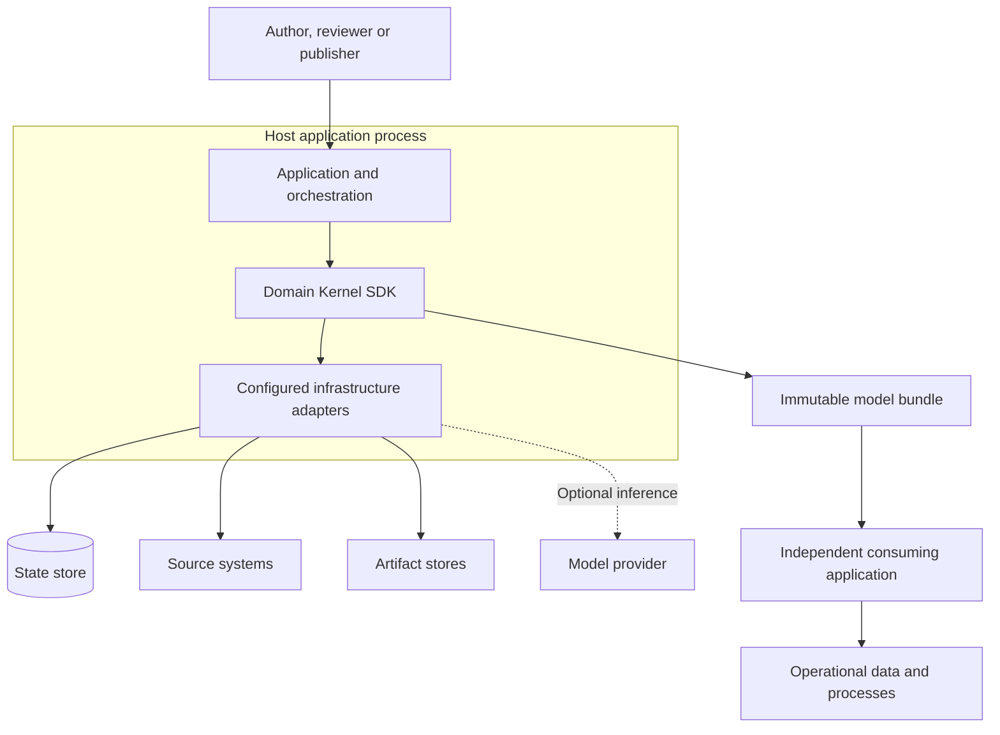
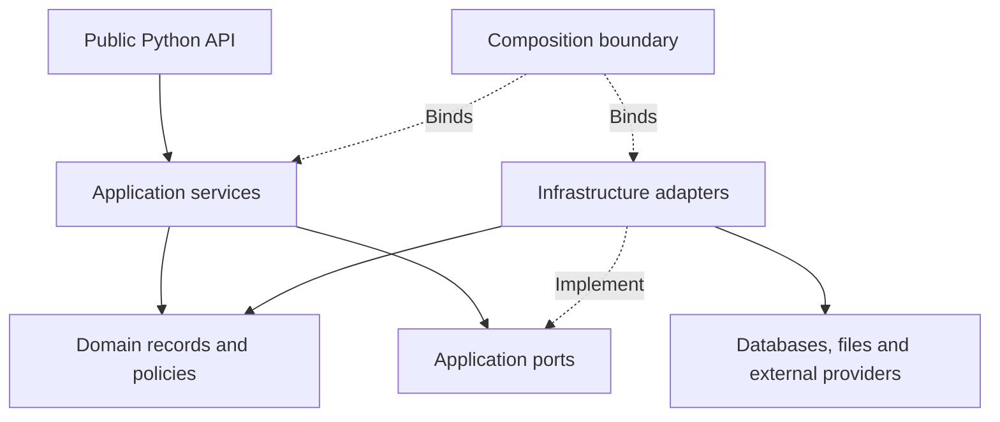
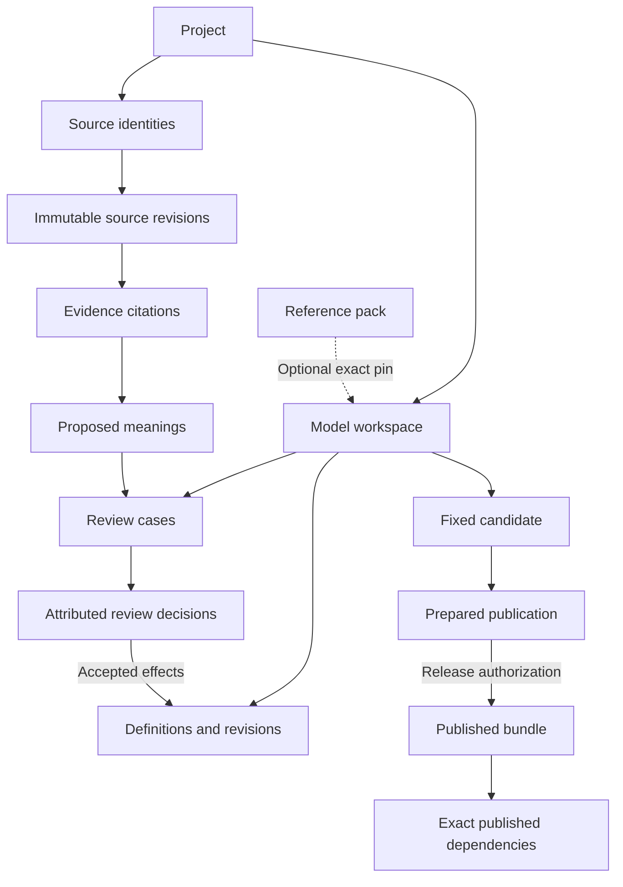
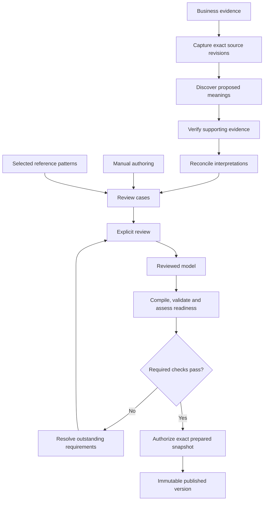
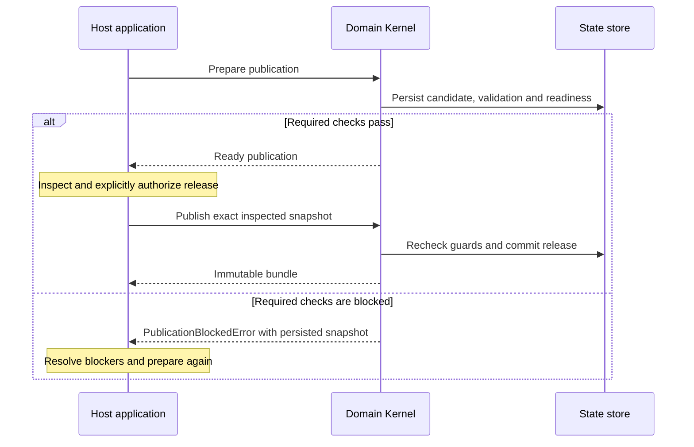
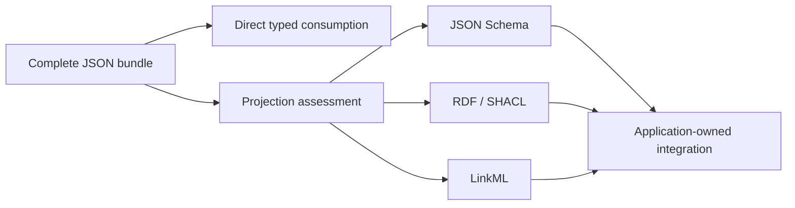

# Domain Kernel Architecture

Domain Kernel is an embeddable Python SDK for building, reviewing and publishing evidence-backed business domain models.

The SDK separates three responsibilities that are often intertwined in business applications: establishing what business information means, reviewing whether that interpretation is justified, and implementing the resulting knowledge in operational systems.

Domain Kernel manages the modeling and review lifecycle and produces a portable contract that applications can consume independently.

This document explains the system architecture, its design decisions and their consequences. The [architecture reference](docs/architecture/README.md) contains the detailed contracts governing individual capabilities.

> [!NOTE]
> Domain Kernel is in Alpha, and automated discovery remains experimental. Expect breaking API changes between releases. Architectural contracts describe the intended behaviour of the SDK. Consult the [capability ledger](examples/notebooks/coverage.json) and implementation tests for verification of individual capabilities.

## 1. Purpose and Scope

Consider a manufacturer whose purchasing documents use the term *part* to describe a catalog item, while its warehouse procedures use the same term to describe an individual serialized physical unit.

Both meanings may be correct, but treating them as interchangeable would introduce errors into applications that manage purchasing or inventory.

Domain Kernel helps authors establish these meanings, examine their supporting evidence and preserve the resulting knowledge in a reviewed domain model.

The distinction between domain knowledge and operational data defines the scope of the SDK.

| Domain Kernel manages | Applications manage |
|---|---|
| What a component represents | Individual component records |
| How components relate to suppliers | Supplier contracts and purchase orders |
| Which attributes identify a physical unit | Equipment inventories and asset identifiers |
| What business rules and processes require | Transactions, workflow execution and enforcement |

A Business Analysis Platform can use Domain Kernel to develop models of current and proposed business operations. An ERP system can consume those models to inform its data structures and configuration. A Graph RAG application can use their definitions to guide knowledge extraction.

These applications do not need to share infrastructure or implement the same workflows.

Domain Kernel is not an ERP, workflow engine, graph database or RAG framework. It manages the business knowledge that such applications may use.

See [purpose and scope](docs/architecture/scope.md).

## 2. Architectural Principles

### Evidence before acceptance

When a document describes a business concept, there may be several ways to interpret it. Domain Kernel preserves the supporting evidence behind discovered meanings so reviewers can examine the source and decide whether an interpretation is justified.

The SDK helps reviewers reach an informed decision. It cannot determine whether a source is trustworthy or whether its interpretation is correct in every business context.

### Separate review from publication

Building a domain model is an iterative process. Authors propose definitions, reviewers correct or accept them, and new questions emerge as the model develops.

A team should be able to work on a model without affecting applications that already use it. Accepting a change and publishing a new model version are therefore separate operations.

Publication releases a specific, validated snapshot that an authorized publisher has inspected.

### Preserve identity and history

Business terminology changes over time. An organization might rename a concept, clarify its meaning or discover that an existing definition represents two different things.

Changing a display name should not break references to the definition. Correcting a definition should not change the contents of a previously published model.

Domain Kernel gives definitions stable identities and records approved changes as new revisions. Splitting or merging meanings requires explicit changes to the affected identities, references and lineage.

### Maintain one authoritative domain model

Different applications need different representations of business knowledge. One might use JSON Schema to validate records, while another might use RDF to construct a knowledge graph.

Rather than maintaining separate models for each format, Domain Kernel generates these representations from the same typed domain model.

Not every format can express the same business requirements. The SDK makes these limitations explicit and rejects an export when a required meaning cannot be preserved.

### Keep applications independent

An application should not need access to the infrastructure where a domain model was created simply to understand its contents.

Published bundles contain the reviewed model and its required dependencies, pinned to exact versions. Applications can exchange these bundles and consume them independently.

Materialized dependencies and retained history increase bundle sizes, so the SDK bounds artifact size and dependency depth.

### Keep responsibilities clear

Domain Kernel manages definitions, evidence, review decisions and published models.

The application knows who its users are, what they are authorized to do and how the business operates. It is responsible for authenticating reviewers, authorizing their decisions and determining how published models are used.

For example, Domain Kernel can record that a catalog owner approved a definition. The application must establish that the person making the decision actually has that authority.

### Keep domain rules independent of infrastructure

The rules governing a domain model should remain the same regardless of which database stores it or which inference provider helps develop it.

Domain Kernel separates domain records and policies from application services and infrastructure adapters. Business invariants can therefore be tested without external services, and infrastructure can evolve without redefining the domain model.

### Keep transactions short and changes recoverable

Discovery may involve reading large documents, calling external providers and waiting for people to make decisions. These operations should not hold database transactions open.

Domain Kernel performs external work separately and commits related model changes, audit records and operation outcomes together.

Persisted progress, idempotency and concurrency checks help applications recover interrupted operations without silently repeating or overwriting business decisions.

### Make failures visible

Documents may become unavailable, discovery may overlook relevant information, and an export format may not support a particular constraint.

Domain Kernel reports detected failures and unsupported capabilities rather than substituting different evidence, discarding required semantics or silently accepting outdated decisions.

An incomplete discovery run may still produce useful proposals. A model cannot be published while its required readiness checks remain unresolved.

## 3. System Context and Ownership

Domain Kernel runs within the process of the application that embeds it. It does not require a separately deployed modeling service.

The host configures the client and its integrations, then invokes the SDK through its public Python API.

The SDK can run in notebooks, backend services and background workers. Applications that only consume published bundles do not need to configure a modeling client, database or inference gateway.

### Responsibility boundaries

| Domain Kernel owns | Host or consuming application owns |
|---|---|
| Source identities, revisions and citations | Source access, credentials and authenticity |
| Discovery and reconciliation | Provider selection, scheduling and job transport |
| Definitions and review state | User interfaces, authentication and authorization |
| Model integrity and publication readiness | Business judgment and operational acceptance |
| Published bundles and projections | Distribution, trusted publisher selection and version adoption |
| Descriptive rules, processes and decisions | Operational records, transactions and execution |

A project is a namespace for source knowledge and models, not a security principal. The host must enforce access boundaries independently.

Applications can create and consume models without sharing a database, deployment lifecycle or central Domain Kernel service.

See [components and ownership](docs/architecture/components-and-ownership.md) and [host integration](docs/architecture/host-integration.md).

## 4. Component Architecture

### 4.1 Architectural slices

Domain Kernel divides the modeling lifecycle into five slices.

| Slice | Responsibility |
|---|---|
| `sources` | Acquire business information and preserve source identities, revisions and evidence. |
| `discovery` | Interpret selected evidence and produce candidate business meanings. |
| `reconciliation` | Compare proposed meanings with local definitions and selected reference knowledge. |
| `review` | Manage explicit decisions, coordinated changes and their effects. |
| `modeling` | Manage definitions, model integrity, reference-pack selection, validation and publication. |

The supporting `reference_packs` package owns reference catalogs, pack content and codecs. Modeling and review own the selection of reference knowledge for an individual model.

The five slices are logical ownership boundaries within one SDK. They are not independently deployed services and do not necessarily represent separate DDD bounded contexts.

Manual authoring can bypass discovery, while independent bundle consumption bypasses the modeling lifecycle entirely.

### 4.2 Internal architecture

Each slice uses the layers appropriate to its responsibilities, following a consistent dependency direction.

| Layer | Responsibility |
|---|---|
| `api/` | Expose typed Python interfaces and operation contracts. |
| `application/` | Coordinate use cases, domain behaviour and transaction boundaries. |
| `domain/` | Define domain values, invariants, policies and permitted transitions. |
| `infrastructure/` | Implement persistence, parsing and external provider integrations. |

Domain records and pure policies own business invariants. They use the Python standard library, remain synchronous and perform no external I/O.

Application services load the required state, invoke domain behaviour and coordinate its effects. Repositories enforce technical guarantees such as uniqueness and compare-and-swap operations without independently determining business outcomes.

The composition boundary injects specific typed collaborators into application services. Services do not receive unrestricted repository registries or database sessions.

Pydantic validates configuration and boundary data without replacing the domain model. Optional integrations remain behind typed ports and named dependency extras.

Cross-slice workflows do not authorize dependencies on another slice's infrastructure.

### 4.3 Public API

Applications interact with the SDK through three scoped handles.

| Handle | Scope |
|---|---|
| `Client` | Configuration, project management and reference catalogs. |
| `Project` | Model management, shared sources and evidence. |
| `Model` | Definitions, discovery, reconciliation, review and publication. |

Public handles delegate to their owning application services. Persistence and external I/O operations are asynchronous, while builders, decision factories and inspection of loaded values remain synchronous.

The [component architecture contract](docs/architecture/components-and-ownership.md) defines package ownership and dependency requirements. The [workspace contract](docs/architecture/workspace-and-configuration.md) defines public API conventions, resource identities and configuration behaviour.

## 5. Domain Architecture

### 5.1 Projects and models

A project organizes shared sources and independently maintained domain models.

Procurement and maintenance models might both use the same equipment catalog. Procurement may focus on products that can be ordered, while maintenance distinguishes equipment types from individually serviced assets.

The source evidence can be shared without sharing its interpretation.

A model workspace contains the definitions, review state and configuration associated with a particular business purpose.

Model boundaries follow business meaning, ownership and change lifecycle rather than automatically corresponding to departments, documents, databases or services.

Domain Kernel distinguishes two model kinds:

- `OBSERVED` describes existing business behaviour based on available evidence.
- `PROPOSED` describes intended or future business behaviour.

Publishing a proposed model does not establish that the business has implemented it or convert it into an observed model.

### 5.2 Conceptual information model

This diagram describes the conceptual information model rather than the persistence schema or complete aggregate structure.

| Object | Architectural role |
|---|---|
| Definition | Stable business meaning with a typed body and revision history. |
| Evidence citation | Reference to an exact source revision and location. |
| Review case | Proposed change or question requiring a decision. |
| Review decision | Attributed action and its applicable rationale. |
| Reference pack | Optional reusable definitions, patterns and obligations. |
| Candidate | Fixed compilation of reviewed model content. |
| Publication | Persisted candidate with validation and readiness results. |
| Bundle | Immutable, portable model version with release authorization. |

The canonical domain model supports concepts, attributes, relationships, value sets, reusable units, structured values, constraints, descriptive processes, business decisions, semantic links and acceptance checks.

### 5.3 Identity and consistency

Permanent identities are distinct from stable lookup names and editable display labels.

Reviewers preserve an identity when they determine that its underlying business meaning remains unchanged. Splits, merges and retirements require explicit reference repairs and lineage.

The model workspace is the consistency boundary for reviewed changes.

Related changes can be evaluated against their combined prospective state and accepted atomically. A workspace may contain intermediate changes and unresolved proposals without being ready for publication.

Optimistic concurrency ensures that decisions apply to the state the reviewer actually inspected. Stale cases, workspace revisions and referenced definitions fail explicitly.

Domain values enforce runtime invariants and capture supplied collections into immutable snapshots.

See [workspace and configuration](docs/architecture/workspace-and-configuration.md), [reference knowledge and domain types](docs/architecture/reference-knowledge-and-domain-types.md) and [model evolution](docs/architecture/model-evolution.md).

## 6. Modeling Lifecycle

Domain Kernel supports both manual authoring and evidence-assisted discovery through a common review and publication lifecycle.

### 6.1 Capture evidence

Source capture establishes which information is being interpreted.

A logical source has a permanent identity within its project. Changed content creates a new revision rather than replacing the evidence associated with previous decisions.

File revisions identify the complete original bytes. Processing fingerprints separately identify the parsing and extraction configuration.

Supported inputs include documents, spreadsheets, ontology resources, attributed statements and host-parsed content.

Original documents, extracted text and evidence excerpts have separate retention policies and are not retained automatically by default.

Evidence retrieval must recover the exact recorded content or report that it is unavailable.

See [sources and evidence](docs/architecture/sources-and-evidence.md).

### 6.2 Discover and reconcile meanings

Discovery uses the model's stated purpose, competency questions and selected source revisions to propose relevant business meanings.

The workflow captures its inputs before inference, verifies supporting passages and record roles, and freezes the local draft before comparing it with selected reference knowledge.

AI-assisted discovery requires a caller-provided model gateway. The host selects the inference provider, model, credentials and transport.

The current whole-question discovery path materializes proposed concepts, relationships and questions for review. It can preserve qualifications within proposed meanings, but typed attributes, business keys and executable constraints require explicit authoring.

The domain model can therefore represent more constructs than discovery currently generates automatically.

Discovery progress is persisted so eligible interrupted operations can resume. Failures and useful proposals may coexist.

Reconciliation addresses two separate questions:

| Alignment | Question |
|---|---|
| Source-to-model | Does a meaning discovered in a source correspond to an existing local definition? |
| Model-to-reference | How does a local definition relate to a selected reference definition? |

Matching labels do not establish equivalence. Reviewed business alignments also do not automatically assert formal ontology equivalence or identity.

See [discovery and reconciliation](docs/architecture/discovery-and-reconciliation.md).

### 6.3 Review changes

Manual definitions, discovered interpretations and corrections enter the same review lifecycle.

A reviewer can inspect the evidence and preview the effects of a typed decision before submitting it.

The preview identifies affected definitions, mappings, review cases, invalidated decisions and publication blockers. It neither applies nor reserves changes.

Submission rechecks the inspected state and commits the authorized effects atomically.

Related changes can be reviewed together when their individual application would otherwise leave the affected graph inconsistent.

Acceptance establishes what has been reviewed within the model. It does not establish that every accepted interpretation is objectively correct.

### 6.4 Validate and publish

Accepting individual definitions does not necessarily make the complete model ready for publication.

Preparation compiles reviewed content into a fixed candidate, evaluates its integrity and applicable validation requirements, and determines whether unresolved work prevents release.

Structural consistency, evidence sufficiency and publication readiness are distinct. Only a passing result satisfies a required acceptance check.

Both ready and blocked preparations are persisted, allowing applications to inspect the exact validation outcome.

Publication verifies the prepared snapshot against current workspace state, review state and applicable policy.

An outdated preparation cannot authorize a new release. The host must prepare and inspect an updated snapshot.

Release authorization, the immutable bundle, audit records and the idempotency outcome commit together.

See [review and publication](docs/architecture/review-and-publication.md).

## 7. Reference Knowledge and Interoperability

### 7.1 Reuse established business knowledge

Reference packs provide versioned business definitions, reusable patterns and validation obligations.

A model can optionally select one exact reference-pack version. Core modeling, discovery, review and publication remain available without a pack.

Adopting a pattern creates proposed local definitions with their own identities. Updating or removing a reference pack requires explicit review and does not change previously published versions.

External ontologies follow a related but distinct contract.

| Operation | Purpose |
|---|---|
| Reference | Preserve an external term's original identity and provenance. |
| Map | Establish a reviewed relationship between local and external meanings. |
| Adopt | Include a reviewed formal ontology module and its pinned dependency closure. |

Referencing a term does not import its axioms. Reviewing a business mapping does not automatically establish a formal logical relationship.

The SDK preserves original ontology identities, resource hashes, graph selections and explicitly resolved imports.

RDF 1.1 is the initial semantic baseline. Formal reasoning requires a supported optional adapter. Retaining ontology content alone does not establish logical consistency or entailment.

See [reference knowledge and domain types](docs/architecture/reference-knowledge-and-domain-types.md).

### 7.2 Publish a complete model contract

The authoritative portable representation is an immutable JSON bundle containing the reviewed definitions, provenance, review decisions, validation results, release authorization and exact materialized dependencies.

It does not necessarily contain original business documents or the complete operational audit history.

Independent applications can load the bundle without a producing client, database or model gateway.

Deserialization verifies wire structure, internal references, content hashes and approval bindings. It does not authenticate the publisher or verify the historical authority of reviewers.

### 7.3 Generate alternative representations

Different consuming applications require different representations of business knowledge.

Domain Kernel derives supported projections from the published bundle rather than maintaining separate editable models.

Projection assessment considers two independent dimensions.

| Dimension | Outcomes |
|---|---|
| Representation | `NATIVE`, `ANNOTATED`, `UNSUPPORTED` |
| Validation responsibility | `TARGET`, `HOST`, `NOT_APPLICABLE`, `UNSUPPORTED` |

A target format may preserve a requirement without being able to enforce it.

For example, JSON Schema can describe the structure of a supplier record but cannot independently enforce the uniqueness of supplier identifiers across a database. The SDK preserves that requirement as a consumer obligation.

Consumer obligations delegate enforcement of preserved meaning. They cannot justify losing required information from a representation.

Unsupported required semantics block the requested projection. They block model publication only when the corresponding capability is itself required by the model's active validation contract.

The optional `linkml` extra provides the bounded LinkML mapping. RDF/SHACL and other semantic capabilities remain subject to their declared adapter contracts.

See [bundles and interoperability](docs/architecture/bundles-and-interoperability.md).

## 8. Model Evolution and Reliability

### 8.1 Evolve models without rewriting history

Approved definition revisions and published model versions are immutable.

Authors can propose revisions, correct earlier mappings, retire definitions or restore them through explicit review.

Domain Kernel also supports several ways to organize knowledge across independently maintained models.

| Capability | Purpose |
|---|---|
| Published dependencies | Reuse exact definitions from another published model. |
| Baseline copying | Create an independent model with recorded correspondence to an exact published baseline. |
| Model composition | Assemble exact published versions into a read-only perspective. |
| Model slicing | Select a focused view and its required supporting definitions. |
| Model comparison | Inspect changes between compatible reviewed snapshots. |

Model dependencies remain within a project. Their active closures are materialized, acyclic, bounded and conflict-free.

Upgrading dependencies requires reviewed remappings and any necessary local repairs. Existing consumers remain pinned to their previous versions.

Copied models receive new local definition identities while retaining baseline correspondence. Composition preserves model boundaries rather than merging definitions.

A model slice is neither an independently approved model nor an access-control boundary. Formal ontology module extraction has separate algorithmic and semantic guarantees.

Comparisons use stable identities and recorded lineage. Compatibility remains undetermined when it cannot be established.

Publication never automatically upgrades downstream applications.

See [model evolution](docs/architecture/model-evolution.md).

### 8.2 Persist state independently of the host workflow

SQLite is the default state store. PostgreSQL is available through the optional `postgres` extra.

The persistence schema is internal. Applications use the public SDK or published bundles rather than querying internal tables.

Each persistence operation acquires its own resource context. Collaborators within an operation share a session, while concurrent operations do not share operation-bound sessions.

Repositories return detached domain values and never commit independently.

Omitting database configuration selects lazy initialization of default SQLite. Explicit database configuration remains operator-managed.

Caller-owned gateways, transports and database pools remain caller-owned. SDK resources are released at the end of their operation.

### 8.3 Preserve consistency and recoverability

Domain Kernel combines several mechanisms to protect model changes across independent requests and workers.

| Mechanism | Architectural guarantee |
|---|---|
| Transactions | Related business changes, audit records and replay outcomes commit together. |
| Optimistic concurrency | Decisions made against outdated state cannot overwrite newer work. |
| Scoped idempotency | Matching retries replay recorded outcomes without repeating committed effects. |
| Checkpoints | Eligible interrupted discovery work can resume. |
| Leases and fencing | An expired worker cannot advance checkpoints after ownership transfers. |
| Immutable artifacts | Existing artifact identities cannot be reused with incompatible content or metadata. |
| External write intents | Uncertain external writes can be inspected and recovered. |

Database transactions do not remain open across document acquisition, parsing, inference, artifact delivery or human review.

Hosts persist operation identities before the first attempt and reuse them for retries of the same intended work.

External provider calls are not guaranteed to execute exactly once. Cancellation or a lost commit acknowledgement does not establish rollback.

An artifact-export failure does not undo an already completed publication.

### 8.4 Preserve attributed history

Every durable business action requires explicit actor attribution.

Business state, audit records and applicable idempotency outcomes commit together. Corrections append new history rather than rewriting earlier decisions.

Pure builders, previews, reads and serialization create no business audit entries.

Published bundles preserve semantic provenance, review decisions and release authorization. The producer retains the broader operational audit.

See [persistence and reliability](docs/architecture/persistence-and-reliability.md) and [host integration](docs/architecture/host-integration.md).

## 9. Security and Trust Boundaries

Domain Kernel processes documents, generated responses, semantic resources and published artifacts that cannot automatically be trusted.

A valid document may contain misleading business statements. A generated response may contain unsupported interpretations. A structurally valid bundle may originate from an untrusted publisher.

The architecture distinguishes the integrity of these resources from the trustworthiness of their contents and origin.

| Risk | SDK design response | Host responsibility |
|---|---|---|
| Source substitution | Exact revision and capture verification | Source access and authenticity |
| Prompt injection and misleading evidence | Treat evidence as data, validate generated output and require review | Provider configuration, monitoring and independent judgment |
| Excessive or malformed input | Typed validation, resource limits and bounded decoding | Parser isolation and deployment resource controls |
| Uncontrolled external retrieval | Configured reader boundaries and explicit ontology resolution | Approved sources and credentials |
| Unauthorized changes | Attributed decisions and concurrency guards | Authentication and authorization |
| Artifact tampering | Content hashes and structural verification | Trusted expected hashes and authenticated distribution |
| Confidential information exposure | Explicit retention policies and redacted diagnostics | Access control, encryption, isolation and provider disclosure |

Human review is not complete protection against prompt injection. Content hashes are not proof of publisher authenticity. Project and model scopes do not provide security isolation by themselves.

The SDK's controls complement the host's security architecture rather than replacing it.

See [SECURITY.md](SECURITY.md) for vulnerability reporting and supply-chain security, and [persistence and reliability](docs/architecture/persistence-and-reliability.md) for library-level protections.

This overview is not a verified threat model or a claim of independent security certification.

## 10. Quality Attributes and Architectural Trade-offs

Domain Kernel prioritizes the integrity, reproducibility and portability of business knowledge.

These priorities influence the architecture and introduce trade-offs that should remain visible as the SDK evolves.

### 10.1 Architectural trade-offs

| Decision | Benefit | Trade-off |
|---|---|---|
| Embedded SDK | Independent application deployment and direct integration | Hosts own orchestration, security and resource isolation. |
| Explicit review | Attributed and inspectable business interpretations | Additional review effort before publication. |
| Immutable revisions | Reproducible history and stable published versions | Growing persistence and audit requirements. |
| Workspace-level consistency guards | Atomic validation of related model changes | Unrelated edits may invalidate concurrent review work. |
| Materialized dependency closures | Independent consumption without producer infrastructure | Increased bundle size and dependency-processing costs. |
| Strict typed domain contracts | Explicit invariants and predictable behaviour | Additional authoring complexity. |
| Bounded semantic projections | Explicit representation fidelity | Some valid models cannot be exported to every format. |
| Optional infrastructure adapters | Provider independence and a lightweight core | Adapter-specific compatibility and conformance testing. |
| Disabled source retention by default | Reduced unnecessary retention of business documents | Historical evidence may become unavailable. |
| Operation-scoped database resources | Explicit lifecycle and ownership | Potential connection overhead without host-managed pooling. |

These decisions favour correctness and reproducibility over automatic resolution and unrestricted interoperability.

Their practical consequences should be measured before introducing more complex consistency, storage or integration mechanisms.

### 10.2 Architectural quality attributes

| Attribute | Verification approach |
|---|---|
| Integrity | Verify immutable revisions, identity preservation, reviewed changes and exact release authorization. |
| Reliability | Exercise retries, concurrent changes, cancellation, uncertain outcomes and recovery. |
| Portability | Load published bundles without producer infrastructure or optional modeling dependencies. |
| Semantic fidelity | Verify that projection assessment and export preserve supported meanings and reject unsupported constructs. |
| Discovery utility | Evaluate coverage, correctness, evidence quality, practical usefulness and improvement over a direct-model baseline. |
| Resource efficiency | Measure memory consumption, artifact sizes and inference costs using representative workloads. |
| Scalability | Measure operation latency, workspace contention and dependency growth. |
| Security | Verify trust boundaries, resource limits and negative cases. |
| Observability | Evaluate available diagnostics, operation identities and recovery information. |

These are evaluation criteria rather than measured performance commitments.

Configured resource limits are safeguards, not demonstrated capacity targets.

### 10.3 Guarantees and limitations

The architecture establishes a controlled lifecycle for business knowledge, not an automatic determination of business truth.

| A published model establishes | It does not establish |
|---|---|
| Required supported integrity and readiness checks passed. | Every relevant meaning has been discovered or correctly interpreted. |
| Release authorization is bound to exact content and attribution. | The identity or legal authority of the actor. |
| Published versions and dependency pins are immutable. | Continued availability of external evidence. |
| Bundle structure and hashes can be verified independently. | Publisher authenticity or trustworthiness. |
| Supported descriptive structures satisfy their validation contracts. | Correct workflow execution or operational compliance. |
| Projection limitations and consumer obligations are explicit. | Universal semantic equivalence across formats. |

See [guarantees and verification](docs/architecture/guarantees-and-verification.md).

### 10.4 Architectural conformance

Architectural guarantees must be supported by implementation and verification evidence.

Domain tests establish the behaviour of invariants and pure policies. Integration and conformance tests establish behaviour across persistence, adapters and interoperability boundaries.

Replayed inference responses verify deterministic workflow behaviour. They do not establish live discovery quality.

Live discovery evaluation must examine actual model outputs against independently reviewed expectations. Discovery evaluation is described in the [benchmark documentation](benchmarks/README.md).

Use the [testing verification map](.agents/skills/domain-kernel-testing/references/verification-map.md) and [capability ledger](examples/notebooks/coverage.json) to locate the evidence associated with individual capabilities.

Successful documentation builds, rendered diagrams and saved notebook outputs do not establish runtime correctness.

## 11. Architecture Reference

The root architecture describes how the system fits together. The supporting specifications own the detailed behavioural requirements of each capability.

| Specification | Responsibility |
|---|---|
| [Scope](docs/architecture/scope.md) | Product boundaries and the distinction between business knowledge and operational data. |
| [Components and ownership](docs/architecture/components-and-ownership.md) | Architectural slices, package ownership, internal layers and dependency direction. |
| [Workspace and configuration](docs/architecture/workspace-and-configuration.md) | Public API conventions, configuration, workspace boundaries and resource identities. |
| [Sources and evidence](docs/architecture/sources-and-evidence.md) | Source acquisition, revision identity, provenance and evidence retrieval. |
| [Discovery and reconciliation](docs/architecture/discovery-and-reconciliation.md) | Inference workflow, proposal generation, alignment and discovery recovery. |
| [Reference knowledge and domain types](docs/architecture/reference-knowledge-and-domain-types.md) | Reference packs, ontology resources, typed authoring, domain constructs and acceptance checks. |
| [Review and publication](docs/architecture/review-and-publication.md) | Review decisions, confirmations, validation, readiness and release authorization. |
| [Bundles and interoperability](docs/architecture/bundles-and-interoperability.md) | Portable wire formats, projection assessment, standards mappings and consumer obligations. |
| [Model evolution](docs/architecture/model-evolution.md) | Revisions, coordinated changes, baselines, dependencies, composition and compatibility. |
| [Host integration](docs/architecture/host-integration.md) | Notebook, backend and worker integration contracts. |
| [Persistence and reliability](docs/architecture/persistence-and-reliability.md) | Storage, transaction boundaries, concurrency, idempotency, retention, audit and recovery. |
| [Guarantees and verification](docs/architecture/guarantees-and-verification.md) | Cross-cutting guarantees, failure recovery and verification requirements. |

When changing the architecture, update the specification that owns the affected contract and its associated verification evidence. Update this overview when a system-wide decision, responsibility or architectural boundary changes.

Avoid duplicating detailed requirements across specifications, guides and examples.

### Further reading

| Resource | Purpose |
|---|---|
| [README](README.md) | Product introduction and quickstart. |
| [Architecture contract index](docs/architecture/README.md) | Navigation and contract ownership. |
| [Glossary](GLOSSARY.md) | Shared domain and architectural terminology. |
| [Configuration recipes](examples/config/README.md) | Infrastructure and provider configuration. |
| [Document discovery](docs/architecture/discovery-and-reconciliation.md) | Practical discovery and evidence inspection. |
| [Interactive notebooks](examples/notebooks/README.md) | Executable walkthroughs and specialist recipes. |
| [Contributing](CONTRIBUTING.md) | Development workflow and engineering standards. |
| [Documentation build](docs/documentation.md#set-up-and-run) | Documentation tooling and generated API reference. |
