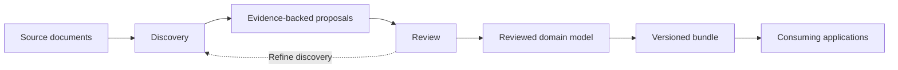
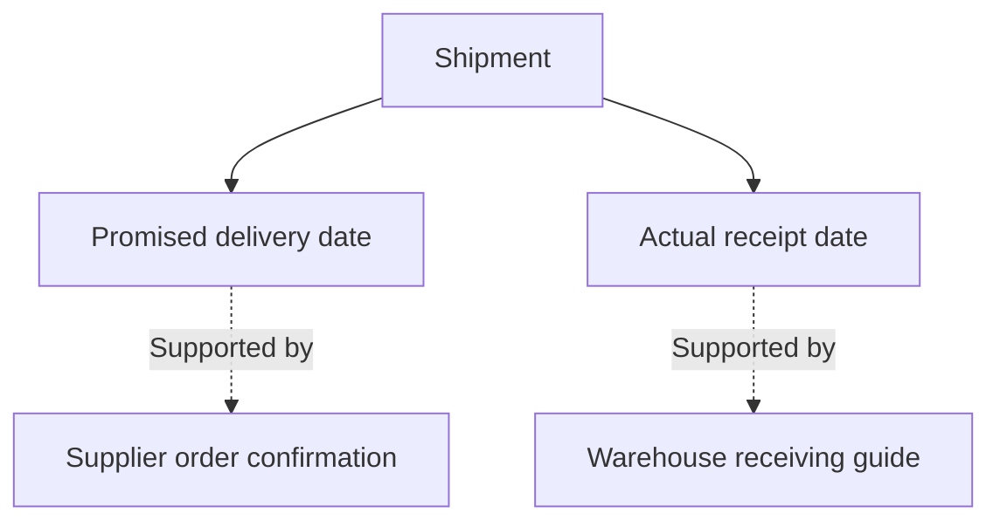

<div align="center">
  <picture>
    
  </picture>
</div>

<div align="center">

[](https://github.com/matejpalenik/domain-kernel/actions/workflows/ci.yml)
[](pyproject.toml)
[](LICENSE)
[](pyproject.toml)
[](src/domain_kernel/py.typed)
[](https://github.com/matejpalenik/domain-kernel)

[Quickstart](#quickstart) · [Documentation](#documentation) · [Architecture](ARCHITECTURE.md) · [Contributing](CONTRIBUTING.md)

</div>

# Overview

Domain Kernel is an open-source embeddable Python SDK for building, validating and sharing evidence-backed business domain models.

A domain model describes the things a business works with, what they mean, how they relate and the rules that govern them.

Domain Kernel helps teams discover this knowledge from documents, verify it against source evidence and publish it as a machine-readable model that applications can use.

> [!WARNING]
> Domain Kernel is currently in Alpha. Its public API is subject to change, and automated discovery remains experimental.

## Why Domain Kernel?

Imagine you are building an application for your sales department that generates a weekly report on late shipments, so the team knows which suppliers to follow up with.

During requirements analysis, the team gives you a collection of documents they use in their daily work, including supplier order confirmations and a warehouse receiving guide.

Both use the term **delivery date**, so you assume they mean the same thing and build a single field in your application.

However, the two documents describe different concepts:

| Source | What it says |
|---|---|
| Supplier order confirmation | “Delivery date: May 12. This is the date we commit to delivering the shipment.” |
| Warehouse receiving guide | “Enter the delivery date when the shipment arrives.” |

The supplier promises delivery on May 12. The shipment arrives on May 15, and the warehouse enters that date in the application. May 15 replaces May 12.

Your application can now tell Sales when the shipment arrived, but not that it was three days late.

Both dates were right. The supplier meant when the shipment was due. The warehouse meant when it actually arrived.

Your application needs two distinct concepts: a promised delivery date and an actual receipt date.

### The problem at scale

Before software can work with business knowledge, that knowledge must be made explicit.

In a large organization, this knowledge is distributed across hundreds or thousands of documents, including policies, contracts, operational procedures and technical specifications.

Different departments may use the same words for different concepts, or different words for the same concept. Business rules may be defined across several documents, and the meaning of a concept may change as those documents evolve.

Engineers and domain experts traditionally reconstruct this knowledge manually during requirements analysis. The resulting understanding often ends up scattered across documentation, database schemas and application code.

As the organization builds more software, several problems emerge:

- Different applications interpret the same business concepts differently.
- Engineers struggle to establish why a particular definition or business rule exists.
- Changes to business documentation are difficult to trace to existing models.
- New applications must repeatedly reconstruct knowledge that other teams have already established.

The challenge is not simply extracting information from documents. It is establishing what that information means, verifying that understanding and preserving it in a form that software can use.

### What Domain Kernel adds

Domain Kernel provides a systematic way to turn distributed business knowledge into explicit, evidence-backed domain models.

It supports three core activities:

- **Discover.** Draft concepts and relationships from documents. Link each proposal to the source passages that support it.
- **Review.** Resolve ambiguities, correct interpretations and record who made each modeling decision and why. Teams can also submit definitions written by hand.
- **Publish.** Release a versioned, machine-readable domain model that other applications can consume independently.

In our shipment example, Domain Kernel helps the team establish two distinct definitions:

| Concept | Definition | Supporting evidence |
|---|---|---|
| Promised delivery date | The date by which a supplier commits to delivering a shipment. | Supplier order confirmation |
| Actual receipt date | The date on which a shipment arrives at the warehouse. | Warehouse receiving guide |

Once reviewed and published, these definitions can be shared across sales applications, warehouse systems and other consumers that need to understand shipments.

Instead of repeatedly reconstructing what the business means, teams can build on a shared, reviewed model of that knowledge.

Domain Kernel does not replace domain experts or decide what the business means on their behalf. It provides the tools to discover, verify and preserve that knowledge.

Applications remain responsible for storing operational data, implementing business logic and deciding how to act on it.

## How it works

Domain Kernel separates the discovery of business knowledge from its acceptance and publication.



### Sources

Ingest documents and retain their exact source revisions. Source revisions provide the foundation for traceable modeling decisions, even as the original documents change.

### Discovery

Discover candidate concepts and relationships according to the stated purpose of a domain model.

Each proposal links back to specific source passages, allowing reviewers to inspect the evidence rather than relying on a generated summary.

Discovery produces proposals, not authoritative business knowledge.

### Review

Inspect the proposed model, verify its supporting evidence and decide which proposals to accept or reject.

The SDK records modeling decisions, their rationale and the actors responsible for them. Reviewers can inspect the impact of proposed changes before accepting them.

### Publication

Publish a versioned bundle containing the reviewed model, its evidence citations and review records.

Other applications can open the published bundle independently, without access to the producer's database or model provider.

## Quickstart

The following example demonstrates how to discover, review and publish the shipment definitions introduced above.

### Installation

Install from source using Git, Python 3.13 or newer, and uv 0.13.7 or newer.

```sh
git clone https://github.com/matejpalenik/domain-kernel.git
cd domain-kernel

uv sync --locked --no-dev
```

For PDF processing and model inference using Docling and LiteLLM, install the optional dependencies:

```sh
uv sync --locked --no-dev \
    --extra documents \
    --extra inference
```

The core SDK does not require Node.js or pnpm. You can omit the `inference` extra if your application provides its own model gateway.

### Configure your client

Domain Kernel is designed to run within your application. The application supplies a `ClientConfiguration` containing the required storage, source readers, document parsers and model gateway.

See the [configuration recipes](examples/config/README.md) for complete configuration examples and [Configure the inference gateway](docs/architecture/discovery-and-reconciliation.md#configure-the-inference-gateway) for configuring a model provider.

The following excerpts assume that this configuration is available as `config` and that the two example PDFs are accessible through the configured input reader.

### 1. Create a domain model

A domain model has a stated purpose that guides discovery.

```python
from domain_kernel import Client, ModelKind

client = Client(config=config)

project = await client.create_project(
    actor="model-author",
    name="receiving",
)

model = await project.create_model(
    actor="model-author",
    name="receiving-terms",
    kind=ModelKind.OBSERVED,
    description=("What dates do sales and receiving use to determine whether a delivery is late?"),
)
```

### 2. Discover knowledge from documents

Ingest the supplier order confirmation and warehouse receiving guide, then run discovery against their source revisions.

```python
from domain_kernel import CaseStatus, PDF

captures = [
    await project.ingest_source(
        actor="model-author",
        name=name,
        source=PDF(path=f"{name}.pdf"),
    )
    for name in [
        "supplier-confirmation",
        "warehouse-guide",
    ]
]

sources = [capture.revision for capture in captures]

run = await model.discover(
    actor="model-author",
    sources=sources,
)

cases = [
    case
    async for case in model.iter_review_cases(
        run_id=run.id,
        status=CaseStatus.PENDING,
    )
]
```

Discovery produces proposals for review.

These proposals may describe distinct concepts correctly, combine concepts that should remain separate or omit relevant knowledge altogether.

Inspect the pending review cases and any issues reported in `run.failures` before proceeding.

### 3. Verify the evidence

Suppose discovery proposes a single definition of delivery date for both documents.

Your application presents the proposal and its supporting evidence to a reviewer. The application supplies the selected review case as `ambiguous_case`.

```python
passages = [await project.get_evidence(evidence=citation) for citation in ambiguous_case.evidence]
```

The reviewer examines the passages and determines that the documents describe different events.

Record that decision:

```python
from domain_kernel import Reject

await model.decide_review(
    actor="receiving-reviewer",
    case=ambiguous_case,
    decision=Reject(
        reason=(
            "The supplier describes a delivery commitment, "
            "while the warehouse describes an actual receipt."
        ),
    ),
)
```

The rejection and its rationale become part of the model's review history.

### 4. Refine the model

Run discovery again with additional instructions that address the ambiguity.

```python
focused_run = await model.discover(
    actor="model-author",
    sources=sources,
    additional_instructions=(
        "Distinguish the date promised in the order "
        "confirmation from the date recorded by the "
        "warehouse on receipt. Cite the source for "
        "each meaning."
    ),
)
```

Inspect the resulting proposals and their supporting evidence.

The intended outcome is a model that distinguishes the supplier's commitment from the warehouse's observation:



Note: This diagram illustrates the intended domain model rather than the SDK's serialized output.

### 5. Accept reviewed definitions

Once a reviewer has verified a proposal against its supporting evidence, preview the impact of accepting it and record the decision.

The application supplies the selected `reviewed_case` and the reviewer's `review_reason`.

```python
from domain_kernel import Accept

decision = Accept(reason=review_reason)

impact = await model.preview_changes(
    case=reviewed_case,
    decision=decision,
)

# Present the impact and obtain reviewer approval.

await model.decide_review(
    actor="receiving-reviewer",
    case=reviewed_case,
    decision=decision,
)
```

Repeat this process for each definition the reviewer chooses to accept.

The accepted model now explicitly distinguishes the two concepts that were previously represented by a single field.

### 6. Publish and share

Once review is complete and any remaining publication blockers have been resolved, prepare and publish a version of the model.

```python
prepared = await model.prepare_publication(
    actor="receiving-owner",
)

# Inspect the preparation and confirm readiness.

bundle = await model.publish(
    actor="receiving-owner",
    publication=prepared,
    version="1.0.0",
    reason="Release the reviewed receiving definitions.",
)

await model.export(
    actor="receiving-owner",
    bundle=bundle,
    store="artifacts",
    path="receiving-1.0.0.json",
)
```

The exported bundle can now be distributed to other applications.

Consumers can [open the exact published version](docs/architecture/bundles-and-interoperability.md#load-and-consume-a-bundle-independently) without access to the original application's database or model provider.

For a complete, executable walkthrough, see the [interactive Jupyter notebook](examples/notebooks/README.md).

## Domain models and interoperability

A domain model represents business knowledge independently of the applications that implement it.

Unlike a database schema, which describes how data is stored, a domain model describes what that data means. It can express concepts, their relationships and the constraints that apply to them.

A [formal ontology](GLOSSARY.md#model-and-reference) can express part of a domain model under explicit machine-interpretable semantics.

Domain Kernel preserves the model together with its evidence citations and review records in a complete JSON bundle.

For integration with other tools, Domain Kernel also supports projections into established formats:

| Format | Purpose |
|---|---|
| Domain Kernel JSON bundle | Preserve and exchange the complete reviewed model, including its evidence citations and review records. |
| JSON Schema | Represent supported structural constraints for JSON data. |
| RDF/SHACL | Represent supported model elements and constraints for semantic and graph-based systems. |

These projections represent selected parts of the domain model. They are not substitutes for the complete Domain Kernel bundle.

See [complete bundles and limited projections](docs/architecture/bundles-and-interoperability.md#complete-bundles-and-limited-projections) for supported capabilities and limitations.

## Design principles

Domain Kernel is built around the following principles:

- **Evidence before acceptance.** Generated proposals should be inspectable against their supporting source material.
- **Human authority.** Domain experts determine which interpretations become part of the reviewed model.
- **Explicit uncertainty.** Discovery can be incomplete or incorrect. Missing evidence and processing failures must not be mistaken for verified knowledge.
- **Traceable decisions.** Modeling decisions retain their rationale, supporting evidence and responsible actors.
- **Versioned publication.** Consumers can depend on a specific published version rather than a changing working model.
- **Independent consumption.** Published models can be used without depending on the infrastructure that produced them.
- **Application ownership.** Applications retain responsibility for their operational data, business logic and model integration.

See [Architecture](ARCHITECTURE.md) for the SDK's architectural boundaries, interfaces and implementation details.

## Evaluation and benchmarks

Domain Kernel is designed to discover business meanings, not simply extract information from documents.

In the shipment example, correctly extracting May 12 and May 15 does not demonstrate an understanding that one represents a supplier's commitment and the other an actual receipt.

Conventional information extraction benchmarks are therefore not sufficient to evaluate the SDK's core capabilities.

### Our evaluation approach

We are developing a dedicated evaluation framework using real-world documents, starting with European Union public procurement notices.

Independent reviewers establish the business meanings supported by the source documents before discovery runs. The SDK operates without access to these reference models.

The evaluation will measure five dimensions:

- **Coverage.** How much of the relevant business knowledge does the SDK discover, and what does it miss?
- **Correctness.** Do the discovered definitions, relationships and constraints accurately represent what the documents mean?
- **Evidence.** Are the discovered meanings supported by their cited source passages?
- **Practical utility.** Can the resulting domain model support answers to meaningful business questions, such as "Who was awarded this contract?"
- **Added value.** How does the SDK perform compared with a direct call to the same underlying language model?

The evaluation focuses on semantic equivalence rather than exact terminology or model structure. Different representations should receive equal credit if they preserve the same business meaning.

### Current status

The evaluation framework is **under construction**.

Existing [experimental benchmarks](docs/evidence/discovery-v23.md) are used to identify regressions and guide development. They are not intended to establish general discovery accuracy or production readiness.

See the [benchmark documentation](benchmarks/README.md) for the existing evaluation methodology and reproducibility instructions.

## Documentation

| Resource | Description |
|---|---|
| [Architecture](ARCHITECTURE.md) | Understand the SDK's design, boundaries, contracts and implementation. |
| [SDK reference](src/domain_kernel/__init__.py) | Explore the public Python API. |
| [Documentation site](docs/documentation.md#set-up-and-run) | Run the documentation locally and access the generated API reference. |
| [Interactive walkthrough](examples/notebooks/README.md) | Follow a live workflow from source ingestion to model publication. |
| [Document discovery](docs/architecture/discovery-and-reconciliation.md) | Configure discovery, inspect evidence, focus discovery runs and resume unfinished work. |
| [Configuration recipes](examples/config/README.md) | Configure storage, document processing and model providers. |
| [Benchmarks](benchmarks/README.md) | Understand and reproduce supported evaluation workflows. |
| [Contributing](CONTRIBUTING.md) | Set up a development environment and contribute to the project. |

## Development

Domain Kernel uses `uv` to manage its Python environment and dependencies.

Install the development dependencies:

```sh
uv sync --locked
```

Run the shared contract tests:

```sh
uv run --locked pytest tests/unit/shared
```

See the [contributing guide](CONTRIBUTING.md) for development setup, pre-commit hooks, adapter tests and pull request requirements.

For documentation website development, follow the [documentation setup guide](docs/documentation.md#set-up-and-run).

## Security

Please follow the [security reporting policy](SECURITY.md) when reporting potential vulnerabilities.

## License

Domain Kernel is open-source software licensed under the [Apache License 2.0](LICENSE).

<a id="dependencies-and-software-bill-of-materials-sbom"></a>

Dependency inventories and Software Bills of Materials (SBOMs) are documented in the [release and verification guide](docs/releasing.md#4-generate-and-validate-the-sboms).
