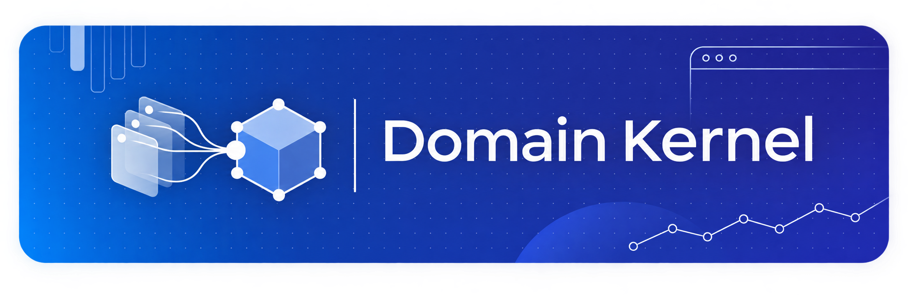
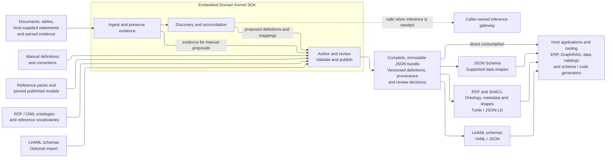

<div align="center">
  <picture>
    
  </picture>
</div>

<div align="center">

[](https://github.com/matejpalenik/domain-kernel/actions/workflows/ci.yml)
[](pyproject.toml)
[](LICENSE)
[](pyproject.toml)
[](src/domain_kernel/py.typed)
[](https://github.com/matejpalenik/domain-kernel)

</div>

## Quickstart

### Requirements

Use Python `v3.13+` and [uv](https://docs.astral.sh/uv/getting-started/installation/)
`v0.13.7` or newer - CI uses uv `v0.13.7`.

### Installation

Install the SDK from a source checkout:

```sh
git clone https://github.com/matejpalenik/domain-kernel.git
cd domain-kernel
uv sync --locked --no-dev
```

This installs the core SDK and its locked runtime dependencies. Optional adapter
dependencies and development tools are installed separately.

### Run the manual recruitment example

From the repository root, run the [recruitment quickstart](examples/recruitment_quickstart.py).

```sh
uv run --locked --no-dev python -m examples.recruitment_quickstart
```

The example pins the original English AI Act edition, reviews the application
vocabulary, then publishes a reviewed change to how many purposes it can record.
A separate Python process loads both JSON files and prints the purpose limits
for releases `1.0.0` and `1.1.0`. Sample reviewers are scripted and the example
cleans up its temporary state. Use the [paired notebook](examples/notebooks/README.md)
to follow each review and publication step interactively.

## Introduction

A Python SDK for building, validating, and managing evidence-backed business domain models.

In enterprise environments, business knowledge is often fragmented across documents, spreadsheets, existing systems, and the people who understand them. Definitions can be inconsistent, relationships unclear, and important decisions difficult to trace.

Domain Kernel helps turn this fragmented knowledge into consistent, structured, and reusable domain models.

Whether you're defining a domain manually, importing existing knowledge, or using AI to discover concepts from documents, Domain Kernel provides the tools to reconcile definitions, validate relationships and constraints, and review changes before publication.

The result is a versioned, portable domain model that captures not just business concepts and their relationships, but also the evidence, decisions, and assumptions behind them.

## How to use Domain Kernel

Domain Kernel is designed to be embedded directly into your Python applications. You can use it to:

- **Build domain models** by defining business concepts, relationships, constraints, and processes.
- **Reuse existing knowledge** by importing schemas, ontologies, and previously published models.
- **Discover domain concepts with AI** by extracting proposed definitions and relationships from documents, tables, and natural language.
- **Validate and reconcile models** by identifying inconsistencies, resolving conflicting definitions, and reviewing proposed changes.
- **Publish and share models** as immutable, self-contained JSON bundles that other applications can consume independently.

### AI Is Optional

Domain Kernel supports AI-assisted domain discovery, but does not depend on AI to function.

When AI is used, your application supplies its own inference gateway, retaining control over the model provider and the information shared with it. The planned discovery API supports additional instructions or a full prompt override to focus proposed meanings, while preserving the SDK-owned output schema and validation.

Manual modelling, deterministic reconciliation, validation, and consumption of published models work without an AI provider.

> [!NOTE]
> Feedback from enterprise and regulated environments is especially welcome. If you encounter any limitations, requirements, or concerns that prevent you from adopting this SDK in such environments, please raise an issue.
>
> The SDK is designed specifically to accelerate domain modelling in enterprise applications, and your feedback will help ensure it meets their architectural, security, and compliance requirements.




## Integration and Interoperability

Domain Kernel is designed to work with your existing applications and infrastructure, without locking you into a particular database, technology stack, or AI provider.

### Export and Share Domain Models

Every domain model can be exported as a **self-contained JSON bundle**, making it easy to share, store, and integrate with other applications.

The bundle includes everything needed to preserve the model's meaning and history:

- **Domain definitions:** Concepts, relationships, constraints, processes, and decisions.
- **Traceability:** Where information came from, supporting evidence, and review history.
- **Dependencies:** Version-pinned references to external models and ontologies.

The JSON bundle is the SDK's **primary integration format** and supports complete export and import without losing information.

### Integrate with Existing Standards

Domain Kernel also supports exporting models into established standards for different use cases:

| Format | Primary use case |
|---|---|
| **JSON Schema** | Data validation and integration with application APIs |
| **RDF/SHACL** | Knowledge graphs, semantic interoperability, and constraint validation |
| **LinkML** | Schema-driven data modelling and interoperability |

RDF/SHACL and LinkML are available through optional adapters.

Because these formats represent domain knowledge differently, not every feature can be exported to every format. The SDK checks compatibility before export and identifies any limitations or validation requirements that your application will need to handle.

### Reuse Existing Models and Ontologies

You don't have to start modelling from scratch. Domain Kernel allows you to import existing schemas and reuse established ontologies.

Imported resources go through an explicit review process before becoming part of your domain model. When reusing ontology terms, the SDK preserves their original identities and tracks their dependencies.

**Importing a resource does not automatically mean accepting its definitions, assumptions, or rules.** Your application retains control over what becomes part of the approved domain model.

### Designed to Fit Your Architecture

Domain Kernel focuses on **managing the integrity, traceability, review, and publication of domain models**, rather than replacing your existing application infrastructure.

Your application remains responsible for authentication, user interfaces, workflows, orchestration, operational data, knowledge graph population, retrieval, code generation, and execution.

This separation allows you to integrate Domain Kernel into existing systems while keeping full control over how domain models are used.


## Development

The repository contains the Python SDK, a [documentation website](apps/docs/README.md)
and an [interactive notebook tour](examples/notebooks/README.md). uv manages Python
dependencies; pnpm manages website dependencies and exposes the development
commands. Turbo coordinates those commands and caches eligible website tasks.

To contribute, install the pinned Python, uv, Node and pnpm versions from
`mise.toml`. Run the following from the repository root. If mise is not activated
in your shell, prefix the `pnpm` and `uv` commands with `mise exec --` to use the
pinned versions.

```sh
mise install
pnpm install --frozen-lockfile
uv sync --locked --group notebook
pnpm --filter @domain-kernel/docs exec playwright install chromium
uv run --locked pre-commit install --hook-type pre-commit --hook-type commit-msg
uv run --locked pre-commit run --all-files
```

Chromium is needed for the documentation browser checks.

### Launch the documentation

```sh
pnpm dev:docs
```

Open [http://localhost:3001/domain-kernel/](http://localhost:3001/domain-kernel/).
Website edits reload during development. Press **Ctrl+C** to stop the server.
After changing Python API sources or canonical notebook reading assets, restart
the command to regenerate their website representations.

To inspect the production static export, stop the development server first, then run:

```sh
pnpm build:docs
pnpm preview:docs
```

The preview uses the same URL and port. Run the build again to include later edits.
These commands run locally; GitHub Pages publication requires a separate manual
workflow described in [documentation development](docs/documentation.md).

### Development commands

Run these from the repository root. The check and build commands provision the
locked Python environment before running tasks that need it.

| Command | Purpose |
|---|---|
| `pnpm test` | Run Python unit tests |
| `pnpm test:integration` | Run integration tests excluding notebook tests |
| `pnpm test:notebook` | Run tests marked `notebook` |
| `pnpm check` | Run SDK, notebook and documentation checks |
| `pnpm check:sdk` | Check Python lint, formatting and types; run SDK tests with coverage |
| `pnpm check:notebook` | Validate notebook pairing, coverage and fixtures; run notebook execution and interaction tests |
| `pnpm check:docs` | Check website formatting, lint, types, content, static build and browser behaviour |
| `pnpm dev:docs` | Start the documentation development server |
| `pnpm build:docs` | Generate the production static website |
| `pnpm preview:docs` | Serve the previously built static website locally |
| `pnpm audit:docs` | Audit website and tooling dependencies for known vulnerabilities |
| `pnpm commit` | Create a Conventional Commit through the guided Commitizen flow after staging changes |

Direct `uv` commands remain available for Python development. To run the notebook
in VS Code, open `examples/notebooks/domain-kernel-tour.ipynb`, select the project's
`.venv` Python kernel and choose **Run All**. The website hosts its reading version;
interactive Python controls require the local notebook kernel.

See [CONTRIBUTING.md](CONTRIBUTING.md) for the development workflow, coding
conventions, tests and dependency updates. Maintainers can follow the
[release guide](docs/releasing.md) to build, verify and publish a release.


## Dependencies and Software Bill of Materials (SBOM)

Domain Kernel provides **transparent dependency tracking** to support security reviews, compliance, and enterprise adoption.

Runtime dependencies and optional features are defined in `pyproject.toml`, while the committed `uv.lock` ensures reproducible dependency resolution.

The release workflow publishes schema-validated **CycloneDX Software Bills of Materials (SBOMs)** alongside the Python wheel and source distribution. These provide separate dependency inventories for:

- **Core SDK:** Dependencies required to run Domain Kernel.
- **Optional features:** Dependencies covering all optional runtime integrations and capabilities.

Development dependencies are excluded from both inventories.

Release assets are available from [GitHub Releases](https://github.com/matejpalenik/domain-kernel/releases).
Download the files for one release into the same directory. Verify the signed
checksum manifest with the GitHub CLI, then check the downloaded files:

```sh
gh attestation verify SHA256SUMS --repo matejpalenik/domain-kernel
sha256sum --check SHA256SUMS
```

On macOS, use `shasum --algorithm 256 --check SHA256SUMS` for the second command.
Individual SBOMs and distributions can also be verified with `gh attestation verify`.
Attestations establish origin and integrity; they do not prove that the inventory
is complete or that its components are vulnerability-free.

The current uv export includes package identities, dependency relationships and
distribution hashes, but does not include dependency licence or supplier metadata.
Schema validation alone does not establish compliance with SBOM minimum-elements
guidance or the EU Cyber Resilience Act. See [SECURITY.md](SECURITY.md) for private
reporting and the project's current support and compliance scope.

> [!NOTE]
> The published SBOMs reflect Domain Kernel's locked dependency graph, not the complete environment in which it is deployed. For a comprehensive security and compliance assessment, consuming applications should generate their own SBOMs, including application dependencies, system libraries, model assets, and other deployed components.
