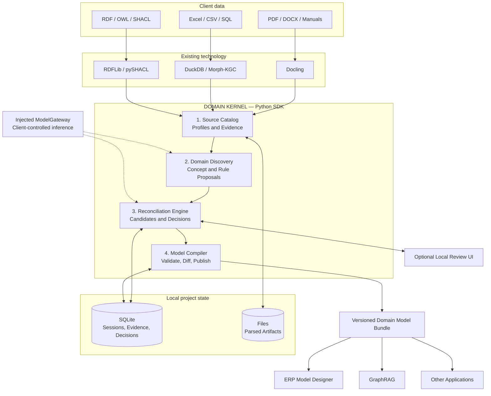

# domain-kernel
An open-source Python SDK for discovering, reconciling, and modeling business domains.


# Architecture



## Dependency overview

This table describes dependency choices. Release-specific, machine-readable SBOMs
are generated from `uv.lock` by the release workflow described below.

**Project:** Domain Kernel  
**License:** Apache-2.0  
**Python baseline:** 3.13+  
**Package manager:** uv  
**Dependency versions verified:** 2026-11-06

### Core and optional runtime dependencies

| Package | Latest PyPI version | License | Architecture component | Responsibility |
|---|---|---|---|---|
| [pydantic](https://pypi.org/project/pydantic/) | 2.14.3 | MIT | Core / Contracts | Typed SDK interfaces, schema validation, serialization of discovery proposals and model bundles |
| [rdflib](https://pypi.org/project/rdflib/) | 7.6.0 | BSD-3-Clause | Ontology Adapter | Import, parse, query and serialize RDF, OWL, Turtle and JSON-LD |
| [pyshacl](https://pypi.org/project/pyshacl/) | 0.40.2 | Apache-2.0 | Model Validation | Validate RDF graphs against SHACL constraints |
| [duckdb](https://pypi.org/project/duckdb/) | 2.0.0 | MIT | Structured Data Adapter | Profile tabular datasets, infer candidate keys and analyze relationships using SQL |
| [openpyxl](https://pypi.org/project/openpyxl/) | 3.1.5 | MIT | Spreadsheet Adapter | Read Excel workbooks, worksheets, column metadata, formulas and cell references |
| [defusedxml](https://pypi.org/project/defusedxml/) | 0.7.1 | PSFL | Spreadsheet Security | Mitigate malicious XML constructs during untrusted workbook processing |
| [docling](https://pypi.org/project/docling/) | 2.148.0 | MIT | Document Adapter | Parse PDF, DOCX and other documents into structured text, tables and evidence locations |
| [rapidfuzz](https://pypi.org/project/RapidFuzz/) | 3.14.6 | MIT | Concept Reconciliation | Fast string similarity and fuzzy matching for generating candidate concept alignments |

### Planned integrations — deferred

These packages are not required for the initial kernel. They should be introduced as optional adapters when their capabilities are implemented.

| Package | Latest PyPI version | License | Architecture component | Responsibility |
|---|---|---|---|---|
| [sssom](https://pypi.org/project/sssom/) | 0.4.22 | MIT | Ontology Alignment | Read, validate and export standardized ontology mappings |
| [networkx](https://pypi.org/project/networkx/) | 3.7 | BSD-3-Clause | Model Analysis | Graph traversal, dependency analysis and graph algorithms |
| [docling-graph](https://pypi.org/project/docling-graph/) | 1.9.1 | MIT | Semantic Extraction | Ontology-guided entity and relationship extraction from documents |
| [morph-kgc](https://pypi.org/project/morph-kgc/) | 2.10.0 | Apache-2.0 | Structured Knowledge Mapping | Convert heterogeneous structured sources into RDF using RML/R2RML |
| [linkml](https://pypi.org/project/linkml/) | 1.12.1 | Apache-2.0 | Model Interoperability | Generate and transform schemas across JSON Schema, RDF, SHACL and other formats |
| [splink](https://pypi.org/project/splink/) | 5.0.0 | MIT | Instance Reconciliation | Scalable probabilistic record linkage and entity deduplication |
| [streamlit](https://pypi.org/project/streamlit/) | 1.67.0 | Apache-2.0 | Local Review Studio | Optional UI for reviewing concept alignments, conflicts and evidence |

### Development dependencies

These packages belong in the development dependency group and are not included in the published runtime requirements.

| Package | Latest PyPI version | License | Responsibility |
|---|---|---|---|
| [pytest](https://pypi.org/project/pytest/) | 9.2.0 | MIT | Unit and integration testing |
| [pytest-cov](https://pypi.org/project/pytest-cov/) | 7.1.0 | MIT | Test coverage reporting |
| [pytest-asyncio](https://pypi.org/project/pytest-asyncio/) | 1.4.1.post1 | Apache-2.0 | Testing asynchronous model-gateway and discovery operations |
| [ruff](https://pypi.org/project/ruff/) | 0.17.4 | MIT | Linting, formatting and import organization |
| [basedpyright](https://pypi.org/project/basedpyright/) | 1.40.2 | MIT | Static type checking with all diagnostics for the SDK and tests |
| [pre-commit](https://pypi.org/project/pre-commit/) | 4.7.0 | MIT | Run locked checks before commits |
| [pre-commit-hooks](https://pypi.org/project/pre-commit-hooks/) | 6.0.0 | MIT | Repository whitespace, newline, TOML, YAML and merge-conflict checks |
| [check-jsonschema](https://pypi.org/project/check-jsonschema/) | 0.39.0 | Apache-2.0 | Validate release SBOMs against the official CycloneDX schema |

## Development

Use Python 3.13+ and [uv](https://docs.astral.sh/uv/getting-started/installation/)
0.13.7 or newer (CI pins 0.13.7). `.python-version` and the optional `mise.toml`
both select 3.13. Install the core SDK and development tools, then enable hooks:

```sh
uv sync --locked
uv run pre-commit install
uv run pre-commit run --all-files
```

Optional adapters stay separate: for example, `uv sync --locked --extra ontology`.
The default environment does not install document-processing or other extras.
All checks use `uv run --locked` so they fail instead of changing `uv.lock`.
Whitespace and EOF hooks may fix staged files; Ruff hooks only verify.

```sh
uv lock --check
uv run --locked ruff check .
uv run --locked ruff format --check .
uv run --locked basedpyright
uv run --locked pytest -m "not integration"
uv run --locked pytest --cov --cov-report=term-missing
```

To apply Python formatting, use `uv run --locked ruff format .`. Ruff enables all
stable rules with preview disabled. Formatter-conflicting rules are excluded;
Google-style docstrings resolve conflicting conventions, and repository licensing
replaces per-file copyright headers. Tests alone permit pytest assertions,
descriptive names without docstrings, and package-free importlib discovery.
The exact exclusions and reasons live in `pyproject.toml`.

BasedPyright's `all` mode checks `src/` and `tests/`, including unsafe `Any`, unknown
types, signatures, and returns. It adds diagnostics beyond Pyright `strict` and
bundles a development-only Node runtime. No typing diagnostics are suppressed.
Ruff additionally requires explicit API annotations. Keep the `py.typed` marker.

The complete local CI sequence is `uv lock --check`, `uv sync --locked`,
`uv run --locked pre-commit run --all-files`, the full pytest command above,
the build and SBOM checks below, and `uv audit --locked` (requires network access).
Run the sequence once with `export UV_PYTHON=3.13` and again with
`export UV_PYTHON=3.14` to match the CI matrix. Then run `unset UV_PYTHON` and
`uv sync --locked` to restore the default 3.13 environment.
The initial tests cover the existing entry point and package metadata/typing
contracts. Coverage is reported without a threshold while application code is
only a stub. Add meaningful tests as the SDK grows. There are no integration
tests yet; mark future slow tests `integration` to exclude them from hooks.

Build both distributions, verify reproducibility, and import the wheel in an
isolated environment outside the source tree:

```sh
export SOURCE_DATE_EPOCH=0
uv build --no-sources
build_check_dir="$(mktemp -d)"
uv build --no-sources --out-dir "$build_check_dir"
for artifact in dist/*.whl dist/*.tar.gz; do
  cmp "$artifact" "$build_check_dir/$(basename "$artifact")"
done
uv export --locked --no-dev --no-default-groups --no-emit-project --format requirements.txt --output-file "$build_check_dir/runtime-requirements.txt"
uv venv "$build_check_dir/wheel-env"
uv pip install --python "$build_check_dir/wheel-env/bin/python" --require-hashes --requirements "$build_check_dir/runtime-requirements.txt"
uv pip install --python "$build_check_dir/wheel-env/bin/python" --no-deps dist/*.whl
(cd "$build_check_dir" && ./wheel-env/bin/python -I -c \
  'from domain_kernel import hello; from importlib.resources import files; assert hello() == "Hello from domain-kernel!"; assert files("domain_kernel").joinpath("py.typed").is_file()')
```

The build backend is pinned explicitly; `uv build` builds the wheel from the
source distribution by default. The smoke-test environment installs hashed core
dependencies from the lockfile and the built wheel, without development tools.
Use a fresh `dist/` for release builds.

Generate and validate the same CycloneDX 1.5 SBOMs as a release:

```sh
mkdir -p dist
uv export --locked --no-dev --no-default-groups --format cyclonedx1.5 --output-file dist/sbom-core.cdx.json
uv export --locked --no-dev --no-default-groups --all-extras --format cyclonedx1.5 --output-file dist/sbom-all-extras.cdx.json
uv run --locked check-jsonschema --schemafile https://cyclonedx.org/schema/bom-1.5.schema.json dist/sbom-*.cdx.json
```

`sbom-core.cdx.json` covers the core runtime graph. `sbom-all-extras.cdx.json`
adds every optional runtime extra. Both exclude development groups and represent
the cross-platform lockfile graph. These are **lockfile-derived SBOMs**, not
inventories obtained by inspecting the built artifacts. External model weights,
system libraries, and later downloads are outside their scope. Schema validation
downloads the official schema and references; failures stop publication.
Generated SBOMs and distributions are ignored by Git. Native SBOM export and
audit are currently marked experimental by uv; CI pins the verified uv version
and validates each SBOM to detect incompatible changes.

### CI, releases, and updates

`.github/workflows/ci.yml` validates pull requests targeting `main`, pushes to
`main`, and `v*` tags. It tests Python 3.13 and 3.14, runs the hooks and full suite,
compares repeated wheel/sdist builds, and checks a clean wheel import. A separate
job runs native `uv audit --locked` against all extras and development groups,
also every Monday. This checks known vulnerabilities without installing extras;
it does not prove the absence of vulnerabilities.

To release, update the package version, refresh and commit `uv.lock`, then push
a matching tag such as `v0.1.0` or `v0.1.0a1`. A mismatched tag fails. Only after
both Python jobs and the security audit pass does the release job download the
validated wheel, sdist, and two SBOMs, upload them to a draft GitHub Release, and
publish it. Alpha/beta/rc/dev versions are marked as prereleases. Upload failures
leave a draft; existing releases are never overwritten automatically. Only the
release job has `contents: write`; it uses the built-in GitHub token. No PyPI
publication is configured. PyPI Trusted Publishing can be added separately with
a dedicated publishing job and `id-token: write`.

Dependabot proposes weekly `uv` and GitHub Actions updates. Review and merge
them through the same CI gates. For a manual update, use
`uv lock --upgrade-package PACKAGE`, `uv sync --locked`, and the checks above;
use `uv add` / `uv remove` when changing direct requirements. Commit the lockfile
with dependency changes. Release jobs never upgrade dependencies. Direct runtime
dependencies use permissive licenses compatible with Apache-2.0; reassess licenses
and any separately downloaded models when adding adapters.
