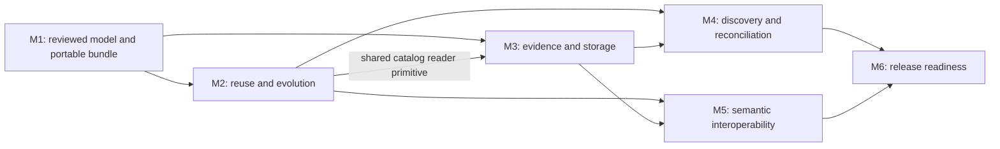

# Domain Kernel v1 implementation roadmap

This is the issue backlog for delivering the SDK described in
[ARCHITECTURE.md](ARCHITECTURE.md), the **single source of truth**.
[SDK_REQUIREMENTS.md](SDK_REQUIREMENTS.md) supplies full usage recipes and
[INTERFACES.md](INTERFACES.md) supplies the proposed typed contracts and virtual
module paths. This roadmap sequences that design; it does not add product scope or
override any of those contracts. Resolve an actual design change in the architecture
first, then align its references and affected issues.

Each issue records its implementation status. `DK-001`–`DK-043` are stable local
issue IDs. The repository's engineering and packaging baseline supports the work
below. An issue is complete when its implementation and acceptance criteria have
been verified.

## V1 scope and delivery policy

V1 includes the currently committed modeling, review, evidence, discovery,
publication, evolution and bounded interoperability contracts. Each capability below
has an implementation owner. “Optional” means optional **at runtime**, not an
unassigned promise: built-in adapters have issues and conformance tests, while
reasoning/module extraction accept explicitly supplied host adapters. No default
heavyweight reasoner is promised. The future integrations already listed in the
architecture remain [deferred](#deferred-integrations).

The SDK establishes business meaning and publishes portable contracts. FDE Workbench,
ERP and Inframeld GraphRAG are independent applications. Their UIs, assignment
methodologies, runtime rule engines, operational data, instance entity resolution,
graph population, retrieval and agent hosting are outside this backlog.

All issue examples are **target API usage**, not claims that the API exists today.
Inputs are stated next to each snippet; examples are independent recipes, not one
script or an automatic approval loop. Read/preview boundaries require the host's
explicit review before an acceptance/approval call. Every Python example uses keyword
arguments. Interface paths in issue ownership fields refer to the proposed modules
in INTERFACES.md; do not assume the files already exist.

All issues target the architecture's [flat public API](ARCHITECTURE.md#flat-public-api).
`Client` exposes project/catalog operations, `Project` exposes model/source
operations, and `Model` exposes definition/review/discovery/publication operations.
Build these as thin typed façades over the slice services. Internal service protocols
in ownership lists describe implementation boundaries, not public collection
properties. Add each direct method with its owning behavior; do not scaffold the
entire façade before implementing the first complete slice.

Use directly injected application protocols and operation-scoped composition.
Services coordinate persistence and invoke pure domain behavior; they do not own
business invariants or retrieve repositories from a broad unit-of-work bundle.
DK-003 owns the planned SQLAlchemy async foundation. This design update and the
repository skills do not complete any implementation or notebook acceptance gate.

The primary hands-on guide and human product-acceptance surface is the
[Domain Kernel Tour](ARCHITECTURE.md#the-legislative-domain-model-notebook-journey): a
developer at a lobbying organisation builds a reusable legislative domain model for
AI in recruitment from real documents and pinned ontologies. ELI and DPV/AI Act are
the core reference resources; LOMO is an optional advanced exercise. The tour ends
at model publication/independent consumption; legislative analysis remains downstream.
Its first manual chapter ships in M1, and every capability extends the
[chapter/exercise coverage map](ARCHITECTURE.md#notebook-capability-coverage).
The independent issue snippets remain reference recipes; they are not concatenated
to create the tour.

## Milestones and how to use the backlog

Start with **DK-001**, then deliver M1 as the first usable increment. Follow each
issue's explicit dependencies; numbering is a reading order, not a requirement to
serialize unrelated work. Dependencies describe implementation prerequisites, not
mandatory runtime extras. Optional adapters must never become prerequisites for
ordinary manual authoring or standalone bundle consumption.

| Milestone | Issues | Demonstrable exit | Cumulative notebook gate |
|---|---|---|---|
| M1 — Manual model lifecycle | DK-001–DK-011 | Author, review, correct, publish and independently reload a small model, including the first developer notebook chapter. | C1–C2 and the manual portions of C7–C10, E6 and R1 execute with a reviewed AI-system/actor fixture; demonstrate a blocker, correction, unchanged earlier publication and independent reload. |
| M2 — Rich modeling and reuse | DK-012–DK-019 | Processes/decisions, packs, baselines, pinned dependencies, reviewed upgrades and workflow views. | E2/E3/E7 extend the same model with authored legislative packs, patterns, three model modules, an upgrade and descriptive workflow/decision definitions; no ontology loader is required yet. |
| M3 — Evidence and storage | DK-020–DK-026 | Capture files/human/host-parsed evidence with exact provenance, retention and local/remote storage boundaries. | C3, E4 and the capture portion of E5 run on pinned real documents/workbook and labelled derived fixtures; E9 adds tested opt-in remote-input/storage recipes. |
| M4 — Evidence-assisted modeling | DK-027–DK-030 | Extract proposals, reconcile meanings, review/correct interpretations and resume interrupted work. | C4/C6/C10 and E5/E9 show focused discovery over full documents, prompt override with a fixed output contract, reviewed mappings, confirmations, a real source update and recovery. Replay and a tested opt-in live gateway have separate results; use M2 packs until M5 resources are available. |
| M5 — Semantic interoperability | DK-031–DK-038 | Preserve ontology resources, project supported standards, assess compatibility and use explicit optional formal adapters. | C5/C9 and E1/E8 execute on selected ELI/DPV resources, with an opt-in LOMO branch, assessed exports/import and real reasoning/extraction example adapters. Record exact resource/profile/engine compatibility. |
| M6 — Release readiness | DK-039–DK-043 | PostgreSQL parity, advanced notebook controls and frontend conformance, integrated tests, packaging and an accountable v1 compatibility boundary. | C1–C10, E1–E10 and R1 have executable locations and acceptance evidence; integrate M4 discovery with M5 ontologies, verify PostgreSQL/frontend recipes, and run the packaged notebook plus independent consumer. |



This diagram summarizes workstreams. The exact dependency lists below are the
scheduling authority. M5 can progress alongside M4 once its prerequisites exist.
M6 adapter work can also start before the final release gates; safety, tests and
documentation accompany each earlier issue rather than being postponed to M6.

Each issue is intended to be copied into an issue tracker with its ID, context,
dependencies, ownership, canonical references, work, example and acceptance criteria.
An issue can span a few cohesive PRs; split it along observable behavior/adapter
boundaries if needed, retain its acceptance criteria and update dependency links.
Do not split into a long queue of empty interfaces followed by all implementations.
There are no invented effort estimates, dates or staffing assumptions.

### Iterative notebook delivery

Every issue below owns its **Notebook contribution** and **Notebook acceptance**
check in the same implementation change as its SDK work. C1–C10, E1–E10 and R1 are
the architecture's stable chapter/exercise labels. DK-001 adopts the paired preview
scaffold and runs the source selection and scope step in C1. DK-011 integrates the
first manual publication journey. Earlier issues supply runnable public-type examples
or explanatory cells where a later public operation is required, with the completing
issue explicitly named. Those partial contributions do not satisfy a complete
chapter gate. SDK dependency lists and parallel workstreams remain unchanged.

Use `examples/notebooks/domain-kernel-tour.ipynb` and its paired text source;
`examples/notebooks/coverage.json` records issue ownership, stable cell IDs or recipe
paths, source/fixture pins, prerequisites, expected outcomes, test references,
human acceptance notes and planned/partial/verified status. Keep the corpus manifest
and reviewed expectations under `examples/notebooks/fixtures/`, with documented
provisioning for resources that cannot be redistributed. The [interactive preview](examples/notebooks/README.md)
now supplies these paths and all chapter/exercise outlines with simulated results.
Its ledger records preview and SDK status separately. Every issue must enable its
planned calls, remove the corresponding fixture dependencies and record real acceptance
evidence; a passing preview cannot complete an issue or any milestone gate above.
Unacquired sources remain visibly unverified until their owning corpus work verifies them.

The expanded preview is the reference content for the 60–90 minute tutorial, not a
completed SDK milestone. Preserve the recruitment-scoped seed, then build the
connected purpose, responsibility, documentation, data/safeguard and legislative
areas from verified 2024 Official Journal passages. DK-005/DK-008 own the shared
shape expectations; DK-022 owns exact passage evidence; DK-027/DK-028 turn the
catalogue's expected distinctions and reviewer corrections into discovery/reconciliation
evaluation cases. DK-009 preserves the distinction between structural failure and
manual semantic judgement. DK-035/DK-036 replace the instructions-for-use and
edition-aware provision projection fixtures with actual exporter acceptance evidence.
DK-010 supplies the independent deserialized-bundle consumer, inspecting fields,
citations and selected descriptive rules without hidden source retrieval. DK-027/DK-028
preserve the Article 13 proposal/correction thread as real results replace fixtures.
DK-040 retains the five focused views, directed connection matrices, searchable
complete inventory, saved worked examples, primary results with expandable supporting
details, static alternatives and tested VS Code interactions as the model grows.
Every milestone checks cumulative catalogue/coverage consistency and a narrative
review: motivation, result interpretation, concrete experiment and transition.
Regression gates include qualified classification, separate document types, dataset
roles and qualified retention; successful mocks never establish extraction accuracy.


| Shared notebook work | Owning issues and required handoff |
|---|---|
| Corpus and story | DK-001 starts the manifest; DK-005 pins the initial definition passages and manual expectations. DK-011 consolidates the AI Act, Commission AI-system guidance and WEC Europe AI-at-work paper roster. DK-020 provisions exact document editions; DK-021 selects the ELI workbook; DK-022 verifies passages/citations and prepares parser fixtures. |
| Reference assets | DK-013–DK-019 build labelled, manually authored legislative/AI/recruitment assets first. DK-031 pins actual ELI/DPV and opt-in LOMO distributions, imports and language resources; DK-032 connects them through reviewed adoption. |
| Semantic expectations | DK-005–DK-011 establish independently reviewed manual expectations as their cells arrive. DK-027/DK-028 add corpus-based expected definitions, relationships, evidence and mapping judgments with an evaluation rubric; DK-030 adds revision expectations. DK-043 evaluates these rather than first inventing them at release. |
| Live integrations | DK-027 supplies a tested example host gateway. DK-037/DK-038 select and supply tested example host adapters for actual reasoning/extraction engines, with pinned setup, capability limits and results. These live under notebook examples, not mandatory SDK dependencies. DK-026/DK-039 own remote/database setups. |
| Execution and coverage | DK-001 establishes stable cells and the coverage ledger; DK-011 implements the cumulative execution/coverage check. Each issue extends it, DK-040 supplies browser/human usability evidence, and DK-042/DK-043 enforce packaged-release completion. |

Each contribution connects the developer's previous result to the next motivation,
explains non-obvious code, interprets a useful result and offers a concrete experiment. Preserve one continuous workspace/model
history; advanced exercises may branch from a named published snapshot without
resetting or silently changing the main journey. Manufacturing snippets remain
independent references, not substitutes for these notebook contributions.

Run the cumulative implemented path after every issue; each milestone gate checks
its completed portions plus earlier ones. Future portions are explicitly pending,
not skipped successes. The default clean-kernel tour remains offline and credential
free after provisioning; separately configured jobs or recorded operator runs verify
live gateways, parsers, engines and remote services. Missing credentials or adapters
may skip an opt-in user run but cannot satisfy that exercise's delivery gate.
Replayed responses test SDK behavior, not live semantic quality. Generic unit tests,
placeholder cells and a coverage row without an executed artifact are insufficient.

## Definition of done for every issue

- Implement the observable behavior and meaningful failure paths, with explicit typed
  contracts and inward dependencies. Domain rules use stdlib records; framework and
  provider I/O stay behind application-owned ports. Preserve existing functionality.
- Keep SDK method parameters keyword-only; identifier constructors may be
  positional-or-keyword. Keep nominal IDs/value objects and enum choices strict,
  immutable snapshots detached, optional inputs predictable, and review
  intent/authority/concurrency guards explicit. Do not add Any, blanket suppressions
  or casts to conceal mismatches.
- Expose each operation through its canonical direct method on the owning handle,
  with explicit signatures and no grouped-service aliases or dynamic forwarding.
  Cover façade delegation and typed usage without duplicating use-case rules;
  preserve async behavior, pagination, review gates and concurrency guards.
- Make persistence-facing public/application methods async on both database adapters,
  including reads and previews; await them in examples and host helpers. Keep pure
  builders, decision construction, loaded snapshot access and codecs synchronous.
- Every new body, decision or resource type updates its applicable validation,
  canonical hashing, wire decoding, audit, revision impact, baseline/dependency
  remapping, traversal/composition and projection assessment. Add exhaustive union
  coverage fixtures so a new type cannot be silently omitted. A later feature owns
  extending earlier infrastructure for its new types.
- Implement scoped idempotency, short atomic transactions, stale-state checks,
  bounded processing, retention and sanitized errors in the feature that needs them.
  DK-041 consolidates their conformance tests; it does not introduce them late.
- Add meaningful unit tests under tests/unit; optional/slow adapter and complete
  journey tests under tests/integration with the integration marker. Tests cover
  invariants and observable outcomes, not copies of implementation details. Install
  each integration job's extras explicitly in CI.
- Run the relevant repository checks from AGENTS.md. Use uv exclusively for Python
  dependencies; intentional dependency changes include pyproject.toml and uv.lock
  together. Checks and releases never rewrite the lockfile. Ruff is the formatter
  and linter; BasedPyright remains strict. Keep py.typed and namespace conventions.
- Update the matching recipes and implemented API documentation. State supported
  subsets and limitations precisely; behavior changes require architecture alignment.
  An issue is complete only when its acceptance criteria and prerequisite contracts
  hold together, not when a stub or standalone happy-path test passes.
- Extend the developer notebook chapter or linked recipe, deterministic fixtures,
  inspection views where applicable and capability coverage map with each feature.
  Keep one coherent legislative-model story with advanced exercises and specialist
  recipes as mapped in the architecture. Record concrete example locations, pinned
  corpus/fixture inputs, extras/adapters, semantic expectations, tests, implementation
  status and human exploratory/product-acceptance checks. The notebook complements
  unit/integration coverage and must run against implemented APIs; replayed inference
  is not evidence of live extraction quality.
- Satisfy the issue's notebook acceptance check and cumulative milestone gate.
  Update the coverage ledger in the same change; fail its check for missing locations,
  placeholders, absent expected outputs or unverified contributions claimed complete.
  Preserve a recorded handoff for a later API dependency and close it in that owner;
  no notebook work is left to an unspecified final documentation pass.

## Issue index

| Issue | Milestone | Depends on |
|---|---|---|
| [DK-001 — Establish nominal identities, immutable records and typed failures](#dk-001) | M1 | None |
| [DK-002 — Implement business shapes, terminology and typed convenience factories](#dk-002) | M1 | [DK-001](#dk-001) |
| [DK-003 — Persist the manual-modeling journey with SQLite transactions](#dk-003) | M1 | [DK-001](#dk-001), [DK-002](#dk-002) |
| [DK-004 — Configure and create independent project/model workspaces](#dk-004) | M1 | [DK-003](#dk-003) |
| [DK-005 — Propose definitions and apply explicit leaf review decisions](#dk-005) | M1 | [DK-004](#dk-004) |
| [DK-006 — Author connected graphs and submit coordinated review plans](#dk-006) | M1 | [DK-005](#dk-005) |
| [DK-007 — Correct, retire and restore definitions without rewriting history](#dk-007) | M1 | [DK-006](#dk-006) |
| [DK-008 — Compile model snapshots and enforce readiness and acceptance checks](#dk-008) | M1 | [DK-005](#dk-005), [DK-007](#dk-007) |
| [DK-009 — Prepare and publish immutable versions](#dk-009) | M1 | [DK-003](#dk-003), [DK-008](#dk-008) |
| [DK-010 — Serialize and independently verify complete portable bundles](#dk-010) | M1 | [DK-009](#dk-009) |
| [DK-011 — Complete the first manual-modeling acceptance journey](#dk-011) | M1 | [DK-006](#dk-006), [DK-007](#dk-007), [DK-008](#dk-008), [DK-009](#dk-009), [DK-010](#dk-010) |
| [DK-012 — Model descriptive processes and business decisions](#dk-012) | M2 | [DK-002](#dk-002), [DK-006](#dk-006), [DK-008](#dk-008), [DK-010](#dk-010) |
| [DK-013 — Compose, validate and serialize immutable reference packs](#dk-013) | M2 | [DK-002](#dk-002), [DK-010](#dk-010), [DK-012](#dk-012) |
| [DK-014 — Load selected packs, adapt patterns and review reference alignment](#dk-014) | M2 | [DK-006](#dk-006), [DK-013](#dk-013) |
| [DK-015 — Review attachment, replacement and removal of a workspace pack](#dk-015) | M2 | [DK-007](#dk-007), [DK-009](#dk-009), [DK-014](#dk-014) |
| [DK-016 — Resolve exact published dependencies and preserve their closure](#dk-016) | M2 | [DK-010](#dk-010) |
| [DK-017 — Copy published models and explain model differences](#dk-017) | M2 | [DK-007](#dk-007), [DK-010](#dk-010), [DK-014](#dk-014), [DK-016](#dk-016) |
| [DK-018 — Upgrade dependencies with explicit remappings and atomic repairs](#dk-018) | M2 | [DK-006](#dk-006), [DK-007](#dk-007), [DK-016](#dk-016), [DK-017](#dk-017) |
| [DK-019 — Compose published models and select bounded workflow views](#dk-019) | M2 | [DK-010](#dk-010), [DK-016](#dk-016) |
| [DK-020 — Acquire local sources with stable revisions and bounded processing](#dk-020) | M3 | [DK-004](#dk-004), [DK-010](#dk-010), [DK-014](#dk-014) |
| [DK-021 — Parse CSV and Excel into bounded typed evidence](#dk-021) | M3 | [DK-020](#dk-020) |
| [DK-022 — Prepare PDF and Word evidence through Docling](#dk-022) | M3 | [DK-020](#dk-020) |
| [DK-023 — Accept host-parsed text, tables and graphs without reparsing](#dk-023) | M3 | [DK-020](#dk-020) |
| [DK-024 — Capture attributed statements and resolve exact evidence](#dk-024) | M3 | [DK-020](#dk-020), [DK-023](#dk-023) |
| [DK-025 — Write immutable artifacts and explicitly retain originals](#dk-025) | M3 | [DK-010](#dk-010), [DK-020](#dk-020) |
| [DK-026 — Add optional S3 and SharePoint readers and S3 storage](#dk-026) | M3 | [DK-004](#dk-004), [DK-020](#dk-020), [DK-025](#dk-025) |
| [DK-027 — Extract typed proposals through a caller-owned model gateway](#dk-027) | M4 | [DK-008](#dk-008), [DK-020](#dk-020), [DK-021](#dk-021), [DK-022](#dk-022), [DK-023](#dk-023), [DK-024](#dk-024) |
| [DK-028 — Reconcile source meanings and reference knowledge separately](#dk-028) | M4 | [DK-014](#dk-014), [DK-016](#dk-016), [DK-027](#dk-027) |
| [DK-029 — Resolve mappings, questions and confirmations and correct occurrences](#dk-029) | M4 | [DK-007](#dk-007), [DK-014](#dk-014), [DK-024](#dk-024), [DK-028](#dk-028) |
| [DK-030 — Orchestrate resumable discovery and incremental updates](#dk-030) | M4 | [DK-003](#dk-003), [DK-027](#dk-027), [DK-028](#dk-028), [DK-029](#dk-029) |
| [DK-031 — Load pinned ontology resources with deterministic import closure](#dk-031) | M5 | [DK-001](#dk-001), [DK-002](#dk-002), [DK-010](#dk-010), [DK-013](#dk-013), [DK-023](#dk-023) |
| [DK-032 — Review formal ontology modules and typed semantic links](#dk-032) | M5 | [DK-006](#dk-006), [DK-013](#dk-013), [DK-016](#dk-016), [DK-019](#dk-019), [DK-031](#dk-031) |
| [DK-033 — Project RDF ontology, provenance and separate SHACL graph roles](#dk-033) | M5 | [DK-012](#dk-012), [DK-025](#dk-025), [DK-031](#dk-031), [DK-032](#dk-032) |
| [DK-034 — Validate candidate model semantics through controlled SHACL](#dk-034) | M5 | [DK-008](#dk-008), [DK-031](#dk-031), [DK-033](#dk-033) |
| [DK-035 — Assess projections and export supported JSON Schemas](#dk-035) | M5 | [DK-010](#dk-010), [DK-025](#dk-025), [DK-033](#dk-033), [DK-034](#dk-034) |
| [DK-036 — Import and export the bounded LinkML schema subset](#dk-036) | M5 | [DK-006](#dk-006), [DK-013](#dk-013), [DK-031](#dk-031), [DK-032](#dk-032), [DK-035](#dk-035) |
| [DK-037 — Support explicit reasoning adapters and candidate validation](#dk-037) | M5 | [DK-008](#dk-008), [DK-031](#dk-031), [DK-032](#dk-032), [DK-033](#dk-033) |
| [DK-038 — Support formal ontology module extraction as a separate capability](#dk-038) | M5 | [DK-019](#dk-019), [DK-031](#dk-031), [DK-032](#dk-032) |
| [DK-039 — Provide PostgreSQL with the same transaction guarantees](#dk-039) | M6 | [DK-003](#dk-003), [DK-009](#dk-009), [DK-015](#dk-015), [DK-018](#dk-018), [DK-030](#dk-030) |
| [DK-040 — Complete notebook controls and frontend conformance](#dk-040) | M6 | [DK-011](#dk-011), [DK-014](#dk-014), [DK-024](#dk-024), [DK-030](#dk-030) |
| [DK-041 — Verify cross-cutting safety, resource bounds and adapter contracts](#dk-041) | M6 | [DK-018](#dk-018), [DK-026](#dk-026), [DK-030](#dk-030), [DK-035](#dk-035), [DK-036](#dk-036), [DK-037](#dk-037), [DK-038](#dk-038), [DK-039](#dk-039), [DK-040](#dk-040) |
| [DK-042 — Ship typed packaging, executable guides and an extras test matrix](#dk-042) | M6 | [DK-011](#dk-011), [DK-012](#dk-012), [DK-015](#dk-015), [DK-017](#dk-017), [DK-018](#dk-018), [DK-019](#dk-019), [DK-026](#dk-026), [DK-030](#dk-030), [DK-035](#dk-035), [DK-036](#dk-036), [DK-037](#dk-037), [DK-038](#dk-038), [DK-039](#dk-039), [DK-040](#dk-040) |
| [DK-043 — Close v1 with end-to-end conformance and a compatibility freeze](#dk-043) | M6 | [DK-041](#dk-041), [DK-042](#dk-042) |

## Implementation issues

### DK-001

**Establish nominal identities, immutable records and typed failures**

**Milestone:** M1 · **Status:** Implemented · **Dependencies:** None

Every later operation needs stable identity, scope and diagnostic contracts. Establish the small shared vocabulary used by the first manual-modeling journey, extending it as later issues require.

**Implementation ownership:** domain-owned `domain/identifiers/` modules, genuinely
cross-domain values and contracts under `shared/`, domain-owned enums and errors,
canonical hashing and codec contracts, and package-root exports.

**Canonical requirements:** [defaults and python type conventions](ARCHITECTURE.md#defaults-and-python-type-conventions), [five slices one model contract](ARCHITECTURE.md#five-slices-one-model-contract); signatures and record fields are in [INTERFACES.md](INTERFACES.md).

**Work:**

- Give common input, duplicate/missing-name, missing-capability and stale-state failures useful sanitized messages with practical next steps, retaining typed codes/issues. Optional spelling hints use a bounded authorized same-scope/same-kind candidate set, with no inference, full-catalog scan or automatic correction. Skip unavailable/expensive hints; never mask the original failure. Avoid an exhaustive repair framework.

- Implement nominal ID/hash/cursor records, closed enums, fixed discriminators, exact model/definition references and structured Issue diagnostics. Keep domain records stdlib-only and immutable.
- Enforce declared Python types at construction: no raw-string ID/enum substitution, numeric coercion, or string-as-sequence acceptance. Methods, factories and record/configuration constructors accept Sequence inputs; validate and immediately freeze lists/tuples, including nested collections. Keep fixed-position pairs and immutable defaults as tuples.
- Define canonical hashing utilities and version-aware codecs at application boundaries. Keep readable names, prose and host actor/version labels as the existing validated strings.
- Preserve the root public entry point and py.typed. Add only contracts exercised by a working increment; do not scaffold every virtual module.

**Notebook contribution:** Use the paired C1 tour and its source manifest to select the original
English AI Act edition, pin its digest with `ContentHash` and state the recruitment model scope
with `ModelKind.OBSERVED`. Explain how the digest, lookup name and generated model identity are
used. Link contract tests in the coverage ledger. DK-004 owns workspace creation, DK-011 owns
cumulative execution and the first complete publication, and DK-020 owns actual file ingestion.

**Target API example:**

```python
from domain_kernel import DefinitionId, ReviewCaseId

component_id = DefinitionId(value="component")
review_id = ReviewCaseId(value="component")
# Inspect component_id.value and review_id.value.
# They are different nominal types, not interchangeable API arguments.
```

**Acceptance criteria:**

- [x] **Notebook acceptance:** The paired scope cell displays the expected English edition, digest,
  model kind and scope in a fresh offline kernel without a database, parser or gateway. The
  ledger records the expected result and links the SDK contract tests, including failure cases.
- [x] Default messages for project/model lookup, duplicate names, missing capabilities, and stale
  state identify the failure and provide a recovery step. The tests verify stable codes and
  explicit message overrides. Optional spelling hints belong to the owning lookup operations.

- [x] Unit/type tests distinguish `DefinitionId` from `ReviewCaseId` and reject malformed SHA-256 values, negative counts and raw enum strings.
- [x] The shared records detach list and tuple inputs, reject text or byte buffers as collection
  inputs, and preserve nominal value types. Nested lists and tuples produce the same canonical
  bytes. Builder drafts and plans apply the same collection contract when introduced.
- [x] SDK method parameters are keyword-only and identifier constructors accept
  positional or keyword values. Importing domain modules loads no database, parser,
  provider or framework adapter.

### DK-002

**Implement business shapes, terminology and typed convenience factories**

**Milestone:** M1 · **Status:** Foundations implemented, downstream acceptance pending · **Dependencies:** [DK-001](#dk-001)

Models must describe usable business contracts without making callers construct ontology syntax or redundant primitive fields.

**Implementation ownership:** `_shared/domain/{model_values,data_shapes,definitions}.py`; structural validation helpers.

**Canonical requirements:** [business data shapes and terminology](ARCHITECTURE.md#business-data-shapes-and-terminology), [typed conveniences without a second model](ARCHITECTURE.md#typed-conveniences-without-a-second-model), [quantity and association patterns](ARCHITECTURE.md#quantity-and-association-patterns); signatures and record fields are in [INTERFACES.md](INTERFACES.md).

**Work:**

- Implement concepts, binary relationships, attribute-type unions, independent field presence, collection kind/item bounds and nullability, value sets, structured values, compound keys, decimal facets and localized terminology.
- Implement AttributeDefinition.string/decimal/reference/value_set with `required`, `collection`, `min_items` and `max_items` on the ordinary record; remove the combined attribute shape wrapper. Attribute/key creation generates IDs once and accepts display_name with optional name, or name alone; attachment validates owner-local uniqueness without suffixes. Preserve typed counts, targets and defaults; edits and codecs retain IDs/names.
- Expose the immutable Concept specialization with direct attributes/keys properties and get_attribute/get_key lookups by exactly one name or ID. Reuse the Definition wire representation and validate kind without caller assertions.
- Add UnitDefinition (DefinitionKind.UNIT), optional ValueSetMember.unit edges, and QuantityBinding with optional quantity_kind. Units retain generated definition identity, names/meaning, optional symbol/terminology and ontology term; referenced-unit and inline-term bindings are mutually exclusive. Validate field structure and active unit references; verify supplied ontology resources under DK-031 without requiring them for local units.
- Centralize typed-reference traversal/remapping for later validators, baselines, dependencies and slices. Embedding is acyclic; ordinary concept relationships may cycle.

**Notebook contribution:** C7/E6/R1 foundation: add public-constructor cells for a provision
locator, actor-role association fields, keys, open/closed vocabularies, collection/nullability
choices and reviewed English/French labels. Add a linked local-unit/quantity and decimal recipe;
DK-006 attaches these authored shapes to model plans.

The constructor and captured-graph foundation satisfies the implementation prerequisite for
later tickets. Close DK-002 after the same shapes complete the full lifecycle. DK-003–DK-011
cover persistence, review, correction, publication and portable reload. DK-012–DK-014 and
DK-016–DK-019 cover reuse and exact dependency traversal. DK-020, DK-023 and DK-025 supply
pinned evidence and artifacts. DK-031–DK-036 verify materialized terms and round-trip the
supported shapes through projection and import.

**Target API example:**

```python
from domain_kernel import AttributeDefinition, CollectionKind, Count

code = AttributeDefinition.string(
    display_name="Asset code",
    required=True,
)
tags = AttributeDefinition.string(
    display_name="Tags",
    collection=CollectionKind.SET,
    max_items=Count(value=10),
)
```

**Acceptance criteria:**

- [ ] **Notebook acceptance:** Constructor examples display the intended shapes and catch an
  explained invalid bound or label conflict. Inputs are labelled application design choices; no
  ontology, conversion or later persistence API is required.
- [ ] Tests independently cover presence and size: required empty collections, optional nonempty collections, absent/null/empty values and finite/unbounded maxima. Reject bounds on SINGLE, nullable collections/items, invalid keys and conflicting localized labels.
- [ ] Constructors/factories normalize collection minimum None to Count(value=0); SINGLE retains None bounds. Edits preserve UNSET fields, explicitly reset bounds with None, and reject switching to SINGLE without clearing stored counts. Requiredness never derives from item counts.
- [ ] Complete bundle codecs preserve/hash explicit required/collection/min_items/max_items fields and reject legacy shape fields. Attribute keys and quantity fields require required=True, SINGLE and non-null; relationship CardinalityBounds stay unchanged.
- [ ] Factories and full constructors produce equivalent shapes, each with freshly generated attribute/key IDs; decimal precision/scale never round or coerce floats. AttributeDefinition.value_set requires a typed value_set reference, constructs ValueSetType and preserves all common attribute options without creating, copying or looking up a value set.
- [ ] Unit edges survive review, reference-pack composition, baseline/dependency remapping, slicing, import and retirement checks. Extend the unreleased 1.0 closed schemas, mapping vocabularies/capabilities and fixtures together; incompatible changes after release require new registered versions. Unsupported readers/exporters fail explicitly.
- [ ] Generated attribute/key names and overrides follow the naming contract; duplicate names fail in the correct owner collection. Direct getters are snapshot-local, reject ambiguous/missing selectors, and expose no mutable lists or extra I/O.
- [ ] Local, ontology-bound and mixed unit sets retain required non-null magnitude/unit fields and closed codes. QuantityBinding and QuantityRequiredCheck remain valid when quantity_kind=None. Reject wrong-kind/stale/dangling unit edges, simultaneous member.unit/ontology_term and invalid supplied term pins; preserve every declared term. No dimensional conversion is inferred.

### DK-003

**Persist the manual-modeling journey with SQLite transactions**

**Milestone:** M1 · **Status:** Persistence implemented, workflow acceptance pending · **Dependencies:** [DK-001](#dk-001), [DK-002](#dk-002)

Review, revisions and publication need durable state and atomic cross-slice changes before higher-level services can safely operate.

The SQLite transaction, audit, workspace revision and replay tests establish the
persistence boundary. DK-004 and DK-005 exercise it through workspace creation and
leaf decisions. DK-006/DK-007 cover coordinated plans and revision history,
DK-008/DK-009 cover validation and blocked preparation, and DK-020/DK-025 cover
external write recovery. The remaining workflow checks apply as those commands land.

**Implementation ownership:** `_database.py`, `_shared/application/persistence.py`, SQLite repository adapters and transaction composition.

**Canonical requirements:** [state evidence and artifacts](ARCHITECTURE.md#state-evidence-and-artifacts), [retries and concurrent work](ARCHITECTURE.md#retries-and-concurrent-work), [durable action audit](ARCHITECTURE.md#durable-action-audit); signatures and record fields are in [INTERFACES.md](INTERFACES.md).

**Work:**

- Implement lazy default SQLite initialization through the internal SchemaManager when database settings are omitted. The first awaited database operation waits for directory/schema setup; Client construction does no DB I/O. Keep explicit database initialization/upgrades operator-owned and implement only the repositories needed by each capability.
- Provide the typed transaction/unit-of-work boundary for model state, append-only durable-action audit, revisions and operation outcomes. Require host-attributed actors on all durable commands; retain exact creation metadata, action/outcome, time, reason and linked before/after records. Add scope uniqueness and compare-and-swap guards.
- Implement async repository/audit/idempotency ports with SQLAlchemy typed ORM mappings and expressions in infrastructure. Add `sqlalchemy[asyncio]` and `aiosqlite` as baseline dependencies using uv and the seven-day cooldown, with lazy imports. Return detached domain/application values, never ORM rows or implicit database reads.
- Make UnitOfWorkFactory a synchronous factory of async resource contexts. Composition creates one clean session and injects specific bound repositories, audit, idempotency and TransactionManager into a fresh service. The service uses async with transaction.begin(): normal exit commits once, failure before commit rolls back, and the resource context only releases resources. No repository commits, active-transaction joining, implicit savepoints or concurrent session sharing.
- Use operation-scoped unpooled engines, close sessions and dispose owned engines on all exits, with bounded database concurrency and no required Client.close(). Keep source/artifact I/O and inference outside transactions; offload only genuinely blocking storage/parser work. Preserve cleanup ownership and durable recovery after cancellation or uncertain commit acknowledgements.
- Persist scoped idempotency request hashes and outcomes. Resolve omitted optional keys to a fresh internal key once per command, reused through internal retries/checkpoints without mutating caller inputs; never derive it from content/request hashes. Preserve plan-ID defaults and recorded manifest-child keys. Implement the shared lease/fencing primitives used by later discovery recovery.
- Treat schema versions separately from bundle/mapping versions. Create only new/empty default databases, reuse compatible schemas and serialize concurrent initialization across clients/processes with atomic schema/version metadata. Unknown, partial, corrupt, unrelated or incompatible schemas fail closed; never migrate, delete, switch paths or fall back to memory/SQLite after failure. Injected transactions always own setup.

**Notebook contribution:** C1/E9 foundation: add isolated-workspace selection, creation/resume
guidance and reset restricted to demo data, with persistence/audit expectations linked to conformance tests.
Assign public create/reopen and restart cells to DK-004, and durable model-history inspection to
DK-007/DK-009; do not expose private database services as tutorial APIs.

**Target API example:**

`settings: SQLiteSettings` selects a database requiring operator setup. Omitted database settings use lazy initialization through the built-in SQLite factory.

```python
from domain_kernel._database import SchemaManager

schema = SchemaManager(settings=settings)
await schema.initialize()
# Deployment setup is explicit and separate from Client construction.
```

**Acceptance criteria:**

- [x] **Notebook acceptance:** Workspace helpers cannot reset non-demo data, and the ledger records
  the DK-004/DK-007/DK-009 handoffs rather than claiming a completed public persistence journey.
- [ ] First default DB use initializes once, compatible reopen preserves data, and concurrent clients/processes converge safely. Failed/cancelled setup never exposes a partial schema as ready. Explicit database settings and injected transactions never initialize the implicit database; failures never trigger migration, replacement or fallback. Schema bootstrap is infrastructure setup, not an attributed business action.

- [x] Failure injection rolls back decision, definition, workspace revision, audit and idempotency outcome together.
- [ ] Audit every durable business action: project/model creation, ingestion/profile/copy, discovery/reconciliation, proposals/review, compilation/validation, preparation, publication and export. Pure builders, previews, reads and projections write no audit; reads never initiate derivative retention.
- [ ] Nested work inherits actor/parent context; resumed work records its actor without rewriting original attribution. Plans retain submitter and per-definition effects, linked to later reviewer decisions. Changed actors conflict under the same key or plan ID; matching retries create no duplicate events.
- [ ] Project/model audit queries are paginated, scoped, read-only and preserve exact historical resources. Blocked preparations and persisted failures retain their actual outcome; the portable bundle keeps semantic provenance and publication authorization without unrelated operational audit.
- [ ] Copy/export journals an attributed intent before external I/O and verifies completion before appending success. Restart after an uncertain write recovers the same operation; failure never undoes publication. No cross-store atomicity or long database transaction is assumed.
- [x] Two concurrent identical requests with the same key converge on one outcome; the same key with a changed request conflicts.
- [ ] Fresh processes can reload committed state. Expired lease holders cannot commit fenced updates. No transaction stays open across source/artifact I/O, inference or human review.
- [ ] Delayed database reads/writes do not block an independent event-loop task. Concurrent operations have separate sessions; all state/audit/outcome adapters within one operation share its session. Test bounded database concurrency, resource release and cancellation before/during/after commit without assuming cancellation proves rollback.
- [ ] Real SQLite tests verify foreign-key enforcement on every connection, uniqueness, stale-revision CAS and atomic state/revision/audit/idempotency outcomes, including an audit or commit failure. No nested/duplicate commits occur; an already active transaction is rejected.
- [x] Loaded results remain usable after session closure without queries. Pure domain tests require no database or SQLAlchemy; public/domain import checks do not load ORM/drivers despite their installation as baseline dependencies.
- [ ] Blocked preparation and other intentionally persisted failure outcomes commit before their documented exceptions are raised; the exception cannot roll back the diagnostic record. Notebook preview results do not establish these persistence guarantees.

### DK-004

**Configure and create independent project/model workspaces**

**Milestone:** M1 · **Status:** Workspace APIs implemented · **Dependencies:** [DK-003](#dk-003)

An application should get a usable local SDK with predictable defaults, while keeping model intent and optional integrations explicit.

C1 and E9 create and reopen the same model through separate clients. The SQLite
integration tests cover isolation, scoped name collisions and audit history.
Source, publication and inference services extend these same handles in their
owning tickets.

**Implementation ownership:** `configuration.py`, `diagnostics.py`, `_settings.py`, `client.py`, `project.py`, `_composition.py`, modeling service/catalog.

**Canonical requirements:** [typed configuration](ARCHITECTURE.md#typed-configuration), [projects models and reference packs](ARCHITECTURE.md#projects-models-and-reference-packs), [defaults and python type conventions](ARCHITECTURE.md#defaults-and-python-type-conventions); signatures and record fields are in [INTERFACES.md](INTERFACES.md).

**Work:**

- Preserve captured configuration origin/path and original database-field presence through TOML parsing, typed loading and default normalization. Explicit SQLite() remains operator-managed even when equal to the default; an injected transaction provider takes precedence over implicit setup.
- Add synchronous Client.inspect_configuration() returning a typed, immutable ConfigurationReport with origin, resolved base directory, setup mode and allowlisted setting/integration summaries. No I/O, health probes, credential/DSN values, secret references or provider repr.
- Keep SDK resources operation-scoped, including cleanup after failures/cancellation; never close host-owned gateways, resolvers, transports or pools. No public client close lifecycle while no client-owned persistent resources require it.

- Implement strict frozen configuration, shared TOML parsing and explicit Env resolution: process environment, selected env_file, then error. ClientConfiguration.from_toml(path="domain-kernel.toml", model_gateway=...) defaults to that path but always requires the file; it attaches a Python gateway after file validation and preserves file-relative base_dir. Client resolves Env references. Add pydantic-settings with uv when implementing; keep settings outside domain records.
- Let omitted/None Client.config load domain-kernel.toml from the captured process working directory, using fresh defaults only when absent. Explicit str/Path inputs require that exact file; typed configuration bypasses discovery and file merging. Never search Git roots, parent directories or global configuration, or load .env unless selected.
- Resolve relative configuration-file paths from captured cwd, then paths inside TOML from its directory; preserve Python base_dir. Snapshot once without live reload or rebasing after file/cwd changes. Preserve redaction, unique binding names and provider-specific credential unions.
- Implement `Client.create_project/get_project/list_projects` and `Project.create_model/get_model/list_models` with bounded query-bound cursors, ModelKind, a required non-blank model description and reference_pack=None. Resolve display_name/optional name using the architecture naming contract; persist both and reject duplicate names atomically without suffixes. Require an explicit copy_from bundle and exact dependency pins when those capabilities arrive. Wire thin handles to internal catalog/modeling services with explicit typed signatures.
- Configure the optional ModelGateway only through ClientConfiguration.model_gateway; remove the duplicate Client/composition gateway parameter. Validate runtime instance shape without invoking it; exclude it from serialization, both schema modes, repr and sanitized diagnostics. Snapshot settings while retaining the exact gateway reference, without deep-copying or closing it. Reject serialized runtime keys and post-construction replacement; preserve typed validation without arbitrary-type or validation bypasses.
- Add SourceSelectionLimits under ClientConfiguration.source_selection: defaults 1,000 files, 10,000 listing entries, depth 32 and 60 seconds of enumeration, all strict positive limits. Bulk overrides may only lower file/concurrency ceilings; DK-020 enforces shared capacity and aggregate traversal budgets.
- Validate ClientIntegrations against declared configuration and preserve caller ownership of transports/pools. Bind optional adapters lazily and report selected missing capabilities explicitly.

**Notebook contribution:** C1: connect the DK-003 workspace helper to real Client/project/model APIs
using minimal configuration, explicit demo isolation and configuration inspection. Add TOML/custom-
path alternatives and duplicate-name recovery. Close the public workspace/reopen handoff without
explicit default-SQLite initialization calls.

**Target API example:**

With no `domain-kernel.toml` in the working directory, Client uses defaults and initializes SQLite on its first database operation. Explicit database settings require operator setup. The generated names are unused.

```python
from domain_kernel import Client, ModelKind

client = Client()
project = await client.create_project(actor="user:model-editor", display_name="Factory")
model = await project.create_model(
    actor="user:model-editor",
    display_name="Maintenance",
    description="Maintenance assets, work orders, business vocabulary and measurements.",
    kind=ModelKind.PROPOSED,
)
```

**Acceptance criteria:**

- [x] **Notebook acceptance:** Fresh and resumed executions preserve project/model identities;
  duplicate names produce useful recovery guidance, configuration output is redacted, and no reset
  or new suffixed workspace occurs silently.
- [ ] ConfigurationReport retains true origin/field presence through from_toml -> Client, reports automatic/explicit/host-managed setup accurately and stays immutable after input/file changes. Inspection and rendering perform no I/O or provider repr calls; redaction covers settings and nested integrations. SDK-owned operation resources are released on success/failure/cancellation without closing caller-owned objects.

- [ ] Default construction creates no project, schema, source or inference request; manual modeling needs no gateway or pack. A client configured with a gateway supports manual work and discovery through the same handles; the gateway is called only by inference-dependent operations.
- [ ] Configuration selection tests cover cwd-only discovery, absence-only fallback, explicit str/Path loading, typed-object bypass, no file merging or automatic .env loading, and strict from_toml loading with its default or explicit path. Invalid, unreadable and non-file paths raise ConfigurationError without fallback. File-relative paths and snapshots remain stable after file/cwd changes; no Git-root, parent or global search occurs.
- [ ] Config tests cover runtime gateway identity through validation/composition, no deepcopy/close/repr leakage, dump and validation/serialization-schema exclusion, invalid instances and serialized-key rejection, and equivalent file/typed settings with retained path origins. File loading performs no gateway/provider creation, secret resolution or inference; Client resolves only explicit Env references. Protocol membership is not proof of a valid response, which remains checked at the inference boundary.
- [ ] The direct Client/Project methods match INTERFACES.md and return scoped handles; grouped collection properties are absent from the public contract.
- [ ] Generated names, explicit overrides and name-only input follow the naming contract; invalid input fails before writes. Concurrent duplicate names raise ProjectAlreadyExistsError/ModelAlreadyExistsError without suffixing or retrieving existing resources; display-name changes preserve names and IDs.
- [ ] Model creation requires a non-blank description; interpretation context and published snapshots preserve it without copying it into definitions. Definition-specific qualifications belong in meaning.
- [ ] Two applications and two models can interpret the same source independently without sharing approval state.
- [ ] Invalid config fails before partial construction; unknown fields, cross-provider credentials, path ambiguity and leaked secrets have regression coverage.

### DK-005

**Propose definitions and apply explicit leaf review decisions**

**Milestone:** M1 · **Status:** Manual leaf review implemented · **Dependencies:** [DK-004](#dk-004)

Manual knowledge must become inspectable proposals before it changes approved model content. This is the same review boundary that later discovery and imports reuse.

C2 runs the three leaf approvals and the alternate rejection against SQLite.
Existing schema 1 workspaces require an explicit operator upgrade to schema 2
before these review tables are available. The upgrade retains the project and
model IDs and audit history.

**Implementation ownership:** `modeling` definition services; `review` domain/application/API; SQLite review adapters.

**Canonical requirements:** [manual definitions and attributed statements](ARCHITECTURE.md#manual-definitions-and-attributed-statements), [decisions and attribution](ARCHITECTURE.md#decisions-and-attribution); signatures and record fields are in [INTERFACES.md](INTERFACES.md).

**Work:**

- Expose ReviewImpact.definition_changes/source_alignment_changes/reference_disposition_changes/compatibility as read-only views of its existing ChangeSet. Keep the full ChangeSet for comparison metadata, with no duplicated wire fields. Make case-local _preview/_decide private; model.preview_changes/decide_review remain the sole public current-state preview/submission operations. Pure case decision factories stay public.
- Keep case-local applicability and transitions on ReviewCase and coordinated effects in pure review-domain policies. Application services supply captured state and commit effects; repositories enforce storage/concurrency constraints without deciding business outcomes.

- Implement manual proposal creation, scoped retrieval/history and the initial Accept/EditDefinition/Reject review actions with their typed applicability rules. Persist generated IDs, stable model-local names and display names; expose exact name/ID lookups and typed get_concept/get_relationship/get_unit snapshots with DefinitionKind enum tags.
- Implement preview_changes/decide_review with the inspected ReviewCase directly; derive identity, scope and version, reject modified/stale snapshots and preserve host-owned actor authorization. Preview is read-only; decide atomically rechecks applicable target/workspace guards, records audit and applies effects. Matching idempotent retries replay before stale checks.
- Keep catalog/definition/review reads, history, previews and submissions async through both public handles and delegated application services. Snapshot properties and local definition attribute/key getters perform no hidden database I/O.
- Keep authored hypothesis, documented evidence and confirmation distinct. Host actor strings convey attribution; identity and authority remain host responsibilities.
- Extend the closed decision family in DK-014 and DK-029; unsupported action/case combinations must fail explicitly at every stage.

**Notebook contribution:** C2: pin selected AI Act definition passages and reviewed manual
expectations, then propose the first AISystem and actor definitions. Show pending-case inspection, decision preview, separate
acceptance/rejection and name lookup. Label scripted demo reviewers and keep the live-data route
explicitly gated.

**Target API example:**

`model: Model` is an existing workspace.

```python
from domain_kernel import Accept, ConceptDefinition

case = await model.propose_definition(
    actor="user:model-editor",
    display_name="Machine",
    meaning="An individual physical production asset.",
    body=ConceptDefinition(),
    reason="Owner-supplied definition.",
)
decision = Accept(reason="Reviewed the asset meaning and its scope.")
impact = await model.preview_changes(case=case, decision=decision)
# Stop for the reviewer to inspect case and impact; decide is a separate action.
```

**Acceptance criteria:**

- [x] **Notebook acceptance:** Cells show that a proposal/preview has not approved a definition;
  accepting changes the inspected model, rejecting the alternate fixture does not, and no inference
  is used.
- [x] Impact properties agree with the backing ChangeSet and preserve wire bytes. No public case.preview/case.decide bypass exists; building/previewing a decision never submits it. Mapping-only previews still expose alignment changes when definition_changes is empty.

- [x] A proposal or preview leaves active definitions unchanged. Acceptance creates only the inspected content; rejection does not approve or erase audit history.
- [ ] Pure domain tests cover valid Accept/EditDefinition/Reject transitions, incompatible actions, resolved cases and stale inspected versions using immutable fixtures, without application services, databases or adapters. Preview and failed transitions leave input snapshots unchanged.
- [ ] Stale versions, foreign scope and incompatible actions fail with no partial effects; a retry with the same key replays the stored receipt.
- [ ] Both review methods accept case= without separate case_id/expected_version. Reject may cancel obsolete target intent with the current case version; caller-modified snapshots and changed requests under a reused key fail.
- [ ] Definition and case histories are paginated and immutable; manually accepted content does not acquire invented evidence.
- [ ] Definition names are unique across kinds within the owning model, including reserved and removed identities. Concurrent collisions fail without suffixes; labels and discovery alternatives may repeat. Typed lookups reject missing identities and wrong kinds without searching dependency namespaces.

### DK-006

**Author connected graphs and submit coordinated review plans**

**Milestone:** M1 · **Status:** Connected review implemented · **Dependencies:** [DK-005](#dk-005)

Developers need a convenient way to author a connected model while preserving atomic submission and explicit acceptance.

C2 reviews the directed relationships, C7 reviews the locator, E6 reviews the
actor assignment and R1 reviews the duration and its unit. The cases persist
under the same recruitment model. Revision operations and mapping corrections
extend the plan in their owning tickets.

**Implementation ownership:** `authoring.py`, `_shared/domain/authoring.py`, `propose_change_plan` and `propose_change_set`.

**Canonical requirements:** [build a domain model with connected definitions](ARCHITECTURE.md#build-a-domain-model-with-connected-definitions), [typed conveniences without a second model](ARCHITECTURE.md#typed-conveniences-without-a-second-model), [coordinated edits in one reviewed change](ARCHITECTURE.md#coordinated-edits-in-one-reviewed-change); signatures and record fields are in [INTERFACES.md](INTERFACES.md).

**Work:**

- Implement one DomainModelBuilder with add_definition/add_concept/add_relationship/add_unit/add_value_set/add_quantity and build_change_plan(reason=...), generated nominal IDs, inspected bindings and immutable ModelChangePlan snapshots. Resolve display_name and optional name overrides using the definition naming contract.
- Accept inspected definition objects directly in typed reference parameters and normalize them to IDs/bindings. For IDs embedded in raw bodies/attributes, accept referenced_definitions in the same call; no separate registration step or implicit lookup.
- Build validates locally without I/O; submission validates the complete prospective graph and creates leaves, reservations, parent case and idempotency outcome in one transaction.
- Start new builder sessions from a freshly created or explicitly reloaded model snapshot; model.info reads never query the database. Keep the original plan/revision for retries and reject concurrent stale submissions without implicit rebasing. Examples show domain relationship direction/cardinality, generated Has Type/has-type naming, plan construction and separate submission before acceptance.
- Implement grouping of existing compatible leaf cases with explicit actions. Parent preview validates their combined effect; parent acceptance applies all effects atomically.
- Decide combined graph validity, generated-member rejection and included-member release in pure review-domain policies; the application transaction persists those effects and reservation/CAS changes without duplicating the rules in adapters.
- Bind plan IDs independently to canonical payloads. Persist generated_member_case_ids at submission, distinguishing generated leaves/corrections from pre-existing included cases, including merged unsubmitted plans.
- Parent rejection atomically rejects generated members, releases pre-existing included cases with new versions, and records parent/generated rejection decisions plus the outcome. Release pending name reservations for never-approved creations while retaining IDs/history; revised work uses a fresh plan.

**Notebook contribution:** C2/C7/E6: extend the same model with connected provider/system/deployer
definitions and an actor-role association using one builder plan. Attach DK-002 shapes, demonstrate
direct definition arguments and generated IDs, and inspect the coordinated case before submission of
its review decision.

**Target API example:**

`project: Project` owns the model. `model: Model` is an existing workspace with no conflicting pending group/pack change.

```python
from domain_kernel import DomainModelBuilder, RelationshipCardinality

model = await project.get_model(name=model.info.name)
builder = DomainModelBuilder(model_info=model.info)
machine = builder.add_concept(display_name="Machine", meaning="A physical production asset.")
site = builder.add_concept(display_name="Site", meaning="A physical operating location.")
builder.add_relationship(
    display_name="Located at",
    meaning="A machine belongs to an operating site.",
    source=machine,
    target=site,
    # Many machines can share the same operating site.
    cardinality=RelationshipCardinality.many_to_one(),
)
plan = builder.build_change_plan(reason="Describe assets.")

case = await model.propose_change_plan(actor="user:model-editor", plan=plan)
# Inspect the parent and members, preview Accept, then explicitly decide.
```

**Acceptance criteria:**

- [x] **Notebook acceptance:** The public notebook builds and reviews the connected graph
  atomically; all referenced definitions and child shapes resolve, and constructing the plan alone
  leaves persistent state unchanged.
- [ ] Repeated unchanged builds with the same reason yield the same plan/ID; changed content or reason creates a new plan, preserving earlier snapshots. Invalid references, collisions and contradictory writes reject the whole submission.
- [ ] Pure domain tests cover combined acceptance, conflicting effects, parent rejection with both generated and pre-existing members, and stale member versions. Rejection emits no model changes or child Reject for released members; all inputs remain immutable. Separate database tests prove atomic reservation, rollback and replay.
- [ ] Reloading before authoring observes completed earlier changes but cannot bypass concurrent workspace guards. Accessing info/building performs no I/O; stale plans require renewed inspection, while idempotent retries preserve the original plan. Business relationships remain distinct from reference-meaning comparisons.
- [x] Concurrent identical submissions reserve IDs once and return the same parent. Partial failures leave no orphan cases or reservations.
- [ ] Rejecting a builder plan leaves no generated member pending. Mixed plans release only pre-existing cases, with no child rejection recorded for them; groups formed entirely from existing cases release all members. Prior decisions survive rejected corrections, provenance and release outcomes survive persistence/bundle reload, and partial failures/retries cannot cause partial or duplicate rejection/release.
- [ ] Rejected never-approved names can be used by a fresh plan with new IDs; approved/removed names stay reserved. Replaying a rejected plan returns the rejected parent rather than recreating proposals.
- [ ] No member can be decided while reserved; group/pack-change mutual exclusion and post-submission workspace guards are tested.
- [ ] add_unit creates one reusable definition; add_quantity creates exactly one structured-value record with an optional external kind and no implicit unit/unit-set creation, fetch, conversion or approval. add_value_set captures existing unit snapshots through referenced_definitions; planned IDs and pinned dependencies retain the same guards. Typed and generic unit edits/removal/restoration preserve identity and revalidate dependents (DK-007).
- [ ] Existing references retain inspected revisions or exact dependency pins; new references use generated IDs. Unknown bare local IDs, conflicting snapshots and foreign model objects fail before submission.

### DK-007

**Edit, remove and restore definitions without rewriting history**

**Milestone:** M1 · **Status:** Reviewed definition lifecycle implemented · **Dependencies:** [DK-006](#dk-006)

A wrong interpretation must be repairable under the same identity, with clear downstream impact and preserved prior publications.

**Implementation ownership:** `authoring.py` DomainModelBuilder; definition lifecycle services; review impact.

**Canonical requirements:** [compose corrections without copying unchanged fields](ARCHITECTURE.md#compose-corrections-without-copying-unchanged-fields), [interactive revisions corrections and retirement](ARCHITECTURE.md#interactive-revisions-corrections-and-retirement); signatures and record fields are in [INTERFACES.md](INTERFACES.md).

**Work:**

- Implement full replacement revision proposals and direct DomainModelBuilder.edit_concept/edit_relationship/edit_unit calls that preserve omitted authored fields, evidence and schema origins. Keep edit_definition for other body kinds; no nested editor.
- Implement add/edit/remove_attribute and add/edit/remove_key on the same builder, with explicit owning Concept and generated child records or inspected targets. Coalesce distinct child operations into one parent revision; allow disjoint parent metadata edits and reject whole-collection/child conflicts or parent removal/restoration conflicts.
- Implement remove_concept/remove_relationship/remove_unit and matching restore helpers, with generic remove_definition/restore_definition alternatives. Removal records reviewed retirement with explicit replacement lineage; restoration retains the same ID and name. Subsequent content changes are separate revisions.
- Compute affected references, alignments and confirmations; require repair/re-review instead of silently restoring decisions. Keep mapping corrections distinct from lifecycle changes.
- Implement add_change_plan/edit/remove/restore/include_case membership rules and no-effect-plan rejection, allowing only the later explicit dependency-only exception. Revised unsubmitted additions use a fresh builder; no discard operation.

**Notebook contribution:** C7/C10/E9: edit the recruitment model and its attributes/keys, remove and
restore an application-authored definition, and inspect attributed history. SQLite tests cover
stale intent and the coordinated unit-dependency repair. DK-009 extends the same story to
immutable publications.

**Target API example:**

`project: Project` owns the model. `model: Model` contains an approved concept named `machine`.

```python
from domain_kernel import DomainModelBuilder

model = await project.get_model(name=model.info.name)
machine = await model.get_concept(name="machine")
builder = DomainModelBuilder(model_info=model.info)
builder.edit_concept(
    concept=machine,
    meaning="An individual physical asset, not a product model.",
)
plan = builder.build_change_plan(reason="Correct the asset interpretation.")

case = await model.propose_change_plan(actor="user:model-editor", plan=plan)
# Preview and explicitly decide this new correction case.
```

**Acceptance criteria:**

- [x] **Notebook acceptance:** The tour shows attributed correction, retirement and restoration
  while keeping names and IDs. The SQLite tests verify that stale intent requires re-inspection.
- [ ] edit_unit/remove_unit/restore_unit produce the same revision/retirement/restoration operations as generic methods. Preserve stable ID/name, inspected scope/revision and dependent-reference guards; UNSET preserves optional symbol/ontology_term, explicit None clears them. Reject wrong-kind replacements; never infer unit conversion or add wire variants.

- [ ] Edits remain drafts until accepted; stale inspected snapshots fail rather than reloading latest.
- [ ] Omitted edit fields preserve content; explicit empty collections clear fields, and None is accepted only for nullable fields. Display-name edits preserve the stable name and ID. Removal never deletes history or silently rewires references.
- [ ] Child operations verify ownership and inspected content, preserve omitted child metadata and emit one concept revision. Removing a referenced attribute requires explicit repair/removal of dependent keys and other references; empty keys and invalid key fields fail against the final graph.
- [ ] Restoration preserves identity/history but grants no automatic mapping or confirmation approval. Active dangling references block publication.
- [ ] Coordinated split/merge repairs use explicit new meanings and retirements; no guessed record selection or hidden mutation occurs.

### DK-008

**Compile model snapshots and enforce readiness and acceptance checks**

**Milestone:** M1 · **Status:** Compilation and readiness implemented · **Dependencies:** [DK-005](#dk-005), [DK-007](#dk-007)

Publication needs a reproducible account of exactly what is known, what remains unresolved and which required checks passed.

Compilation saves exact reviewed candidates and validation reports. Existing
SQLite workspaces can be upgraded explicitly to schema 3 while retaining their
workspace and review identities.

**Implementation ownership:** `modeling/application/{compiler,validation}.py` for orchestration; `modeling/domain/validation.py` for invariants, acceptance and ModelReadinessEvaluator; validator ports.

**Canonical requirements:** [model acceptance checks](ARCHITECTURE.md#model-acceptance-checks), [supported semantics and consumer contracts](ARCHITECTURE.md#supported-semantics-and-consumer-contracts), [from a workspace to a fixed snapshot](ARCHITECTURE.md#from-a-workspace-to-a-fixed-snapshot); signatures and record fields are in [INTERFACES.md](INTERFACES.md).

**Work:**

- Compile immutable candidates with approved definitions, tombstones, current dispositions, provenance, pending gaps and policy/context fingerprints.
- Validate structural/reference closure, shape constraints, evidence sufficiency and applicable required obligations separately. Return granular issues and readiness checks.
- Implement ModelReadinessEvaluator as a pure domain policy over captured candidate, validation, review, pack and publication rules. It structurally satisfies the application port without importing it; application services coordinate adapters and persistence, not eligibility rules.
- Implement bounded built-in acceptance predicates and explicit PASS/FAIL/UNKNOWN/UNSUPPORTED/ERROR results. ManualCriterion is descriptive, not executable success.
- Keep validation results outside their own candidate input hash. Extend validators as packs, processes, sources and formal semantics are added; no silent success for an unsupported required construct.

**Notebook contribution:** C8/R1: compile the reviewed model and evaluate a required
provider/deployer DistinctDefinitionsCheck and a quantity check in the linked recipe. Display the
advisory ManualCriterion as unknown. Tests exercise unresolved and unsupported results.
DK-009 connects readiness to publication blocking.

**Target API example:**

`model: Model` contains reviewed definitions and acceptance checks.

```python
candidate = await model.compile(actor="user:model-editor")
report = await model.validate(actor="user:model-editor", candidate=candidate)
# Inspect report.issues and report.acceptance.
# Validation describes this fixed candidate; it is not publication approval.
```

**Acceptance criteria:**

- [x] **Notebook acceptance:** C8 and R1 validate the reviewed actor and duration definitions.
  The manual criterion stays unknown, and the narrative allows one actor to hold both roles.
  Tests exercise invalid and unsupported results.
- [ ] Required unknown/unsupported/failed checks block readiness; advisory outcomes remain visible. No optional-question decision can waive a required gap.
- [ ] Pure domain tests cover required FAIL/UNKNOWN/UNSUPPORTED/ERROR, reviewed optional questions, independent structural/evidence/confirmation gaps and mismatched snapshot bindings. Identical captured inputs yield identical readiness without databases, validators/adapters, clocks or application services.
- [ ] Candidate hashes are deterministic for the same semantic snapshot; changes to relevant content/policy/pins invalidate earlier results.
- [ ] Tests cover malformed graphs, invalid keys/bounds, unresolved references and independent evidence/confirmation failures, not only a happy path.

### DK-009

**Prepare and publish immutable versions**

**Milestone:** M1 · **Status:** Implemented · **Portable bundle verification:** [DK-010](#dk-010) · **Dependencies:** [DK-003](#dk-003), [DK-008](#dk-008)

Publication must authorize and release the exact inspected snapshot, including validation and policy, in one atomic operation. Preparation survives separate backend requests or worker restarts.

**Implementation ownership:** `modeling` domain publication/bundle policies; application publication services, repositories and transaction coordinator.

**Canonical requirements:** [from a workspace to a fixed snapshot](ARCHITECTURE.md#from-a-workspace-to-a-fixed-snapshot), [backend requests and workers](ARCHITECTURE.md#backend-requests-and-workers), [retries and concurrent work](ARCHITECTURE.md#retries-and-concurrent-work), [durable action audit](ARCHITECTURE.md#durable-action-audit); signatures and record fields are in [INTERFACES.md](INTERFACES.md).

SQLite schema 4 adds preparation and release tables. Use explicit
`SchemaManager.upgrade(target_version="4")` for compatible existing SQLite workspaces.
C2 prepares and authorizes 1.0.0. C8 records the pending-review blocker and publishes 1.1.0
after review. C10 reopens both releases and compares their exact snapshots. Independent bundle
loading and comparison with a deserialized bundle depend on DK-010.

**Work:**

- Implement `prepare_publication()` as capture, compute outside transactions, then compare-and-swap persistence of an exact Publication with validation, readiness and changes. Commit the snapshot and idempotency outcome before returning it when ready or raising `PublicationBlockedError(publication=...)` when blocked. Implement same-model candidate/publication diffs for this journey; DK-017 adds direct-baseline comparison.
- Let async `Model.diff(before=..., after=...)` accept DomainModelBundle, ModelVersion or Candidate on either side. Reload exact stored snapshots and verify supplied objects' scope, identity, hashes and full content before normalizing bundles to existing version references. Preserve read-only behavior, mixed inputs and unchanged ChangeSet wire pins; never import, recompile or substitute latest state.
- Implement preparation retrieval and `publish(publication=..., version=..., actor=..., reason=...)` with scope, state, content, review and policy checks. Create the retained `Approval` inside the same transaction as the bundle, audit and idempotency outcome; expose no separate approval command.
- Keep publication binding/eligibility checks in domain behavior over explicit captured state. The application loads and rechecks current state and owns the transaction/CAS; historical readiness alone never authorizes a changed workspace.
- Record complete typed audit and immutable version identity. Integrate the portable bundle contract delivered in DK-010; do not freeze an incomplete v1 wire schema.
- Make retries replay stored outcomes and reject changed requests/version conflicts. A failed export must not undo a published model.

**Notebook contribution:** C2/C8/C10: complete the first publication, inspect its exact
candidate/checks and attributed authorization, then publish a reviewed correction. Inspect a saved PublicationBlockedError while required review is pending. Complete the
review and prepare the corrected candidate with a fresh request. Invalid structural drafts remain
covered by SDK tests.

**Target API example:**

`model: Model` contains reviewed, valid content; publication is an explicit host-authorized action.

```python
publication = await model.prepare_publication(actor="user:model-editor")
# Run the following only after the reviewer inspects this publication.
bundle = await model.publish(
    publication=publication,
    version="1.0.0",
    actor="user:owner",
    reason="Release this reviewed snapshot.",
)
```

**Acceptance criteria:**

- [x] **Notebook acceptance:** The first bundle remains unchanged after the second publication; the
  blocker is visible before correction, and stale preparations cannot publish a different or newly
  modified workspace.
- [x] Preparation returns only when required checks pass; a blocked preparation raises after commit with the complete retrievable snapshot in `error.publication`. Check results are not truncated at the first blocker; failures before snapshot creation retain their own typed errors.
- [x] Publication exposes snapshot-local `ready`, `checks`, `blockers`, and `nonblocking_questions`; collections are immutable tuples and `error.issues` aliases `error.publication.blockers`. Workbench error handling can inspect the same candidate, validation and changes without further I/O.
- [x] Preparation retries with the same key return the original ready snapshot or raise with the original blocked snapshot, including after restart or later workspace changes. After resolving blockers, omit the key or supply a new one; preparation never implicitly approves or publishes.
- [x] A required blocker prevents publication. Workspace/case/policy changes after preparation make publication stale; failed publication leaves no authorization, version, success audit or idempotency outcome.
- [x] A second process can load the exact preparation and publish with the host-verified actor, reason and version. Matching retries return the same bundle and authorization without duplicate audit; changed actor/reason/version/snapshot under the same key conflicts.
- [x] Backend examples separate preparation/diagnostic display from explicitly authorized publication, using operation-specific retry identities and the exact inspected publication ID; handling a blocked result never falls through to publishing.
- [x] Concurrent publication cannot overwrite a version or create two different outcomes. Mutated caller-supplied snapshots are rejected against stored identities/hashes.
- [ ] Diff accepts mixed bundle/version/candidate inputs; equivalent bundle/reference calls produce identical changes and pins. Detached deserialized bundles require matching registered publications. Malformed bundles, missing publications, altered snapshots and foreign scope fail with the specified integrity/not-found/stale/scope errors. Comparison creates no audit writes, approvals or readiness claims.
- [x] Pure domain tests reject blocked preparations and scope/candidate/hash/validation/review/policy binding mismatches, including changed captured workspace state, without database or service setup. Valid approval/bundle construction preserves exact bindings and input snapshots; database tests separately prove final recheck/CAS, atomicity and retry outcomes.

### DK-010

**Serialize and independently verify complete portable bundles**

**Milestone:** M1 · **Status:** Planned · **Dependencies:** [DK-009](#dk-009)

A downstream application must consume the full reviewed model without the producer database, inference provider or optional semantic libraries.

**Implementation ownership:** `bundles.py`, modeling serialization ports/codecs and closed wire schema.

**Canonical requirements:** [independent consumption](ARCHITECTURE.md#independent-consumption), [complete bundles and limited projections](ARCHITECTURE.md#complete-bundles-and-limited-projections); signatures and record fields are in [INTERFACES.md](INTERFACES.md).

**Work:**

- Implement `DomainModelBundle.serialize()` and classmethods `DomainModelBundle.deserialize(payload=..., expected_hash=..., max_bytes=...)` and `DomainModelBundle.get_json_schema(schema_version=...)` through the shared built-in codec; retain the `validate_bundle` helper. Schema retrieval returns JSON text, defaults to the current bundle format (`"1.0"`) and selects exact registered format versions, independently of model releases. Use explicit wire versions, canonical semantic hashing and strict tagged value decoding, with no standalone serialization/schema aliases.
- Add synchronous `bundle.get_concept()` with exactly one of `name` or `concept_id` over the bundle's own active/removed definitions, returning the existing typed Concept. Require no revision argument, I/O, dependency search or new wire fields; preserve missing/wrong-kind errors.
- Preserve the model description, definitions, revisions/tombstones, evidence references, approvals, decisions and exact dependency/resource closure. Unit bodies, nullable quantity kinds and member.unit edges extend the unreleased schema and traversal tests together. Codecs preserve/hash exact unit metadata, IDs and supplied term pins; no silent migration or unknown-kind drops.
- Verify raw expected hashes separately from canonical content integrity; validate ID/scope/reference/approval bindings, strict base64, exact scalars and configured size/depth limits.
- Reject unknown versions, duplicate/unknown fields and malformed or substituted resources. Loading is pure structural verification, not re-execution of inference, evidence access or reasoning.

**Notebook contribution:** C2/C9: serialize the actual tour bundle and load it in a fresh
independent consumer process, inspecting definitions, source/reference metadata where available and
review provenance. Add a labelled corrupted-payload example; later issues extend these same consumer
checks with their new content.

**Target API example:**

`bundle: DomainModelBundle` is an existing publication.

```python
from domain_kernel import DomainModelBundle, validate_bundle

payload = bundle.serialize()
received = DomainModelBundle.deserialize(payload=payload)
wire_schema = DomainModelBundle.get_json_schema(schema_version=received.schema_version)
validate_bundle(bundle=received)
# Inspect received.model_version and bundle.model_version.
```

**Acceptance criteria:**

- [ ] **Notebook acceptance:** The consumer needs no producer database, gateway or optional
  adapters; preserved identities/meanings are checked semantically, and corrupted payloads fail with
  an explained typed error.
- [ ] A clean consumer process uses `bundle.serialize()` and `DomainModelBundle.deserialize()` with only core dependencies and no Client, configuration, source transport, network access, producer state or audit writes. Serialization returns canonical UTF-8 JSON bytes; deserialization accepts bytes/text and preserves the existing transport-hash and size checks.
- [ ] get_json_schema is a synchronous keyword-only class method returning the built-in codec's closed JSON Schema text without constructing a bundle or performing I/O/audit writes. Default/explicit supported format selection agrees with serializer/decoder contracts; unknown formats raise UnsupportedBundleVersionError. Model release versions and business-data projections are not substituted for bundle schema versions; no standalone schema alias is exported.
- [ ] Bundle concept lookup by name and ID returns the same inspected revision after deserialization, including removed entries and direct attribute/key reads. Tests cover absent/wrong-kind entries, selector exclusivity and no live/dependency/history lookup; later draft edits cannot affect results.
- [ ] Round trips preserve exact decimal/date/datetime semantics and all typed audit payloads. Byte and semantic hash roles have independent tests.
- [ ] Tampering with content, closure, approval or identity raises `InvalidBundleError`; unknown versions raise `UnsupportedBundleVersionError` without migration. Public methods and complete JSON exports use the same versioned codec and produce identical bytes.

### DK-011

**Complete the first manual-modeling acceptance journey**

**Milestone:** M1 · **Status:** Planned · **Dependencies:** [DK-006](#dk-006), [DK-007](#dk-007), [DK-008](#dk-008), [DK-009](#dk-009), [DK-010](#dk-010)

This milestone proves the first usable SDK increment, before document or LLM dependencies, and integrates the notebook contributions begun in DK-001 into the first complete teaching and product-acceptance journey.

**Implementation ownership:** `tests/integration/`, `examples/notebooks/domain-kernel-tour.ipynb` and its paired text source, pinned public-corpus manifest and source-derived/manual fixtures, initial `notebook.py` display integration, notebook CI and the implemented public surface. These are proposed artifact paths, not existing deliverables.

**Canonical requirements:** [quickstart create review and publish a model](ARCHITECTURE.md#quickstart-create-review-and-publish-a-model), [developer notebook journey](ARCHITECTURE.md#the-legislative-domain-model-notebook-journey), [corpus and ontologies](ARCHITECTURE.md#notebook-corpus-and-ontologies), [capability coverage](ARCHITECTURE.md#notebook-capability-coverage), [notebook delivery](ARCHITECTURE.md#portable-delivery-and-continuous-acceptance), [implementation sequence](ARCHITECTURE.md#implementation-sequence); signatures and record fields are in [INTERFACES.md](INTERFACES.md).

**Work:**

- Create a small manually authored fixture with AISystem, AIProvider and AIDeployer using selected corpus definitions, plus relationships, an application-owned identifier, a closed sample purpose vocabulary and a reviewed localized label. Label application design choices separately from legal definitions. Use a required DistinctDefinitionsCheck for provider/deployer identities; it does not assert disjoint roles. Source ingestion, discovery and ontology loading arrive in their own milestones, not as hidden M1 dependencies.
- Exercise graph proposal, explicit preview/acceptance, preparation/publication, then an inspected correction and a second publication.
- Load both versions in an independent consumer process and compare them. Include a failed/stale decision path and demonstrate recovery by re-inspecting state.
- Turn the relevant quickstart into an executable example using initialized temporary state; keep human review boundaries explicit in example comments and host callbacks.
- Deliver the first tour chapter with real public APIs and basic bounded rich inspection plus text fallback. Install notebook tooling separately from the core; keep registration lazy, repeat-safe and reversible, with no I/O or mutation during rendering. Later features extend their own views; DK-040 is not a prerequisite for using the notebook.
- Extend the paired `.ipynb`/Jupytext scaffold and coverage ledger from DK-001 with the executed reading version and a locked local launch. Record source editions, languages, URLs, hashes, locations and redistribution/attribution terms in the corpus manifest. Use a credential-free isolated demo with labelled manual interpretations and scripted sample decisions; later parser/gateway chapters add labelled replay fixtures and an explicit-gate live corpus run. Document new/resume/sample-only reset, stable operation identity and teardown.
- Add clean-kernel execution CI with timeouts, no network after provisioning and no unexpected errors. Check semantic outputs, restart/rerun behavior and independent bundle consumption. Include a human usability check of the first publication journey; later issues extend these checks.

**Notebook contribution:** C1–C2 integration: consolidate the initial pinned AI Act definition
passages and reviewed manual expectations, complete the document roster and corpus manifest, and
integrate DK-001–DK-010 cells. Implement the coverage/execution check, paired-source verification,
reading build and initial human walkthrough; keep later chapters visibly pending.

**Target API example:**

`model: Model` has completed the fixture journey and published both versions.

```python
before = await model.get_version(version="1.0.0")
after = await model.get_version(version="1.1.0")
changes = await model.diff(before=before, after=after)
# Inspect changes.changes and changes.compatibility.
# DK-009 supplies same-model publication diffs; DK-017 adds baseline comparisons.
```

**Acceptance criteria:**

- [ ] **Notebook acceptance:** The cumulative M1 tour runs from a clean kernel through two
  publications and independent reload. CI rejects a missing required cell/recipe or claimed-complete
  placeholder; reviewed expectations and a recorded newcomer walkthrough accompany the result.
- [ ] Version 1 remains loadable and unchanged after the correction; version 2 has the intended change and audit link.
- [ ] The headless integration journey requires no ontology, document, notebook or LLM adapter. A separate job installs the optional notebook environment and executes the same SDK behavior; the required acceptance check actually runs in both.
- [ ] A newcomer can follow the legislative-model developer story from setup to a published and independently loaded model. Record observed usability against the architecture's ten-minute target after environment provisioning.
- [ ] The corpus manifest identifies real sources and separates manual interpretations, authored application structures and deliberate failure fixtures. Planned ontology/advanced exercises have coverage owners without implying M1 support.
- [ ] Fresh execution, resume and repeated cells preserve identity and review boundaries; resets affect only owned sample state. Paired sources agree, and saved outputs contain no secrets or private evidence.
- [ ] All M1 APIs are implemented behavior, not empty scaffolding. Core type checking, linting and relevant tests pass.

### DK-012

**Model descriptive processes and business decisions**

**Milestone:** M2 · **Status:** Planned · **Dependencies:** [DK-002](#dk-002), [DK-006](#dk-006), [DK-008](#dk-008), [DK-010](#dk-010)

The SDK must express workflow and decision meanings alongside concepts without becoming an execution engine.

**Implementation ownership:** `_shared/domain/definitions.py`, modeling child identifiers, authoring, typed model reads, process/decision validators, compiler/codec/reference traversal.

**Canonical requirements:** [processes and business decisions](ARCHITECTURE.md#processes-and-business-decisions), [supported semantics and consumer contracts](ARCHITECTURE.md#supported-semantics-and-consumer-contracts); signatures and record fields are in [INTERFACES.md](INTERFACES.md).

**Work:**

- Implement the documented activities, roles, events, flows, gateways, conditions, inputs/outputs, decision tables and hit policies using the existing typed bodies.
- Add DomainModelBuilder.add_process with generated child IDs, display_name/optional name, direct role/node/condition and model-definition arguments, list inputs frozen to tuples and explicit build/submit/review. Reuse the ordinary ProcessDefinition, not another builder or execution engine.
- Give process children one owner-local name namespace across kinds; reject duplicate names/IDs and references to missing/conflicting children. Shared Condition uses generated ConditionId and names in decisions too; symbolic expression inputs and decision input/output keys retain their separate contracts.
- Normalize stored edges to typed IDs/pins; capture inspected model snapshots in plan bindings, recheck revisions/scope and preserve no-I/O authoring. Add async Model/Definitions.get_process and immutable Process direct child properties/getters with exactly one name/typed-ID selector.
- Validate local IDs, reference closure, starts/ends, reachability, branch/default coverage, parallel joins and exception paths for the supported descriptive subset.
- Implement DecisionValue native scalar validation and exact wire representations. Keep textual conditions inert; unsupported formal proof remains explicit.
- Extend revisions, hashes, bundle serialization, diffs and reference traversal. Add supported model-vs-instance constraint targeting, without executing transactions or arbitrary expressions.

**Notebook contribution:** E7: author an Article 9-informed risk-management iteration and the Article 6 classification
decision table in the same domain, with roles, branches, typed inputs/outputs and one deliberately
invalid structural variant. Explain that these are authored application designs, and publish/inspect
their definitions without executing the process.

**Target API example:**

`project: Project` owns `model: Model`; `repair_process: ProcessDefinition` is a complete inspected fixture whose existing model references are supplied in `referenced_definitions`.

```python
from domain_kernel import DomainModelBuilder

model = await project.get_model(name=model.info.name)
builder = DomainModelBuilder(model_info=model.info)
builder.add_process(
    display_name="Repair Workflow",
    meaning="The described maintenance repair process.",
    roles=repair_process.roles,
    activities=repair_process.activities,
    events=repair_process.events,
    flows=repair_process.flows,
    gateways=repair_process.gateways,
    conditions=repair_process.conditions,
    referenced_definitions=referenced_definitions,
)
plan = builder.build_change_plan(
    reason="Capture roles, activities, branches and business decisions.",
)
case = await model.propose_change_plan(actor="user:model-editor", plan=plan)
# Explicitly review the process description; this does not start a repair job.
```

**Acceptance criteria:**

- [ ] **Notebook acceptance:** The recipe displays the process and decision structure, explains the
  rejected malformed variant, and verifies their bundle round-trip without running a legislative-
  analysis workflow.
- [ ] Child creation generates stable nominal IDs and names; duplicate names across process child kinds fail without suffixes. Direct objects and equivalent typed IDs yield the same stored edges, but unknown/foreign/conflicting snapshots fail; no referenced child is inserted implicitly.
- [ ] Typed process lookups are async; loaded child properties/getters are synchronous, immutable and owner-local. Wrong definition kinds and missing children fail explicitly, and edited workspace revisions invalidate stale authoring bindings.
- [ ] Complete bundle/repository round trips preserve child names/IDs, Process views and typed edges without serializing runtime authoring context. Copies/adoption remap all owner-local edges; supported projections retain structure and unsupported cases report limits/blockers. Update schema/mapping drafts and versions consistently.
- [ ] Malformed endpoints, missing required branches and incompatible decision-value types block readiness.
- [ ] Booleans differ from integers, datetimes from dates; nonfinite decimals, floats and naive datetimes are rejected where prohibited.
- [ ] Descriptive acceptance never claims BPMN/DMN round-trip conformance, completeness of arbitrary expressions or workflow execution.

### DK-013

**Compose, validate and serialize immutable reference packs**

**Milestone:** M2 · **Status:** Planned · **Dependencies:** [DK-002](#dk-002), [DK-010](#dk-010), [DK-012](#dk-012)

Reusable business definitions, patterns and obligations need an independent authoring and transport contract, rather than a special empty pack or implicit industry defaults.

**Implementation ownership:** `reference_packs.py`, modeling pack records/composer/codec, semantic remapping ports.

**Canonical requirements:** [authoring and composing reference packs](ARCHITECTURE.md#authoring-and-composing-reference-packs), [reference packs and reusable patterns](ARCHITECTURE.md#reference-packs-and-reusable-patterns); signatures and record fields are in [INTERFACES.md](INTERFACES.md).

**Work:**

- Implement ReferencePackSpec/imports and ReferencePack.compose(spec=..., actor=..., reason=...) returning ReferencePackBuild. Expose reference_pack.validate()/serialize() and ReferencePack.deserialize(payload=..., expected_hash=..., max_bytes=...)/get_json_schema(schema_version=...) over the same strict codec, without a Client or producer database. Keep composition/codec dispatch at the SDK boundary and remove standalone public aliases.
- Give authored patterns generated independent IDs and display_name/generated-name conventions with optional name overrides. Validate pack-local pattern name/ID uniqueness without suffixes; preserve names and IDs through codec reconstruction. Add synchronous exact get_pattern(name=...)/get_pattern(pattern_id=...) lookup and typed PatternNotFoundError.
- Namespace imported definition/pattern/obligation IDs deterministically; preserve body-local keys, exact upstream origins, licensing/applicability and materialized dependencies.
- Preserve imported pattern names/display names and reject name collisions explicitly. Retain composition namespaces; attach the destination pack pin as read-only runtime context on materialized pattern snapshots, excluding it from embedded wire bytes to avoid self-hashing.
- Require explicit imported obligation selections, including deliberate empty selection. Preserve complete omitted-obligation snapshots and reproducible warnings for required omissions.
- Remap typed references through supported mappers, never prose substitution. Unsupported required expression translation fails. DK-031/DK-032 extend this path for formal resource/semantic closure.

**Notebook contribution:** E2: author and serialize a labelled example legislative reference pack
with a reusable actor/system pattern and explicit obligation selections. Compose it with an authored
recruitment extension. Use reviewed manual definitions in M2; DK-031/DK-032 later add genuine
ontology resources without making M2 depend on a loader.

**Target API example:**

`spec: ReferencePackSpec` contains explicit metadata, typed definitions/imports and obligation selections; see the complete composition recipe in SDK_REQUIREMENTS.md.

```python
from domain_kernel import ReferencePack

build = ReferencePack.compose(
    spec=spec, actor="user:pack-author", reason="Compose reviewed references."
)
if build.pack is not None:
    validation = build.pack.validate()
    payload = build.pack.serialize()
    restored = ReferencePack.deserialize(payload=payload)
# Inspect build.validation.issues; the host owns catalog transport/publication.
```

**Acceptance criteria:**

- [ ] **Notebook acceptance:** The notebook restores both packs, inspects provenance/omissions and
  demonstrates a diagnosed naming or reference conflict; sample packs are not presented as official
  EU assets.
- [ ] Value methods preserve composition diagnostics, canonical bytes, schema/hash/size checks and typed codec errors. Schema retrieval supports only registered versions. Domain imports remain free of optional adapters; methods perform no catalog, file, database or network I/O and do not approve/publish packs. Root exports expose records, not redundant standalone aliases.

- [ ] Namespace/ID collisions, dangling refs, incompatible pins and unknown wire versions fail with structured diagnostics and no usable partial pack.
- [ ] Round-trip validation retains omissions, requiredness and provenance; equal labels never merge imported definitions.
- [ ] Same key/version with changed content conflicts in the catalog publication contract. Pack composition does not claim industry compliance or decide license compatibility.
- [ ] Pattern creation generates IDs independently of names; lookup requires exactly one exact selector and never performs I/O or searches labels. Name collisions fail without automatic renaming. Round trips preserve IDs/names and associate loaded patterns with the verified containing pin; composing changes no source pack and creates no self-referential hash.

### DK-014

**Load selected packs, adapt patterns and review reference alignment**

**Milestone:** M2 · **Status:** Planned · **Dependencies:** [DK-006](#dk-006), [DK-013](#dk-013)

Applications should selectively reuse reference knowledge while preserving their own meanings and keeping every adaptation reviewable.

**Implementation ownership:** Internal ReferencePacks/catalog reader behind `Client.get_reference_pack/list_reference_packs`, `Model.propose_pattern`, reference-alignment review actions.

**Canonical requirements:** [reference packs and reusable patterns](ARCHITECTURE.md#reference-packs-and-reusable-patterns), [projects models and reference packs](ARCHITECTURE.md#projects-models-and-reference-packs), [two separate alignment questions](ARCHITECTURE.md#two-separate-alignment-questions); signatures and record fields are in [INTERFACES.md](INTERFACES.md).

**Work:**

- Implement configured-reader pack lookup/listing with verified version/hash/dependency closure. No catalog gives empty listing and typed not-found on lookup.
- Implement the shared bounded filesystem SourceReader primitive needed for approved catalog bytes here, with root containment and exact-byte checks. DK-020 reuses it for source ingestion; this issue does not require the later source catalog/parser pipeline.
- Materialize a selected pack at model creation, preserving reference_pack=None as the normal no-pack path.
- Implement propose_pattern(pattern=...) with the inspected pattern directly and no adoption namespace. Verify its exact originating pack pin and full content against the model's selected pack, mint local IDs, remap internal refs, verify optional inspected bindings and return a coordinated graph proposal. Persist the pack pin/pattern ID and content in request identity/provenance. Name collisions fail atomically; no automatic prefixes/suffixes or label-based reuse.
- Expose reference-case same_as/narrower_than/broader_than/related_to/distinct_from factories with inspected local_definition/reference_definition snapshots and reason; return typed MapToReference decisions without requiring callers to select an enum. Retain ApproveLocalExtension and required pack coverage checks. Keep qualified business alignment distinct from formal OWL/SKOS links.

**Notebook contribution:** E2/C6: configure the local example catalog, load the exact DK-013 pack,
and select it when creating a recruitment-model branch in the same project. Look up its pattern by
name and adapt it; inspect local/reference definitions before reviewing a mapping or local extension.
Retain the original no-pack model; DK-015 adds reviewed attachment to existing models.

**Target API example:**

`client: Client` has an approved catalog; `project: Project` belongs to it. The named pack/pattern are fixture assets, not promised bundled industry content.

```python
from domain_kernel import ModelKind

pack = await client.get_reference_pack(key="example.maintenance", version="1.0.0")
pattern = pack.get_pattern(name="asset-pattern")  # Exact lookup in the loaded pack; no I/O.
model = await project.create_model(
    actor="user:model-editor",
    display_name="Reference Maintenance",
    description="Maintenance asset meanings adapted from selected reference knowledge.",
    kind=ModelKind.PROPOSED,
    reference_pack=pack,
)
case = await model.propose_pattern(
    actor="user:model-editor",
    pattern=pattern,
    reason="Adapt this selected graph to our scope.",
)
# Inspect and review; reference knowledge is not automatically approved company truth.
```

**Acceptance criteria:**

- [ ] **Notebook acceptance:** Pattern adaptation generates local identities while retaining pack
  origins, a collision fails atomically, and explicit bindings reuse the intended existing
  definitions without automatic renaming or approval.
- [ ] Unknown assets never trigger public downloads or implicit ontology/context fetches; selected unavailable validators fail explicitly.
- [ ] Pattern adoption preserves upstream resources, validates all bindings and cannot partially create company definitions.
- [ ] Public and delegated signatures accept pattern= without pattern_id/namespace. Unassociated, wrong-version, foreign or modified pattern snapshots fail without selecting latest; duplicate local names roll back the entire proposal. Explicit bindings preserve existing definition identity. The same persisted request replays the same IDs/case without weakening changed-request conflicts.
- [ ] Loaded reference definitions retain their containing-pack pin as runtime context, including pattern members; pack bytes omit that context to avoid self-hashes. Reference decisions preserve both inspected snapshots and an explicit pack pin across serialization; preview/submission reject foreign, stale, unassociated or modified targets without substitution.
- [ ] No-pack models have no synthetic reference dispositions. Local extensions and exclusions cannot waive unrelated required obligations.

### DK-015

**Review attachment, replacement and removal of a workspace pack**

**Milestone:** M2 · **Status:** Planned · **Dependencies:** [DK-007](#dk-007), [DK-009](#dk-009), [DK-014](#dk-014)

A model must be able to change its reference basis even before its first publication or while blocked, without replacing its local identities.

**Implementation ownership:** `Model.propose_reference_pack_change`, typed case/audit payloads, transaction coordinator.

**Canonical requirements:** [adopting and changing reference packs](ARCHITECTURE.md#adopting-and-changing-reference-packs); signatures and record fields are in [INTERFACES.md](INTERFACES.md).

**Work:**

- Implement attach/swap/remove as explicit proposed changes with materialized old/new pack snapshots and a post-proposal workspace guard.
- Apply accepted changes atomically, preserving company meaning/IDs and history while clearing old active alignments and generating applicable new review work.
- Supersede only eligible generated old-pack pending/deferred work; preserve resolved history and unrelated core, source, manual and confirmation obligations.
- Enforce one pending pack-change and mutual exclusion with coordinated reservations. Explicit None means requested removal; omission does not.

**Notebook contribution:** E2: create a second authored tour-pack version with a changed reference
requirement, then preview and review replacement. Show attachment/removal in a branch and inspect
affected pending cases and required gaps. Label the pack revision as a modelling exercise, not a
legislative amendment.

**Target API example:**

`model: Model`; `replacement_pack: ReferencePack` is an inspected valid pack. Read the workspace revision before submitting.

```python
case = await model.propose_reference_pack_change(
    actor="user:model-editor",
    reference_pack=replacement_pack,
    expected_workspace_revision=model.info.revision,
    reason="Adopt the reviewed replacement reference basis.",
)
# Use reference_pack=None explicitly to propose removal, then preview and decide.
```

**Acceptance criteria:**

- [ ] **Notebook acceptance:** The recipe records before/after pack pins and explains a blocker or
  affected case; rejection preserves the original pack and reviewed history, and acceptance never
  silently waives required coverage.
- [ ] A blocked or unpublished workspace can propose a change; prior published bundles and historical packs remain unchanged.
- [ ] Same-pin/no-op changes fail; stale acceptance fails, but explicit rejection with the current case snapshot can cancel obsolete target intent.
- [ ] Removing a pack does not waive core/evidence checks or keep obsolete active requirements. Preparation/approval fingerprints invalidate correctly.

### DK-016

**Resolve exact published dependencies and preserve their closure**

**Milestone:** M2 · **Status:** Planned · **Dependencies:** [DK-010](#dk-010)

Shared meanings must refer to exact publications rather than live sibling workspaces, so every consumer can reproduce the same model.

**Implementation ownership:** Model creation/dependency records, compiler/codec materialization and reference resolver.

**Canonical requirements:** [referencing a published dependency](ARCHITECTURE.md#referencing-a-published-dependency), [projects models and reference packs](ARCHITECTURE.md#projects-models-and-reference-packs); signatures and record fields are in [INTERFACES.md](INTERFACES.md).

**Work:**

- Implement explicit same-project dependency pins and version-qualified definition references with exact revision/hash checks.
- Materialize transitive bundles/resources for preparation and standalone consumption. Enforce unique compatible pins across diamonds and reject SDK dependency cycles.
- Distinguish local company IDs, pack reference IDs and published dependency refs at every body/reference boundary.
- Extend validation, bundling and provenance with complete deterministic closures; never substitute latest or fetch producer state during consumer loading.

**Notebook contribution:** E3: publish manually authored legislative-core and AI-regulation models,
then create a recruitment-model branch with their exact publications as dependencies. Inspect the
materialized closure and use the independent consumer to verify reuse without the producer workspace.

**Target API example:**

`project: Project`; `assets_bundle: DomainModelBundle` is published within the same project.

```python
from domain_kernel import ModelKind

maintenance = await project.create_model(
    actor="user:model-editor",
    display_name="Maintenance With Assets",
    description="Maintenance definitions that depend on the published shared asset vocabulary.",
    kind=ModelKind.PROPOSED,
    dependencies=[assets_bundle.model_version],
)
# Use PinnedDefinitionReference for exact shared definitions; bare IDs remain local.
```

**Acceptance criteria:**

- [ ] **Notebook acceptance:** Removing access to the producer database does not change the consumed
  dependency meanings; exact pins resolve, equal labels do not collapse identities and looking up
  the latest version never substitutes content.
- [ ] Missing, stale, retired, foreign-scope and hash-substituted referenced definitions fail deterministically.
- [ ] Two transitive routes to one identical pin deduplicate safely; conflicting versions/hashes fail.
- [ ] Editing the upstream workspace cannot change a consumer model pinned to an older publication.

### DK-017

**Copy published models and explain model differences**

**Milestone:** M2 · **Status:** Planned · **Dependencies:** [DK-007](#dk-007), [DK-010](#dk-010), [DK-014](#dk-014), [DK-016](#dk-016)

An application must compare intended and observed designs or explore a separate model without confusing copied lineage with live reuse.

**Implementation ownership:** Project.create_model/Models.create copy_from, ChangeSet/compatibility comparison, compiler prepare-diff behavior.

**Canonical requirements:** [copy published models](ARCHITECTURE.md#create-separate-models-by-copying-published-models), [compare observed and proposed models](ARCHITECTURE.md#compare-observed-and-proposed-models); signatures and record fields are in [INTERFACES.md](INTERFACES.md).

**Work:**

- Implement create_model(copy_from=bundle, ...) and Models.create(copy_from=...) with DomainModelBundle | None. Omission/None means no copy. Verify the exact stored source publication in the same project by identity/hash/integrity before creation; reject live models, version references, foreign/unregistered or forged bundles.
- Copy active source definitions into fresh local IDs with deterministic remapped refs; retain dependency pins. Record copy_from.model_version in the existing baseline metadata and direct definition lineage without changing serialized fields.
- Keep pack selection explicit: omission means no pack, even when the copied model has one. Clear active old-pack dispositions while preserving source provenance.
- Extend DK-009 same-model diffs to exact direct-baseline comparisons, including retirement, dispositions, pack/dependency changes and structured compatibility impacts. Preserve bundle/version/candidate arguments on both sides; cross-model before must identify after's exact source publication, never a foreign candidate.
- Match by identity/lineage, never similar labels. Reject unrelated cross-model comparisons. New definitions have no invented baseline correspondence.

**Notebook contribution:** E3/C10: copy the inspected recruitment bundle into a separate proposed
design, change an application-authored shape and inspect lineage-aware differences. Explain that
Observed/Proposed describe model intent, not whether legislation is in force or merely proposed.

**Target API example:**

`project: Project`; `observed: DomainModelBundle` is an inspected observed-model publication in that project.

```python
from domain_kernel import ModelKind

# Create an independent model from this exact published version.
proposal = await project.create_model(
    actor="user:model-editor",
    display_name="Maintenance Redesign",
    description="Proposed maintenance design derived from the published observed model.",
    kind=ModelKind.PROPOSED,
    copy_from=observed,
)
print(f"Created {proposal.info.display_name} ({proposal.info.name})")
# No reference pack is inherited unless explicitly supplied.
```

**Acceptance criteria:**

- [ ] **Notebook acceptance:** Copied definitions have fresh local IDs with preserved lineage;
  comparison identifies the authored change, while the source publication and exact shared
  dependencies remain unchanged.
- [ ] The source stays immutable and does not grant inherited approval; the new model must satisfy its own selected checks. Later source publications cannot change the copy.
- [ ] The project facade and Models service accept copy_from as a keyword-only optional bundle; invalid source inputs leave no partial model. Existing baseline fields retain the exact source version pin and diff behavior.
- [ ] Reference remapping covers every currently implemented body type and keeps published dependency references qualified.
- [ ] Prepare compares the latest same-model publication, else the direct baseline, else the empty initial model. Tests cover each case.
- [ ] Cross-model diffs verify the exact source publication pinned by the after snapshot, whether after is a stored candidate, bundle or version reference. Direct-bundle and reference forms agree; unrelated models, another source release and foreign candidates are rejected. Examples compile with an explicit actor, pass snapshots directly and inspect compatibility/change kinds without implying approval.

### DK-018

**Upgrade dependencies with explicit remappings and atomic repairs**

**Milestone:** M2 · **Status:** Planned · **Dependencies:** [DK-006](#dk-006), [DK-007](#dk-007), [DK-016](#dk-016), [DK-017](#dk-017)

A workspace should adopt an improved shared model while preserving its own identities and correcting affected references in the same reviewed transition.

**Implementation ownership:** `DependencyChangeRequest`, DomainModelBuilder dependency plans, review/persistence/compiler audit.

**Canonical requirements:** [reviewed dependency upgrades](ARCHITECTURE.md#reviewed-dependency-upgrades); signatures and record fields are in [INTERFACES.md](INTERFACES.md).

**Work:**

- Implement complete before/after direct pin sets, exact definition remappings and optional local revisions/retirements in one proposed plan.
- Validate old/new transitive closures independently. Edited bodies already contain final references; remappings repair otherwise untouched owners only.
- Limit dependency-bearing membership to the documented operations; forbid creates, restorations, add/include-case and mapping-correction members.
- Atomically accept pins/content/audit or reject all generated dependency-plan members. Preserve both historical closures and allow a valid non-noop dependency-only plan.

**Notebook contribution:** E3: publish a revised authored shared model and upgrade the recruitment
model's dependency with an explicit remapping and coordinated local repair. Inspect the prospective
state and demonstrate a blocked transition before accepting the complete repair.

**Target API example:**

`project: Project` owns the model. `model: Model` has shared assets as its only direct dependency; `new_assets: DomainModelBundle` and `old_ref`/`new_ref: PinnedDefinitionReference` are inspected exact versions. With other dependencies, include every desired unchanged pin in after.

```python
from domain_kernel import DomainModelBuilder, DependencyChangeRequest, DependencyRemapping

model = await project.get_model(name=model.info.name)
upgrade = DomainModelBuilder(model_info=model.info)
upgrade.change_dependencies(
    change=DependencyChangeRequest(
        before=model.info.dependencies,
        after=[new_assets.model_version],
        remappings=[DependencyRemapping(before=old_ref, after=new_ref)],
    )
)
upgrade_plan = upgrade.build_change_plan(reason="Adopt the reviewed assets release.")

case = await model.propose_change_plan(actor="user:model-editor", plan=upgrade_plan)
# Inspect the complete prospective state, then explicitly decide the parent.
```

**Acceptance criteria:**

- [ ] **Notebook acceptance:** The notebook shows all-or-nothing pin advancement, preserved local
  identities and unchanged earlier bundles; the failed branch commits no partial dependency upgrade.
- [ ] An unresolved prospective reference or transitive version conflict blocks the entire transition with no partial pin advance.
- [ ] Stale acceptance fails; rejection uses the current case version even with obsolete target guards, retains original pins/content and rejects every generated member. This is the ordinary generated-member rule with no pre-existing cases to release; no member can apply a partial upgrade.
- [ ] Local IDs and old bundles remain stable; differences expose pin changes, remapped references and explicit local repairs.

### DK-019

**Compose published models and select bounded workflow views**

**Milestone:** M2 · **Status:** Planned · **Dependencies:** [DK-010](#dk-010), [DK-016](#dk-016)

Enterprise and workflow use cases need reusable model boundaries and readable slices without copying every workflow into a new ontology.

**Implementation ownership:** `composition.py`, modeling composition/slice records and typed-reference traversal.

**Canonical requirements:** [domain modules enterprise compositions and workflow views](ARCHITECTURE.md#domain-modules-enterprise-compositions-and-workflow-views); signatures and record fields are in [INTERFACES.md](INTERFACES.md).

**Work:**

- Implement compose_models over verified same-project publications and exact dependency closure with deterministic hashes.
- Implement slice_model with qualified seeds, direction/hop limits, selected versus support content and mandatory outgoing reference closure.
- Reject conflicting versions, missing seeds and exceeded byte/definition limits rather than truncating required support. Later body issues must extend the shared traversal.
- Keep results read-only; a selected formal module stays whole after DK-032. Neither composition nor slicing is an approval, identity merge, access filter or formal extraction guarantee.

**Notebook contribution:** E3: compose the legislative-core, AI-regulation and recruitment
publications, then select a focused recruitment view and inspect its supporting closure. Reuse the
existing modules rather than constructing an unrelated demonstration model.

**Target API example:**

`maintenance_bundle`/`procurement_bundle: DomainModelBundle` are compatible same-project publications; `work_order_ref: PinnedDefinitionReference` points into them.

```python
from domain_kernel import compose_models, slice_model

enterprise = compose_models(bundles=[maintenance_bundle, procurement_bundle])
workflow = slice_model(composition=enterprise, seeds=[work_order_ref], max_hops=1)
# Inspect workflow.selected, workflow.support and workflow.models.
```

**Acceptance criteria:**

- [ ] **Notebook acceptance:** The view identifies owning models, selected/supporting definitions
  and exact pins; it preserves equal-name distinctions and explains why a bounded view is not a
  formal ontology module.
- [ ] Equal names from different models remain distinct; exact duplicate pins deduplicate without collapsing ownership.
- [ ] Zero-hop selection still closes required references. Size limits never return a deceptively complete partial view.
- [ ] Source bundles remain unchanged; the host can route edits to each owning model and authorize the complete returned view.

### DK-020

**Acquire local sources with stable revisions and bounded processing**

**Milestone:** M3 · **Status:** Planned · **Dependencies:** [DK-004](#dk-004), [DK-010](#dk-010), [DK-014](#dk-014)

Evidence needs a project-scoped identity, exact revision and reproducible locator before extraction can safely cite it.

**Implementation ownership:** `sources` descriptors/services/repositories; SourceReader and filesystem adapter; processing policies.

**Canonical requirements:** [files and citations](ARCHITECTURE.md#files-and-citations), [state evidence and artifacts](ARCHITECTURE.md#state-evidence-and-artifacts); signatures and record fields are in [INTERFACES.md](INTERFACES.md).

**Work:**

- Implement SourceInput, SourceFolder, typed BatchIngestionResult views and ingest_sources over independently committed ingestion. Expand paginated folder selections, validate resolved naming/overlap, then process with bounded workers sharing the client's concurrency ceiling. Use direct files or recursive descendants, case-sensitive relative include/exclude globs and explicit root/prefix containment; no followed links, silent truncation, upserts or deletions.
- Expose IngestionFailure.message/code/severity as read-only views of its existing Issue; retain the full diagnostic and enum severity without duplicating serialized fields. Basic examples inherit configured limits and distinguish complete, partial and empty results before downstream discovery; advanced examples may supply lower per-call limits.
- Persist immutable SourceManifestId-backed manifests with actor, selection hash, provider identities/tokens, resolved inputs/issues and generated per-file keys. Capture + audit + folder replay outcome commit atomically before content ingestion; use existing leases/fencing. Generated child keys retain guards on subset retries, and equivalent overlaps share one ingestion/audit with aliased outcomes. Extend source repositories, reader list_children/open guards and root exports together.
- Implement source descriptors, ReaderLocation resolution, generated SourceId, display_name/name under the shared naming rules, and immutable digest-backed revisions. Enforce unique source names per project (no suffix or upsert), separately from file paths/digests. Reuse the shared filesystem SourceReader from DK-014 and verify containment through this entry point too.
- Enforce configured raw/expanded byte, page and concurrency limits before unbounded work; defaults remain 64 MiB raw, 256 MiB expanded, 1,000 pages and two concurrent sources.
- Dispatch through parser ports and preserve parser/source fingerprints. DK-021/DK-022 supply the built-in table/document implementations.
- Expose `Project.ingest_source/ingest_sources/ingest_source_revision/get_source/list_sources/profile_source/get_source_revision/list_source_revisions` over the source services, with bounded cursors and explicit retention flags. No automatic originals, extracted text or excerpts retention; no hidden disk spill.

**Notebook contribution:** C3/C10: provision the manifest's exact AI Act, Commission guidance and
WEC Europe paper editions into an isolated inputs tree, with hashes and redistribution/provisioning
instructions. Add single-file, recursive/nonrecursive folder and partial-batch exercises;
DK-021/DK-022 complete parser-dependent cells.

**Target API example:**

`project: Project` has an initialized source catalog and configured inputs reader. This acceptance example runs once the CSV parser in DK-021 is available.

```python
from domain_kernel import CSV, ReaderLocation, SourceFolder

captured = await project.ingest_source(
    actor="user:model-editor",
    source=CSV(location=ReaderLocation(reader="inputs", path="assets.csv")),
    display_name="Assets",
)
profile = await project.profile_source(actor="user:model-editor", revision=captured.revision)
source = await project.get_source(name="assets")
updated = await project.ingest_source_revision(
    actor="user:model-editor",
    source_id=source.id,
    source=CSV(path="assets-updated.csv"),
)

batch = await project.ingest_sources(
    actor="user:model-editor",
    sources=[
        SourceFolder(
            location=ReaderLocation(reader="inputs", path="incoming"),
            recursive=True,
            include=["**/*.csv"],
            name_prefix="incoming",
        ),
    ],
)
# Inspect batch.failures before continuing; batch.revisions contains only successes.
```

**Acceptance criteria:**

- [ ] **Notebook acceptance:** Reader-level selection tests cover the actual fixture tree and
  bounded failure handling; parser-dependent handoffs are explicit, and no missing input is silently
  replaced by a newer download or invented document.
- [ ] Source naming follows shared generation/override rules; duplicate creation/races raise SourceAlreadyExistsError. get_source accepts exactly one name/ID selector; missing/foreign sources fail with SourceNotFoundError/ScopeMismatchError. Name-only creation and reload preserve resolved names and generated IDs.
- [ ] ingest_source creates the first revision; ingest_source_revision requires an existing ID and retains its names. Repeated exact bytes reuse the same revision without overwriting provenance; changed content creates a new revision without substituting old evidence. Naming is excluded from content hashes.
- [ ] Individual ingestion commands audit the supplied actor. Idempotent replay precedes acquisition/collision checks; changed requests conflict. Unique-name/version guards and atomic metadata/audit/outcome commits prevent partial acceptance and lost concurrent appends; explicit retention follows external-write recovery.
- [ ] Mixed files/folders and local/SharePoint/S3 readers share direct/recursive/filter semantics. Generated names handle paths, prefixes, Unicode/slug failures and collisions without suffixes; unsupported formats and links are explicit issues. Identical overlaps deduplicate; conflicting names/options fail deterministically.
- [ ] Batch items and derived successes/failures/revisions preserve input/path order. Listing failures import no files from incomplete folders; other items proceed. Document failures retain successes, empty folders succeed, cancellation/fatal failures propagate and explicit invalid inputs fail preflight.
- [ ] Failure message/code/severity properties match the underlying Issue, preserve sanitization and IssueSeverity typing, and add no serialized fields or setters. Examples inspect optional locations and typed stages, report per-input failures, and distinguish empty selections from completed ingestion before consuming successful revisions.
- [ ] File/entry/depth/time budgets fail without truncation; filtered entries count toward traversal budgets. Parallel batches and individual calls share the configured client ceiling; lower per-call overrides work and higher/invalid overrides fail. No unbounded worker creation or hidden disk spill.
- [ ] Frozen manifests survive restart and folder mutation: retries/subset retries preserve child keys and available acquisition pins, never include new arrivals or overwrite prior revisions. Failed listings retry until complete capture; changed actor/selection under a key conflicts. Without version tokens, hash actual acquired bytes without claiming an atomic folder snapshot. Audit and per-file idempotency remain atomic across races/crashes.
- [ ] Traversal/symlink escape, oversized expansion and invalid descriptor combinations fail with no partial accepted revision.
- [ ] Memory/retention tests distinguish transient processing from persisted metadata; all provider I/O occurs outside database transactions.

### DK-021

**Parse CSV and Excel into bounded typed evidence**

**Milestone:** M3 · **Status:** Planned · **Dependencies:** [DK-020](#dk-020)

Tabular business sources must expose stable cells, headers and summaries without treating every row as a canonical business definition.

**Implementation ownership:** `sources/infrastructure` table parsers/profilers and normalized table contracts; tabular extra.

**Canonical requirements:** [files and citations](ARCHITECTURE.md#files-and-citations), [already parsed evidence](ARCHITECTURE.md#already-parsed-evidence); signatures and record fields are in [INTERFACES.md](INTERFACES.md).

**Work:**

- Implement the configured DuckDB CSV and Openpyxl Excel paths using the existing parser/profile ports; keep their libraries in the tabular extra.
- Preserve sheet/table coordinates, column identities, row locations and exact source revision in citations and normalized outputs.
- Validate encoding, malformed rows/workbooks, expansion and worksheet limits; parsing never executes macros or infers an approved domain identity from a header.
- Expose the metadata/sample contracts required by discovery while respecting retention and configured resource bounds.

**Notebook contribution:** E4: select and pin the real ELI metadata workbook, identify useful
sheets/columns and prepare a labelled CSV derivative with its transformation recorded.
Ingest/profile both through public APIs and inspect exact cell evidence, inferred types and
candidate keys.

**Target API example:**

`project: Project` selects the Excel parser, configured inputs reader and installed tabular extra.

```python
from domain_kernel import Excel, ReaderLocation

captured = await project.ingest_source(
    actor="user:model-editor",
    source=Excel(location=ReaderLocation(reader="inputs", path="components.xlsx")),
    display_name="Components",
)
# Inspect captured.revision and captured.evidence.
```

**Acceptance criteria:**

- [ ] **Notebook acceptance:** Expected sheets, coordinates and representative values match the
  pinned sources; the notebook distinguishes profiling from semantic discovery and never treats
  candidate keys as approved definitions.
- [ ] Golden fixtures produce stable CellRange citations across repeated processing of identical bytes.
- [ ] Malformed/oversized input and missing selected dependencies produce typed failures without fallback parser semantics.
- [ ] Tests cover CSV quoting/encoding, empty tables, multiple sheets and hostile expansion cases; source rows remain evidence, not persisted ERP records.

### DK-022

**Prepare PDF and Word evidence through Docling**

**Milestone:** M3 · **Status:** Planned · **Dependencies:** [DK-020](#dk-020)

Manufacturing manuals and policy documents need structured evidence with page/span provenance before an LLM proposes meanings.

**Implementation ownership:** `sources/infrastructure` Docling parser and document profiling; documents extra.

**Canonical requirements:** [files and citations](ARCHITECTURE.md#files-and-citations), [1 parse the manuals into usable evidence](ARCHITECTURE.md#1-parse-the-manuals-into-usable-evidence); signatures and record fields are in [INTERFACES.md](INTERFACES.md).

**Work:**

- Implement PDF/Word dispatch through the declared Docling parser adapter, returning SDK-owned document/table structures and DocumentSpan citations.
- Preserve source bytes identity, page/span/table locators and parser version in provenance. Keep Docling objects behind the adapter.
- Honor byte/page/concurrency limits and explicit retention. Make parser/model asset initialization and any required assets explicit to operators; do not turn ordinary SDK import into downloads.
- Return actionable unsupported/malformed/resource failures; parsing alone performs no concept approval, workflow execution or graph population.

**Notebook contribution:** C3: parse the selected legislation, guidance and position-paper PDFs,
recording required parser/model assets and versions. Curate representative passage/page/table
expectations and labelled pre-parsed replay fixtures; add a derived DOCX fixture only with explicit
origin/format labelling.

**Target API example:**

`project: Project` selects Docling, has access to required parser assets, and installs the documents extra.

```python
from domain_kernel import PDF, ReaderLocation

manual = await project.ingest_source(
    actor="user:model-editor",
    source=PDF(location=ReaderLocation(reader="inputs", path="maintenance-manual.pdf")),
    display_name="Maintenance manual",
)
# manual.revision feeds discovery; parsing has not produced approved meanings.
```

**Acceptance criteria:**

- [ ] **Notebook acceptance:** A configured live-parser run verifies selected passages and source
  locations from the real files. The offline route visibly identifies captured evidence, and
  malformed-input failure is inspected without hiding successful documents.
- [ ] Representative PDF and DOCX fixtures retain citations back to their exact revision and page/span after normalization.
- [ ] A documents-extra-free core install imports and runs manual modeling; selecting the absent parser fails explicitly.
- [ ] Integration tests cover tables, repeated headings, damaged files and limits; retained content and later reacquisition obey the same source-integrity contract.

### DK-023

**Accept host-parsed text, tables and graphs without reparsing**

**Milestone:** M3 · **Status:** Planned · **Dependencies:** [DK-020](#dk-020)

Existing content platforms should supply already-parsed evidence while retaining their own acquisition and access-control responsibilities.

**Implementation ownership:** `ParsedSource` family, `ParsedSourceProvider`/`ParsedSourceResolver`, `ClientIntegrations` and source capture codec.

**Canonical requirements:** [already parsed evidence](ARCHITECTURE.md#already-parsed-evidence); signatures and record fields are in [INTERFACES.md](INTERFACES.md).

**Work:**

- Implement ParsedSourceOrigin, ParsedText/Table/Graph and stable ExternalLocation keys with strict element/type validation. Preserve serialized source/origin tags and canonical capture schemas when applying the public Python renames.
- Canonical capture hashing includes upstream document identity/revision, payload and locators, excludes acquisition time, and treats an asserted original-file digest separately.
- Implement retained-content or caller-owned ParsedSourceResolver retrieval with digest verification and explicit unavailable/mismatch failures.
- Register named ParsedSourceProvider objects in ClientIntegrations.parsed_source_providers through Client(integrations=...) at the original startup; reuse the existing client/project/model for ingestion, discovery and review. ParsedSourceOrigin.provider selects the provider by its name. Registration validates/snapshots the integrations without invoking or copying host resolvers; provider resources remain caller-owned.
- Do not dereference locator strings or invoke another parser. Semantic graph parts are evidence; DK-031 supplies formal ontology import semantics when requested.

**Notebook contribution:** E4: implement an example host provider/resolver for a captured passage,
table and graph using recorded source identities. Feed these through the same project, inspect
resolved evidence and demonstrate an unavailable or mismatched original source without reparsing.

**Target API example:**

`project: Project` is the existing handle whose client has the matching parsed-source provider registered at startup; `origin: ParsedSourceOrigin` identifies an immutable host capture.

```python
from domain_kernel import ExternalLocation, ParsedSource, ParsedText

capture = await project.ingest_source(
    actor="user:model-editor",
    source=ParsedSource(
        origin=origin,
        parts=[
            ParsedText(
                text="A machine belongs to a site.", locator=ExternalLocation(key="section:assets")
            ),
        ],
    ),
    display_name="Host parsed manual",
)
```

**Acceptance criteria:**

- [ ] **Notebook acceptance:** The recipe preserves the captured provenance and exact resolver
  bindings, invokes no parser on the supplied evidence, and displays the mismatch/unavailability
  rather than substituting other content.
- [ ] Equivalent captures have stable hashes despite capture timestamp differences; meaningful payload/locator/upstream-revision changes alter the digest.
- [ ] Resolver substitution or unavailable exact content fails instead of silently using latest.
- [ ] Provider names are unique/non-blank and origin.provider selects the matching name; registration performs no retrieval or gateway invocation. Existing handles share the startup integrations, preserve host resolver ownership and reject post-construction replacement. Public names/exports agree, while serialized tags and canonical hashes remain unchanged by the renames.
- [ ] Supplied captures cannot use copy_original; all downstream provenance identifies the supplied origin rather than inventing a file location.

### DK-024

**Capture attributed statements and resolve exact evidence**

**Milestone:** M3 · **Status:** Planned · **Dependencies:** [DK-020](#dk-020), [DK-023](#dk-023)

Human interviews and source citations need traceable attribution without conflating a speaker, recorder, confirmer or model approver.

**Implementation ownership:** `sources` Statement capture, evidence access/resolver, retention and evidence contracts.

**Canonical requirements:** [manual definitions and attributed statements](ARCHITECTURE.md#manual-definitions-and-attributed-statements), [decisions and attribution](ARCHITECTURE.md#decisions-and-attribution), [state evidence and artifacts](ARCHITECTURE.md#state-evidence-and-artifacts); signatures and record fields are in [INTERFACES.md](INTERFACES.md).

**Work:**

- Implement versioned Statement captures with required non-blank context, explicit typed form/intent and speaker. Resolve omitted/None recorded_by once from the ingestion actor, including batch and source-revision ingestion; preserve explicit overrides. Allow stated_at=None for unknown original time and require timezone awareness when supplied. Persist resolved attribution before hashing; include context and nullable stated_at in canonical content, with unknown time encoded as null and SDK-assigned recorded_at excluded. Matching retries preserve the captured attribution and timestamps.
- Implement EvidenceAccess and revision resolution over retained content, approved readers or parsed-source resolvers. Accept an existing Evidence citation, verify its exact revision and return EvidenceContent with excerpt, citation and verified acquisition origin.
- Enforce separate originals/extracted-text/excerpt retention policies and sanitize diagnostics; no evidence text leaks through default representations.
- Keep recorded confirmation evidence distinct from the original assertion. DK-029 implements ConfirmStatement.from_statement over a capture with known stated_at and nonempty evidence; ordinary statement ingestion still permits unknown time.

**Notebook contribution:** E5: record a labelled sample developer clarification explaining an
application-owned term or field, with distinct speaker/recorder attribution. Resolve its evidence
explicitly and connect it to a model proposal; DK-029 owns the separate confirmation/review step.

**Target API example:**

`project: Project`; `owner: Person` is supplied by the host. The original statement time is unknown in this example.

```python
from domain_kernel import Statement, StatementForm, StatementIntent

statement = await project.ingest_source(
    actor="user:model-editor",
    source=Statement(
        text="Asset codes are unique within a site.",
        speaker=owner,
        # Omitted recorded_by uses the ingestion actor; omitted stated_at remains unknown.
        context="Maintenance identity",
        form=StatementForm.QUOTATION,
        intent=StatementIntent.ASSERTION,
    ),
    display_name="Asset code interview",
)

# Ingestion returns citation references; load the supporting content explicitly.
if statement.evidence:
    citation = statement.evidence[0]
    evidence_content = await project.get_evidence(evidence=citation)
    print(evidence_content.excerpt)
else:
    print("No evidence citations were returned for this source.")
```

**Acceptance criteria:**

- [ ] **Notebook acceptance:** The notebook preserves the statement as an attributed claim and shows
  its exact evidence; rendering does not retrieve content, and capture alone does not confirm the
  claim.
- [ ] Changed or unavailable evidence returns SourceRevisionMismatchError/EvidenceUnavailableError rather than newer content.
- [ ] Evidence lookup checks project/source/revision/location binding and resource bounds; foreign or forged citations fail.
- [ ] Statement recorder defaults resolve from the single/batch/revision actor; explicit recorders remain unchanged. Omitted/None stated_at stays unknown, supplied times require timezone awareness, and descriptor construction never reads a clock or actor. Empty context/recorder and omitted form/intent fail validation. Canonical hashes include resolved recorder/context and null or supplied stated_at, exclude recorded_at, and matching retries preserve original attribution and timestamps.
- [ ] A recorded statement remains an attributed claim; acceptance alone does not make it a verified fact.

### DK-025

**Write immutable artifacts and explicitly retain originals**

**Milestone:** M3 · **Status:** Planned · **Dependencies:** [DK-010](#dk-010), [DK-020](#dk-020)

Applications need portable output and optional exact-source retention without coupling publication to storage success.

**Implementation ownership:** `ArtifactStore`, filesystem store, ExportPayload/ArtifactWrite metadata flow, source copy service.

**Canonical requirements:** [state evidence and artifacts](ARCHITECTURE.md#state-evidence-and-artifacts), [complete bundles and limited projections](ARCHITECTURE.md#complete-bundles-and-limited-projections); signatures and record fields are in [INTERFACES.md](INTERFACES.md).

**Work:**

- Implement root-contained filesystem stores, immutable writes and exact verification of destination bytes and metadata.
- Implement model.export(bundle=..., ...) with request omitted/None for complete JSON through the bundle codec. Verify the supplied bundle against its exact stored publication by scope, identity and hash; never substitute latest state. Implement copy_original/retain_original through source readers. Only file origins have originals.
- Preserve semantic metadata and ConsumerObligation records through export payload, store request and Artifact; DK-033/DK-035 supply projected payloads.
- Same destination and identical bytes/metadata may replay; changed bytes or metadata conflict. Publication remains valid when export/copy fails.

**Notebook contribution:** C3/C9: retain an exact selected source revision and export the actual
published recruitment bundle to the configured artifact store. Inspect verified hashes and metadata;
demonstrate recovery from a deliberately failed output write without rebuilding the publication.

**Target API example:**

`project: Project`, exact file `revision: SourceRevision`, `model: Model` and its `bundle: DomainModelBundle`; an artifacts store is configured.

```python
from domain_kernel import CopyTo

original_copy = await project.copy_source_original(
    actor="user:model-editor",
    revision=revision,
    destination=CopyTo(store="artifacts"),
)
print(f"Verified content hash: {original_copy.verified_hash.value}")
print(f"Artifact store: {original_copy.artifact.store}")
print(f"Artifact key: {original_copy.artifact.key}")

artifact = await model.export(
    actor="user:model-editor",
    bundle=bundle,
    store="artifacts",
    path="models/maintenance-1.0.0.json",
)
```

**Acceptance criteria:**

- [ ] **Notebook acceptance:** Copied source bytes and exported bundle bytes match their pins; a
  failed artifact write leaves publication intact, and the independent consumer loads the verified
  output.
- [ ] A copy verifies the exact requested original revision, including any native provider-copy optimization; changed source bytes fail.
- [ ] Equal bytes with different obligations/semantic metadata cannot silently reuse an artifact.
- [ ] Export rejects foreign/unregistered/forged bundles before artifact I/O; omitted request writes the same canonical bytes as bundle.serialize(), independently of the path suffix.
- [ ] Failure/cancellation tests leave no falsely successful artifact record and do not roll back an independent publication.

### DK-026

**Add optional S3 and SharePoint readers and S3 storage**

**Milestone:** M3 · **Status:** Planned · **Dependencies:** [DK-004](#dk-004), [DK-020](#dk-020), [DK-025](#dk-025)

The same SDK journey must work against approved enterprise input locations and independent output credentials.

**Implementation ownership:** Remote source/store adapters, typed credential configuration and ClientIntegrations.

**Canonical requirements:** [typed configuration](ARCHITECTURE.md#typed-configuration), [state evidence and artifacts](ARCHITECTURE.md#state-evidence-and-artifacts), [extension points](ARCHITECTURE.md#extension-points); signatures and record fields are in [INTERFACES.md](INTERFACES.md).

**Work:**

- Implement the specified S3/SharePoint reader capabilities and S3 artifact storage with provider dependencies in named runtime extras. Support bounded list_children pagination, slash-delimited S3 prefixes, SharePoint folder recursion in the coordinator, provider identity/version guards and configured-scope cursor validation; match local folder semantics from DK-020.
- Enforce configured root/prefix and exact revision/hash guarantees; do not treat a provider ETag alone as a universal SHA-256 content digest.
- Keep input/output credentials separate, redact secrets, support the declared AWS/Entra credential variants, and perform authentication only when used.
- Respect caller ownership of injected transports/pools, bounded retries/cancellation and no implicit local disk staging. No public open/close ceremony is introduced.

**Notebook contribution:** E9: deliver opt-in S3 and SharePoint setups using copies of the same
pinned public corpus, exercising individual files, folder depth, bounded pagination and per-source
errors. Include independent S3 output credentials, credential provisioning and cleanup restricted to
owned demo resources.

**Target API example:**

```python
from domain_kernel.configuration import (
    AwsDefaultChain,
    AwsProfile,
    S3Reader,
    S3Store,
)

inputs = S3Reader(
    name="inputs",
    bucket="approved-inputs",
    prefix="manuals/",
    region="eu-central-1",
    credentials=AwsProfile(profile="client-inputs"),
)

outputs = S3Store(
    name="artifacts",
    bucket="approved-outputs",
    prefix="models/",
    region="eu-central-1",
    credentials=AwsDefaultChain(),
)
# Supply these typed objects through ClientConfiguration and matching ClientIntegrations.
```

**Acceptance criteria:**

- [ ] **Notebook acceptance:** Recorded configured runs verify equivalent selection/provenance
  across local and remote inputs, including partial failures. Credential-free users receive
  prerequisites; a skipped remote run is not recorded as successful integration evidence.
- [ ] Adapter contract suites cover pagination, changed objects, missing versions, authentication failures, cancellation and immutable destination conflicts.
- [ ] Path/prefix escape and redirects or provider responses outside the approved binding cannot bypass containment.
- [ ] Core/no-extra tests load no remote SDKs. Selected missing dependencies fail explicitly; real service tests are optional credentialed integration jobs.

### DK-027

**Extract typed proposals through a caller-owned model gateway**

**Milestone:** M4 · **Status:** Planned · **Dependencies:** [DK-008](#dk-008), [DK-020](#dk-020), [DK-021](#dk-021), [DK-022](#dk-022), [DK-023](#dk-023), [DK-024](#dk-024)

Evidence-assisted modeling should use any host-selected LLM transport while treating generated content as untrusted proposals.

**Implementation ownership:** `ModelGateway`/request/response contracts, discovery extractor ports and structured-output validation.

**Canonical requirements:** [5 discover and reconcile meanings](ARCHITECTURE.md#5-discover-and-reconcile-meanings), [five slices one model contract](ARCHITECTURE.md#five-slices-one-model-contract); signatures and record fields are in [INTERFACES.md](INTERFACES.md).

**Work:**

- Implement configured extraction tasks over bounded source evidence using the original client's ClientConfiguration.model_gateway; reuse existing project/model handles. Keep model/provider/authentication and transport lifecycle in the host; retain serializable inference policies and actual response provenance without hashing or persisting the live gateway object.
- Validate structured responses into typed draft definitions and evidence references, preserving parser, prompt, model and extractor provenance/fingerprints. Accept optional keyword-only additional_instructions and prompt_override on extraction/discovery: default alone, default plus additional instructions, or override alone with priority over both. Reject blank supplied strings. Keep source/context inputs separate and response_schema_json SDK-owned in every mode; retain existing error/retry/recovery behavior and never silently fall back to the default.
- Handle malformed output, missing citations, incomplete results and provider failures explicitly; retry only the bounded recoverable cases described by the operation policy.
- Keep source instructions inert as evidence. No tools, code execution, arbitrary network actions or human-approval bypass arise from document text.

**Notebook contribution:** C4: prepare reviewed corpus expectations for definitions, relationships
and citations with an evaluation rubric independent of generated answers. Supply a tested example
host gateway and provider/model configuration outside the core, plus labelled replay responses from
recorded requests. Add opt-in live discovery with explicit setup and cost boundaries.
Teach recruitment-focused instructions over the full AI Act, inspect the captured prompt,
and compare an isolated override without changing the proposal schema. Explain supporting
cross-references and the difference between a relevance instruction and an article filter.

**Target API example:**

`model: Model` has an explicit gateway and configured parser/extractor policies; `manual_revision: SourceRevision` is already ingested.

```python
draft = await model.extract_proposals(
    actor="user:model-editor",
    source_revisions=[manual_revision],
)
# The draft contains proposals and provenance; it has not accepted any meaning.
```

**Acceptance criteria:**

- [ ] **Notebook acceptance:** The same cells support replay and a recorded live-provider run; live
  results are scored against the reviewed rubric with uncertainty/correction effort retained, and
  fixture success cannot stand in for live extraction evidence.
- [ ] Deterministic gateway doubles exercise valid, malformed, unsupported and transient-failure responses; no provider-specific class crosses the public/domain boundary.
- [ ] Test all three instruction modes and both arguments together, blank-value preflight, immutable prompt inspection, and unchanged response schema under hostile/custom instructions. Invalid output follows existing bounded failure/recovery rules and cannot enter proposals. Notebook practice explains override precedence and fixed output validation; live evaluation records relevant omissions and irrelevant proposals rather than requiring fixture-exact output.
- [ ] Missing gateway affects inference calls only. Manual modeling, bundles and supported deterministic matching remain usable.
- [ ] Generated relationships/references are validated against their draft context; a provider response cannot write approved definitions.

### DK-028

**Reconcile source meanings and reference knowledge separately**

**Milestone:** M4 · **Status:** Planned · **Dependencies:** [DK-014](#dk-014), [DK-016](#dk-016), [DK-027](#dk-027)

Matching needs to distinguish what a source occurrence means from how a company definition relates to optional reference knowledge.

**Implementation ownership:** `reconciliation` matching policies/ports/services, Alignment records and generated review cases.

**Canonical requirements:** [two separate alignment questions](ARCHITECTURE.md#two-separate-alignment-questions), [reference packs and reusable patterns](ARCHITECTURE.md#reference-packs-and-reusable-patterns); signatures and record fields are in [INTERFACES.md](INTERFACES.md).

**Work:**

- Implement source-to-model and model-to-reference matching as separate typed results with scope, evidence and context fingerprints.
- Use configured deterministic matching and optional fuzzy/inference adapters for candidate suggestions. Implement the declared RapidFuzzSimilarityScorer in the matching extra, with adapter tests; confidence or name similarity never grants identity or approval.
- Preserve compatible reviewed decisions across incremental runs only when their exact target/context/evidence remains valid; surface conflicts and required re-review.
- Persist alignment checkpoints, generated cases and workspace advancement atomically. No-pack models skip reference reconciliation without synthetic dispositions.

**Notebook contribution:** C6: curate expected source-to-model and model-to-reference judgments for
the selected corpus, using the M2 authored packs until M5 integration. Show a grounded match, a
qualified/narrower meaning and an explicitly labelled incorrect suggestion that the reviewer
rejects.

**Target API example:**

`model: Model`; `draft_id: DiscoveryDraftId` is the ID returned by its completed extraction draft.

```python
alignment = await model.propose_alignment(
    actor="user:model-editor",
    discovery_id=draft_id,
)
cases = await model.list_review_cases(reconciliation_id=alignment.id, limit=50)
```

**Acceptance criteria:**

- [ ] **Notebook acceptance:** The notebook exposes both alignment stages and their evidence;
  reviewed direction/qualifications agree with the curated expectations, and similar labels or
  business mappings do not silently merge IDs or create formal axioms.
- [ ] Fixtures distinguish catalog Part from physical Part despite similar labels, and preserve explicit broader/narrower/related/distinct business relations.
- [ ] Unmatched source occurrences and required pack gaps remain visible; duplicate retries do not duplicate cases.
- [ ] Business mapping never emits formal equivalence/subclass/sameAs assertions implicitly.

### DK-029

**Resolve mappings, questions and confirmations and correct occurrences**

**Milestone:** M4 · **Status:** Planned · **Dependencies:** [DK-007](#dk-007), [DK-014](#dk-014), [DK-024](#dk-024), [DK-028](#dk-028)

Human reviewers need precise decisions and recoverable corrections without accidentally changing a definition when only one source occurrence was misinterpreted.

**Implementation ownership:** Review-domain decision/confirmation/correction policies; `review/api/review.py` statement-factory adaptation; application transactions and audit.

**Canonical requirements:** [decisions and attribution](ARCHITECTURE.md#decisions-and-attribution), [interactive revisions corrections and retirement](ARCHITECTURE.md#interactive-revisions-corrections-and-retirement), [two separate alignment questions](ARCHITECTURE.md#two-separate-alignment-questions); signatures and record fields are in [INTERFACES.md](INTERFACES.md).

**Work:**

- Complete MapToDefinition/MapToReference, Exclude, Defer, AnswerQuestion, KeepNonblockingQuestion, ApproveLocalExtension and ConfirmStatement applicability and evidence rules.
- Add synchronous, keyword-only ConfirmStatement.from_statement(source=..., authority=..., reason=...) at the SDK boundary. Copy captured speaker/original time/recorder/capture time/evidence into the ordinary Confirmation record, set RECORDED and authenticated_actor=None, and retain explicit non-blank authority/reason. Read no clock and perform no I/O, inference, writes or approval; keep direct construction and the existing wire discriminator/payload.
- Adapt IngestedSource to its SourceRevision and evidence in the public facade; delegate validation/construction to the domain helper with explicit authority/reason. Domain code must not import sources API types, even under TYPE_CHECKING. The facade adds no fields or wire variant, and public codecs preserve its construction surface.
- Fail with InvalidDecisionError for non-statement captures, unknown original time, empty or revision-inconsistent evidence, and invalid attribution/timestamps. Validate local capture consistency without retrieval; normal review rechecks exact stored provenance, project scope, evidence requirements and compatible case kind. Keep sources API types outside domain dependencies.
- Expose synchronous ReviewCase.same_as(definition=..., reason=...) for source alignment and the two-definition same_as/narrower_than/broader_than/related_to/distinct_from forms for reference alignment. Return typed MapToDefinition/MapToReference records, not booleans; perform no I/O, writes, inference or automatic submission. Validate argument forms/case kinds locally and retain exact inspected snapshots/pins for stored-state rechecks. Keep existing discriminators and MappingRelation enum values; methods select the relation internally.
- Use the Car/Vehicle explanation: a document's Automobile means the company's Car via source same_as; Car is narrower than reference Vehicle because Vehicle also includes motorcycles/trucks. Narrower/broader mean strict inclusion, same_as equivalent business meaning, related_to no asserted inclusion and distinct_from no asserted disjointness. Never infer identity merges or formal ontology axioms from these judgments. Preserve name lookup and explicit impact inspection before separate submission.
- Implement reopened interpretation cases and occurrence-scoped corrections, linking the new decision to its predecessor without rewriting the old case.
- Keep definition lifecycle changes in revision/retirement/restoration services. An occurrence correction to an accepted proposal leaves its definition approval intact.
- Wire DomainModelBuilder.correct_mapping/include_case and MapToPlannedDefinition to the same transaction rules; resolve planned final revisions at submission rather than guessing them.

**Notebook contribution:** C6/E5: complete the developer-statement confirmation from DK-024, resolve
a source question and correct a deliberately mistaken occurrence mapping through preview and
separate submission. Display effects on affected cases and preserve the original decisions in
history.

**Target API example:**

`model: Model`; `reviewed_case: ReviewCase` is an effective source-mapping decision; `occurrence_id: ProposalId` identifies the exact occurrence to correct. `correct_definition: Definition` is the inspected active local definition for the physical unit.

```python
correction = await model.reopen_review_case(
    actor="user:model-editor",
    case_id=reviewed_case.id,
    expected_version=reviewed_case.version,
    proposal_ids=[occurrence_id],
    reason="This occurrence means a physical unit.",
)
decision = correction.same_as(
    definition=correct_definition,
    reason="The selected occurrence describes this physical-unit meaning.",
)
impact = await model.preview_changes(case=correction, decision=decision)
# Inspect the case and impact; submission remains a separate action.
```

**Acceptance criteria:**

- [ ] **Notebook acceptance:** Cells distinguish recording, confirming and approving actors/actions;
  the correction changes only the selected scope, and all affected cases and unresolved required
  gaps remain inspectable.
- [ ] Required gaps cannot become nonblocking questions. Confirmation records retain speaker/confirmer/recorder/authenticated-actor distinctions and separately supplied evidence.
- [ ] Repeated from_statement construction preserves the exact captured attribution, evidence and timestamps without clock reads; its result and wire payload match equivalent direct construction. Missing statement time never falls back to ingestion time, and invalid captures/citations fail before a decision is returned. Construction alone cannot authenticate authority, approve a case or persist an audit record; submission rejects foreign or altered provenance.
- [ ] Pure domain tests construct confirmations from revision/evidence values and reject wrong origins, unknown times, empty/mismatched citations and invalid attribution. Separate boundary tests verify IngestedSource adaptation and public direct/factory/decoded command compatibility without changing the wire payload.
- [ ] Pure review-domain tests cover occurrence-scoped correction, unchanged unaffected mappings and dependent invalidation/re-review from captured state. Rejected corrections preserve the prior interpretation; repositories persist the determined effects rather than derive them.
- [ ] Overlapping pending corrections, superseded targets and invalid reopening of lifecycle/group/pack parents fail.
- [ ] Rejecting a correction cancels only the proposed replacement; the prior interpretation remains effective. Accepting selected occurrences leaves other occurrences unchanged.
- [ ] Mapping round trips preserve the inspected definition snapshot; stale, modified, removed or foreign direct targets fail without substituting latest. Derived ID/revision properties agree with the snapshot. Planned mappings retain their atomic prospective-state semantics. Preview shows source-alignment changes even when no definition changes, with no implicit submission.
- [ ] Both same_as forms and the four other factories are keyword-only and synchronous, return the correct typed decision/relation, reject mixed/incomplete arguments and incompatible case kinds, and never perform I/O or approval. Reference request identity includes both snapshots and the exact pack pin. Car/Vehicle fixtures verify direction, inverse broader meaning, equivalent/related/distinct semantics and unchanged identity/formal-ontology boundaries.

### DK-030

**Orchestrate resumable discovery and incremental updates**

**Milestone:** M4 · **Status:** Planned · **Dependencies:** [DK-003](#dk-003), [DK-027](#dk-027), [DK-028](#dk-028), [DK-029](#dk-029)

Backend workers must process documents without holding transactions open or keeping a process alive while a human reviews results.

**Implementation ownership:** `Model.discover/extract_proposals/resume_discovery/get_discovery_run/list_discovery_runs`, internal Discovery service, run/checkpoint repository and progress callbacks.

**Canonical requirements:** [5 discover and reconcile meanings](ARCHITECTURE.md#5-discover-and-reconcile-meanings), [backend requests and workers](ARCHITECTURE.md#backend-requests-and-workers), [retries and concurrent work](ARCHITECTURE.md#retries-and-concurrent-work), [durable action audit](ARCHITECTURE.md#durable-action-audit); signatures and record fields are in [INTERFACES.md](INTERFACES.md).

**Work:**

- Add optional Model.iter_review_cases with the same filters/cursor and page_size=50. Its synchronous factory returns AsyncIterator[ReviewCase]; reads occur during async iteration through bounded list_review_cases pages. Materialize one page, with no prefetch/transaction across yields, stronger snapshot guarantee or implicit decisions. Keep bounded page APIs for UIs/checkpointed jobs.

- Connect verified retrieval of ingested SourceRevision records, extraction and reconciliation into the persisted discovery workflow while retaining the independently callable stages. Named source creation/revision ingestion stays explicit; discover rejects raw descriptors rather than creating anonymous sources.
- Implement source/task checkpoints, partial-failure status, bounded progress reporting, idempotent replay, lease renewal/fencing and recoverable resume. Basic discovery needs no key: generate an internal invocation identity; callers supply a persisted request/job ID for cross-call recovery. Retrieval/resumption targets the existing run ID.
- Reuse unchanged compatible interpretation context; changed source/policy/pack/model context creates explicit new work and re-review where required. Persist DiscoveryPrompt before inference and pin effective instructions, exact response schema and context in the processing fingerprint. Include both supplied instruction values in idempotency identity. Retries/resume reuse captured instructions across restarts/default upgrades; changing instructions starts a new run.
- Return persisted run IDs/results and bounded case pages. Backend examples display run status/failures and page continuation, then separate impact preview from explicit submission of the same inspected case and decision. Never wait for human input inside a worker operation or promise exactly-once remote provider calls.
- Expose DiscoveryFailure records with direct read-only message/code/severity properties derived from Issue, preserving enum severity and serialized diagnostics. Examples inspect failures and either traverse pending-case pages or explicitly show continuation with stable filters, use default page sizes and RunStatus members, and distinguish an empty queue from successful discovery. Recovery inspects the returned resume snapshot for the existing run ID.
- Keep incremental discovery/inspection separate from comparison after explicit review decisions. Recompile reviewed content before diffing against the exact prior publication; inspect change kinds, compatibility and paginated definition history by the published concept's stable ID. Pending proposals never become approved through compile/diff, and earlier publications remain immutable.

**Notebook contribution:** C4/C10/E9: select and pin an additional real source or revised edition
and annotate expected model changes/no-ops before running discovery. Add interrupted-run resume,
lazy queue inspection and review/publication comparison using persisted operation intent and the
same workspace. C10 supplies its per-run focus explicitly; E9 resumes the stored prompt
without asking the caller to supply it again.

**Target API example:**

`model: Model` has required adapters/gateway; `manual_revision: SourceRevision` is exact evidence. This recovery example uses separate host-persisted discovery_request_id/resume_request_id values retained across retries of each request. Resume is guarded by the eligible run statuses after recoverable failures have been addressed. Basic calls omit the optional keys.

```python
from domain_kernel import RunStatus

result = await model.discover(
    actor="user:model-editor",
    sources=[manual_revision],
    idempotency_key=discovery_request_id,
)
stored = await model.get_discovery_run(run_id=result.id)
# In a later worker, after inspecting a recoverable failure:
if stored.status in [RunStatus.PARTIALLY_FAILED, RunStatus.FAILED, RunStatus.CANCELLED]:
    result = await model.resume_discovery(
        actor="user:model-editor", run_id=stored.id, idempotency_key=resume_request_id
    )
else:
    result = stored

# Inspect the latest result; failures can coexist with pending review cases.
print(f"Discovery {result.id.value}: {result.status.value}")
for failure in result.failures:
    print(f"{failure.source_label}: {failure.message} [code={failure.code}]")
```

**Acceptance criteria:**

- [ ] **Notebook acceptance:** Replay and live results remain separate; resumed work keeps its run
  identity without duplicated effects, reviewed changes appear in the new publication, and
  irrelevant source changes do not force invented model changes.
- [ ] Iterator creation performs no I/O. Traversal preserves filters/cursors and page-size limits, releases transactions before yielding, propagates errors/cancellation and fetches no further pages after early exit. It neither submits decisions nor claims snapshot guarantees beyond list_review_cases.

- [ ] Crash/cancellation at each checkpoint can resume documented recoverable work without duplicate approved changes or cases.
- [ ] Both discovery entry points capture and expose prompt provenance. Restart/default-upgrade tests preserve the effective prompt and exact schema on resume; changed instruction arguments under a retained request key conflict, including ignored additional text. No prompt option appears on resume_discovery; fresh work is explicit.
- [ ] An expired worker cannot advance progress; changed payload under a replay key conflicts. Provider calls may repeat but their state effects remain guarded.
- [ ] Separate unkeyed discovery calls can create distinct runs over identical evidence; internal retries retain their invocation identity. A stable host key recovers a lost response without duplicate runs/effects, while changed actor/request conflicts. Resuming an eligible known run preserves its ID/checkpoints; basic examples omit keys and retry examples retain them.
- [ ] A new process can inspect failed/partial runs, resume, review and publish. Errors remain visible alongside pending cases.
- [ ] DiscoveryFailure properties preserve the underlying Issue's message/code/IssueSeverity and sanitization without duplicated fields or setters; the type is exported consistently. Inspection examples follow all case pages or explicitly surface next_cursor with the same run/status filters, preserve failure visibility when the queue is empty, compare RunStatus enum members, and use the resume result without starting a replacement discovery run.
- [ ] Incremental-update examples separate pending-case inspection from comparison after review, expose history pagination and use defaults. Acceptance fixtures verify that compile/diff do not apply unresolved proposals, accepted changes appear after recompilation, and the earlier published bundle remains unchanged; a diff is not a readiness check.

### DK-031

**Load pinned ontology resources with deterministic import closure**

**Milestone:** M5 · **Status:** Planned · **Dependencies:** [DK-001](#dk-001), [DK-002](#dk-002), [DK-010](#dk-010), [DK-013](#dk-013), [DK-023](#dk-023)

Ontology reuse requires precise original identities and import semantics, not label matching or uncontrolled remote dereferencing.

**Implementation ownership:** `ontologies.py`, ontology asset/domain records, OntologyAdapter and lazy RDFLib adapter; source ontology descriptor integration.

**Canonical requirements:** [original ontology terms and immutable semantic resources](ARCHITECTURE.md#original-ontology-terms-and-immutable-semantic-resources), [imports reuse and documentation links](ARCHITECTURE.md#imports-reuse-and-documentation-links); signatures and record fields are in [INTERFACES.md](INTERFACES.md).

**Work:**

- Implement OntologyDocument/Pin/TermReference/Closure, exact entity kinds, document/ontology/version/term identities and selected default/named graph semantics.
- Implement load_ontology and the declared syntax serialization/transcoding helpers with supplied resource/context bindings. The default RDFLib adapter advertises only supported syntaxes; additional syntaxes need explicit adapters.
- Preserve original bytes, full supported datasets, literals, blank-node scope and parser fingerprints. Distinguish byte identity, representation hash and graph-equivalent serialization.
- Resolve exact supplied aliases/imports/contexts; allow OWL import cycles with finite visited-pin traversal, reject missing/ambiguous/substituted resources, and enforce encoded/decoded closure limits.
- Extend pack/bundle codecs and optional quantity/unit-term validation with verified materialized resources. Local units and quantity_kind=None need no ontology adapter; supplied term identity/kind checks remain strict. Ontology-file ingestion can supply evidence, while load/adoption remain explicit semantic steps.

**Notebook contribution:** C5/E1: select exact ELI/DPV distributions and opt-in LOMO resources,
curate their import/context/graph closure and language inputs, and extend the corpus manifest. Load
them through the public API, inspect selected terms and demonstrate a missing-dependency repair.
Record DPV representation/namespace differences.

**Target API example:**

`document: OntologyDocument` and `resources: Sequence[OntologyDocument]` contain exact hashes and all required imports/contexts; the selected parser extra is installed.

```python
from domain_kernel import load_ontology

ontology = load_ontology(document=document, resources=resources)
# Resources are supplied explicitly; loading does not adopt axioms into a model.
```

**Acceptance criteria:**

- [ ] **Notebook acceptance:** The notebook loads the real pinned resources with no implicit fetch,
  verifies selected term identities and source hashes, and shows that loading alone has not adopted
  axioms or changed the model.
- [ ] Conformance fixtures cover legal OWL cycles, named-graph selection, shared versus document-local blank nodes, punning, relative IRI resolution and conflicting unversioned aliases.
- [ ] Two selected graphs from the same bytes have distinct semantic pins. External IRIs are never normalized or renamed into the company namespace.
- [ ] No implicit context/import fetch occurs; structural bundle loading verifies embedded resources without importing a parser or reasoner.

### DK-032

**Review formal ontology modules and typed semantic links**

**Milestone:** M5 · **Status:** Planned · **Dependencies:** [DK-006](#dk-006), [DK-013](#dk-013), [DK-016](#dk-016), [DK-019](#dk-019), [DK-031](#dk-031)

Users need first-class formal assertions while retaining the difference between source provenance, business alignment and adopted ontology semantics.

**Implementation ownership:** `SemanticLinkDefinition`, `OntologyModuleDefinition`, ModelTermReference; validators, compiler, traversal, pack and bundle integration.

**Canonical requirements:** [semantic links inheritance and reasoning capabilities](ARCHITECTURE.md#semantic-links-inheritance-and-reasoning-capabilities), [original ontology terms and immutable semantic resources](ARCHITECTURE.md#original-ontology-terms-and-immutable-semantic-resources); signatures and record fields are in [INTERFACES.md](INTERFACES.md).

**Work:**

- Implement explicit module adoption/revision through ordinary plans and typed semantic predicates with endpoint-kind and exact-resource checks.
- Preserve complex OWL axioms in their standard module rather than inventing a custom OWL expression language. A provenance term or documentation link never adopts its full source ontology.
- Support direct assertions and multiple inheritance without last-parent-wins flattening or applying SDK dependency-cycle rules to subclass graphs.
- Extend retirement, dependency remapping, baseline copying, composition/slicing, hashes and codecs. Keep raw assertions separate from derived reasoning results.

**Notebook contribution:** C5/E1/E2: extend the existing authored packs/model with reviewed ELI/DPV
modules and a local recruitment specialisation using typed formal links. Add the opt-in LOMO branch,
preserving restrictions and separating its instance shapes from model checks; preview adoption
before accepting it.

**Target API example:**

`project: Project` owns the model. `model: Model`; `ontology: OntologyClosure` is loaded, inspected and complete.

```python
from domain_kernel import DomainModelBuilder, OntologyModuleDefinition

model = await project.get_model(name=model.info.name)
builder = DomainModelBuilder(model_info=model.info)
builder.add_definition(
    display_name="Equipment ontology",
    meaning="The explicitly selected equipment axiom module.",
    body=OntologyModuleDefinition(ontology=ontology),
)
plan = builder.build_change_plan(reason="Adopt reviewed formal semantics.")

case = await model.propose_change_plan(actor="user:model-editor", plan=plan)
# Inspect and approve the proposed adoption; load_ontology alone did not adopt it.
```

**Acceptance criteria:**

- [ ] **Notebook acceptance:** The notebook distinguishes reference, business mapping and formal
  adoption in state and exports; selected original axioms/IRIs survive publication, and rejected
  adoption leaves the prior model unchanged.
- [ ] Business equivalence/narrower mapping never silently creates owl:sameAs/equivalentClass/subClassOf assertions.
- [ ] Invalid entity-kind endpoints, dangling module resources or mismatched pins fail; replacing a module triggers dependent validation/re-review.
- [ ] Cycles in subclass assertions are not rejected simply as cycles; unsatisfiability/inconsistency claims require the explicit reasoning capability.

### DK-033

**Project RDF ontology, provenance and separate SHACL graph roles**

**Milestone:** M5 · **Status:** Planned · **Dependencies:** [DK-012](#dk-012), [DK-025](#dk-025), [DK-031](#dk-031), [DK-032](#dk-032)

Downstream semantic tools need portable graph identities and preserved meaning, with explicit mapping versions and no replacement of the authoritative SDK model.

**Implementation ownership:** `interchange.py`, SemanticProjector/RdfLibProjector, semantic manifests and artifact metadata.

**Canonical requirements:** [rdf identity and vocabulary contract](ARCHITECTURE.md#rdf-identity-and-vocabulary-contract), [business shape projection contract](ARCHITECTURE.md#business-shape-projection-contract), [standards mappings and optional schema tooling](ARCHITECTURE.md#standards-mappings-and-optional-schema-tooling); signatures and record fields are in [INTERFACES.md](INTERFACES.md).

**Work:**

- Implement dk-rdf/1.0 with stable scoped term paths, versioned graph IRIs and UTF-8 percent encoding; names/labels never determine external identity.
- Emit separate ontology, model-metadata, model-shape and instance-shape roles for the root and exact dependencies, retaining external resources and per-model formal adoption.
- Map supported RDFS/OWL, SKOS labels, PROV-O attribution and SHACL structures exactly as specified. Emit stable labelled dk:Unit resources, optional symbols, code-to-unit metadata and exact supplied term pins; keep operational codes as literals and quantity-kind absence explicit. Preserve business alignments without overstating formal identity.
- Support Turtle/JSON-LD through RdfProjectionRequest and single-role model.export(bundle=..., request=..., role=...) with graph-placement/obligation metadata. Default role to ONTOLOGY; assess all four roles and exact closure before selection. Build one internal mapping analysis for DK-035 preflight and serialization.
- Reject unsupported selected list/null/decimal-facet or structured-set semantics; full-bundle transport remains complete. No instance extraction, database writes or implicit inference.

**Notebook contribution:** C9/E8: export the actual recruitment model with adopted resources to
Turtle and JSON-LD, inspecting ontology, metadata/provenance and separate model/instance-shape
roles. Extend the independent-consumer checks with the same pinned closure and retained source
identities.

**Target API example:**

`bundle: DomainModelBundle` uses the supported mapping subset and the ontology extra is installed.

```python
from domain_kernel import Iri, SemanticGraphRole, project_semantics

projection = project_semantics(bundle=bundle, base_iri=Iri(value="https://example.org/domains/"))
instance_shapes = [
    document
    for document in projection.documents
    if document.role == SemanticGraphRole.INSTANCE_SHAPES
]
# The host selects version/graphs and loads bytes into its own store.
```

**Acceptance criteria:**

- [ ] **Notebook acceptance:** The consumer locates the expected local/external terms and provenance
  in the intended graph roles; projections preserve the declared mappings and never imply
  unsupported instance population or automatic identity assertions.
- [ ] Golden/conformance fixtures verify graph roles, stable unit identity across label/symbol edits, exact dependency pins, local/ontology-bound/mixed quantities, source term identity and formal adoption boundaries. Unit codes retain sh:in; no implicit owl:sameAs, SKOS classification/mapping or import is emitted.
- [ ] Supported string/code SET checks avoid redundant host obligations; canonical numeric/date/reference equality and keys retain required typed obligations.
- [ ] SINGLE minCount derives only from required. Direct-predicate SET fixtures accept optional/minimum-zero and required/positive-minimum shapes, reject required-empty and optional-nonempty shapes, and preserve all four fields in metadata. Preflight/export never claim an equality obligation repairs lost presence.
- [ ] Turtle and JSON-LD preserve the same mapped graph meaning without asserting byte equality or graph-isomorphism hashes. Missing optional libraries never affect core usage.

### DK-034

**Validate candidate model semantics through controlled SHACL**

**Milestone:** M5 · **Status:** Planned · **Dependencies:** [DK-008](#dk-008), [DK-031](#dk-031), [DK-033](#dk-033)

SHACL must validate the intended model graph during preparation, while exported instance shapes describe checks that a downstream application runs on its own data.

**Implementation ownership:** SemanticProjector.validation_graphs, ShaclModelValidator/pySHACL and diagnostic path mapping.

**Canonical requirements:** [model validation versus downstream data validation](ARCHITECTURE.md#model-validation-versus-downstream-data-validation); signatures and record fields are in [INTERFACES.md](INTERFACES.md).

**Work:**

- Implement candidate-only projection using deterministic internal non-resolving identities, exact pack/dependency context and node-to-diagnostic-path bindings.
- Run registered model-target constraints against model metadata; validate syntax/subset/closure of instance-target shapes without pretending to validate absent operational records.
- Advertise supported SHACL Core/extensions and entailment preprocessing separately. Reject unavailable required validators and unsupported required semantics.
- Disable remote imports/contexts, SHACL-JS, arbitrary code and uncontrolled SPARQL extensions; respect resource bounds and preserve validator fingerprints.

**Notebook contribution:** C8/E1: add a small authored model-target SHACL constraint for the tour
and a deliberately violating candidate; inspect path-addressed diagnostics, repair through review
and prepare again. Contrast this with preserved LOMO instance shapes, which are not automatically
model validators.

**Target API example:**

`model: Model` explicitly selects the SHACL validator and installed ontology capability.

```python
candidate = await model.compile(actor="user:model-editor")
validation = await model.validate(actor="user:model-editor", candidate=candidate)
validation.issues
# The configured SHACL validator checks model-target constraints, not live inventory.
```

**Acceptance criteria:**

- [ ] **Notebook acceptance:** A live pySHACL-backed exercise blocks the intended defective
  candidate and passes the corrected one; report locations resolve to inspected definitions and
  required failures cannot be waived by a review click.
- [ ] Preparation validates unpublished candidates without inventing a bundle, approval, public base IRI or publication version.
- [ ] Model and instance targets cannot be confused; tests show that a valid model says nothing about whether Press-17 has its required asset code.
- [ ] Shared mapping fixtures catch drift between validation graphs and exported shapes; violations map to precise SDK locations.

### DK-035

**Assess projections and export supported JSON Schemas**

**Milestone:** M5 · **Status:** Planned · **Dependencies:** [DK-010](#dk-010), [DK-025](#dk-025), [DK-033](#dk-033), [DK-034](#dk-034)

Consumers need one read-only way to understand portability before writing artifacts, separating representation from actual enforcement.

**Implementation ownership:** DomainModelBundle.assess_projection, ProjectionRequest/Assessment records, ModelExporter.assess, target mapping analysis and JSON Schema exporter.

**Canonical requirements:** [assess a projection before exporting](ARCHITECTURE.md#assess-a-projection-before-exporting), [business shape projection contract](ARCHITECTURE.md#business-shape-projection-contract); signatures and record fields are in [INTERFACES.md](INTERFACES.md).

**Work:**

- Implement bundle.assess_projection(request=...) with dispatch at the SDK boundary over typed JSON Schema/RDF/LinkML requests, exact source/selection closure, mapping/library fingerprints and deterministic report hashes. Return one ProjectionAssessment with named inspection properties; require no Client and perform no artifact writes.
- Report per-feature typed locations, representation, validation responsibility, precise obligations and remedies, including UNIT_DEFINITION/UNIT_REFERENCE/QUANTITY_BINDING. Missing adapters/unknown mappings/failed analysis cannot appear as partial success; annotation-only unit metadata is explicit.
- Use JsonSchemaProjectionRequest for both assessment and model.export(bundle=..., request=...). The typed request replaces format/schema/semantic arguments. Export assesses internally, raises ProjectionBlockedError carrying the exact non-exportable assessment before artifact writes, and preserves separate input/scope/authentication/storage errors.
- Accept direct concept/structured-value snapshots as JSON Schema roots alongside existing IDs/pinned references. Verify active local scope, ID, revision and complete content against the exact bundle; dependency roots retain explicit pins. Normalize verified roots to pinned references before report hashing, export journaling and rendering, preserving canonical identity/retries and reference-only manifests without changing wire/mapping versions.
- Implement supported JSON Schema 2020-12 root/$defs/identity envelopes, enum/open code semantics, bounds and consumer metadata. UnitAnnotation/UnitBindingAnnotation in x-domain-kernel preserve the reachable unit closure and optional quantity kind without changing operational code enums. Reuse the exact analysis for export and reject before writing when blocked.
- Use stable attribute names for JSON properties and retain generated IDs in identity metadata/manifests. Display-name edits cannot rename properties; RDF term identity and local reference paths remain ID-based.
- RDF assessment covers all four roles, including when export subsequently selects one. LinkML dispatch initially reports missing capability until DK-036 is available.
- Emit collection obligations only when native target semantics are insufficient; an obligation cannot excuse dropping unsupported essential meaning.

**Notebook contribution:** C9/E8: assess and export a supported provision-locator/actor-role shape
from the published model. Add a deliberate unsupported target feature, inspect findings and consumer
obligations, and revise the request or model explicitly rather than silently dropping semantics.

**Target API example:**

`bundle: DomainModelBundle` contains the published `machine` concept.

```python
from domain_kernel import Iri, JsonSchemaProjectionRequest

machine = bundle.get_concept(name="machine")
request = JsonSchemaProjectionRequest(
    root=machine, base_iri=Iri(value="https://example.org/domains/")
)
report = bundle.assess_projection(request=request)
# Inspect report.exportable, report.findings and report.consumer_obligations.
# Reuse request for model.export(bundle=bundle, request=request, ...) if storing the projection.
```

**Acceptance criteria:**

- [ ] **Notebook acceptance:** Assessment and export agree for the same bundle/request; the
  successful schema preserves expected fields, bounds and references, while the blocked branch
  explains a concrete remedy without producing a misleading success.
- [ ] Preflight/export parity fixtures produce identical obligations for identical bundle/request/mapping inputs; stale reports never authorize bypassing reanalysis.
- [ ] Direct-object, local-ID and equivalent pinned-root inputs produce identical canonical reports/artifact identity. Foreign, absent/removed, wrong-kind and modified/revision-mismatched roots raise the specified scope/not-found/kind/stale errors before artifact writes; explicit dependency pins still work. No live draft lookup, implicit revision replacement or embedded definition payload is allowed.
- [ ] Export without preflight succeeds or raises ProjectionBlockedError with the same diagnostic report for unsupported semantics, missing adapters, unknown mappings or failed analysis; blocked paths perform no artifact writes.
- [ ] Typed/runtime argument checks reject legacy format/schema/semantic arguments and non-RDF role selection; JSON Schema/RDF exports preserve request identity, audit attribution and immutable retry behavior.
- [ ] Exact string/code sets use native checks; date/numeric/reference equality, keys and cross-record rules retain the documented host duties.
- [ ] JSON Schema fixtures verify all required/min_items combinations against missing, empty, null, singleton and out-of-bounds data. Object required and array minItems/maxItems remain independent; SINGLE has no item bounds.
- [ ] Unsupported facets, formal semantics or target constraints block projection with actionable typed findings; ordinary full-bundle loading remains available.

### DK-036

**Import and export the bounded LinkML schema subset**

**Milestone:** M5 · **Status:** Planned · **Dependencies:** [DK-006](#dk-006), [DK-013](#dk-013), [DK-031](#dk-031), [DK-032](#dk-032), [DK-035](#dk-035)

LinkML should unlock surrounding schema tooling while preserving explicit loss/error reporting and the SDK review boundary.

**Implementation ownership:** LinkmlMapper/LinkmlSchemaMapper, SchemaDocument/import results, versioned SDK annotations and linkml extra.

**Canonical requirements:** [optional linkml compatibility](ARCHITECTURE.md#optional-linkml-compatibility), [business shape projection contract](ARCHITECTURE.md#business-shape-projection-contract); signatures and record fields are in [INTERFACES.md](INTERFACES.md).

**Work:**

- Implement the declared flat class/structured-value, scalar/reference/set, cardinality, key and closed-vocabulary mapping; paired inverse slots preserve one relationship identity.
- Preserve stable attribute names as slot names within their owner, qualify collisions across owners explicitly, and retain generated IDs in projection provenance. Imported identities are fresh; labels never trigger a merge.
- Map static OPEN value sets to permissive string types with typed versioned dk:open_value_set metadata, never closed enums. Preserve quantities including absent external kinds, localized metadata and reusable units through typed UnitAnnotation/UnitBindingAnnotation records in dk:units/dk:unit_bindings. Include standalone selected units; member meaning IRIs target local unit identities or existing inline ontology terms without changing codes.
- Implement strict import with supplied hash-verified schemas, packaged pinned linkml:types, exact expanded IDs and conflict/cycle checks before merging. No network/filesystem fallback or generated-code execution.
- Import creates fresh proposed identities with schema origins; it never matches by label/source IRI or approves/adopts ontology resources. Account for full selected semantic closure.
- Use model_info for the inspected ModelInfo argument in both load_linkml and LinkmlMapper.load, consistent with DomainModelBuilder. Import performs no hidden model lookup or mutation.
- Complete shared assessment/export analysis, exact manifests, exclusions and host obligations. Reject dynamic enums, unsupported ordering/null/facets/inheritance/rules rather than flattening them.

**Notebook contribution:** E8/R1: export the supported recruitment shapes to LinkML and import a
labelled edited schema back as proposals. Include an open vocabulary, an import conflict and the
quantity recipe's local units; inspect fresh-ID remapping and preserved annotations before review.

**Target API example:**

`bundle: DomainModelBundle` is within the supported subset; `receiving_model: Model` is the explicit destination with any required ontology resources already supplied; linkml extra is installed.

```python
from domain_kernel import Iri, load_linkml, project_linkml

projection = project_linkml(bundle=bundle, base_iri=Iri(value="https://example.org/domains/"))
result = load_linkml(
    document=projection.schema,
    dependencies=projection.dependencies,
    model_info=receiving_model.info,
    reason="Review a supplied schema as new company definitions.",
)
if result.plan is not None:
    case = await receiving_model.propose_change_plan(actor="user:model-editor", plan=result.plan)
```

**Acceptance criteria:**

- [ ] **Notebook acceptance:** The recipe proves the supported round-trip and displays
  unsupported/conflicting input diagnostics; import does not approve changes or invent external
  units. Workspace changes require explicit proposal/review, and earlier publications stay unchanged.
- [ ] Open sets accept unlisted strings after export. SDK round trips retain known-code metadata; missing annotations become plain strings, while malformed/unknown/conflicting/narrowed annotations fail. Unit fixtures cover standalone/shared/pinned units, optional ontology terms and quantity kinds, fresh-ID remapping, missing/contradictory bindings and native enum drift; an unannotated foreign IRI never implies a unit definition.
- [ ] Repeated source annotation references reconstruct one proposed definition without merging existing company definitions. Original-term resources must already resolve before submission.
- [ ] Fixtures cover both directional relationship bounds, foreign annotation limits, import conflicts and preflight/export parity; generic LinkML tooling is not claimed to enforce all SDK obligations.
- [ ] Attribute round trips preserve required independently of multivalued/item bounds, including required-empty and optional-nonempty sets. Absent required defaults false; imports never infer it from a positive minimum. Validate generated output for tightening/weakening; set obligations require host presence/size/equality checks before normalization.

### DK-037

**Support explicit reasoning adapters and candidate validation**

**Milestone:** M5 · **Status:** Planned · **Dependencies:** [DK-008](#dk-008), [DK-031](#dk-031), [DK-032](#dk-032), [DK-033](#dk-033)

Applications may require formal consistency, classification or entailment without imposing a heavy reasoner on ordinary modeling.

**Implementation ownership:** `reason_ontology`, OntologyReasoner capabilities/results and ReasoningModelValidator.

**Canonical requirements:** [semantic links inheritance and reasoning capabilities](ARCHITECTURE.md#semantic-links-inheritance-and-reasoning-capabilities); signatures and record fields are in [INTERFACES.md](INTERFACES.md).

**Work:**

- Implement the typed reasoning orchestration contract over a caller-supplied adapter, exact input closure, profile/regime/task/options and resource limits.
- Preserve complete/incomplete/unsupported/timeout/failure outcomes, unknown consistency/entailment where unestablished, and separate inferred statements with provenance/explanations when available.
- Implement candidate ReasoningModelValidator through the shared asserted-ontology projector. Initial configuration permits consistency or all-named-class classification only; scoped queries are standalone/custom-validator work.
- Publish adapter contract/conformance fixtures. No default engine or Java service is mandated; host adapters own lifecycle/isolation and must advertise their actual tested capability matrix.

**Notebook contribution:** E1: own a runnable optional example OntologyReasoner binding to an actual
selected engine, with locked provisioning, lifecycle/resource limits and a tested profile matrix
outside the SDK core. Use the pinned tour closure and reviewed specialisation for consistency,
classification and standalone entailment; show an explained incomplete/unsupported case.

**Target API example:**

`ontology: OntologyClosure`, `request: ReasoningRequest` and `reasoner: OntologyReasoner` are explicit host-supplied inputs. The host selects and installs the engine.

```python
from domain_kernel import reason_ontology

result = await reason_ontology(ontology=ontology, request=request, reasoner=reasoner)
# Inspect status, consistency/classification and diagnostics before relying on inferences.
```

**Acceptance criteria:**

- [ ] **Notebook acceptance:** A recorded real-engine run produces the expected selected
  hierarchy/entailment and separate inference provenance; mock adapters alone do not complete the
  exercise, and required unknown results block candidate readiness.
- [ ] Unsupported features/datatypes are never stripped to obtain success; inconsistent input does not return arbitrary useful entailments.
- [ ] Required incomplete/unknown/unavailable checks block readiness; classification also requires no unsatisfiable named classes.
- [ ] Reports bind exact input, adapter version, request and integer-millisecond limits, and are excluded from their own candidate input hash. Normal preparation without this validator claims no logical consistency.

### DK-038

**Support formal ontology module extraction as a separate capability**

**Milestone:** M5 · **Status:** Planned · **Dependencies:** [DK-019](#dk-019), [DK-031](#dk-031), [DK-032](#dk-032)

A formal module with an advertised semantic guarantee is different from the graph slice used in diagrams and workflow context.

**Implementation ownership:** `extract_ontology_module`, OntologyModuleExtractor capabilities/results and provenance.

**Canonical requirements:** [domain modules enterprise compositions and workflow views](ARCHITECTURE.md#domain-modules-enterprise-compositions-and-workflow-views), [semantic links inheritance and reasoning capabilities](ARCHITECTURE.md#semantic-links-inheritance-and-reasoning-capabilities); signatures and record fields are in [INTERFACES.md](INTERFACES.md).

**Work:**

- Implement the explicit adapter orchestration API with exact seed signature, method/profile/regime, selected source graphs, new ontology identity and limits.
- Validate returned pins, declared guarantee, algorithm/version and diagnostics; maintain original term IRIs while recording the derived module identity.
- Distinguish locality BOT/TOP/STAR guarantees from MIREOT/neighborhood extraction. Report retained whole-source imports instead of claiming a small standalone module.
- Provide adapter contract fixtures; host-supplied engines remain optional. Publishing/adopting extracted results uses ordinary module review.

**Notebook contribution:** E1: own a runnable optional example OntologyModuleExtractor binding to an
actual selected engine. Extract a module from the pinned tour closure using explicit seed terms,
inspect algorithm/profile/guarantee and retained imports, and review adoption. Reuse the reasoning
setup for applicable verification.

**Target API example:**

All inputs are explicit: `ontology: OntologyClosure`, `seeds: Sequence[OntologyTermReference]`, `method: ModuleExtractionMethod`, `profile: ReasoningProfile`, `regime: SemanticRegime`, `module_iri: Iri`, `extractor: OntologyModuleExtractor`.

```python
from domain_kernel import extract_ontology_module

module = await extract_ontology_module(
    ontology=ontology,
    seeds=seeds,
    method=method,
    profile=profile,
    regime=regime,
    ontology_iri=module_iri,
    extractor=extractor,
)
# Inspect status, guarantee and diagnostics before proposing module adoption.
```

**Acceptance criteria:**

- [ ] **Notebook acceptance:** A real-engine run preserves original seed IRIs and declared
  provenance, verifies selected consequences within the advertised regime, and distinguishes the
  result from an ordinary view; test doubles or whole-source imports cannot masquerade as successful
  standalone extraction.
- [ ] Unsupported/timeout/incomplete extraction cannot masquerade as a successful guaranteed module.
- [ ] Request, seeds, algorithm, source closure and resource limits participate in the result fingerprint.
- [ ] Extraction never mutates or silently adopts upstream axioms; a slice cannot be relabeled as entailment-preserving extraction.

### DK-039

**Provide PostgreSQL with the same transaction guarantees**

**Milestone:** M6 · **Status:** Planned · **Dependencies:** [DK-003](#dk-003), [DK-009](#dk-009), [DK-015](#dk-015), [DK-018](#dk-018), [DK-030](#dk-030)

Hosted applications need a shared database option without changing domain semantics or weakening concurrent review and recovery guarantees.

**Implementation ownership:** `_database.py`, PostgreSQL repositories/unit of work across five slices, optional database extra.

**Canonical requirements:** [state evidence and artifacts](ARCHITECTURE.md#state-evidence-and-artifacts), [retries and concurrent work](ARCHITECTURE.md#retries-and-concurrent-work), [extension points](ARCHITECTURE.md#extension-points); signatures and record fields are in [INTERFACES.md](INTERFACES.md).

**Work:**

- Implement the complete async repository/transaction contracts with SQLAlchemy and Psycopg's async dialect in the optional PostgreSQL extra. Use explicit schema management and caller-owned pool bindings; follow uv and the seven-day cooldown when adding dependencies.
- Use database constraints/locking/CAS to preserve scope uniqueness, immutable versions, review reservations, idempotency outcomes and lease fencing.
- Run the same repository and journey conformance suite against SQLite and PostgreSQL; adapters may differ internally but not in observable contract behavior.
- Preserve SQLite's directly injected services, async repository/transaction contracts and operation-local session ownership. Host-owned pools remain open; release borrowed resources on all exits and preserve cancellation/uncertain-commit recovery.
- Keep connection lifecycle, rollback/cancellation handling, sanitized errors and deployment credentials at the infrastructure boundary.

**Notebook contribution:** E9: supply an opt-in PostgreSQL configuration and operator-owned schema
setup, then execute the same recruitment-model lifecycle and restart/retry exercises against it.
Keep the default SQLite path and public notebook calls unchanged.

**Target API example:**

```python
from domain_kernel import ClientConfiguration
from domain_kernel.configuration import (
    Env,
    PostgreSQL,
)

configuration = ClientConfiguration(
    database=PostgreSQL(dsn=Env(env="DK_DATABASE_DSN")),
)
# The operator initializes/upgrades schema; the host supplies any owned pool binding.
```

**Acceptance criteria:**

- [ ] **Notebook acceptance:** Configured integration evidence compares semantic publications and
  recovery behavior across both databases; PostgreSQL failure never silently redirects the notebook
  to SQLite or changes the workspace identity.
- [ ] Real-database integration tests cover simultaneous plan submission, competing decisions/publications, expired leases and aborted multi-repository transactions.
- [ ] Restart/retry and nonblocking async behavior match SQLite; source/artifact I/O and inference occur outside domain transactions. Connection ownership and cancellation tests also run against PostgreSQL.
- [ ] Core installation needs no PostgreSQL driver; configuration selects the adapter explicitly and missing selection dependencies fail.
- [ ] The shared real-database suite proves session isolation, atomic audit/outcome writes, detached results, active-transaction rejection and commit-before-raise diagnostics on PostgreSQL. Mocked adapters and the notebook preview are not evidence of these guarantees.

### DK-040

**Complete notebook controls and frontend conformance**

**Milestone:** M6 · **Status:** Planned · **Dependencies:** [DK-011](#dk-011), [DK-014](#dk-014), [DK-024](#dk-024), [DK-030](#dk-030)

Build on the working tour and display integration delivered in DK-011 and extended by each feature. Complete optional controls, presentation quality and frontend evidence while retaining the same SDK semantics as backend applications.

**Implementation ownership:** `notebook.py`, NotebookRenderer, example notebook controls, browser tests and the notebook frontend capability matrix.

**Canonical requirements:** [notebook inspection](ARCHITECTURE.md#notebook-inspection), [10 use notebooks and backend applications](ARCHITECTURE.md#10-use-notebooks-and-backend-applications); signatures and record fields are in [INTERFACES.md](INTERFACES.md).

**Work:**

- Complete coverage of the documented NotebookValue union: bounded definition/pages, ingestion/discovery outcomes, review cases/impact, publication checks, changes, projection assessments, bundle summaries, configuration reports and exported artifact metadata. Preserve useful text/static fallbacks, notebook-trust behavior and exact snapshot identity.
- Add optional selection/filter/evidence/review controls in the example application layer, with the equivalent Python visible and code-cell alternatives. Preview and explicit submission call ordinary SDK operations; rendering remains synchronous, bounded and free of I/O or mutations.
- Test pending/duplicate clicks, stale snapshots, refreshed results and host-supplied actor attribution. Scripted demo actors remain distinguishable from human review. No frontend creates a second review store or silently approves real data.
- Verify Jupyter Notebook/JupyterLab and VS Code behavior, keyboard/label/contrast support, graph table alternatives and light/dark rendering. Record actual frontend/version capabilities; no untested blanket accessibility or platform claims.
- Provide the optional locked Codespaces/devcontainer launch. Evaluate Deepnote as an optional template against widget and `.ipynb` round-trip limitations; vendor blocks must not become essential. Binder is disposable only; reactive alternatives remain separate evaluations.
- Preserve lazy notebook dependencies, repeat-safe enable/disable registration and caller-provided rendering. Browser interaction tests complement clean-kernel execution; outputs and errors show useful next actions without exposing secrets or implicitly fetching evidence.

**Notebook contribution:** E10: complete bounded views and optional controls across the accumulated
C/E exercises, keeping equivalent Python and static/table alternatives visible. Run the newcomer
walkthrough and advanced usability checks, recording confusing steps and fixes without replacing the
main journey with widgets.

**Target API example:**

`publication: Publication` is an explicitly loaded snapshot.

```python
from domain_kernel import enable_notebook_display

# Setup once; later cells inspect ordinary loaded values without wrapper calls.
enable_notebook_display()
publication  # No persistence read, inference, source acquisition or state transition.
```

**Acceptance criteria:**

- [ ] **Notebook acceptance:** Browser and human checks cover actual tour values/actions, keyboard
  and light/dark use, stale/duplicate submissions and code-only recovery; outputs remain readable
  without frontend-specific controls.
- [ ] Hostile labels, source text and URLs cannot inject executable HTML; no secrets or unrequested excerpts appear.
- [ ] Render tests assert meaningful content and escaping rather than unstable entire-page snapshots.
- [ ] Notebook and backend operations produce the same persistent records; display registration can be enabled/disabled without leaking global formatter changes.
- [ ] Browser-tested controls retain exact review/publication boundaries, stable retry intent and attribution. Essential operations work without widgets and on the documented fallback path.
- [ ] The portable developer tour remains one understandable legislative-model journey with complete capability-to-chapter/recipe coverage, tested frontend evidence and recorded human exploratory acceptance; no downstream analysis application is required.

### DK-041

**Verify cross-cutting safety, resource bounds and adapter contracts**

**Milestone:** M6 · **Status:** Planned · **Dependencies:** [DK-018](#dk-018), [DK-026](#dk-026), [DK-030](#dk-030), [DK-035](#dk-035), [DK-036](#dk-036), [DK-037](#dk-037), [DK-038](#dk-038), [DK-039](#dk-039), [DK-040](#dk-040)

A release needs integrated evidence that its existing guarantees survive hostile inputs and failures across adapter boundaries. This issue consolidates tests; it is not permission to defer safety from earlier implementation.

**Implementation ownership:** Shared conformance fixtures, integration/adversarial tests and sanitized diagnostics across all slices.

**Canonical requirements:** [state evidence and artifacts](ARCHITECTURE.md#state-evidence-and-artifacts), [retries and concurrent work](ARCHITECTURE.md#retries-and-concurrent-work), [extension points](ARCHITECTURE.md#extension-points), [failures and the next action](ARCHITECTURE.md#failures-and-the-next-action); signatures and record fields are in [INTERFACES.md](INTERFACES.md).

**Work:**

- Run shared adapter suites for containment, retention, revision verification, bounded bytes/pages/closures, query-bound pagination and caller-owned resource cleanup.
- Include SQLAlchemy persistence conformance from DK-003/DK-039: per-operation session isolation, same-session atomic effects, detached results, no double commits, and resource ownership after cancellation or uncertain commit.
- Exercise cancellation/crash/retry and state/policy changes across discovery, coordinated review, pack/dependency changes, preparation, atomic publication and artifact writes.
- Audit logs/errors/progress/rendering for secrets and unintended source content; validate unsafe parser/executable semantic features remain disabled.
- Record repeatable representative workload measurements within configured limits. Investigate unbounded growth or accidental whole-dataset copies without inventing an architecture-wide latency SLA.

**Notebook contribution:** E9/conformance: integrate the tour's deliberate failure/recovery branches
with adversarial resource, retention, redaction and concurrency checks. Trace each relevant ledger
row to a real test and recorded outcome, including example-adapter limits.

**Target API example:**

Run in the appropriate CI environment with all extras required by that job explicitly installed from the locked environment. Credentialed live-service jobs remain separately configured.

```sh
uv run --locked pytest -m "not integration"
uv run --locked pytest tests/integration
uv run --locked pytest --cov --cov-report=term-missing
```

**Acceptance criteria:**

- [ ] **Notebook acceptance:** The cumulative notebook survives the documented restart/retry paths
  without hidden resets or duplicate state; missing or failed required evidence prevents a verified
  coverage status even when isolated SDK tests pass.
- [ ] Adversarial fixtures prove malformed/untrusted inputs fail with typed, actionable, sanitized outcomes and no partial committed semantic effects.
- [ ] Retain the earlier issues' pure domain behavior suites independently of database/application-service fixtures. Import-boundary checks reject domain dependencies on API/application/infrastructure modules, including type-only imports; adapter suites separately prove transaction, concurrency and persistence guarantees.
- [ ] Resource/cancellation tests show bounds and cleanup; no hidden spill, implicit remote ontology fetch or adapter fallback appears.
- [ ] All advertised built-in adapters pass the common contracts. Optional external reasoner/extractor claims are limited to engines tested by their providers.
- [ ] Application-service tests use narrow protocol doubles and real domain behavior; real SQLite/PostgreSQL suites separately establish rollback, concurrency and recovery. Future internal examples, skill validation and simulated notebook outputs never count as implemented persistence.

### DK-042

**Ship typed packaging, executable guides and an extras test matrix**

**Milestone:** M6 · **Status:** Planned · **Dependencies:** [DK-011](#dk-011), [DK-012](#dk-012), [DK-015](#dk-015), [DK-017](#dk-017), [DK-018](#dk-018), [DK-019](#dk-019), [DK-026](#dk-026), [DK-030](#dk-030), [DK-035](#dk-035), [DK-036](#dk-036), [DK-037](#dk-037), [DK-038](#dk-038), [DK-039](#dk-039), [DK-040](#dk-040)

Consumers need a small core installation, accurate documentation and reliable declared capability boundaries, not only a passing developer environment.

**Implementation ownership:** `pyproject.toml`, `uv.lock`, CI, package exports, examples and user-facing documentation.

**Canonical requirements:** [five slices one model contract](ARCHITECTURE.md#five-slices-one-model-contract), [grow the model step by step](ARCHITECTURE.md#grow-the-model-step-by-step), [implementation sequence](ARCHITECTURE.md#implementation-sequence); signatures and record fields are in [INTERFACES.md](INTERFACES.md).

**Work:**

- Extend the existing engineering baseline rather than rebuilding it. Preserve Python 3.13 minimum, implicit component namespaces, package-root exports, py.typed and Apache-2.0 metadata.
- Use uv for dependency changes and keep pyproject/lock together. Define named extras for actually shipped adapters; optional engines remain caller-supplied where the contract requires an explicit adapter.
- Make the quickstart and progressive examples executable against implemented behavior, with declared setup/fixture inputs and explicit review boundaries. Document each supported/rejected mapping matrix.
- Release the compatible developer notebook, paired source, pinned corpus manifest, sanitized executed guide and tested launch instructions together. Advertise read/local/browser entry points only when verified; check notebook coverage and pairing in CI, with runtime extras separated from authoring/test dependencies. Preserve the registry cooldown and action SHA policy.
- Run core-only, individual-extra and combined-extra integration/type/import jobs. Document setup, schema operations, exact evidence retention and compatibility/version policies.
- Verify built wheel/sdist in an isolated consumer environment, including standalone bundle loading and absence of optional imports. Keep generated distributions/coverage/SBOM outputs out of Git.

**Notebook contribution:** C1–C10/E1–E10/R1 delivery: package the paired tour, corpus/expectation
manifests, linked recipes and tested optional gateway/engine/deployment setups. Extend coverage CI
to resolve cell IDs/paths, fixture pins, prerequisites and execution reports; build the sanitized
reading version from that tested source.

**Target API example:**

Use the repository-required uv version. Dependency updates are a separate deliberate implementation action; checks/builds do not rewrite uv.lock.

```sh
uv sync --locked
uv run --locked ruff check .
uv run --locked ruff format --check .
uv run --locked basedpyright
uv run --locked pre-commit run --all-files
uv build --no-sources
```

**Acceptance criteria:**

- [ ] **Notebook acceptance:** Fresh packaged environments execute the offline tour and configured
  optional recipes; pairing, missing cells, placeholders, stale pins or unexecuted contributions
  claimed complete fail the delivery check, with no secret/runtime-state artifacts in the
  distribution.
- [ ] Ruff, BasedPyright and relevant tests pass without Any, broad suppressions or casts hiding contract mismatches.
- [ ] No example claims an unsupported capability; keyword-only examples, public imports and wire/schema documents are checked automatically.
- [ ] Core-only wheel use works independently of source checkout, producer database and optional adapter installations.

### DK-043

**Close v1 with end-to-end conformance and a compatibility freeze**

**Milestone:** M6 · **Status:** Planned · **Dependencies:** [DK-041](#dk-041), [DK-042](#dk-042)

The v1 boundary is a coherent supported SDK contract across independent workloads, not a claim of universal ontology support or a completed downstream application.

**Implementation ownership:** Release checklist, requirements coverage, schemas/mapping registries, complete acceptance scenarios.

**Canonical requirements:** [what a published model establishes](ARCHITECTURE.md#what-a-published-model-establishes), [manufacturing walkthrough from pdfs to a reviewed model](ARCHITECTURE.md#manufacturing-walkthrough-from-pdfs-to-a-reviewed-model), [optional interoperability roadmap](ARCHITECTURE.md#optional-interoperability-roadmap), [implementation sequence](ARCHITECTURE.md#implementation-sequence); signatures and record fields are in [INTERFACES.md](INTERFACES.md).

**Work:**

- Run the legislative-domain-model tour, complementary manual/manufacturing recipes, pack/dependency upgrade journey and standalone consumer journey against the packaged release candidate. Reconcile the capability map with implemented chapters/recipes and conformance evidence, including optional formal/deployment exercises.
- Record live parsing/discovery results against independently reviewed corpus expectations for definitions, relationships, citations, mappings and correction effort. Keep these results separate from replay-based teaching/regression checks; unsupported adapters remain explicit.
- Exercise three independent embedding fixtures: FDE modeling/review, ERP model/configuration consumption, and GraphRAG ontology/shapes consumption. No application implementation or handoff is required.
- Freeze the supported initial public/wire/mapping contracts only after all relevant issues and conformance fixtures are complete. Record version compatibility rules and explicit unsupported capabilities.
- Reconcile this roadmap coverage matrix against ARCHITECTURE.md and INTERFACES.md. Move no committed capability out of v1 silently; an actual scope change updates the architecture first.
- Prepare release notes and build artifacts/checksums for the host release process. Actual registry publication is a separate authorized action, not an effect of this roadmap.

**Notebook contribution:** Full journey acceptance: integrate corpus discovery with actual ELI/DPV
adoption and the optional LOMO branch, then execute the released C1–C10 path, E1–E10 and R1 in their
declared environments. Review the prepared semantic rubric, live results, human usability notes and
independent consumer artifacts; close every earlier handoff.
Retain the C4 prompt exercise, short C6–C7 teaching steps and six practice tasks as their fixtures are replaced;
verify wrong-answer feedback, hints, reset, reruns and independent name lookup in a newcomer trial.

**Target API example:**

`published: DomainModelBundle` comes from the packaged release-candidate manufacturing acceptance journey.

```python
from domain_kernel import DomainModelBundle, validate_bundle

portable = published.serialize()
consumer_model = DomainModelBundle.deserialize(payload=portable)
validate_bundle(bundle=consumer_model)
# Separate host fixtures consume this contract according to their own workload.
```

**Acceptance criteria:**

- [ ] **Notebook acceptance:** All ledger entries have real executable locations and required
  evidence, no promised exercise remains planned/partial or is satisfied only by a skip, and the
  final model is independently consumable without implementing the downstream legislative-analysis
  app.
- [ ] All v1 issue acceptance criteria are satisfied; reproducible test reports identify the tested adapter/mapping versions and optional-engine boundaries.
- [ ] The complete bundle round trip is authoritative; projections preserve declared semantics or fail with precise reports. No unsupported meaning is silently flattened.
- [ ] The released package keeps downstream apps independent, supports explicit corrections/history and requires no mandatory managed agent loop, graph database or SDK server.

## Requirements coverage

Use this matrix during implementation and at DK-043. It covers the architecture's
committed behavior, including refinements that span several issues. An issue adding
a new type must also extend the existing shared contracts under the definition of
done above. Traceability is by capability and canonical section, not a claim that
all illustrated interoperability ecosystems are implemented.

| Requirement family | Primary issues | Release evidence |
|---|---|---|
| Embeddable Python SDK, five slices, typed public records, independent apps | DK-001, DK-004, DK-042, DK-043 | Core-only import/consumer tests and independent embedding fixtures. |
| Optional defaults, explicit kind/actor/versions, strict boundary configuration | DK-001, DK-004 | Typed negative examples, settings/secret/path tests and no-side-effect construction. |
| Business fields, bounds, code sets, nulls, keys, decimals, structured values, terminology | DK-002, DK-008 | Constructor/validator/codec matrices, including Unicode/language-tag and scalar equality cases. |
| Reusable units, quantity patterns and optional ontology terms | DK-002, DK-006, DK-010, DK-031, DK-033, DK-035, DK-036 | Typed identity/reference closure, local and ontology-bound exports, strict supplied-term validation; no inferred conversion. |
| Processes, decisions and descriptive constraints | DK-012, DK-008 | Structural workflow/table tests and explicit unsupported-proof results. |
| Manual/graph authoring and convenience helpers | DK-005, DK-006, DK-011 | Small quickstart through the ordinary review lifecycle. |
| Revisions, coordinated corrections, retirement/restoration | DK-007, DK-029 | Atomic group effects, preserved history and targeted occurrence repair. |
| Candidate compilation, executable checks, readiness and atomic publication | DK-008, DK-009 | Required gaps block; immutable publication authorizations/versions survive restarts and reject stale state. |
| Portable complete bundles, strict schemas and canonical hashing | DK-010, DK-031, DK-042 | Tampering/size/version tests and clean independent consumer process. |
| Pack authoring, imports, omissions, provenance and immutable codec | DK-013, DK-031, DK-032 | Deterministic composition/remapping and reproducible omission warnings. |
| Pack catalog, pattern adaptation and workspace pack transitions | DK-014, DK-015 | Explicit selection, no-pack behavior and reviewed attach/swap/remove. |
| Exact dependencies, baselines/diffs and atomic dependency upgrades | DK-016, DK-017, DK-018 | Historical closure, lineage and transitive-conflict/stale-transition tests. |
| Enterprise composition and workflow views | DK-019, DK-032 | Qualified identity, support closure and bounded non-truncating slicing. |
| Filesystem sources, CSV/Excel, PDF/Word and ontology evidence | DK-020, DK-021, DK-022, DK-031 | Stable revisions/citations, parser capabilities and bounded input fixtures. |
| Host-parsed text/table/graph input and exact resolver replay | DK-023 | Canonical capture identity and mismatch/unavailable tests. |
| Statements, evidence access, attribution and confirmations | DK-024, DK-029 | Distinct speaker/recorder/confirmer/approver and separately bound evidence. |
| Retention, verified copying, immutable artifact output and metadata | DK-020, DK-024, DK-025 | Exact copy, retention defaults and byte-plus-metadata conflict tests. |
| S3/SharePoint readers, S3 output and independent credentials | DK-026 | Optional adapter conformance and containment/redaction fixtures. |
| Host-owned inference and typed extraction provenance | DK-027 | Provider-independent gateway tests and a tested notebook host gateway, with separate replay/live semantic-quality evidence; malformed/untrusted responses never approve content. |
| Two-stage reconciliation and human decisions | DK-028, DK-029 | Ambiguity, business-vs-formal mapping and no automatic identity merge. |
| Recoverable discovery, incremental interpretation and backend jobs | DK-030 | Checkpoint/lease/crash tests and bounded inspect/resume APIs. |
| Ontology terms, imports/contexts, datasets, cycles, punning and exact source identity | DK-031, DK-032 | Explicit closure/graph/entity-kind conformance fixtures. |
| Formal module adoption, semantic links and inheritance meaning | DK-032, DK-037 | Reviewed direct assertions, no implicit flattening or inference approval. |
| RDF identity and four roles, SKOS/PROV metadata, SHACL validation distinction | DK-033, DK-034 | Versioned mapping fixtures and model/instance-target separation. |
| Unified compatibility assessment and typed remedies/host obligations | DK-035, DK-036 | Complete analysis and preflight/export parity with conditional SET obligations. |
| JSON Schema and bounded LinkML including static open vocabularies | DK-035, DK-036 | Supported/rejected target matrix and annotation round-trip/conflict tests. |
| Explicit optional reasoning and formal module extraction | DK-037, DK-038 | Host-adapter contracts and real-engine notebook runs with tested profiles and truthful outcomes/guarantees; no bundled-engine promise. |
| SQLite/PostgreSQL atomicity, scope, idempotency and fencing | DK-003, DK-039, DK-041 | Same shared repository/concurrency suite against both databases. |
| Primary legislative-model developer notebook, teaching and human product acceptance | DK-001, DK-011; every feature; DK-040, DK-042, DK-043 | Enforced [iterative delivery](#iterative-notebook-delivery) and [chapter/exercise coverage](ARCHITECTURE.md#notebook-capability-coverage), pinned public corpus/ontologies, clean execution, rerun/resume, independent consumer checks, separate live semantic-quality evidence, human acceptance and frontend tests. |
| Limits, secrets, untrusted inputs, retries, cancellation and lifecycle | Every affected issue; DK-041 | Adversarial integrated conformance without weakening feature-level checks. |
| Typed packaging, extras, CI, runnable examples and v1 compatibility | DK-042, DK-043 | Isolated artifact tests, documentation parity and explicit release capability matrix. |

## Deferred integrations

These remain outside the v1 release criteria, following the architecture's
[optional interoperability roadmap](ARCHITECTURE.md#optional-interoperability-roadmap).
They are future backlog candidates, not additional v1 issues or missing core
implementations. No speculative provider interfaces are required now.

| Deferred work | Existing extension point / trigger |
|---|---|
| Curated QUDT/UCUM packs, dimensional validation and unit conversion tooling | Quantity/term records, reference packs and explicit validators; pursue concrete manufacturing needs. |
| SSSOM mapping-set interchange | Reviewed alignment records and exact provenance; preserve qualified mapping semantics. |
| R2RML/CSVW operational source bindings | Published term identities and host integration; instance extraction/population remains host-owned. |
| Industrial ISA-95-related/AAS packs and adapters | Selectable packs/semantic references with versions and provenance; no mandatory industry ontology. |
| RDFC-1.0 dataset canonicalization | Optional interchange comparison; never substitute it for raw-byte or canonical JSON hashes. |
| DCAT 3 catalog discovery | Existing bundle/pack provenance and distribution metadata; no SDK-hosted catalog service. |
| Ordered RDF lists, null-in-RDF, decimal-facet projection, arbitrary OWL-to-schema conversion | Separate explicitly versioned mapping expansions with semantic conformance fixtures. |
| Broader LinkML/BPMN/DMN mappings, dynamic vocabularies and richer acceptance predicates | Demand-driven adapter extensions; no automatic generated-code or workflow execution. |
| Additional reasoner/extractor engine distributions and syntax adapters | Existing explicit ports/capability matrices. DK-037/DK-038 supply tested optional host-side notebook examples; further engine integrations remain deferred, with no bundled/default SDK engine. |

Static annotated open LinkML value sets are **in v1** under DK-036. They are distinct
from dynamic vocabulary evaluation. Preservation of supported ontology resources and
the reasoning/extraction adapter contracts are also in v1; universal OWL reasoning,
full source-language conversion and every downstream generator are not promised.

## V1 completion checklist

- [ ] Every DK issue is complete or an explicitly approved architecture change has
  updated its scope and dependent acceptance criteria. Optional runtime adapters are
  not silently omitted from the delivery accounting.
- [ ] The primary legislative-model developer notebook and complementary manual/manufacturing recipes
  run against packaged artifacts, including deliberate wrong interpretations,
  explicit corrections and unchanged old versions. The notebook grows with the SDK
  and has recorded human product-acceptance and frontend results. Its capability map
  accounts for main/advanced exercises and specialist/conformance coverage, pinned
  public sources and ontology releases, and separate replay/live-run evidence.
- [ ] The coverage check verifies executable contributions for every DK issue and
  all C1–C10/E1–E10/R1 entries, with expected semantic outputs and closed handoffs.
  No required exercise remains planned, partial, placeholder-only or skip-only;
  opt-in integrations have recorded configured-run evidence for the released versions.
- [ ] Full portable bundles retain complete supported review/provenance/dependency
  state; consumers require no producer database, provider or implicit network access.
- [ ] Projection reports and exports agree on scope, unsupported semantics and host
  obligations. Supported capability matrices name the tested adapter/mapping versions.
- [ ] Security/resource/concurrency behavior, core-only and optional-extra installs,
  both databases, notebook escaping and documentation/type checks have recorded results.
- [ ] ARCHITECTURE.md, SDK_REQUIREMENTS.md, INTERFACES.md, runnable examples and this
  issue ledger agree on the released contract. Deferred integrations remain explicit.
- [ ] Release artifacts/notes are ready for the separately authorized publication
  process. No downstream app implementation is required to release the SDK.
