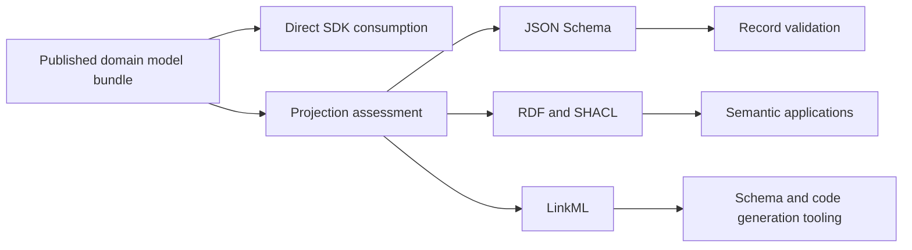
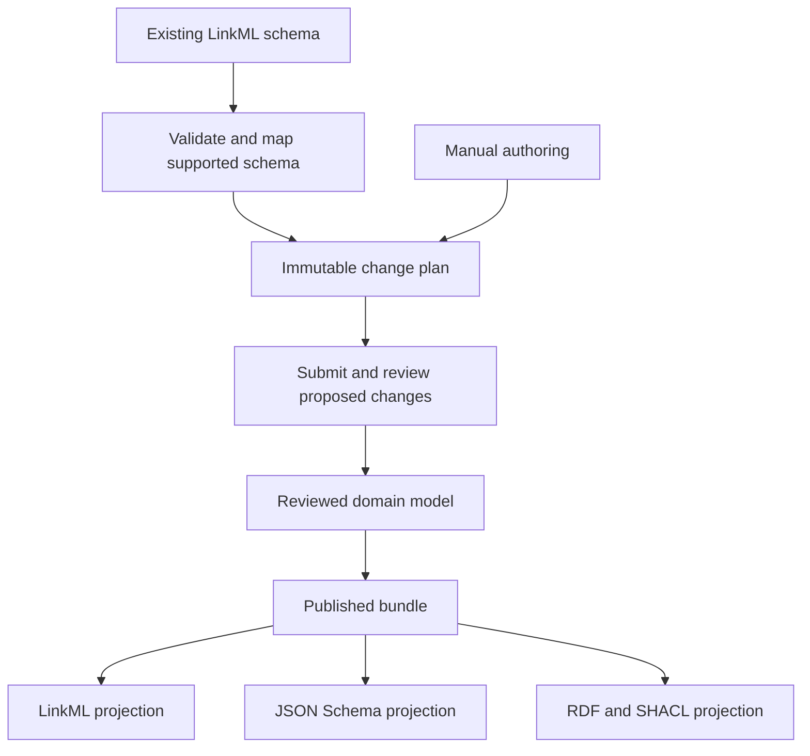

# Published models and interoperability

[Architecture overview](../../ARCHITECTURE.md) · [Contract index](README.md)

<a id="8-consume-the-published-model"></a>

Once a domain model has been reviewed and published, other applications need a way to use it.

Consider a manufacturer that has established the meaning of `Component`, `Machine` and `Supplier`. Its ERP needs these definitions to configure business records and validate their structure. Its knowledge graph needs them to establish relationships between business entities. Its business analysts need to understand why particular definitions were accepted.

All three applications work with the same business knowledge, but they need different representations of it.

Domain Kernel addresses this through a complete, portable model bundle and a set of projections into established formats such as JSON Schema, RDF/SHACL and LinkML.

The bundle preserves the reviewed model. Each projection represents the parts of that model that its target format can support.

## 1. Published domain models

A published Domain Kernel model is a self-contained, immutable JSON bundle.

An application can distribute the bundle as a file, store it in an artifact repository or transfer it through its own API. The receiving application does not need access to the database or infrastructure that produced it.

For example, an ERP using version `1.0.0` of a component catalog can continue using that version while business analysts review changes for version `1.1.0`.

Publishing a new version does not change the contents of the previous bundle or require existing consumers to upgrade.

### What's included in a published bundle?

A bundle preserves the model together with the information needed to understand how it was established.

| Content | Purpose |
|---|---|
| Model identity, description, kind and version | Identify the model and explain the business context it represents. |
| Definitions, relationships, constraints, processes and decisions | Describe the reviewed business knowledge. |
| Source revisions, evidence citations and proposal snapshots | Trace definitions back to their supporting evidence and original interpretations. |
| Reference dispositions and materialized reference packs | Preserve the reference knowledge and obligations used by the model. |
| Review decisions, validation results and publication readiness | Explain how the model was reviewed and whether its required checks passed. |
| Nonblocking questions | Identify reviewed uncertainties that did not prevent publication. |
| Publication records, approvals, hashes and dependency pins | Preserve the identity, integrity and lineage of the released model. |

A bundle contains the complete published model, but not necessarily the original business documents or the producer's entire operational audit history.

Evidence citations identify the source revisions and locations behind a definition. Whether the original documents or extracted passages remain accessible depends on the configured retention policies and source availability.

When a model has no reference pack, the bundle records that absence explicitly as `null`. The corresponding reference-pack pins in the candidate, publication and validation report are also nullable.

Active reference mappings remain empty, although historical records may preserve earlier reference-pack selections. The semantic-mapping version remains explicit even when no reference pack is selected.

## 2. Load and consume a bundle independently

The simplest way to exchange a domain model is to serialize its published bundle.

### Serialize a published model

Retrieve the exact version you intend to distribute:

```python
from pathlib import Path

published = await model.get_version(version="1.0.0")

bundle_path = Path("component-catalog.bundle.json")
bundle_path.write_bytes(data=published.serialize())
```

If the application already holds the bundle returned by `publish()`, it can serialize that object directly without retrieving it again.

`serialize()` returns JSON bytes. Writing those bytes to a filesystem, uploading them to an artifact repository or sending them over a network remains the responsibility of the application.

### Deserialize a published model

A separate application can load the same bundle without creating a Domain Kernel client:

```python
from pathlib import Path

from domain_kernel import DomainModelBundle

payload = Path("component-catalog.bundle.json").read_bytes()

bundle = DomainModelBundle.deserialize(
    payload=payload,
)

print(f"Version: {bundle.version}")
print(f"Model kind: {bundle.kind.value}")

for definition in bundle.content.definitions:
    print(f"{definition.display_name}: {definition.meaning}")
```

The receiving application can inspect the reviewed definitions, their supporting evidence references and the decisions recorded in the publication.

For example, it can also inspect questions that remained open when the model was published:

```python
for question in bundle.publication.nonblocking_questions:
    print(question.text)
```

These are loaded, immutable SDK values. Inspecting them does not perform additional database queries or retrieve evidence automatically.

### Inspect the bundle format

Applications that need to process the serialized format independently can retrieve its JSON Schema:

```python
from domain_kernel import DomainModelBundle

wire_schema = DomainModelBundle.get_json_schema()
```

The method returns JSON Schema text describing the complete bundle format.

The current supported bundle schema version is `1.0`. Callers can select it explicitly or use the version recorded in a loaded bundle:

```python
wire_schema = DomainModelBundle.get_json_schema(
    schema_version=bundle.schema_version,
)
```

The bundle schema version identifies the serialization contract. It is separate from a business model version such as `1.0.0`.

It is also separate from the JSON Schema projections described later in this document. The bundle schema describes Domain Kernel artifacts. A business-data projection describes records belonging to a particular business domain.

Unsupported bundle schema versions raise `UnsupportedBundleVersionError`.

### Bundle validation and trust

Receiving a domain model from another application introduces two separate questions:

1. Is the bundle structurally valid and consistent with its recorded content?
2. Is the producer authorized and trustworthy?

Domain Kernel addresses the first question through deserialization.

`DomainModelBundle.deserialize()` verifies:

- The supported wire format and its typed records.
- Internal references and dependency bindings.
- Content hashes.
- Publication and approval bindings.

The method accepts JSON bytes or text. Callers can also provide an `expected_hash` to verify the exact received payload.

The `max_bytes` parameter bounds the accepted payload size and defaults to 64 MiB.

Invalid content raises `InvalidBundleError`. Unregistered schema versions raise `UnsupportedBundleVersionError`.

Bundle wire version `1.0` requires explicit type tags, fields, nullable values and strict scalar representations. Unknown fields, discriminators and malformed records are rejected rather than silently ignored.

Canonical JSON provides reproducible content hashes.

These checks establish the structural integrity of the artifact. They do not establish the identity of its publisher.

For example, a malicious producer could construct an internally consistent bundle containing fabricated business definitions and approval records. Its hashes might be valid even though its contents should not be trusted.

Consumers therefore need an appropriate distribution and trust mechanism, such as a trusted artifact repository, authenticated transport or an independently established expected hash.

Deserialization also does not retrieve the original evidence, reauthenticate historical reviewers or rerun optional semantic validators.

Serialization, deserialization and wire-schema retrieval are synchronous operations over supplied values. They require no client, actor, database, network access, inference provider or optional semantic adapter. They create no operational audit records.

## 3. From published models to projections

The complete bundle is useful when an application needs to understand the reviewed model and its history.

However, not every application needs to work directly with Domain Kernel's internal definition types.

An application accepting supplier records might only need a JSON Schema describing the permitted fields. A semantic application might need an RDF ontology and SHACL shapes. A schema-oriented development platform might prefer LinkML.

Domain Kernel generates these representations from the same published model.



The complete JSON bundle remains the authoritative portable representation. Projections are derived artifacts, not separately editable models that must be kept synchronized.

### What each format provides

| Format | Typical use |
|---|---|
| Domain Kernel bundle | Exchange the complete reviewed model, including its evidence, decisions and dependency history. |
| JSON Schema | Describe supported structures and constraints for JSON business records. |
| RDF | Represent business concepts, relationships, semantic links and associated metadata as a graph. |
| SHACL | Describe supported validation requirements for RDF graphs. |
| LinkML | Exchange supported schema definitions with schema-oriented applications and generators. |

JSON Schema projections follow the supported JSON Schema 2020-12 mapping. RDF projections are available in supported Turtle and JSON-LD formats. LinkML schemas can be represented in YAML or JSON.

The SDK does not provide a generic YAML serialization of its complete bundle.

Each projection has its own versioned mapping contract. A format being supported does not mean that every Domain Kernel definition can be represented in it.

### Why projections have limitations

Consider a model that defines a supplier identifier.

JSON Schema can require every supplier record to contain an identifier of a particular type. It cannot independently establish that the identifier is unique across every supplier record in an application database.

The model's uniqueness requirement remains meaningful, but enforcing it requires knowledge of other records.

Other differences are harder to accommodate. A domain model may distinguish between a missing field and a field containing an empty collection. An RDF representation that produces no triples in either case cannot preserve that distinction.

Domain Kernel handles these situations differently.

If a target can preserve a requirement but cannot enforce it, the SDK records what the consuming application must enforce.

If the representation itself loses a required meaning, the projection is rejected.

This distinction is the basis of projection assessment.

## 4. Assess a projection before exporting

A consuming application can inspect whether a published model is compatible with a target format before generating an artifact.

Use `bundle.assess_projection(request=...)` to assess the selected model and its required dependency closure.

The operation returns a `ProjectionAssessment`. It works directly with a published bundle and does not require the producing application's client or artifact store.

### Supported assessment requests

| Request | Purpose |
|---|---|
| `JsonSchemaProjectionRequest` | Select a root definition and base IRI for JSON Schema generation. |
| `RdfProjectionRequest` | Select RDF syntax, base IRI and a nominal `MappingId`. |
| `LinkmlProjectionRequest` | Select LinkML mapping options and an optional subset of definitions. |

The assessment follows the references and exact published dependencies required by the selected projection.

For RDF, it covers all four generated graph roles, even when an eventual export selects only one of those graphs.

The complete JSON bundle does not require projection assessment.

### How assessment works

The assessment considers two independent questions for each selected feature:

- Can the target format represent the feature?
- Who is responsible for validating or enforcing it?

These questions must remain separate because a format can preserve information without being able to validate every requirement associated with it.

Representation outcomes are:

| Outcome | Meaning |
|---|---|
| `NATIVE` | The target format directly represents the feature. |
| `ANNOTATED` | The feature is preserved through declared metadata or annotations. |
| `UNSUPPORTED` | The selected mapping cannot preserve the feature. |

Validation responsibility is classified separately:

| Responsibility | Meaning |
|---|---|
| `TARGET` | The target's supported validation mechanisms enforce the requirement. |
| `HOST` | The consuming application must enforce the requirement. |
| `NOT_APPLICABLE` | The feature is descriptive and does not require operational validation. |
| `UNSUPPORTED` | The required validation cannot be supported under the selected contract. |

For example:

| Model feature | Representation | Validation |
|---|---|---|
| A required string attribute | Native JSON Schema | Target |
| A composite business key | Preserved key metadata | Host |
| A descriptive purchasing process | Supported descriptive metadata | Not applicable |
| A collection whose required presence cannot be preserved | Unsupported | Unsupported |

An open LinkML vocabulary may be represented as a native string type with annotations describing known codes. The fact that the annotations are descriptive does not require an application to restrict values to those codes.

A host-enforced requirement must refer to an exact existing `ConsumerObligation`. The assessment cannot invent an obligation as a way to make an otherwise unsupported projection succeed.

### Understand the assessment report

A `ProjectionAssessment` records:

- The exact source model and projection request.
- Mapping and library versions.
- Capability availability.
- Feature-level findings and diagnostics.
- Aggregated consumer obligations.
- A deterministic content hash.

Each `ProjectionFinding` identifies the affected location, representation outcome, validation responsibility, explanation and suggested remedy.

Locations use exact pinned definitions and, where applicable, nominal attribute, key or code identifiers.

For example, a finding can identify a collection attribute whose equality requirements cannot be fully enforced by the target validator. If its representation preserves the required semantics, the report can identify the corresponding host obligation.

Aggregated obligations form a deterministic, deduplicated union of the individual findings.

### Determine whether export is possible

The assessment's `exportable` result indicates whether the selected representation can be generated without unsupported findings or assessment errors.

An exportable model may still contain requirements that must be enforced by the consuming application.

Capability availability is evaluated separately. An `AVAILABLE` result requires the selected mapping to be resolved and every selected feature to be assessed, including features that turn out to be unsupported.

Missing adapters, unknown mappings and failed analysis produce explicit availability results or diagnostics rather than apparently successful partial assessments.

Suggested remedies may include:

- Installing a required optional dependency.
- Selecting a different projection format.
- Enforcing a declared host obligation.
- Using the complete bundle instead.
- Creating a separately reviewed model with a different supported contract.

Assessment is advisory. It does not modify the model or authorize changes to its requirements.

### Assessment and export guarantees

Assessment and serialization use the same target-specific analysis through the existing `ModelExporter`, `SemanticProjector` and `LinkmlMapper` ports.

The SDK does not introduce a separate projection-planning framework or capability registry.

Export assesses the exact bundle and typed request again before writing an artifact. A previous assessment is not an approval token and cannot be used to bypass validation.

If the selected projection is not exportable, the operation raises `ProjectionBlockedError` with the corresponding assessment before writing an artifact.

Missing projection adapters, unsupported mapping versions and analysis failures are represented through the assessment. Invalid input, scope violations, authentication failures and storage failures retain their own typed errors.

Assessment hashes cover the source, request, mapping and library versions, and the assessment results. The hash field itself is excluded.

The operation performs no network access, inference, instance validation, model writes or dependency installation.

Unlike publication preparation, assessment is diagnostic information rather than a persisted authorization snapshot.

## 5. Export a published model

Applications can serialize a complete bundle themselves or use the SDK's configured artifact stores.

The stored export operation is useful when an application already uses Domain Kernel to manage its models and wants an attributed record of artifact delivery.

### Export the complete bundle

```python
artifact = await model.export(
    actor="user:model-editor",
    bundle=published,
    store="artifacts",
    path="models/catalog-1.0.0.json",
)

print(f"{artifact.store}/{artifact.key}")
```

Omitting the projection request, or explicitly passing `request=None`, exports the complete bundle.

The resulting content is identical to the bytes returned by `published.serialize()`.

The SDK reloads the exact stored publication and verifies the supplied bundle's scope, identity and content hash.

It does not substitute the latest published version or the current workspace.

A detached consumer can inspect and assess a bundle independently. Export through `model.export()` requires the corresponding publication to exist in the bound model.

### Export a JSON Schema projection

A JSON Schema projection starts with an explicit root definition.

For example, an inventory application might need a schema describing component records:

```python
from domain_kernel import Iri, JsonSchemaProjectionRequest

component = published.get_concept(name="component")

request = JsonSchemaProjectionRequest(
    root=component,
    base_iri=Iri(value="https://example.org/domains/"),
)

assessment = published.assess_projection(
    request=request,
)

if assessment.exportable:
    artifact = await model.export(
        actor="user:model-editor",
        bundle=published,
        store="artifacts",
        path="models/catalog-1.0.0.schema.json",
        request=request,
    )

    for limitation in artifact.projection_limits:
        print(limitation)
```

The request determines the output format. Changing the destination filename or its extension does not change the selected projection.

There is no separate `format`, `schema` or `semantic` argument.

The root can be an inspected concept or structured-value definition, an appropriate identifier or an exact pinned definition reference.

When an inspected definition is supplied directly, the SDK verifies its scope, identity, revision and complete content against the selected bundle. The definition must be active and of a compatible kind.

Dependency roots retain their exact published pins.

Equivalent object and reference inputs normalize to the same canonical projection identity. The request manifest does not embed a second copy of the supplied definition.

Foreign, missing, mismatched or incompatible roots fail before artifact writes. The SDK does not substitute another revision.

The `base_iri` establishes stable identities for generated resources.

### Export RDF graphs

An `RdfProjectionRequest` selects the RDF mapping and syntax.

When exporting through `model.export()`, the `role` argument selects the required root-model graph. It defaults to `SemanticGraphRole.ONTOLOGY`.

Other generated graph roles can be selected explicitly.

The SDK assesses all four graph roles and the required dependency closure before writing the selected graph.

This prevents callers from exporting an apparently valid ontology graph while bypassing unsupported semantics elsewhere in the selected model.

The `role` argument is specific to RDF projections and is invalid for other projection requests.

### Artifact integrity

An exported artifact contains both its payload and metadata describing the contract under which the payload was generated.

Relevant metadata includes:

- Source model and dependency pins.
- Mapping version.
- Content hash.
- Projection limitations.
- Applicable consumer obligations.
- Semantic graph information, where relevant.

An existing immutable artifact can be reused only when its content bytes and required metadata match.

Identical file hashes are not sufficient when the artifacts carry different consumer obligations or semantic metadata.

## 6. Supported business-shape mappings

The complete Domain Kernel bundle can represent business constructs that individual projection formats cannot express.

The following table describes the bounded `1.0` projection mappings implemented in this revision.

| Business feature | JSON Schema | RDF / SHACL | LinkML |
|---|---|---|---|
| Closed vocabulary | String `enum` | `sh:in` with code metadata | Static permissible values |
| Open vocabulary | String with known-code annotations | Open strings with known-code metadata | Permissive string with versioned annotations |
| Required single value | Property schema and object `required` | `sh:maxCount 1` and `sh:minCount 1` | Required scalar slot |
| Unordered set | Array bounds, independent presence and `uniqueItems` | Supported count and presence combinations | Multivalued slot with bounds and host obligation |
| Required collection that may be empty | Supported | Unsupported by direct-predicate mapping | Supported representation with host obligation |
| Optional collection that must be nonempty when present | Supported | Unsupported by direct-predicate mapping | Supported representation with host obligation |
| Ordered list | Ordered array | Unsupported | Unsupported |
| Nullable single value | Union with `null` | Unsupported | Unsupported |
| Structured value | Embedded `$defs` and `$ref` | Structured node shape | Inlined class without identifier |
| Reusable units and quantity bindings | Typed metadata and magnitude/unit shape | Labelled unit resources and code bindings | Code values and versioned unit annotations |
| Business keys | Consumer obligation | Metadata and consumer obligation | Supported `unique_keys` and consumer obligation |
| Decimal facets | Unsupported | Unsupported | Unsupported |
| Localized terminology | Versioned annotations | SKOS labels and descriptions | Versioned annotations |

These mappings are separate from the complete bundle wire schema.

Reusable units, optional quantity kinds and their associated annotation schemas belong to the current `1.0` mapping contracts.

Capability declarations, codecs, importers, validators and conformance fixtures must agree before a feature is advertised as supported.

Incompatible changes to a released wire or mapping contract require a new registered version. Readers and exporters that do not support that version fail explicitly.

### Presence and collection size

Consider an application that maintains a list of approved supplier codes.

A model may require the field to exist while allowing it to contain no codes. Alternatively, it may allow the field to be absent but require at least one code whenever it is supplied.

These are different requirements.

Domain Kernel therefore treats field presence and collection size independently:

| Presence | Minimum size | Missing field | Empty collection |
|---|---:|---|---|
| Optional | 0 | Allowed | Allowed |
| Required | 0 | Rejected | Allowed |
| Optional | 1 | Allowed | Rejected |
| Required | 1 | Rejected | Rejected |

JSON Schema can represent all four combinations using the object's `required` property and the array's `minItems` constraint.

The initial RDF direct-predicate mapping cannot represent all four combinations because missing and empty collections produce the same absence of value triples.

LinkML preserves the presence and cardinality information, but consumers must enforce the original distinction before normalization.

A host obligation cannot make a representation supported if the representation has already discarded the distinction.

### Equality and collection uniqueness

A set contains distinct values according to the meaning of its declared value type.

For strings, equality is exact Unicode equality, including case. Domain Kernel does not implicitly trim or normalize string values.

For other value types, distinct serialized representations may identify the same value.

For example, two timestamps with different timezone offsets can describe the same instant. A validator comparing their serialized strings might treat them as different even though they represent equal datetime values.

When a target can represent the set but cannot fully enforce its typed equality requirements, Domain Kernel records a `CollectionSemanticsObligation`.

The obligation tells the consuming application which additional checks it must perform.

The initial mappings use the following rules:

- Exact string and code sets may use native JSON Schema uniqueness or supported RDF/SHACL datatype and count semantics without an additional host uniqueness obligation.
- Numeric, date, datetime and reference sets retain host obligations for their applicable equality semantics.
- Hosts compare canonical values and reject duplicates rather than silently removing them.
- LinkML set projections retain obligations covering presence, item bounds and distinctness because no particular generated validator is guaranteed.
- Nullable collection items and nested collections are outside the initial projection contracts.
- RDF sets of structured values are unsupported because blank-node identity does not establish equality of the represented structures.

`CollectionSemanticsObligation` may delegate validation of preserved presence, item-count and equality requirements. It cannot authorize a lossy representation.

### Decimal values

Domain Kernel's complete bundle preserves decimal values and their supported facets.

The initial projection mappings do not claim to preserve every decimal precision and scale constraint across target formats.

Consequently, decimal facets are unsupported by the current projections.

Unfaceted decimal JSON instances use JSON numbers. Consumers that require exact decimal handling should use decimal-aware parsing.

The SDK's own wire records preserve exact canonical decimal strings.

## 7. JSON Schema mapping

JSON Schema is useful when an application needs to validate the structure of individual business records.

For example, a reviewed `Component` definition may describe a required component number, an optional description and a reference to a manufacturer.

The generated JSON Schema describes the supported structure of a component record. It does not create records, establish that a component number is unique across a database or verify that the referenced manufacturer exists.

Those requirements remain part of the wider consumer contract.

### JSON Schema identity and references

Every JSON Schema projection starts with an explicit root concept or structured-value definition and a stable `base_iri`.

The schema's `$id` follows the versioned model identity path, ending in `schemas/{definition_id}`.

Reusable definitions appear under `$defs`, with keys derived from stable scoped identities rather than display labels.

For attributes, the stable attribute `name` becomes the JSON property name.

Generated `AttributeId` values remain identity metadata and reference targets. They do not become user-facing property names.

This allows a definition's display label to change without unnecessarily changing the corresponding JSON property.

Projection manifests retain the mapping between each property name, its owning definition and its attribute ID.

The following property names and prefixes are reserved:

- `@id`
- `@type`
- `rel:`

### Represent concepts and references

A concept describes independently identifiable business records.

Each projected concept record requires:

- `@id`, containing an absolute IRI identifying the record.
- `@type`, containing the exact projected class IRI.

A reference to another concept uses an envelope containing only these two properties.

For example, a component record might reference a supplier through its identity and projected type:

```json
{
  "@id": "https://example.org/records/components/c-123",
  "@type": "https://example.org/types/component",
  "component-number": "C-123",
  "supplier": {
    "@id": "https://example.org/records/suppliers/s-42",
    "@type": "https://example.org/types/supplier"
  }
}
```

This is an illustrative business record. Actual class IRIs follow the SDK's versioned identity mapping.

The referenced supplier is not embedded recursively into the component record.

Reference identity is based on `@id`, independently of display information.

Reference envelopes are closed. Concept records remain open unless a separately supported constraint closes them.

### Represent structured values

A structured value groups related information without giving that information an independent operational identity.

For example, a postal address may contain a street, city and postal code.

Unlike a concept reference, an embedded structured value contains its own fields directly and does not require `@id` or `@type`.

Structured-value schemas use `$defs` and `$ref` to represent supported reusable structures.

They remain open unless explicitly closed by a supported constraint.

### Represent relationships

Binary relationships use properties named according to the `rel:{relationship_id}` convention.

Their values are arrays of target identity envelopes with distinct IDs and explicit cardinality bounds.

The generated schema can describe the number and structure of the references contained within an individual record.

It cannot independently establish whether:

- The referenced records exist.
- Their actual types match the declared target.
- Their identities are unique within the consuming dataset.
- Incoming relationship participation satisfies inverse cardinality requirements.

The projection records these requirements as consumer obligations.

### Validate supported record shapes

The JSON Schema mapping preserves supported scalar types, structured values, references, vocabularies, nullability and collection requirements.

Field presence maps to the owning object's `required` array. Collection size maps independently to `minItems` and `maxItems`.

Dates and datetimes use declared formats. Consumers must enable format assertions in their validator before claiming conformance with those requirements.

Unsupported inherited constraints, formal axioms and custom constraints block projection rather than being omitted.

For the underlying format semantics, see [JSON Schema object presence](https://json-schema.org/understanding-json-schema/reference/object#required-properties), [array length](https://json-schema.org/understanding-json-schema/reference/array#length) and [JSON Schema 2020-12 validation](https://json-schema.org/draft/2020-12/json-schema-validation).

## 8. Consumer obligations

Some business requirements need information outside an individual projected record.

For example, an equipment model may declare that an asset code must be unique within a particular site.

The requirement can be expressed as a business key over two fields:

```text
(site, asset_code)
```

A schema can require both fields to be present. Enforcing their combined uniqueness requires access to the application's operational dataset.

Domain Kernel preserves that requirement as a consumer obligation.

`ConsumerObligation` is a closed union covering:

| Obligation | Host responsibility |
|---|---|
| Business keys | Enforce the declared uniqueness requirements against operational records. |
| Reference targets | Verify that referenced records exist and satisfy their declared identity and type requirements. |
| Relationship constraints | Enforce requirements that depend on relationships across records, including inverse participation. |
| Collection semantics | Enforce preserved collection presence, size and typed equality requirements where target validation is insufficient. |

Each obligation identifies the exact published definition and any applicable attribute or key.

The application must bind these obligations to its own operational data and validation mechanisms before claiming that its records conform to the model.

### Preserve obligations in artifacts

JSON Schema artifacts carry consumer obligations and source mapping metadata under `x-domain-kernel`.

The typed obligations are also available through `Artifact.consumer_obligations`.

`ExportPayload` and `ArtifactWrite` preserve the same obligations and semantic metadata through the artifact storage boundary.

RDF and LinkML manifests retain their applicable obligations as well.

This ensures that an application receiving an artifact can determine which requirements remain its responsibility.

A schema validator returning a successful result establishes only the requirements that the validator actually evaluated.

Model acceptance checks belong to the publication's validation metadata. They do not automatically become constraints on individual operational records.

### Preserve unit metadata

Reusable units and quantity bindings introduce additional metadata that is relevant to consumers.

For example, a pressure measurement may contain a decimal magnitude and a code identifying the permitted unit.

The unit's business meaning, symbol and external ontology reference remain useful even though the operational record contains only the unit code.

JSON projections preserve this information through:

- `x-domain-kernel.units`
- `x-domain-kernel.unit_bindings`

These contain versioned `UnitAnnotation` and `UnitBindingAnnotation` records for the relevant reference closure.

They preserve unit names, meanings, symbols, localized terminology, exact source pins, code-to-unit relationships and optional quantity-kind information.

Unit annotations are metadata resources. They are not additional operational record schemas or alternative unit values.

Adding unit metadata does not change the magnitude's type, the field's requiredness or the permitted unit codes.

## 9. RDF and SHACL mapping

Semantic applications often need to work with business knowledge as a graph rather than as a collection of record schemas.

RDF represents concepts, properties and relationships through identified resources and statements. SHACL can describe supported requirements for validating RDF graphs.

Domain Kernel projects its reviewed model into these representations while preserving the distinction between business definitions, model metadata and operational data requirements.

### Project a model into RDF

The standalone `project_semantics(bundle=..., base_iri=...)` operation generates an RDF projection from a published bundle.

It does not require a producing database or Domain Kernel client.

The caller supplies a stable, absolute HTTP or HTTPS base IRI ending in `/`, without a query or fragment.

The base IRI determines the identities of generated resources. Changing it changes those identities.

Applications should therefore choose a stable base IRI before distributing semantic projections that other systems will reference.

### RDF identity and vocabulary contract

The versioned `dk-rdf/1.0` mapping defines the following identity conventions.

| Resource | Identity |
|---|---|
| Model | `{base}projects/{project}/models/{model}/` |
| Definition | `{model_path}definitions/{definition_id}` |
| Attribute or constraint | A path beneath its owning definition |
| Definition revision | `{definition_path}/revisions/{revision}` |
| Snapshot graph | `{model_path}versions/{version}/{role}` |

Opaque identifier and version segments use UTF-8 percent encoding.

Public resource identities derive from stable SDK identities, not mutable display labels.

Cross-model references use the dependency's scoped resource IRI and preserve its exact published version pin.

The projection materializes the required dependency graphs from bundled dependencies using the same base IRI. It does not resolve another model's latest version or retrieve remote ontology contexts.

Private structural blank nodes may appear within output graphs, but public definition identities do not depend on them.

### Separate graph roles

Domain Kernel generates four distinct graph roles:

| Graph role | Purpose |
|---|---|
| Ontology | Represent concepts, properties and explicitly reviewed formal semantic relationships. |
| Model metadata | Preserve definition identities, business meanings, provenance and SDK-specific metadata. |
| Model shapes | Represent supported validation requirements concerning the domain model itself. |
| Instance shapes | Represent supported validation requirements concerning operational RDF records. |

Each role has its own named-graph identity.

Turtle and JSON-LD artifacts represent their declared graph content. The accompanying metadata identifies the graph into which a consumer should load the document.

Keeping these roles separate allows applications to select the information needed for their task without treating descriptive metadata as operational records or validation requirements as ontology axioms.

Consumers should select an exact model version and its required dependency closure rather than indiscriminately combining graphs from historical releases.

### Mapping domain definitions to RDF

| Domain construct | RDF representation |
|---|---|
| Concepts | Stable `rdfs:Class` resources with supported RDFS and SKOS annotations. |
| Attributes | Scoped `rdf:Property` resources with supported XSD datatypes or referenced classes. |
| Relationships | Typed RDF properties with declared source and target classes. |
| Semantic links | Explicitly reviewed standard predicates between resolved resources. |
| Adopted ontology modules | Exact formal ontology closures retained separately from generated graphs. |
| Reusable units | Stable resources typed as `dk:Unit`, with names, meanings and optional symbols. |
| Requiredness and cardinality | SHACL shapes expressing supported validation semantics. |
| Terminology and mappings | SKOS annotations and qualified mapping records. |
| Evidence and revisions | PROV-O relationships and SDK-specific metadata. |
| Processes, decisions and rules | Descriptive metadata expressed through the versioned SDK vocabulary. |

Supported scalar types map to their corresponding XSD datatypes, including `xsd:dateTime` for datetimes.

The model description remains model-level metadata rather than being copied into each definition's annotations.

Stable lookup names remain SDK metadata. Display names, meanings, aliases and explicitly supplied localized terminology provide the corresponding human-readable annotations.

Reference alignments remain distinct from formal semantic links. An ordinary business mapping does not automatically create an OWL identity or equivalence assertion.

### SDK extension vocabulary

Some information represented in a Domain Kernel model does not have a direct equivalent in RDF, RDFS, OWL, SHACL or SKOS.

The versioned `dk:` extension vocabulary preserves this information without redefining the semantics of those standards.

The current mapping uses the vocabulary IRI:

```text
https://domain-kernel.invalid/vocabulary/dk-rdf/1.0#
```

It identifies the SDK-specific metadata contract associated with this mapping version.

The use of this IRI does not require a network request.

The projection preserves definition IDs, revisions, exact model pins and local attribute or constraint paths.

### Units and quantity bindings in RDF

Units are independently reusable definitions and therefore follow the ordinary definition IRI convention, including exact dependency scope.

Neither a unit's label nor its symbol establishes its identity.

Unit resources use `dk:Unit`, with `rdfs:label`, `rdfs:comment` and an optional `dk:symbol`. Language-tagged annotations are generated only where the model explicitly supplies localized terminology.

Code-to-unit relationships, optional ontology pins and nullable quantity kinds remain explicit model metadata.

In operational RDF, unit values remain exact string literals. A closed set of permitted unit codes retains its `sh:in` requirement.

The projection does not implicitly convert unit codes into unit-resource IRIs.

Referencing an external ontology term also does not generate `owl:sameAs`, a SKOS mapping or a formal ontology import.

A resource being typed as `dk:Unit` does not by itself classify it as a SKOS concept.

### External ontology modules

A generated RDF projection may depend on formal ontology resources that originated outside Domain Kernel.

`SemanticProjection.ontologies` carries those original materialized closures separately from the generated graphs.

A reviewed `OntologyModuleDefinition` activates its declared root closure. A term reference alone does not activate its source ontology's axioms.

Consumers assemble the asserted graphs and adopted formal closures needed for their particular semantic task.

Named-graph membership identifies how statements are organized. It does not itself establish logical import relationships or access permissions.

`SemanticProjection.ontology_dependencies` records the exact adopted `OntologyClosurePin` values.

When a single graph is exported, its applicable dependencies remain available through `Artifact.semantic.ontology_dependencies`.

Resources retained only for provenance are not presented as formal imports.

`Artifact.semantic` also records the source pin, graph identity, role and mapping version.

Payload hashes identify exact serialized bytes. They do not claim RDF graph isomorphism or logical equivalence.

Individual RDF graphs therefore cannot replace the complete semantic projection manifest. A complete Domain Kernel round-trip requires the original JSON bundle.

## 10. Model validation and operational data validation

A domain model describes how business information should be understood. Operational records describe actual things that exist or events that have occurred.

Validation requirements can apply to either.

Consider a manufacturer defining the concept `Machine`.

The domain model might be required to distinguish a machine from a machine type. An operational machine record might separately be required to contain an asset code.

The first requirement concerns the model. The second concerns its instances.

Domain Kernel distinguishes these targets explicitly.

| Constraint target | Purpose |
|---|---|
| `ConstraintTarget.MODEL` | Validate requirements concerning the definition model. |
| `ConstraintTarget.INSTANCE` | Describe validation requirements for operational records. |

Model validation is the default target.

### Validate model metadata

During publication preparation, supported model-target semantic constraints are evaluated against a temporary RDF metadata graph.

The `SemanticProjector.validation_graphs` port receives the candidate and its optional materialized reference pack directly.

This allows validation to take place before a final model version or publication authorization exists.

Temporary resources use the following identity convention:

```text
https://domain-kernel.invalid/validation/{encoded_candidate_hash}/
```

The identities retain the exact candidate and dependency pins. Generated graph nodes can be mapped back to diagnostic locations in the model.

The temporary representation follows the published semantic mapping rules but does not become a public export identity.

The SDK does not need to fabricate an approval or construct a published bundle merely to validate a candidate.

### Generate instance shapes

Instance-target constraints describe requirements intended for downstream operational records.

During model preparation, the SDK checks their supported syntax, references and completeness. It does not evaluate them against a production dataset.

Applications can use generated SHACL shapes to perform instance validation in their own environment.

The initial mapping uses supported constructs including:

| SHACL construct | Purpose |
|---|---|
| `sh:targetClass` | Identify the concepts to which a shape applies. |
| `sh:datatype` | Validate supported scalar datatypes. |
| `sh:class` | Describe required resource types. |
| `sh:node` | Apply supported structured-value shapes. |
| `sh:in` | Restrict values to a closed vocabulary. |
| `sh:minCount` and `sh:maxCount` | Express supported cardinality bounds. |
| `sh:inversePath` | Express incoming relationship requirements. |

Single-valued attributes have `sh:maxCount 1`. Required single-valued attributes additionally have `sh:minCount 1`.

Collection item bounds do not apply to single-valued attributes.

### Collection presence in RDF

RDF normally represents the values of a property as statements connecting the subject to each value.

Consider a machine with no assigned inspection codes.

An empty collection and a missing collection both produce no value statements under the initial direct-predicate mapping.

The representation therefore cannot distinguish the two cases.

For this reason, the mapping supports:

- Optional sets whose minimum item count is zero.
- Required sets whose minimum item count is positive.

Other presence and minimum-count combinations are rejected.

The SDK does not delegate these unsupported combinations to a host equality obligation because the representation itself has already lost the necessary information.

This limitation follows from the selected mapping and [SHACL's value-node count semantics](https://www.w3.org/TR/shacl/#MinCountConstraintComponent).

### Relationship participation

Relationship shapes preserve outgoing cardinality bounds directly and incoming bounds through inverse paths.

Relationship convenience factories default to zero minimum participation. A caller must supply explicit positive minimums to establish mandatory participation.

Generated shapes remain open with `sh:closed false`, unless a separately supported constraint closes them.

### Validation execution boundaries

The optional pySHACL adapter performs supported validation through the SDK's validator port.

Only registered declarative constraint subsets are executed.

Remote imports, SHACL-JS, arbitrary code execution and uncontrolled SPARQL extensions are outside the supported validation contract.

Unsupported required semantics cause explicit validation or projection failures.

Validating an operational RDF graph remains an application responsibility. SHACL does not implement application authorization, transaction handling, workflow execution or scheduling.

## 11. Formal semantics and ontology reasoning

Business terms may be related in several different ways.

A manufacturer might establish that its definition of `Part` is narrower than an external definition of `Component`. That can be a useful reviewed business mapping even when the two definitions have not been formally expressed as ontology classes.

A formal semantic relationship makes a more specific assertion about the resources and their interpretation under a particular semantic regime.

Domain Kernel keeps these operations separate.

### Business mappings and formal semantic links

A reference-alignment decision such as `same_as()` establishes reviewed equivalence of business meaning within its declared context.

Its stored `MappingRelation.EQUIVALENT` does not automatically imply any of the following formal assertions:

- `owl:equivalentClass`
- `owl:sameAs`
- `skos:exactMatch`

Similarly, a reviewed narrower-than business mapping does not automatically establish an `rdfs:subClassOf` assertion.

These predicates have distinct formal meanings and consequences.

Domain Kernel requires formal relationships to be authored explicitly through `SemanticLinkDefinition` and accepted through the ordinary review lifecycle.

Supported links include subclass and subproperty relationships, class and property equivalence, disjointness, inverse properties, SKOS mappings, individual identity and difference, and documentation links.

Endpoints use `ModelTermReference`, including supported scoped attribute paths, or original `OntologyTermReference` values.

The SDK validates endpoint kinds, exact dependency pins and resolution to active definitions or materialized ontology resources.

Ordinary unresolved documentation links may remain annotations rather than executable dependencies.

Local definitions retain their own IRIs. External terms retain their original identities.

Projection manifests preserve both identities, their source pins and the declared relationships.

### Understanding formal inheritance

Inheritance in an ontology is different from inheritance in an object-oriented programming language.

Suppose an ontology declares `ElectricMotor` as a subclass of `Machine`.

This means that every instance of `ElectricMotor` is also an instance of `Machine`.

It does not mean that an electric motor is physically part of a machine. It also does not establish workflow order or cause the SDK to inherit Python fields.

Formal subclass relationships support multiple inheritance.

If two classes are subclasses of one another, their logical relationship may establish class equivalence. This is not necessarily an invalid cycle.

Constraints inherited from several parents combine according to their formal semantics rather than following a last-parent-wins override policy.

A class can also become unsatisfiable without making the entire ontology inconsistent. For example, a class defined as a subclass of two disjoint classes may have no possible instances while the rest of the ontology remains consistent.

The SDK preserves direct assertions separately from inferred hierarchies and effective views. Reasoning results retain their source and reasoning provenance.

Applications that flatten inherited schemas into operational configurations must explicitly resolve supported inherited fields and any resulting collisions.

### Open-world semantics

OWL generally uses an open-world assumption.

Under this assumption, missing information does not automatically mean that something is false. Different names also do not necessarily identify different individuals.

Consider an ontology stating that every machine has a manufacturer.

If a particular machine has no manufacturer statement in the available graph, OWL may allow the possibility that a manufacturer exists but has not been identified in the data.

A SHACL shape requiring a manufacturer value addresses a different question: does the supplied graph actually contain the required information?

The distinction also applies to RDFS domain and range declarations. These declarations can establish inferred types rather than function as record-validation rules.

Formal reasoning therefore cannot be treated as a replacement for operational validation.

Inference also does not merge Domain Kernel's local definition identities or enforce transactions in consuming applications.

### Optional semantic capabilities

Domain Kernel delegates formal semantic processing to optional adapters rather than embedding an unrestricted reasoning engine into the core model.

| Capability | Adapter contract |
|---|---|
| RDF and ontology processing | Preserve supported syntax, original bytes, graph structure, datatypes and annotations. |
| RDFS and OWL reasoning | Declare the supported semantic regime, OWL profiles, datatypes and reasoning tasks. |
| OWL Full and extensions | Preserve supported syntax and identify limitations without claiming unrestricted or terminating reasoning. |
| SHACL | Declare supported Core features, extensions and entailment preprocessing. |
| LinkML | Declare supported schema mappings and relevant generator capabilities. |
| Ontology module extraction | Declare the extraction algorithm, source closure, seed signature and semantic guarantees. |

OWL 2 EL, QL, RL and DL refer to the language profiles defined by W3C. They are unrelated to Domain Kernel reference packs.

The primary extension interfaces are:

| Interface | Responsibility |
|---|---|
| `OntologyAdapter` | Inspect and transcode supported ontology representations. |
| `OntologyReasoner` | Evaluate supported consistency, classification and entailment tasks. |
| `OntologyModuleExtractor` | Extract formal ontology modules under a declared contract. |

These interfaces exchange immutable SDK values.

The domain records remain independent of RDFLib, pySHACL, OWLAPI, ROBOT and other semantic frameworks.

The `ontology` extra provides RDFLib and pySHACL. Other reasoning and module-extraction engines depend on the explicitly available adapter implementation.

The existence of an interface does not establish that every potential engine is implemented or supported.

Applications manage external process lifecycles, credentials, transport and resource isolation where required.

Adapters must not silently download additional semantic resources, switch reasoning engines or change the selected semantic regime.

### Reasoning results and validation

The `reason_ontology()` operation evaluates a selected immutable ontology input through the configured reasoner.

Its report identifies:

- The exact ontology closure.
- The adapter and its version.
- The requested reasoning task.
- The semantic regime and profile.
- Applicable options and resource limits.
- Completion status and resulting findings.

Results distinguish successful completion, incomplete analysis, unsupported capabilities, timeouts and failures.

Consistency and entailment remain unknown unless established by the selected reasoner.

Classification completeness applies to the requested named signature. It does not imply enumeration of every theoretically entailed RDF statement.

Inferred statements remain separate from original assertions and preserve available explanations and reasoning provenance.

Inconsistent inputs are reported explicitly rather than used to derive arbitrary conclusions. Unsupported constructs and datatypes produce diagnostics rather than being silently removed.

### Reasoning during publication preparation

Applications can select `ReasoningModelValidator` to include formal reasoning in publication preparation.

The validator's fingerprint identifies its engine, profile, semantic regime, task, options and input mapping.

Its results are preserved in `ValidationReport.reasoning`.

When a reasoning requirement is mandatory, an unknown, incomplete or unavailable result blocks publication readiness.

Without the selected reasoning validator, successful publication preparation does not establish formal logical consistency.

The initial preparation validator supports consistency checking and classification of all named classes.

Scoped classification signatures and entailment queries are rejected at construction because the relevant candidate-local identities do not yet exist.

Standalone reasoning over known immutable ontology inputs can support scoped classification and entailment. Custom validators may bind queries through the shared projector.

Classification readiness requires a consistent ontology with no unsatisfiable named classes under the selected check.

Timeouts use integer milliseconds.

### Formal ontology modules

Applications may need to work with a smaller formal ontology rather than its complete source closure.

Module extraction is distinct from selecting a visually relevant subset of a domain model.

A formal extractor must declare the algorithm, selected signature, source closure, semantic regime and guarantees associated with the resulting module.

The SDK's model-slicing operations do not establish these formal guarantees.

See [formal ontology module extraction](model-evolution.md#extract-smaller-formal-ontology-modules) for the corresponding model-evolution contract.

### Adapter conformance

Semantic adapters must document their supported syntax, versions, semantic regimes, operations and tested capabilities.

Relevant conformance cases include W3C standard fixtures and Domain Kernel's own identity, graph and import-resolution tests.

OWL tool conformance requires the applicable RDF/XML input and output support.

These are adapter design and verification requirements. They are not claims that every optional adapter has achieved formal W3C certification.

Relevant specifications include [OWL Conformance](https://www.w3.org/TR/owl2-conformance/), [OWL Profiles](https://www.w3.org/TR/owl2-profiles/), [OWL Semantics](https://www.w3.org/TR/owl2-primer/), [OWL Imports](https://www.w3.org/TR/owl2-syntax/#Imports) and [SHACL](https://www.w3.org/TR/shacl/).

## 12. Optional LinkML compatibility

LinkML provides a structured way to describe schemas independently of a particular programming language or application.

For Domain Kernel, it offers two useful integration paths.

An application can export reviewed business definitions into a supported LinkML schema. It can also import an existing LinkML schema as a starting point for a new or evolving domain model.

In both cases, the Domain Kernel model and its review lifecycle remain authoritative.

The `linkml` extra implements the bounded `dk-linkml/1.0` mapping.

See the [public interoperability entry points](../../src/domain_kernel/interchange.py) and [round-trip and rejection tests](../../tests/integration/modeling/interchange/test_linkml_projection.py).

### Import and export operations

The SDK provides two standalone operations:

| Operation | Purpose |
|---|---|
| `project_linkml()` | Export selected definitions from a published bundle. |
| `load_linkml()` | Import supplied schema bytes and verified dependencies into a proposed authoring plan. |

Neither operation transports operational records, invokes inference or directly changes an approved model.

Import and export use the same underlying typed domain contracts as other Domain Kernel operations.



An imported schema is a source of proposed business knowledge. It is not automatically an approved interpretation of the receiving application's domain.

### Import and review

`load_linkml()` returns a `SchemaImportResult`.

When mapping succeeds, the result contains a proposed authoring plan that can enter the ordinary review lifecycle.

The caller supplies the inspected receiving model snapshot through `model_info=receiving_model.info`, consistent with the `DomainModelBuilder` contract.

The import operation performs no model lookup or mutation.

Imported definitions receive new local identities while preserving their source schema and element origins.

They begin as hypotheses that require review.

Matching names, labels or source IRIs do not automatically establish that an imported definition is equivalent to an existing local definition.

Imported assertions also do not become mandatory reference-pack obligations or proof that the represented business requirements are correct.

### Supported LinkML mapping

The initial mapping supports:

- Flat classes and inlined structured values.
- Closed value sets and annotated open vocabularies.
- Names, descriptions and supported localized terminology.
- Scalar and reference attributes.
- Unordered sets with supported presence and cardinality semantics.
- Declared business keys.
- Supported binary relationships.

The initial mapping rejects unsupported constructs, including dynamic enumerations, ordered lists, nullable slots, inheritance and mixins, unions, arbitrary rules and unsupported constraints.

Descriptive processes and decision tables have no executable LinkML mapping.

### Relationships and inverse slots

Domain Kernel represents a binary relationship through explicit source and target definitions and cardinality bounds in both directions.

A supported LinkML export represents that relationship using paired inverse slots with stable resource identities.

The projection manifest associates both slots with the same SDK relationship.

During import, the SDK reconstructs a relationship only when the inverse pair and directional bounds are unambiguous.

A supported reference slot without such a pair becomes a reference attribute.

Names alone are insufficient to establish that two slots form a relationship.

### Presence and unordered collections

LinkML represents field presence through its `required` flag.

An unordered collection uses `multivalued: true`, with the applicable `minimum_cardinality` and `maximum_cardinality` values.

An unbounded maximum is omitted.

Import preserves the explicit presence requirement, defaulting to false where applicable. It does not infer field requiredness from a positive minimum item count.

For example, an optional collection with a minimum cardinality of one remains optional.

Unsupported scalar item bounds and conflicting annotations are rejected.

An unordered multivalued slot becomes a Domain Kernel set only when its distinctness semantics are established.

The projection retains a `CollectionSemanticsObligation` identifying the exact attribute and its applicable presence, item-bound and uniqueness requirements.

Consumers enforce these requirements against the original data before performing normalization that could remove distinctions such as a missing field versus an empty collection.

See the LinkML documentation for [`required`](https://linkml.io/linkml-model/latest/docs/required/) and [`minimum_cardinality`](https://linkml.io/linkml-model/latest/docs/minimum_cardinality/).

### Closed and open value sets

A closed value set restricts a field to explicitly declared business codes.

For example, a component's lifecycle status might permit only `active`, `deprecated` and `retired`.

An open value set describes known codes without claiming that they exhaust all valid values.

This is useful when an organization has established commonly used categories but needs to accommodate additional values.

LinkML can represent closed value sets through static permissible values.

Domain Kernel represents open value sets differently. The underlying LinkML type remains a permissive string, accompanied by a versioned `dk:open_value_set` annotation.

The annotation contains an `OpenValueSetAnnotation` preserving:

- The exact source `PinnedDefinitionReference`.
- Annotation version.
- Original `ValueSetDefinition` body.
- Open membership.
- Known codes, labels, meanings and localized terminology.
- Applicable original ontology-term pins and reusable-unit references.

The normal LinkML type label and description preserve the value set's display name and meaning. SDK-specific metadata preserves its stable lookup name.

Slots reference the permissive string type.

A generic LinkML application can ignore the known-code metadata while continuing to accept unlisted string values. This preserves the open vocabulary's essential meaning.

The assessment therefore reports native string support accompanied by an annotated known-code catalog, rather than claiming that every LinkML consumer understands Domain Kernel's vocabulary metadata.

### Import open value sets

When importing an SDK-annotated open value set, the adapter verifies the annotation version, typed body, source pins and consistency with the associated permissive string type.

Conflicting enum restrictions, invalid pins and inconsistent copies of the same source identity are rejected.

Repeated references to one source value-set definition reconstruct one local definition with a new identity and preserved schema origin.

When the annotation is absent, the SDK imports the supported ordinary string representation rather than inventing an open vocabulary.

Malformed or unsupported SDK annotations cause explicit failures. Dynamic vocabulary queries and foreign annotation dialects remain outside the initial contract.

Original ontology resources referenced by an annotation must already be available through the receiving model's selected reference pack or reviewed ontology modules.

An annotation does not trigger resource retrieval or formal adoption.

The source schema must provide the required display names and meanings. Local lookup names follow the ordinary definition naming rules.

Invalid or conflicting names produce diagnostics rather than automatic suffixing or merging.

### Reusable units and quantity bindings

LinkML projections preserve the distinction between the code used in an operational record and the business meaning of the unit represented by that code.

A code member's `MeaningText` becomes its permissible-value description.

If the member references a reusable unit, its permissible-value meaning uses the unit's scoped local IRI.

If the member instead contains an original `ontology_term`, that term's IRI is preserved.

When neither reference is present, the SDK does not invent a meaning IRI.

The operational code remains the permissible value in every case.

Schema-level `dk:units` and `dk:unit_bindings` annotations carry versioned `UnitAnnotation` and `UnitBindingAnnotation` records.

These include selected standalone units and their required reference closure. Names, symbols, meanings, localized terminology, optional ontology pins and code-to-unit relationships remain explicit.

Generic LinkML applications do not need to interpret these metadata annotations to process the native code values.

### Import units and quantities

Import reconstructs local unit definitions and their relationships together with the corresponding value sets and quantity bindings.

A new local unit ID is generated once for each source identity. References are remapped consistently.

The adapter rejects:

- Missing unit records.
- Unresolved unit bindings.
- Unknown annotation versions.
- Conflicting duplicate annotations.
- Disagreement between SDK metadata and native enum codes or meaning IRIs.

An ordinary foreign meaning IRI does not automatically establish a reusable unit or verified ontology binding.

Required ontology resources must already be materialized before submission.

The import operation does not retrieve or formally adopt those resources.

Quantity bindings, including an absent `quantity_kind`, and localized metadata round-trip through the versioned SDK annotations.

Foreign annotations that resemble Domain Kernel metadata require an explicit supported mapping and review.

### Select definitions for export

Applications can select a subset of published definitions for a LinkML projection.

The projection also includes the supporting content and pinned dependencies required to resolve their references.

Its manifest records:

- Selected and excluded definition identities.
- Exact dependency hashes.
- Mapping and library versions.
- Diagnostics and limitations.

Selecting a subset does not authorize removing applicable formal links, inherited constraints or adopted ontology axioms.

If the selected meanings cannot be preserved, the projection fails.

A separately reviewed derived model may provide an appropriate alternative. Selecting a visual model slice is not sufficient to establish a new formal projection contract.

### Resolve LinkML imports

A LinkML schema may depend on other schemas.

To reproduce its meaning, Domain Kernel needs to know exactly which imported definitions are used.

The adapter resolves built-in `linkml:types` resources from pinned content packaged with the adapter.

All other imports must be explicitly supplied, uniquely identified and verified by content hash.

Each supplied resource envelope includes a `schema_iri`. This must match the parsed schema's ID after validated CURIE expansion.

Resolution uses declared prefixes and exact absolute IRIs.

It does not use filename guesses, suffix matching, implicit relative-path resolution or network fallbacks.

Before using SchemaView or other schema-merging helpers, the adapter validates the complete import closure for:

- Import cycles.
- Conflicting prefix bindings.
- Duplicate or conflicting class, slot and type keys.
- Conflicting expanded element IRIs.

Conflicting declarations fail rather than being resolved by import order.

Exactly identical declarations may be deduplicated while preserving all recorded origins.

Import does not trigger automatic filesystem or network retrieval, dependency installation or execution of generated Python code.

### Downstream schema generation

LinkML provides an ecosystem of schema inspection and generation tools.

Depending on the target, these tools can generate Python or Pydantic models, JSON Schema, SQL DDL and documentation.

Domain Kernel's LinkML adapter may use tools such as SchemaBuilder and SchemaView internally.

Generator behaviour must still be checked against the declared mapping because generators do not all support the same features.

The availability of a LinkML projection does not establish that Domain Kernel generates production-ready application code, installs database schemas or performs ERP migrations.

Those operations remain separate application integrations.

For further background, see [LinkML Enums](https://linkml.io/linkml/schemas/enums.html), [SchemaBuilder](https://linkml.io/linkml/developers/schemabuilder.html) and [LinkML generator coverage](https://linkml.io/linkml/generators/dashboard.html).

## 13. Apply published models in consuming applications

A published domain model provides structured business knowledge. How an application uses that knowledge depends on the application's own responsibilities.

Consider three applications operated by the same manufacturer.

| Application | Uses Domain Kernel for | Remains responsible for |
|---|---|---|
| Business analysis platform | Establish reviewed definitions, compare models and inspect supporting evidence. | Stakeholder collaboration, interviews, analysis methodology and visualization. |
| ERP | Consume definitions, supported schemas and business constraints. | Operational records, transactions, permissions, business rules and migrations. |
| GraphRAG application | Consume semantic definitions, relationships and stable resource identities. | Fact extraction, entity resolution, graph population, retrieval and access control. |

These applications do not need to share a Domain Kernel client, model database or deployment lifecycle.

Each can independently create models or consume published bundles from another authorized producer.

Applications can inspect `bundle.content.definitions` and dispatch on each definition body's typed `kind`.

Application-specific adapters then translate the supported definitions into the structures needed by the receiving application.

### Manufacturing example

Suppose a manufacturer publishes a model distinguishing `MachineType` from `Machine`.

The source documents might define a machine type called `MX-200`. That evidence supports knowledge about the equipment type. It does not establish that the manufacturer owns a particular physical unit called `Press-17`.

An ERP can use the model to establish the structure of machine records and their relationships to machine types.

A GraphRAG application can use the same model as an ontology for extracting equipment instances and relationships from operational documents.

Neither application receives those operational records automatically when it loads the published bundle.

The ERP still needs to create and validate its records. The GraphRAG application still needs to extract, resolve and populate its instance graph.

If the model specifies that `(site, asset_code)` uniquely identifies a machine, the ERP must enforce that requirement against its own dataset.

Similarly, observing an asset-code column in a spreadsheet does not establish that the field must be required. That requirement needs an explicit reviewed definition.

The [manufacturing walkthrough](../../examples/notebooks/README.md#manufacturing-and-independent-hosts) demonstrates this workflow using pinned manufacturer PDFs, replayed inference, a reviewed correction and independent consumers.

See the [source evidence contract](sources-and-evidence.md#files-and-citations), [discovery workflow](discovery-and-reconciliation.md#run-discovery) and [publication contract](review-and-publication.md#7-review-validate-and-publish) for the preceding modeling operations.

### Integrate with graph databases

An RDF-capable store can consume supported RDF documents produced by the semantic projection.

A property-graph database requires an explicit application-owned mapping from RDF or typed SDK definitions into its own nodes, edges, labels and properties.

Representing the domain model itself as a graph is different from using that model to define the structure of an operational instance graph.

Loading a domain ontology does not populate its instances or install operational database constraints.

Consumer adapters must preserve supported identities, version boundaries, provenance and applicable constraints.

Unsupported essential meanings must be rejected or resolved through an appropriate reviewed model change.

### Adopt a new model version

Publishing a model does not deploy it into consuming applications.

Consider a catalog model that previously treated a catalog item and a serialized physical unit as the same concept.

A later reviewed change may separate them into distinct definitions.

An ERP consuming the new version must determine whether its existing records and references require migration.

A GraphRAG application must decide whether the ontology change requires fact re-extraction, graph rebuilding or revalidation.

Domain Kernel preserves the earlier model and the reviewed changes leading to the new version. It does not automatically perform the downstream migration.

For models that reuse independently published definitions, [reviewed dependency upgrades](model-evolution.md#upgrade-shared-model-dependencies-through-review) preserve local identities and apply the upgrade together with its required local repairs. Rejecting an upgrade leaves the existing dependency active.

Consumers select and adopt new versions explicitly.

### Choose the appropriate artifact

Not every application needs every representation.

An application that needs provenance, review history and complete model definitions should consume the JSON bundle.

An application that only validates supported record structures may use a JSON Schema projection together with its consumer obligations.

A semantic application may use the RDF ontology, metadata and SHACL graphs appropriate to its task, including required adopted ontology closures.

A schema-oriented application may use the supported LinkML projection and its versioned annotations.

For stable, well-understood data structures, an ordinary schema may be sufficient without Domain Kernel.

The SDK adds value when business meaning is ambiguous, requires review, evolves over time or needs to be shared across applications.

## 14. Implementation and verification boundaries

Domain Kernel maintains one typed domain model. The core domain records use the Python standard library and remain independent of optional semantic frameworks.

Infrastructure adapters may use RDFLib, pySHACL, LinkML or other explicitly supported tools without exposing those libraries' runtime classes through public domain interfaces.

The `ontology` and `linkml` extras provide their respective optional dependencies.

Ordinary authoring, review, package import and independent bundle loading do not load these optional libraries.

Selecting an unavailable required capability produces an explicit error rather than a weaker substitute.

### Verify the interoperability contracts

Interoperability tests must establish more than successful serialization.

A generated artifact may be syntactically valid while losing important business meanings.

Verification should therefore cover:

| Contract | Required verification |
|---|---|
| Bundle loading | Verify wire structure, exact hashes, internal bindings, supported versions and resource limits. |
| Independent consumption | Load published bundles without a producing client, database or inference gateway. |
| Projection assessment | Verify that assessment and actual export agree about supported and rejected features. |
| Identity mapping | Preserve stable resource identities, definition references and exact dependency pins. |
| Business data shapes | Verify supported presence, cardinality, vocabulary, unit and collection semantics. |
| Consumer obligations | Preserve the exact responsibilities that target validation cannot enforce. |
| RDF graph roles | Verify generated identities, graph separation and required external resources. |
| Semantic reasoning | Distinguish parsing, logical consistency, classification, entailment and incomplete analysis. |
| LinkML import and export | Verify supported round-trips, resource resolution, identity remapping and rejection of unsupported constructs. |
| Artifact storage | Verify that payloads, metadata and obligations remain consistent through immutable writes. |

Tests should compare supported semantic outcomes rather than relying solely on byte equality where the mapping does not define canonical semantic serialization.

A byte hash can establish identity of a serialized payload. It cannot establish logical equivalence between differently serialized RDF graphs.

Adapter conformance evidence must identify the actual supported syntax, mappings, semantic regimes and tested capabilities.

See the [testing verification map](../../.agents/skills/domain-kernel-testing/references/verification-map.md) and the [capability ledger](../../examples/notebooks/coverage.json).

## 15. Standards and references

| Standard or tool | Relevance |
|---|---|
| [JSON Schema 2020-12](https://json-schema.org/draft/2020-12/json-schema-validation) | Structured JSON records and supported validation requirements. |
| [RDF Schema](https://www.w3.org/TR/rdf-schema/) | Classes, properties and semantic graph vocabulary. |
| [OWL](https://www.w3.org/TR/owl2-primer/) | Formal ontology semantics and logical reasoning. |
| [SHACL](https://www.w3.org/TR/shacl/) | Validation of RDF graphs. |
| [SKOS](https://www.w3.org/TR/skos-reference/) | Terminology, classification and vocabulary mappings. |
| [PROV-O](https://www.w3.org/TR/prov-o/) | Provenance representation. |
| [RDFLib](https://rdflib.readthedocs.io/en/stable/) | RDF processing infrastructure. |
| [pySHACL](https://github.com/RDFLib/pySHACL) | Optional SHACL validation infrastructure. |
| [LinkML](https://linkml.io/linkml/) | Schema interoperability and generation tooling. |
| [ROBOT](https://robot.obolibrary.org/) | Ontology engineering and potential optional semantic integrations. |
| [Docling](https://docling-project.github.io/docling/) | Upstream document processing and source evidence acquisition. |

These references describe the standards and ecosystem capabilities relevant to Domain Kernel.

Their inclusion does not establish complete SDK support or formal conformance. The versioned mapping contracts and their associated verification evidence define the supported interoperability boundary.
