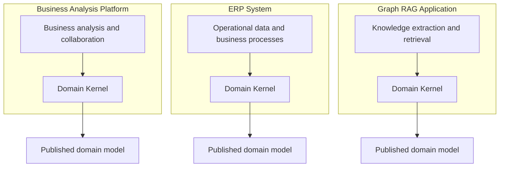
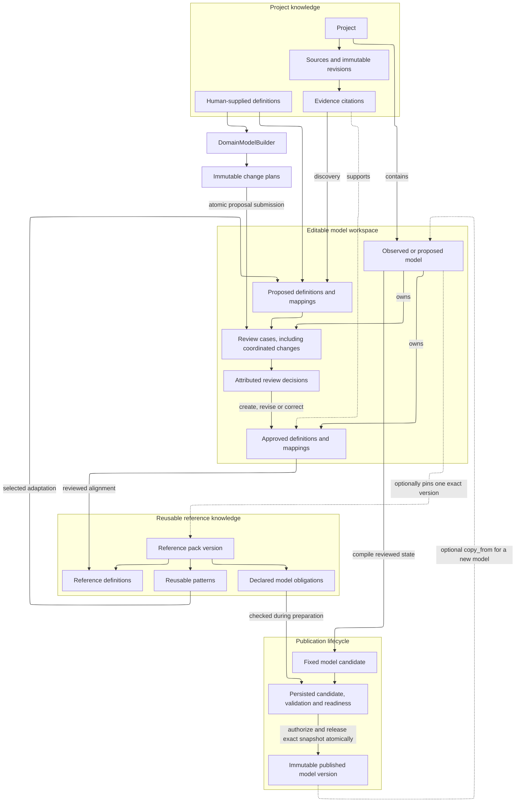
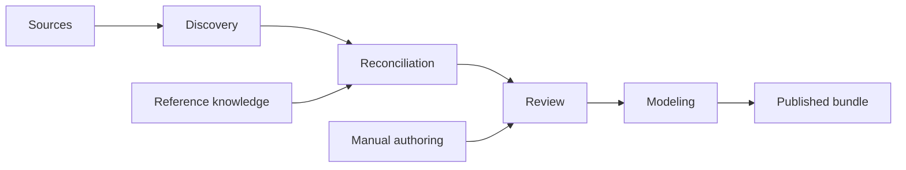
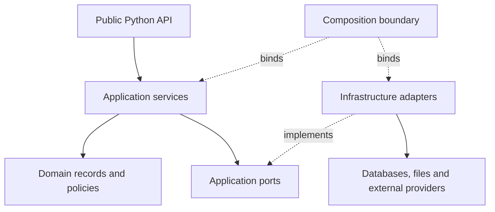

# Architecture and Ownership

[Architecture overview](../../ARCHITECTURE.md) · [Contract index](README.md)

<a id="2-architecture-and-ownership"></a>

Domain Kernel is an embeddable Python SDK. Rather than providing a standalone modeling service, it gives developers the tools to build domain modeling capabilities into their own applications.

An application can use the complete SDK to discover, author, review and publish domain models. Another application can simply load a published model and use its definitions without running any of the modeling components.

This allows applications to share business knowledge without sharing a database, deployment environment or application architecture.

## Independent Applications, Shared Contracts

Consider three applications that need to work with business domain models:

- A **Business Analysis Platform** helps analysts understand how an organization operates by examining documents, conducting interviews and developing models of current and proposed business processes.
- An **ERP system** uses reviewed definitions, relationships and constraints to configure the structure of its business records.
- A **Graph RAG application** uses domain definitions to establish the meaning and structure of the knowledge it extracts from documents.

Each application has different requirements, but all three benefit from a consistent way to represent business knowledge.



Each application can embed Domain Kernel independently, maintain its own models and publish its own versions.

Applications can also exchange published bundles when they need to reuse business knowledge established elsewhere. For example, an ERP system might consume a domain model published by a Business Analysis Platform.

However, this is an integration choice made by the applications, not a required workflow imposed by the SDK.

Domain Kernel does not require a central modeling service, shared workspace, common database or prescribed application-to-application handoff.

## Conceptual Model and Lifecycle

Business knowledge changes as new documents become available, people clarify existing interpretations and organizations develop new requirements.

Domain Kernel separates the evidence used to establish business knowledge from the model being developed and the versions already published.

This allows teams to continue working on a model without changing what existing consumers have received.

### Projects and sources

A project provides a namespace for source material and independently managed domain models.

For example, a manufacturer might create a project containing its purchasing policies, equipment catalogs, warehouse procedures and statements collected from business experts.

Different models within that project can use the same sources.

A procurement model might interpret an equipment catalog in terms of products that can be purchased, while a maintenance model might focus on equipment types and individual assets.

Sharing the same evidence does not require both models to adopt the same interpretation.

Source revisions preserve the identity of the material being interpreted. Evidence citations identify the particular locations that support a proposed meaning.

### Model workspaces

A model workspace contains the definitions, mappings, proposals and review decisions associated with a particular business domain.

The workspace can describe either existing business behaviour or a proposed future design.

Authors can introduce new definitions manually or use automated discovery to propose interpretations from selected sources.

Neither approach directly changes approved definitions. Proposed changes enter the review process first.

### Review and publication

A reviewer examines a proposed change, considers its supporting evidence and decides whether to accept, correct or reject it.

Accepted changes become part of the model's reviewed state.

When the team is ready to release a model, Domain Kernel compiles that state into a fixed candidate and evaluates its publication readiness.

A successful preparation makes the candidate eligible for publication. An authorized publisher must then explicitly release that exact snapshot as a named, immutable version.

The following diagram shows how these responsibilities fit together.



The distinction between a workspace and a published bundle is important. A workspace represents knowledge that is still evolving. A published bundle preserves what was accepted and authorized at a particular point in time.

Review decisions concern changes to the model itself. They are separate from the descriptive business decisions that a model may represent, such as the conditions under which a purchasing request should be approved.

### Core architectural objects

| Object | Responsibility |
|---|---|
| `Project` | Organizes source knowledge and independently managed models. |
| Source and evidence | Preserve source identities, revisions and citations. |
| Model workspace | Maintains editable definitions, mappings and proposed changes. |
| Reference pack | Supplies reusable definitions, modeling patterns and declared obligations. |
| Review case | Represents a proposed change or unresolved question requiring a decision. |
| Review decision | Records an attributed decision and its applicable rationale. |
| Candidate | Captures a fixed snapshot of reviewed model content. |
| Publication | Preserves the candidate, its validation results and publication readiness. |
| Published bundle | Represents an authorized, immutable model version. |

See [workspace and configuration](workspace-and-configuration.md), [sources and evidence](sources-and-evidence.md) and [review and publication](review-and-publication.md) for the contracts governing these objects.

## Reference Packs and Model Independence

Organizations do not always need to define their business concepts from scratch.

A manufacturer developing a procurement model might want to start with established definitions of suppliers, purchase orders and order lines. It may also want to adopt common modeling patterns or check its model against declared procurement requirements.

Domain Kernel provides this reusable knowledge through reference packs.

A reference pack contains versioned definitions, modeling patterns and validation obligations that can be used when developing a local model.

Reference knowledge informs the modeling process, but it does not automatically become an approved interpretation of the organization's business.

A model can optionally pin one exact version of a reference pack. Models that do not need reference knowledge can be authored, reviewed and published without one.

Changing the selected reference pack requires an explicit reviewed proposal. A team can attach a pack to an existing model, replace it with a different version or remove it entirely.

These operations change the working model's reference context. They do not rewrite previously published versions.

An application consuming an older bundle therefore retains the exact reference knowledge that applied when that version was authorized.

The complete reference-pack lifecycle, including pattern adoption, composition and reviewed upgrades, is defined in [reference knowledge and domain types](reference-knowledge-and-domain-types.md).

<a id="five-slices-one-model-contract"></a>

## Five Architectural Slices, One Model Contract

Domain Kernel divides the modeling lifecycle into five architectural slices.

The purpose of this separation is to keep different kinds of business decisions and technical operations within the components responsible for them.

Acquiring a document, interpreting its meaning, comparing that interpretation with an existing definition and accepting a change are different operations. They have different inputs, failure conditions and responsibilities.



The diagram shows a typical evidence-assisted modeling workflow. It does not define mandatory package dependencies or require every operation to pass through all five slices.

### Sources

The `sources` slice acquires business information and establishes which exact content is available for interpretation.

For example, when an application ingests a purchasing policy, the sources slice records the document's identity and revision. It also provides the citations needed to locate supporting passages.

Its responsibilities include source acquisition, revision tracking, profiling and evidence retrieval.

Its output is traceable source knowledge, not approved business definitions.

See [sources and evidence](sources-and-evidence.md).

### Discovery

The `discovery` slice interprets selected evidence in the context of a model's stated purpose.

A procurement policy might describe suppliers, purchasing responsibilities and delivery commitments. Discovery identifies candidate meanings and proposes definitions or relationships that represent them.

The slice also records discovery progress, diagnostics and supporting evidence.

Its output is a set of proposed interpretations. Those interpretations still need to be reconciled and reviewed.

See [discovery and reconciliation](discovery-and-reconciliation.md).

### Reconciliation

Different sources may describe the same business concept using different terminology. They may also use identical terminology for different concepts.

The `reconciliation` slice helps establish how proposed meanings relate to existing model definitions and, when configured, external reference knowledge.

For example, it might identify that a source's definition of `Vendor` appears equivalent to an existing `Supplier` definition, or that a proposed definition has a narrower meaning than its reference counterpart.

Reconciliation produces alignment proposals and identifies conflicts that require review. It does not approve those interpretations.

See [discovery and reconciliation](discovery-and-reconciliation.md).

### Review

The `review` slice manages decisions about proposed definitions, mappings and changes.

It allows applications to inspect review cases, preview the effects of proposed decisions and record explicit, attributed outcomes.

Related changes can be reviewed together when their individual application would otherwise leave the model in an inconsistent state.

The slice also enforces the applicable concurrency guards so that a decision cannot silently overwrite changes made since the reviewer inspected the model.

See [review and publication](review-and-publication.md) and [model evolution](model-evolution.md).

### Modeling

The `modeling` slice manages the definitions that make up a domain model, together with its configuration, reference-pack selection, validation and publication lifecycle.

It compiles reviewed content into fixed candidates, evaluates publication readiness and produces immutable model bundles.

It also provides the contracts through which published models can be inspected and projected into supported external formats.

See [reference knowledge and domain types](reference-knowledge-and-domain-types.md), [review and publication](review-and-publication.md) and [bundles and interoperability](bundles-and-interoperability.md).

### Reference-pack ownership

The supporting `reference_packs` package owns reference catalogs, pack content and serialization codecs.

The modeling and review slices own the selection of a reference pack for a particular model and the decisions that change that selection.

This separates management of reusable reference knowledge from decisions about how that knowledge applies to a local business domain.

### Relationship to Domain-Driven Design

The five slices organize the responsibilities of the SDK. They are not independently deployed services and should not automatically be treated as five separate DDD bounded contexts.

Domain model boundaries follow business meaning, ownership and change lifecycle. Internal slice boundaries follow the responsibilities required to manage that knowledge.

Manual authoring can bypass discovery entirely. Applications consuming published bundles can bypass the modeling lifecycle altogether.

The slices cooperate through shared typed contracts without maintaining competing representations of the domain model.

## Internal Architecture

Domain Kernel uses a layered architecture within its slices.

The main purpose of this structure is to keep business rules independent of the infrastructure used to store models, acquire evidence or invoke external providers.

For example, determining whether a proposed relationship references valid definitions should not require a SQLAlchemy session or a connection to an inference provider.

The same domain rule should apply regardless of whether an application uses SQLite, PostgreSQL or a custom persistence implementation.

### Layers and responsibilities

| Layer | Responsibility |
|---|---|
| `api/` | Exposes typed Python interfaces and public operation contracts. |
| `application/` | Coordinates use cases, domain behaviour and transaction boundaries. |
| `domain/` | Defines domain records, business invariants and permitted state transitions. |
| `infrastructure/` | Implements persistence, parsing, external provider access and other technical integrations. |

Not every slice requires all four layers.

Public operations may be exposed through package-root handles such as `Client` and `Project`, or through the relevant public API package, such as `modeling/api/`.

The SDK's API is a Python interface. It does not expose or require an HTTP server.



These arrows describe architectural dependencies rather than the order in which the modeling workflow executes.

### Public interfaces

The public SDK handles provide the entry points through which applications interact with Domain Kernel.

They identify the resources involved in an operation and delegate execution to the owning application service.

Public handles should remain thin. They should not duplicate business rules or introduce a second implementation of the underlying operation.

For the complete public handle and configuration contracts, see [workspace and configuration](workspace-and-configuration.md).

### Domain layer

The domain layer owns the rules that determine whether a business operation is valid.

For example, domain records and policies determine whether a proposed change is compatible with an inspected review case, whether a definition satisfies its structural invariants or whether a coordinated change can preserve reference integrity.

These rules should be testable using supplied domain values alone, without opening a database connection or configuring an infrastructure adapter.

Domain code uses the Python standard library. Domain methods remain synchronous and perform no I/O.

Not every domain object needs mutation methods. An immutable definition revision, review decision or publication snapshot can represent a complete domain value. Behaviour that evaluates relationships between several such values may belong to a pure domain policy.

This avoids introducing mutable entities merely to satisfy an architectural pattern.

### Application layer

Application services coordinate the work required to execute a use case.

Consider accepting a proposed definition. The operation may need to load the current review case, retrieve referenced definitions, evaluate the applicable domain rules and persist the resulting changes.

The application service coordinates these steps. It does not independently redefine the rules used to determine whether the decision is valid.

SDK-authored application services explicitly implement their application-facing protocols.

Their collaborators are supplied through keyword-only constructor injection. An operation receives the specific repositories, audit, idempotency and transaction collaborators it needs.

Services must not receive a general repository registry or a SQLAlchemy session.

Keeping dependencies explicit makes each service's responsibilities easier to understand and its behaviour easier to test.

### Infrastructure layer

Infrastructure adapters implement the ports required by application services.

For example, a repository loads and stores model state, while a source reader retrieves content from a filesystem or remote storage provider.

Repositories enforce technical guarantees such as persistence integrity, uniqueness and compare-and-swap operations.

They do not independently determine whether a business interpretation should be accepted or whether a model change is appropriate.

SDK-authored adapters and test doubles explicitly implement their corresponding protocols and use `@override` where the dependency direction permits it.

Pure domain policies may structurally satisfy application ports without importing the application layer.

This keeps domain code independent of the infrastructure and orchestration mechanisms that use it.

### Composition boundary

The composition boundary connects application services to their configured infrastructure.

It assembles the specific collaborators required by each operation and manages their resource scope.

For persistence operations, the relevant repositories and transaction collaborators share the operation's resource context. Concurrent operations do not share operation-bound sessions.

The composition boundary allows applications to select or supply infrastructure without changing the underlying domain rules.

### Cross-slice operations

Some operations affect more than one architectural slice.

Accepting a review case, for example, may update model definitions, change source alignments and create additional review work.

Where these effects form one business operation, the application coordinates them within a shared transaction boundary.

This ensures that related changes are committed together rather than leaving partially applied business state.

Downloads, parsing, inference and other external provider calls remain outside database transactions. Domain objects never perform that I/O directly.

See [persistence and reliability](persistence-and-reliability.md) for the transaction, resource ownership and recovery contracts.

## Package Structure

The source layout reflects the architectural responsibilities described above.

```text
src/domain_kernel/
├── __init__.py          # Public package exports
├── py.typed
├── client.py            # Client handle
├── project.py           # Project handle
├── configuration.py     # Public configuration contracts
├── diagnostics.py       # Redacted configuration inspection
├── authoring.py         # Pure typed DomainModelBuilder
├── interchange.py       # Optional standards interoperability
├── bundles.py           # Independent bundle consumption
├── reference_packs.py   # Reference-pack value exports
├── notebook.py          # Optional inspection utilities
├── _composition.py      # Composition of services and adapters
├── _settings.py
├── _database.py
├── errors.py
├── shared/              # Contracts and code used across slices
│   ├── contracts.py
│   ├── identifiers/
│   ├── domain/
│   │   ├── codecs/        # Canonical record encoding and restoration
│   │   ├── entities/      # Identified definitions, parts, and other snapshots
│   │   ├── enums/
│   │   ├── errors/
│   │   ├── operations/    # Authored changes in a model plan
│   │   ├── policies/      # Checks and transforms across domain types
│   │   ├── protocols/
│   │   ├── types/
│   │   ├── validators/    # Reusable checks for domain fields and parts
│   │   └── value_objects/ # Values without an identity of their own
│   ├── application/
│   └── infrastructure/
├── sources/             # Source capture and evidence
├── discovery/           # Candidate meaning generation
├── reconciliation/      # Source and reference comparisons
├── review/              # Decisions and coordinated changes
├── modeling/            # Models, validation and publication
└── reference_packs/     # Reference catalogs and codecs
```

Each architectural slice contains the layers necessary for its responsibilities.

Code used across slices lives in `shared/` and follows the same layer boundaries.

The component and layer directories use implicit namespace packages. The package root retains its `__init__.py` and PEP 561 `py.typed` marker.

The package-root exports define the supported public SDK entry points.

### Dependency placement

The domain model remains independent of third-party validation frameworks, database libraries and external provider implementations.

Pydantic is used to validate configuration and data crossing system boundaries. It does not replace the domain records or their invariants.

Optional capabilities and their dependencies remain isolated in named extras.

For example, an application that only authors definitions manually or reads published bundles should not need to install an inference provider or ontology reasoning engine.

This keeps the core SDK usable in environments that do not require its more specialized integrations.

<a id="what-belongs-to-an-application"></a>

## Application Responsibilities

Domain Kernel is responsible for managing business knowledge through its modeling, review and publication lifecycle.

The application is responsible for how that knowledge is acquired, presented, authorized and used within the wider business system.

This distinction is best understood through practical examples.

### Business Analysis Platform

A Business Analysis Platform might provide tools for managing engagements, interviewing business experts, collaborating on proposed solutions and documenting requirements.

Domain Kernel supplies the underlying capabilities for recording evidence, discovering business meanings, reviewing definitions and publishing domain models.

The application remains responsible for the analyst's workflow, stakeholder collaboration, presentation of findings and solution design.

### ERP system

An ERP system might consume a reviewed domain model describing suppliers, components, warehouses and purchasing processes.

Domain Kernel supplies the definitions, relationships, constraints and applicable projections.

The ERP remains responsible for its operational records, transaction processing, permissions, business-rule execution, integrations and migrations.

For example, Domain Kernel can preserve a rule describing when a purchase order requires approval. The ERP must implement that rule and enforce it when processing actual purchase orders.

### Graph RAG application

A Graph RAG application might use a reviewed domain model to determine which business entities and relationships should be represented in its knowledge graph.

Domain Kernel supplies the definitions, semantic relationships, evidence provenance and supported ontology projections.

The Graph RAG application remains responsible for extracting individual facts, resolving entity identities, populating the instance graph, indexing its content and retrieving relevant knowledge.

Publishing a domain model does not automatically create a populated knowledge graph.

### Responsibility boundaries

| Domain Kernel owns | Host or consuming application owns |
|---|---|
| Scoped domain definitions, evidence links and review decisions | Authentication, authorization and verification of business authority |
| Discovery, reconciliation and persisted operation progress | Queues, scheduling, HTTP endpoints, notifications and review interfaces |
| Model integrity, validation and publication readiness | Business decisions, applicability judgments and operational acceptance |
| Portable, immutable and versioned model bundles | Artifact distribution, trusted publisher selection, version adoption and runtime configuration |
| Descriptive business processes, rules and decisions | Workflow execution, transactions, operational records and migrations |
| Source parsing and parsed-source contracts | RAG chunking, indexing, retrieval, instance graphs and entity resolution |

Applications do not need to reproduce the functionality of other applications that embed the SDK.

An ERP does not need to implement stakeholder interviews or business analysis workflows. A Graph RAG application does not need to manage procurement transactions. A Business Analysis Platform does not need to operate a knowledge graph database.

They can all work with the same domain modeling contracts while retaining ownership of their respective application concerns.

For information about consuming published models, see [bundles and interoperability](bundles-and-interoperability.md). For application configuration and operational integration, see [host integration](host-integration.md) and [workspace and configuration](workspace-and-configuration.md).
