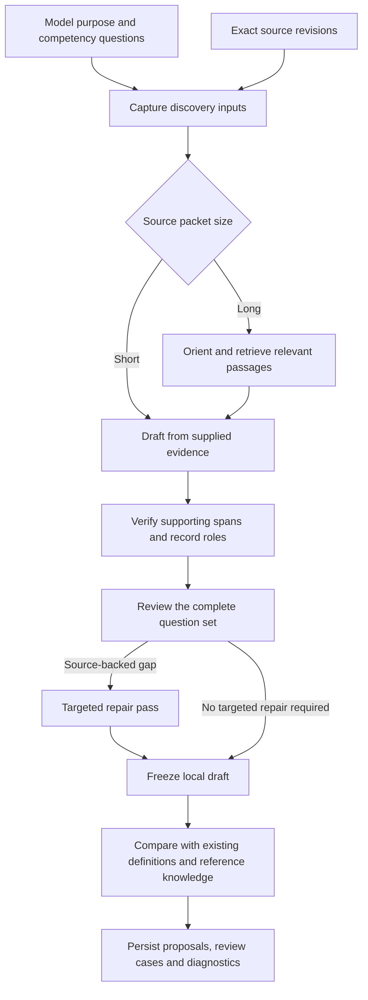
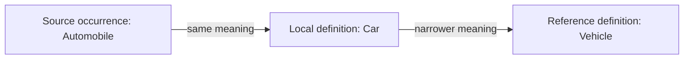

# Discovery and Reconciliation

[Architecture overview](../../ARCHITECTURE.md) · [Contract index](README.md)

<a id="5-discover-and-reconcile-meanings"></a>

Business documents rarely describe an organization using a single, consistent vocabulary.

A supplier catalog might use the term `Part` to describe an item that can be ordered, while a maintenance manual uses the same term to describe an individual physical unit. Other documents might use `Component` or `Item` to describe similar concepts.

When building a domain model, two questions arise:

- What business concepts and relationships do these documents describe?
- How do those meanings relate to definitions that the organization has already established?

Domain Kernel addresses the first question through **discovery** and the second through **reconciliation**.

Discovery proposes meanings from selected evidence. Reconciliation determines which interpretations may correspond to existing definitions, which may represent new concepts and which require further clarification.

Both produce proposals for review. A generated interpretation, regardless of its confidence score, does not become approved business knowledge until an explicit review decision is recorded.

## 1. Discovery

Discovery helps authors develop a domain model from existing business knowledge rather than defining every concept manually.

The process begins with a model's stated purpose and a selection of source revisions. These establish what the model is intended to describe and which evidence is available.

For example, a manufacturer building a component catalog might supply a spreadsheet of components, a purchasing policy and a statement from the person responsible for maintaining the catalog.

The objective is to discover the meanings relevant to that catalog, rather than extract every fact mentioned in the supplied material.

### Configure the inference gateway

AI-assisted discovery requires a host-provided `ModelGateway`.

The application supplies the gateway through `ClientConfiguration.model_gateway` when creating its client. Projects and models created or retrieved through that client reuse the configured gateway.

This allows the application to choose its inference provider, model, credentials and transport without introducing provider-specific dependencies into the domain model.

Domain Kernel owns the discovery workflow, its structured response contracts and the validation of generated proposals. The host controls which provider receives the selected evidence.

Configuring a gateway does not cause manual modeling operations to invoke inference.

Deterministic reconciliation, manual editing, model compilation and publication remain available without an inference gateway.

An operation that requires inference raises `MissingCapabilityError` when no suitable gateway is configured.

See the [configuration recipes](../../examples/config/README.md) for practical gateway setup.

## 2. Run Discovery

Discovery operates on exact source revisions rather than file paths or the latest available versions of documents.

This distinction matters because a document may change while a model is being developed. The SDK must be able to identify which version supported a particular interpretation.

Before running discovery, register the relevant sources using `ingest_source()` or capture updated content using `ingest_source_revision()`.

See [sources and evidence](sources-and-evidence.md) for source acquisition and revision contracts.

### Start a discovery run

The following example assumes an existing component catalog model and three previously ingested sources: a component spreadsheet, a purchasing policy and an attributed statement.

```python
from domain_kernel import RunStatus

run = await model.discover(
    actor="user:model-editor",
    sources=[
        components.revision,
        policy.revision,
        statement.revision,
    ],
)

print(f"Discovery run: {run.id.value}")
print(f"Status: {run.status.value}")
```

The `discover()` operation coordinates evidence retrieval, proposal extraction and reconciliation.

If the SDK needs to retrieve source content during discovery, it verifies that the recovered content matches the recorded revision.

Discovery does not create unnamed sources from file descriptors. Source registration and revision capture remain separate operations.

The result is a `DiscoveryResult` snapshot describing the outcome of the run.

### Inspect the discovery outcome

A discovery run may successfully process some sources while encountering problems with others.

For example, the SDK might discover several useful concepts from a spreadsheet but fail to recover the exact revision of a supporting policy document.

The resulting proposals can still be useful, provided the application makes the incomplete outcome visible to the reviewer.

```python
for failure in run.failures:
    print(
        f"{failure.source_label}: "
        f"{failure.message} "
        f"[severity={failure.severity.value}, "
        f"code={failure.code}, "
        f"retryable={failure.retryable}]"
    )

if run.status in [
    RunStatus.PARTIALLY_FAILED,
    RunStatus.FAILED,
    RunStatus.CANCELLED,
]:
    print("Discovery is incomplete. Inspect the failures before proceeding.")
```

Failures are represented by typed `DiscoveryFailure` records.

Each record contains a structured `issue` and exposes its `message`, `code` and `severity` through read-only properties. Severity remains an `IssueSeverity` enum.

These properties provide convenient access to the diagnostic information without duplicating it in the underlying record.

The host application determines whether to retry the failed work, proceed with the available proposals or request additional evidence.

### Inspect pending review cases

Discovery produces review cases containing proposed definitions, alignment decisions and questions that require clarification.

Use `list_review_cases()` to retrieve the cases associated with the discovery run.

```python
from domain_kernel import CaseStatus

pending = await model.list_review_cases(
    run_id=run.id,
    status=CaseStatus.PENDING,
)

displayed_cases = 0

while True:
    for case in pending.items:
        displayed_cases += 1

        print(f"\nCase: {case.id.value}")
        print(f"Kind: {case.kind.value}")
        print(f"Reason: {case.reason}")

        for definition in case.definitions:
            print(f"Definition: {definition.display_name} ({definition.name})")

        if case.question is not None:
            print(f"Question: {case.question.text}")

        print(f"Evidence citations: {len(case.evidence)}")

    if pending.next_cursor is None:
        break

    pending = await model.list_review_cases(
        run_id=run.id,
        status=CaseStatus.PENDING,
        cursor=pending.next_cursor,
    )

print(f"Pending review cases inspected: {displayed_cases}")
```

Review cases contain definition snapshots and references to supporting evidence.

The citations identify where the evidence came from. Applications retrieve the corresponding passages explicitly when presenting them to a reviewer.

Review cases are paginated. The application must preserve the original query filters when requesting subsequent pages.

For sequential inspection, the SDK also provides `iter_review_cases()`. See the [host integration contract](host-integration.md) for pagination and asynchronous iteration.

The discovery outcome and the review queue should be inspected separately. An empty queue may mean that there were no proposals to review, but it does not establish that discovery completed successfully.

Inspecting a discovery result or review case does not accept any proposed changes.

## 3. Whole-question discovery workflow

A domain model is normally developed to answer particular business questions.

For example, a procurement model might need to establish:

- What is the difference between a catalog item and a physical unit?
- How do suppliers relate to the items they provide?
- What determines whether a shipment was delivered late?

Answering these questions requires more than identifying relevant terms. Their meanings may depend on several passages, relationships between business records and qualifications found elsewhere in the source material.

Domain Kernel therefore organizes discovery around the purpose of the model and the complete set of competency questions supplied for the run.



### 3.1 Capture the discovery inputs

Before invoking inference, `Model.discover()` records the inputs that define the run.

These include:

- The exact selected source revisions.
- The model snapshot used during discovery.
- The supplied modeling inputs and competency questions.
- The provider profile, when supplied.

If no competency questions are provided, the model's description supplies the purpose of discovery.

Source context, an as-of date and additional modeling instructions participate only when explicitly provided by the host.

Capturing these inputs allows the SDK to associate discovery results with the model and evidence actually used, rather than their later versions.

Provider calls execute outside database transactions.

### 3.2 Select relevant evidence

The amount of material required to establish a business meaning depends on the source.

A short supplier confirmation may contain enough information to draft a useful definition directly.

A lengthy purchasing policy may require an initial orientation step to identify relevant sections, followed by retrieval of passages related to the modeling questions.

The discovery workflow handles these situations differently:

- Short source packets are used directly for drafting.
- Longer packets use orientation and retrieval to select relevant evidence.

Evidence selection is guided by the modeling purpose. It should retain relevant definitions, qualifications and relationships needed to establish the requested meanings.

### 3.3 Draft and verify proposed meanings

The selected passages provide the basis for a draft containing candidate concepts and relationships.

For each candidate, the workflow verifies the issued supporting spans and the roles played by records in the proposed interpretation.

Record roles matter because a passage may refer to several related concepts without describing them in the same way.

For example, a procurement document might describe a supplier, a buyer and an awarded contract. Identifying all three terms is not enough if the resulting relationship assigns the award to the wrong participant.

The workflow must preserve which business objects participate in a relationship and the roles they occupy.

Verification checks the proposed meaning against its cited evidence rather than relying on the plausibility of the generated description alone.

This process reduces unsupported interpretations, but it does not replace human review or guarantee that every accepted candidate is correct.

### 3.4 Review the complete question set

After drafting, the workflow evaluates the proposed meanings against the complete set of modeling questions.

This helps identify whether a draft has omitted a relationship, qualification or concept needed to address the stated purpose.

Grounded edits can be admitted independently. Correcting one interpretation should not require discarding unrelated proposals that remain supported by the evidence.

The workflow permits at most one targeted repair pass for a source-backed gap.

When a check omits its supporting example, previously issued spans may be reused only if they actually satisfy the requirement.

The workflow must not invent examples or infer hard bounds that the source does not establish.

For example, observing several purchase orders containing one supplier does not establish that every purchase order is legally or operationally restricted to exactly one supplier.

A supported observation and a mandatory business constraint are different kinds of knowledge.

### 3.5 Freeze and reconcile the draft

Once the local draft has been established, the workflow freezes it before comparison with any selected reference pack.

This separates the interpretation of local evidence from the comparison with reusable external knowledge.

A reference pack can help identify possible alignments or differences. It should not cause the original interpretation of a source to be silently rewritten.

The workflow persists the draft, diagnostics and resulting pending review cases.

Failures may leave a partial draft. Eligible resumption reuses completed work and the recorded identities rather than starting an unrelated discovery run.

Approval and publication remain separate operations.

### Current discovery capabilities

The discovery workflow and the underlying domain model have different capability boundaries.

The current whole-question discovery path materializes proposed concepts, relationships and questions for review.

It can also preserve relevant qualifications within proposed meanings.

It does not currently generate typed attributes, business keys or executable constraints through this discovery path.

For example, discovery may identify that a component number is used to identify a catalog item. It does not automatically turn that interpretation into a typed uniqueness constraint on operational component records.

Authors can add those structures explicitly through `DomainModelBuilder` and submit them through the ordinary review lifecycle.

See [typed domain authoring](reference-knowledge-and-domain-types.md#author-connected-domain-definitions), the [draft materializer](../../src/domain_kernel/discovery/application/schema_model.py) and [discovery integration tests](../../tests/integration/discovery/test_schema_discovery.py).

The ability to represent a construct in a domain model must not be confused with the ability to discover that construct automatically.

## 4. Inference gateway contracts

Domain Kernel separates the discovery workflow from the infrastructure used to perform inference.

The workflow determines which structured operation is required, supplies its inputs and validates the returned response. The gateway provides the configured inference capability.

A custom gateway supporting the whole-question workflow advertises `supports_schema_discovery` and implements the supplied structured-output contracts.

The workflow uses the following schema identifiers:

| Schema identifier | Purpose |
|---|---|
| `schema-compact-orientation` | Establish context and guide evidence selection for longer source packets. |
| `schema-compact-draft` | Produce candidate business meanings from selected evidence. |
| `schema-compact-repair` | Address a targeted source-backed gap in the draft. |
| `schema-mapping` | Support comparison and reconciliation of proposed meanings. |

The gateway must honor the response schema supplied for each operation.

Source text, retrieved passages and other evidence remain data. Instructions appearing within those inputs must not be treated as authorized modifications to the discovery task.

The workflow does not select an inference provider or model on behalf of the application.

### Request identity and response journals

A staged gateway journals responses against their exact request identity.

This allows the workflow to recover previously completed inference work where the applicable recovery contract permits it.

These journals may contain confidential source material and generated interpretations. Applications must keep them private and protect them according to their data-handling policies.

See [persistence and reliability](persistence-and-reliability.md) for recovery, idempotency and resource ownership.

### Run extraction and reconciliation separately

Applications do not always need to execute the entire discovery workflow in one operation.

The SDK exposes two operations for applications that need to inspect or control the intermediate stages independently.

| Operation | Responsibility |
|---|---|
| `model.extract_proposals(source_revisions=...)` | Produce a standalone discovery draft. |
| `model.propose_alignment(discovery_id=...)` | Reconcile an existing draft and open the corresponding review work. |

`model.discover()` coordinates these responsibilities as a complete workflow.

Separating the operations does not bypass the review requirements. Neither a standalone draft nor a proposed alignment constitutes approved domain knowledge.

## 5. Focus discovery without changing its output contract

The same source material can support several domain models.

For example, the EU AI Act contains provisions concerning recruitment, education, critical infrastructure and other uses of artificial intelligence.

An application building a model of AI systems used in recruitment does not necessarily need to discover every meaning contained in the legislation.

It does, however, need access to relevant definitions, responsibilities, exceptions and cross-references elsewhere in the document.

Domain Kernel allows applications to guide discovery without changing the structured contract used to represent the resulting proposals.

### Model context and run-specific instructions

There are three sources of discovery instructions.

| Input | Purpose |
|---|---|
| Model `description` | Establishes the persistent business context and intended purpose of the model. |
| `additional_instructions` | Adds task-specific guidance to the SDK's default discovery prompt. |
| `prompt_override` | Replaces the SDK's default discovery prompt entirely. |

Both prompt arguments are optional, keyword-only, non-blank strings when supplied.

They are available on `discover()` and `extract_proposals()`.

### Focus a discovery run

The following example uses a previously captured revision of the full legislation while focusing discovery on recruitment and selection.

```python
run = await model.discover(
    actor="user:model-editor",
    sources=[legislation.revision],
    additional_instructions=(
        "Focus on AI used in recruitment and selection: "
        "intended purpose, provider and deployer responsibilities, "
        "documentation, data and oversight. "
        "Retain supporting definitions, cross-references, "
        "conditions and exceptions from elsewhere in the document. "
        "Do not determine any organisation's compliance."
    ),
)

print(run.prompt.effective_instructions)
```

The instructions guide which business meanings the workflow should propose.

They do not replace the selected source revision or restrict the evidence to a predetermined article.

This matters when the meaning of a requirement depends on definitions or qualifications located elsewhere in the legislation.

### Replace the default prompt

Applications requiring complete control over the discovery prompt can supply `prompt_override`.

The selection rules are:

| Arguments supplied | Effective discovery prompt |
|---|---|
| Neither argument | The SDK's versioned default prompt. |
| `additional_instructions` only | The default prompt with the supplied additional guidance. |
| `prompt_override` only | The supplied replacement prompt. |
| Both arguments | The replacement prompt. Additional instructions are ignored when constructing the effective prompt. |

Evidence and model context remain separate inputs regardless of which prompt option is used.

The SDK continues to supply `ModelRequest.response_schema_json` and validate the generated response against its fixed proposal contract.

Neither prompt argument allows an application to replace that response schema or introduce an unsupported domain representation.

Existing retry, failure and recovery behavior continues to apply. A failed custom prompt does not cause a silent fallback to the SDK's default prompt.

### Preserve the effective instructions

Discovery results must remain attributable to the instructions used to generate them.

The immutable `run.prompt` or `draft.prompt` capture records:

- The supplied instructions.
- The effective prompt text.
- The SDK's default prompt version, when used.
- The response-schema version.

The workflow persists this capture before invoking inference.

The exact prompt, schema and model context participate in the processing fingerprint and remain pinned for retries and resumption.

Changing a prompt constitutes new discovery intent and requires a new run.

A changed request submitted under an existing idempotency key raises a conflict. This also applies when the changed argument would have been ignored because `prompt_override` took precedence.

The recorded request identity concerns what the application submitted, not only the effective prompt generated from it.

### Focus is not a coverage guarantee

Additional instructions provide semantic guidance. They do not establish a deterministic document filter or guarantee that every relevant meaning will be discovered.

The [legislative notebook](../../examples/notebooks/README.md) demonstrates this distinction using the complete original AI Act.

Article 13 serves as a worked example, while relevant supporting definitions and qualifications may appear elsewhere in the legislation.

Reviewed passage selections provide an evaluation rubric. They are not hidden excerpts supplied to the discovery workflow or an exact list that every live inference run must reproduce.

Reviewers must inspect the actual proposals, supporting evidence and relevant omissions before accepting the resulting interpretations.

## 6. Recover and resume discovery

Discovery can involve several source reads and inference operations. Some of those operations may complete successfully before another part of the workflow fails.

Domain Kernel persists discovery progress so that an interrupted operation can be inspected and, where eligible, resumed.

Applications can retrieve discovery state through:

| Operation | Purpose |
|---|---|
| `get_discovery_run()` | Retrieve an existing discovery run and inspect its recorded outcome. |
| `list_discovery_runs()` | Inspect discovery runs associated with the model. |
| `resume_discovery()` | Resume eligible failed, partially failed or cancelled discovery work. |

Resumption continues the existing run using its recorded inputs and completed work.

It does not substitute newer source revisions, a different model snapshot or changed discovery instructions.

If the application intends to change those inputs, it must start a new discovery run.

The host remains responsible for scheduling workers, deciding when retries are appropriate and presenting incomplete outcomes to users.

The SDK owns the persisted discovery state and the recovery contracts required to continue eligible work.

See [persistence and reliability](persistence-and-reliability.md) for scoped idempotency, leases, fencing and recovery behavior.

Discovery operations do not wait for a reviewer to make decisions.

Once the discovery operation returns, its proposals remain pending until the host initiates the corresponding review actions.

<a id="two-separate-alignment-questions"></a>

## 7. Source Alignment and Reference Alignment

Discovery may identify a meaning that already exists in the local model.

It may also identify a relationship between that local meaning and an external reference definition.

Although both involve comparing business meanings, they answer different questions.

Consider a company selling passenger cars.

One of its documents uses the term `Automobile` to describe a passenger car. Its existing domain model already defines `Car` with the same meaning.

The company also uses a reference pack that defines `Vehicle` more broadly, including passenger cars, motorcycles and trucks.

The reviewer needs to establish two separate relationships.



The first relationship establishes what a particular source occurrence means within the local model.

The second establishes how the local definition relates to reusable reference knowledge.

Neither requires replacing the local `Car` definition with the reference definition of `Vehicle`.

### 7.1 Source-to-model alignment

A source alignment connects an interpretation discovered in a particular source to an appropriate definition within the local model.

In the car example, the reviewer establishes that `Automobile` refers to the existing `Car` concept.

The corresponding decision can be prepared using:

```python
mapping = source_case.same_as(
    definition=car,
    reason="Automobile in this document means our existing Car concept.",
)
```

When accepted through the review lifecycle, this resolves the selected source occurrence against the inspected local definition revision.

It does not create an additional `Automobile` definition or modify the source document.

A reviewer may instead conclude that the source describes a separate concept or that the occurrence should be excluded from the model's scope.

The selected interpretation and its rationale remain part of the review history.

### 7.2 Model-to-reference alignment

A reference alignment relates a local definition to a definition belonging to the model's selected reference pack.

In the same example, the company's definition of `Car` covers a narrower range of things than the reference definition of `Vehicle`.

| Example | Fits the local Car definition? | Fits the reference Vehicle definition? |
|---|---|---|
| Passenger car | Yes | Yes |
| Motorcycle | No | Yes |
| Truck | No | Yes |

Every passenger car fits the reference meaning of `Vehicle`, but not every vehicle fits the company's meaning of `Car`.

The reviewer can prepare that decision using:

```python
mapping = reference_case.narrower_than(
    local_definition=car,
    reference_definition=vehicle,
    reason=(
        "Every Car is a Vehicle, but motorcycles and trucks are not included in our Car definition."
    ),
)
```

The direction of the relationship is always expressed from the local definition relative to the reference definition.

In this example, `Car` is narrower than `Vehicle`.

The relationship describes the coverage of the two meanings. It does not indicate that one definition is more accurate, more important or supported with greater confidence.

The local definition retains its own identity and meaning.

Where no suitable reference definition exists, a compatible review case may establish a justified local extension. Applicable required reference-pack obligations continue to apply.

See [reference knowledge and domain types](reference-knowledge-and-domain-types.md) for reference alignment, local extensions and required coverage.

### 7.3 Keep business mappings separate from formal semantics

A reviewed business mapping does not necessarily establish a formal logical relationship.

For example, two definitions may be considered equivalent for the purposes of a company's procurement model without satisfying the formal requirements of OWL class equivalence.

The reference form of `same_as()` records equivalent business meaning. It does not merge the two identities or automatically produce a formal ontology assertion.

Similarly, a reviewed narrower-than relationship does not automatically become an `rdfs:subClassOf` assertion.

Formal semantic relationships have their own contracts and require explicit authoring and review.

See [formal semantics and interoperability](bundles-and-interoperability.md) for the distinction between business alignments and ontology relationships.

### 7.4 Reuse reviewed meanings

Reviewed definitions and mappings can be reused when their interpretation context remains valid and compatible.

However, terminology alone is not sufficient to establish that compatibility.

Suppose a supplier document uses `Part` to describe a catalog component and the reviewer maps it to `Component`.

A second document may use `Part` to describe an individually serialized physical unit.

The existing mapping is useful context, but applying it automatically to the second occurrence could introduce an incorrect interpretation.

Reconciliation must consider the source evidence, model context, relevant definition revisions and selected reference knowledge.

Where compatibility cannot be established, the interpretation requires further review.

## 8. Review a Proposed Alignment

Reconciliation produces a proposed relationship between meanings. The reviewer determines whether that relationship is appropriate.

Consider a source-alignment case that proposes mapping a discovered meaning to the existing `Component` definition.

The host application presents the case and supporting evidence to the reviewer. Once the reviewer has inspected the relevant information, the application can construct the intended decision.

### 8.1 Retrieve the exact review case and definition

The host supplies `selected_case_id`, obtained from a review case that the user explicitly selected.

It must not infer the case identity from a source label or choose an arbitrary case from the review queue.

```python
case = await model.get_review_case(
    case_id=selected_case_id,
)

component = await model.get_concept(
    name="component",
)
```

The returned objects represent inspected snapshots of the review case and existing definition.

### 8.2 Inspect the supporting evidence

The application can retrieve the passages referenced by the selected case.

```python
passages = [await project.get_evidence(evidence=citation) for citation in case.evidence]

for passage in passages:
    print(passage.excerpt)
```

The reviewer can use the passages to determine whether the proposed mapping accurately represents the meaning described by the source.

If the exact evidence cannot be recovered, the application should make that limitation visible rather than substitute content from a newer source revision.

### 8.3 Prepare the mapping decision

After reviewing the evidence, the reviewer determines that the source occurrence describes the existing `Component` concept.

Prepare the corresponding decision:

```python
mapping = case.same_as(
    definition=component,
    reason="This source describes the existing Component concept.",
)
```

`same_as()` is a synchronous factory that constructs a typed source-meaning decision.

It captures the inspected definition snapshot, including its identity and revision.

The operation does not infer or prove equivalence. It represents the interpretation selected by the reviewer.

Constructing the decision does not persist it or modify the model.

### 8.4 Preview the proposed effects

Before submitting the decision, inspect its consequences:

```python
impact = await model.preview_changes(
    case=case,
    decision=mapping,
)

print(f"Workspace revision: {impact.workspace_revision}")
```

The preview allows the host to explain what accepting the mapping would change.

For example, resolving a source occurrence against an existing definition may update source alignments without creating a new definition revision.

The impact also identifies other review cases or previously recorded decisions that may be affected.

#### Inspect definition changes

```python
print(f"Definition changes: {len(impact.definition_changes)}")

for change in impact.definition_changes:
    print(f"Change: {change.kind.value}")

    for definition in change.before:
        print(f"Before: {definition.display_name}, revision {definition.revision}")

    for definition in change.after:
        print(f"After: {definition.display_name}, revision {definition.revision}")
```

The `before` and `after` snapshots allow the application to present the proposed effects without modifying the existing definition.

#### Inspect source alignment changes

```python
print(f"Source alignment changes: {len(impact.source_alignment_changes)}")

for change in impact.source_alignment_changes:
    alignment = change.after

    if alignment is not None:
        print(f"Proposal: {alignment.proposal_id.value}")
        print(f"Disposition: {alignment.disposition.value}")

        if alignment.definition_id is not None:
            print(f"Definition: {alignment.definition_id.value}")
            print(f"Revision: {alignment.definition_revision}")

    elif change.before is not None:
        print(f"Remove alignment for proposal: {change.before.proposal_id.value}")
```

Source alignment changes identify how the selected proposals would relate to existing domain definitions after acceptance.

#### Inspect related review work

```python
print(f"Affected cases: {len(impact.affected_case_ids)}")

for case_id in impact.affected_case_ids:
    print(case_id.value)

print(f"Invalidated decisions: {len(impact.invalidated_decision_ids)}")

for decision_id in impact.invalidated_decision_ids:
    print(decision_id.value)
```

An interpretation may affect other parts of the model.

For example, correcting the meaning of a source occurrence might invalidate an earlier decision that relied on the previous interpretation.

The preview makes this additional work visible before the reviewer commits to the change.

#### Inspect publication blockers

```python
if impact.blockers:
    for blocker in impact.blockers:
        print(f"{blocker.severity.value}: {blocker.message} [code={blocker.code}]")
else:
    print("No blockers found in the preview.")
```

The absence of blockers in a preview does not establish that a decision has been submitted or that the complete model is ready for publication.

Previewing a decision reserves no resources and applies no changes.

### 8.5 Submit the reviewed decision

Once the reviewer has inspected the proposed effects and explicitly authorized the mapping, the application submits the decision.

```python
receipt = await model.decide_review(
    actor="user:model-reviewer",
    case=case,
    decision=mapping,
)

print(f"Recorded decision: {receipt.decision_id.value}")
```

In an interactive application, this call belongs in a separate user-authorized action after the preview.

The application must retain the inspected case and decision rather than silently replacing them with newer snapshots at submission time.

During preview and submission, the SDK verifies the supplied definition's identity, revision, scope, active status and exact content against stored state.

If the inspected target is stale or has been modified, the operation fails rather than selecting a different definition revision.

Submission rechecks the current state before committing the decision and its effects.

These guarantees also apply to reference-alignment decisions. Their synchronous factories construct typed decisions, while preview and submission remain separate asynchronous operations.

The host application establishes the identity and authority of the reviewer. Domain Kernel records the attributed decision and enforces the applicable model integrity and concurrency requirements.

See [review and publication](review-and-publication.md) for decision submission, coordinated changes and publication readiness.

## 9. Architectural guarantees and limitations

Discovery and reconciliation provide a controlled way to develop business interpretations from existing knowledge.

Their architectural guarantees concern how those interpretations are generated, recorded and presented for review.

| Contract | Guarantee or limitation |
|---|---|
| Source selection | Discovery operates on exact captured source revisions. |
| Modeling context | The model purpose, selected inputs and effective instructions are recorded for the run. |
| Evidence | Proposed meanings retain references to their supporting source passages. |
| Structured responses | Generated output must satisfy the SDK's fixed proposal contract. |
| Discovery scope | The current whole-question path proposes concepts, relationships and review questions rather than every supported domain construct. |
| Reference comparison | The local draft is frozen before comparison with a pinned reference pack. |
| Reconciliation | Matching terminology does not automatically merge definitions or establish equivalence. |
| Review | Discovery and reconciliation produce proposals rather than approved model changes. |
| Concurrency | Decisions are checked against their inspected case and definition snapshots. |
| Recovery | Eligible interrupted runs can reuse completed work under the recorded operation identity. |
| Provider independence | Applications select and supply their own inference gateway. |
| Publication | Approval of individual interpretations does not authorize publication of the complete model. |

These contracts establish traceability and control over the discovery workflow.

They do not establish that every relevant meaning has been discovered, that every proposed interpretation is correct or that the selected evidence fully represents the organization's business practices.

Those questions require evaluation and review.

## 10. Verification and further reading

Discovery quality and workflow correctness require different forms of verification.

A deterministic integration test can establish that the SDK correctly processes a structured model response, preserves its evidence references and creates the appropriate review cases.

It cannot establish that a live inference provider will consistently discover the right business meanings from unfamiliar documents.

Similarly, successfully extracting a concept does not establish that its relationships, qualifications or supporting evidence are correct.

Domain Kernel therefore distinguishes verification of the discovery workflow from evaluation of live discovery quality.

The [benchmark documentation](../../benchmarks/README.md) describes the project's evaluation work.

The following references provide the implementation and technical contracts associated with discovery and reconciliation.

| Resource | Purpose |
|---|---|
| [Discovery workflow](../../src/domain_kernel/discovery/application/workflow.py) | Application-level orchestration of discovery operations. |
| [Draft materializer](../../src/domain_kernel/discovery/application/schema_model.py) | Materialization of supported discovery proposals into SDK records. |
| [Reconciliation service](../../src/domain_kernel/reconciliation/application/service.py) | Comparison of proposed meanings and creation of alignment review work. |
| [Discovery integration tests](../../tests/integration/discovery/test_schema_discovery.py) | Verification of discovery drafts, reconciliation and review behavior. |
| [Live discovery notebook recipe](../../examples/notebooks/README.md#live-discovery) | Provision inputs and run discovery from a notebook. |
| [Sources and evidence](sources-and-evidence.md) | Source acquisition, revisions, citations and evidence retrieval. |
| [Reference knowledge and domain types](reference-knowledge-and-domain-types.md) | Manual authoring, supported definitions and reference alignment contracts. |
| [Review and publication](review-and-publication.md) | Review decisions, validation and immutable publication. |
| [Persistence and reliability](persistence-and-reliability.md) | Recovery, transaction boundaries, idempotency and concurrency. |
| [Discovery tests](../../tests/integration/discovery/) | Evidence for implemented discovery and recovery behavior. |

Together, these contracts allow applications to discover and reconcile business meanings without confusing generated interpretations with reviewed knowledge.
