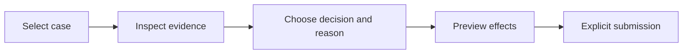
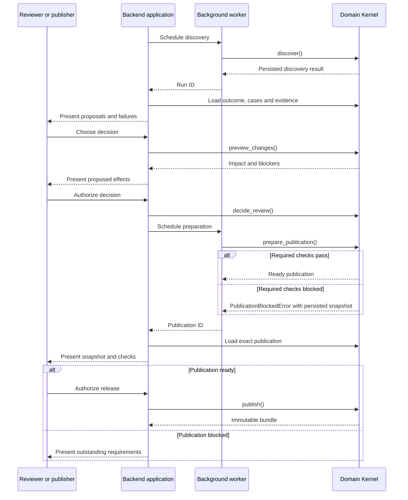

# Integrating Domain Kernel into Applications

[Architecture overview](../../ARCHITECTURE.md) · [Contract index](README.md)

<a id="10-use-notebooks-and-backend-applications"></a>

Domain Kernel runs inside the application that uses it. A notebook, backend service or background worker can use the same public API, reopen the same persisted models and work with the same review and publication records.

The difference between these environments lies in how the application presents information, schedules operations and receives decisions from its users.

## 1. Responsibility Boundaries

The SDK manages domain models and their lifecycle. The host determines how that lifecycle fits into its application.

| Responsibility | Owner |
|---|---|
| Authentication, authorization and actor verification | Host application |
| Request handling, background jobs and retry scheduling | Host application |
| Discovery, review and publication state | Domain Kernel |
| Model integrity, concurrency and idempotency | Domain Kernel |
| User interfaces, notifications and error presentation | Host application |
| Operational adoption of published models | Consuming application |

An application does not need to keep a long-running SDK session open while waiting for a reviewer. Persisted models, discovery runs, review cases and publication preparations can be reopened across requests, workers and notebook sessions.

Persistence, source acquisition and inference operations are asynchronous. Await reads and previews as well as durable commands. The SDK keeps blocking adapter work off the event-loop thread.

In-memory builders, loaded snapshot inspection and serialization remain synchronous.

## 2. Notebook Integration

Notebooks provide an interactive environment for exploring evidence, developing domain models and inspecting the results of SDK operations.

They use the ordinary public API rather than a separate modeling or review implementation.

### The Legislative Domain Model Notebook Journey

The [canonical notebook](../../examples/notebooks/README.md) demonstrates how a developer could build a domain model for legislative analysis of AI systems used in recruitment.

It follows Article 13 of the EU AI Act from the original document to a published model that another application can consume.

| Step | What the developer does |
|---|---|
| Capture evidence | Download and pin the English PDF, configure the client and reopen Docling's retained Article 13 text from SQLite. |
| Discover meanings | Run discovery through LiteLLM and inspect the resulting proposals and citations. |
| Review the model | Read Article 11, preview and record an attributed correction, add an optional logging field and preserve the source qualification in a cited rule. |
| Publish and consume | Prepare and authorize an immutable version, reopen its bundle independently and validate a sample record against a supported JSON Schema projection. |

The walkthrough distinguishes requirements supported by the legislation from modeling choices made by the application.

Domain Kernel preserves those distinctions. The consuming application remains responsible for operational records and legislative conclusions.

The [live discovery recipes](../../examples/notebooks/README.md#live-discovery) cover additional sources, including European Commission guidance.

Keep the main walkthrough focused on the modeling lifecycle. Advanced configuration, failure scenarios and detailed contract verification belong in focused recipes and tests.

Notebook explanations should address the reader directly and describe the result of each operation.

See the [notebook validation report](../../examples/notebooks/VALIDATION.md) for verification evidence.

### Notebook corpus and ontologies

The [source manifest](../../examples/notebooks/fixtures/sources.json) records the source class, edition, attribution, original content digest and passage locators.

The canonical walkthrough uses the verified English AI Act PDF. Preserve the distinction between original-byte identity and captured-content identity.

Specialist recipes retain the French edition, WEC stakeholder paper, ELI workbook, ELI, DPV/AI Act and optional LOMO resources, including their imports and the provenance of derived fixtures.

Select SKOS/RDFS or OWL semantics explicitly. Business mappings and formal ontology adoption follow their respective review contracts.

### Notebook capability coverage

The [capability ledger](../../examples/notebooks/coverage.json) maps capability IDs to notebook cells, specialist recipes or owning conformance tests.

Record exact source pins and expected outcomes for the walkthrough.

Advanced modeling, reference packs, dependencies, formal reasoning, interoperability and provider or database configuration belong in [focused recipes](../../examples/notebooks/README.md#recipes) and their associated tests.

Replayed inference responses verify deterministic workflow behaviour. Live discovery quality must be evaluated separately against independently reviewed corpus expectations.

## 3. Notebook Inspection

A notebook should make SDK results easy to understand without requiring a separate presentation call after every operation.

Enable optional rich display once per kernel:

```python
from domain_kernel import enable_notebook_display

enable_notebook_display()

publication
```

Subsequent cells can end with the SDK value the developer wants to inspect.

For example, inspecting `publication.checks` in its own cell displays the already-loaded validation and readiness results.

Ordinary attributes, typed getters and standard IPython display remain available.

### Display contracts

Rich display presents captured SDK values without retrieving additional state or changing their contents.

| Value | Default presentation |
|---|---|
| Definition | Name, kind, meaning, attributes, keys, references, provenance and revision. |
| Definition or review page | Bounded rows, displayed count and whether another page is available. |
| Source, ingestion batch or discovery result | Exact identity, successes, failures, diagnostics and recovery information. |
| Review case and impact | Proposed changes, evidence references, requirements, rationale and affected definitions or decisions. |
| Publication and checks | Snapshot identity, validation results, blockers and nonblocking questions. |
| Change set and projection assessment | Changed definitions, compatibility, supported scope, limitations and consumer obligations. |
| Bundle | Model identity, version, hash, definitions, dependencies, provenance and release authorization. |
| Exported artifact | Destination metadata, content hash, semantic mapping, projection limitations and consumer obligations. |

Display must remain bounded, synchronous and read-only.

Rendering performs no database reads, inference, evidence retrieval, writes or review decisions.

Show identity and revision information from the supplied snapshot without implying that it has been refreshed. Display only explicitly loaded `EvidenceContent` excerpts.

Do not infer unloaded collection totals, retrieve related definitions automatically, download exported artifacts or render unbounded graphs.

### Security and accessibility

Notebook output may contain untrusted source text or generated content.

Renderers must:

- Escape untrusted text, validate link schemes and redact secrets.
- Provide meaningful plain-text fallbacks.
- Provide accessible tables alongside definition graphs.
- Support keyboard interaction and status indicators that do not depend on colour alone.
- Verify light and dark presentation.
- Respect notebook frontend trust rules.

Avoid dumping recursive internal records or exposing private implementation state.

### Optional rendering integration

Rich display belongs to the optional notebook integration. Importing Domain Kernel does not load IPython.

Applications can supply a typed `NotebookRenderer`.

`disable_notebook_display()` restores the previous formatters. The low-level `render_notebook()` utility remains available for escaped HTML rendering, inspection tests and integrations.

Core domain records remain independent of notebook frameworks and custom JavaScript.

## 4. Optional Notebook Controls

Interactive widgets can make reviewing a domain model more convenient, particularly when a notebook contains several definitions, evidence citations or review cases.

Their responsibilities must remain separate from the SDK itself.

| Component | Responsibility |
|---|---|
| Core SDK | Model integrity, operation contracts and persistence. |
| Display integration | Render supplied snapshots. |
| Notebook application | Selection, filtering, forms, widgets and callbacks. |

Controls can select definitions, cases and versions or explicitly request evidence.

A review interaction follows the same sequence as any other application:



Widgets call the ordinary SDK operations. They do not introduce a separate review engine, service or state store.

Every essential action must also be available through an equivalent Python code cell.

Prefer standard widgets unless a demonstrated requirement justifies a custom implementation.

Rendering must never trigger callbacks that mutate model state. Explicit callbacks preserve actor attribution, inspected revisions, idempotency and stale-state checks.

Disable actions known to be stale or already in progress, reload affected snapshots after mutations and prevent duplicate clicks from creating duplicate intended operations.

A shared notebook or kernel does not establish the identity or authority of its users. Applications working with real business data must supply verified actor identities.

## 5. Running and Resuming Notebooks

A notebook kernel is temporary, but the model state stored by Domain Kernel is not.

Restarting a kernel does not reset its SQLite database. Developers should be able to reopen their existing workspace and continue working rather than recreate their model whenever a session ends.

### Live inference

The legislative walkthrough downloads pinned publisher PDFs, processes them locally through Docling and sends the declared pages to GPT-6 Luna through LiteLLM.

Before offering a Run All operation, document the `OPENAI_API_KEY` requirement and applicable request bounds.

The native-text PDF pipeline requires the `documents` extra. The live inference gateway requires the `inference` extra.

The sample reviewer explicitly records decisions using the cited documents. The sample publisher separately authorizes each model version.

Automated workflow tests inject controlled sources and inference responses at the host boundaries and do not require a live provider key.

### Reruns and recovery

To make notebooks safe to rerun:

- Record workspace names, resource identities and durable operation or plan keys.
- Reopen existing handles after kernel restart.
- Reload snapshots after model changes.
- Reuse recorded operation identities for retries of the same intended work.
- Assign new identities when inputs or intended operations change.
- Preserve duplicate-name and stale-state errors rather than silently substituting another resource.

Rebuilding a `DomainModelBuilder` creates new identities. It is not a retry mechanism for an existing submitted plan.

Never delete existing user data or generate new names automatically to make a demonstration succeed.

Use explicit, isolated demonstration configuration rather than accidentally inheriting production settings.

### Execution environment

Use top-level `await`, the correct project kernel and explicit filesystem paths.

Avoid nested event-loop patches and hidden working-directory changes.

Show the paths and hashes of delivered artifacts. Keep detailed configuration diagnostics in the appropriate deployment recipes.

During host teardown, release caller-owned gateways, pools and transports. Domain Kernel releases its own operation resources and does not require a separate client shutdown step.

See [workspace and configuration](workspace-and-configuration.md) and [persistence and reliability](persistence-and-reliability.md).

## 6. Notebook Distribution and Verification

The notebook is both a learning resource and an executable demonstration of the SDK's public contracts.

### Distribution

The canonical artifact is a versioned Jupyter `.ipynb` notebook, paired with a reviewable text representation through Jupytext.

Verify that both representations agree and distribute them together with their verified assets in the versioned notebook archive.

Embedded outputs describe captured example state. They do not establish the state of a reader's workspace or prove that the current notebook executes successfully.

Label simulated results and exclude runtime databases, credentials and private evidence from committed notebooks.

### Supported environments

| Environment | Role |
|---|---|
| Jupyter Notebook and JupyterLab | Primary notebook targets. |
| VS Code notebooks | Supported developer environment. |
| GitHub Codespaces / devcontainer | Preferred optional browser-based environment using the same locked tooling. |
| Deepnote | Optional collaborative environment, subject to compatibility testing. |
| Binder | Disposable introduction rather than resumable model storage. |
| marimo and other reactive notebooks | Evaluate separately to prevent implicit repetition of durable operations. |

The canonical notebook must remain usable without vendor-specific blocks or accounts.

Before supporting Deepnote, verify its [widget support](https://deepnote.com/docs/ipywidgets-in-deepnote) and [notebook import/export limitations](https://deepnote.com/docs/importing-and-exporting-jupyter-notebooks).

Document tested frontend versions, accessibility results and available text or static fallbacks rather than promising identical behaviour across environments.

Optional notebook runtime dependencies belong in a named extra. Notebook authoring and execution tools belong in a development dependency group.

Use the pinned uv environment, locked installations and the project's seven-day dependency cooldown. Notebook cells must not install unpinned latest versions.

Version the notebook and its tested setup with each SDK release.

### Continuous acceptance

Run the canonical notebook independently of the documentation website.

CI must execute the deterministic walkthrough using a fresh kernel, isolated workspace, explicit timeouts and nbclient or equivalent Jupyter execution tooling.

Verification must cover:

- Successful execution without unexpected exceptions.
- Independent consumption of the published bundle.
- Semantic outcomes rather than unstable generated IDs or timestamps.
- Reruns, kernel restart, recovery and stale actions.
- Browser-based widget interactions.
- Useful, bounded and escaped rendering without implicit I/O or mutation.

Exercise typed failure scenarios in the owning implementation tests.

Headless notebook execution does not establish that browser widgets behave correctly. Saved cell output does not establish that the current notebook has passed its execution checks.

### Evaluate the learning experience

Each feature should update the canonical journey, a specialist recipe or its owning conformance evidence in the [capability ledger](#notebook-capability-coverage).

A newcomer starting from the README should aim to reach the first independent bundle read within ten minutes of having a ready environment.

Record where developers encounter difficulties and whether they can identify:

- Which interpretation was reviewed.
- Which evidence supported it.
- What changed in the published model.

This is an onboarding target, not an established performance guarantee.

Evaluate live parsing and discovery separately against independently reviewed expectations for definition and relationship quality, evidence accuracy, mapping quality and correction effort.

The walkthrough should demonstrate the model and its independent consumption without implementing an entire downstream application.

## 7. Backend Requests and Workers

Backend applications typically perform discovery and publication preparation in background workers while exposing review and inspection operations through their own request handlers.

For example, a Business Analysis Platform might schedule discovery when an analyst submits a collection of documents. The worker processes the selected revisions and returns a run ID. The analyst can inspect the resulting proposals later without keeping the worker running.

Domain Kernel persists the modeling state. The host owns the queue, request transport, user interface and scheduling.



The following examples represent separate worker operations and request handlers, not a single automated discovery-to-publication script.

The host verifies `actor` before supplying it to the SDK.

Each operation's `*_request_id` must be assigned and persisted before its first attempt. Reuse it for retries of the same operation and assign a new identity for new intended work.

### Discovery and Review

#### Run discovery in a worker

The worker receives exact, previously ingested source revisions.

```python
run = await model.discover(
    actor=actor,
    sources=source_revisions,
    idempotency_key=discovery_request_id,
)

run_id = run.id
```

Store the run ID in the host's job result.

Discovery persists its outcome and review cases. The worker does not wait for human review.

#### Retrieve the discovery outcome

When the user opens the result, load the persisted run and the relevant page of review cases.

```python
from domain_kernel import CaseStatus

run = await model.get_discovery_run(run_id=run_id)

pending = await model.list_review_cases(
    run_id=run.id,
    status=CaseStatus.PENDING,
    cursor=cursor,
)
```

The application should present the run status, failures, pending proposals and supporting evidence.

Each failure exposes its source label, message, diagnostic code and retryability.

An empty page of review cases does not establish successful discovery.

Return `pending.next_cursor` to the frontend when further pages are available. The cursor is `None` on the first request.

#### Preview a review decision

After the user selects a case, retain its exact inspected snapshot.

The `decision` represents the typed action and reason selected by the reviewer.

```python
impact = await model.preview_changes(
    case=case,
    decision=decision,
)
```

Present the proposed effects, including the inspected workspace revision, before-and-after definitions, source and reference alignment changes, affected cases, invalidated decisions and publication blockers.

Previewing does not apply or reserve the changes.

#### Submit the decision

Submit the decision only after the reviewer explicitly authorizes it.

```python
receipt = await model.decide_review(
    actor=actor,
    case=case,
    decision=decision,
    idempotency_key=review_request_id,
)
```

Preserve the exact case and decision used during preview.

Do not retrieve the latest case during submission and silently apply the previous decision to it. Domain Kernel rechecks current state before committing the operation.

The host authenticates and authorizes the actor rather than trusting an identity supplied in a request body.

See [review and publication](review-and-publication.md).

### Preparation and Publication

#### Prepare a publication in a worker

Publication preparation can involve expensive validation and therefore may run as a background operation.

```python
from domain_kernel import PublicationBlockedError

try:
    publication = await model.prepare_publication(
        actor=actor,
        idempotency_key=preparation_request_id,
    )
except PublicationBlockedError as error:
    publication = error.publication

publication_id = publication.id
```

Both ready and blocked preparations are persisted.

The worker records the exact publication ID so that the application can retrieve its candidate, checks and blockers later.

#### Inspect readiness

Before offering publication, retrieve the saved preparation and inspect its readiness information.

```python
publication = await model.get_publication(
    publication_id=publication_id,
)

print(publication.ready)

for check in publication.checks:
    print(check)

for blocker in publication.blockers:
    print(f"{blocker.code}: {blocker.message}")
```

A blocked preparation provides diagnostic information. It does not authorize publication.

#### Publish the inspected snapshot

Once a user has inspected a ready preparation and explicitly authorized its release, a separate request publishes that exact snapshot.

```python
publication = await model.get_publication(
    publication_id=reviewed_publication_id,
)

bundle = await model.publish(
    publication=publication,
    version="1.0.0",
    actor=actor,
    reason="Release the reviewed domain model.",
    idempotency_key=publication_request_id,
)
```

The host must retain the publication identity that the user actually inspected.

If the workspace has changed, publication fails as stale. The application must prepare and present a fresh snapshot before requesting authorization again.

After resolving publication blockers, preparation constitutes new work. Omit the previous idempotency key or supply a new one.

Retrying the earlier preparation key retrieves its original outcome.

See [review and publication](review-and-publication.md) and [persistence and reliability](persistence-and-reliability.md).

## 8. Pagination and Sequential Inspection

A model may contain more definitions, review cases or historical records than an application should load at once.

SDK list operations therefore return bounded pages with a `next_cursor`.

A single page must not be treated as the complete result set. Preserve the original query filters when requesting subsequent pages.

For sequential inspection, `iter_review_cases()` handles cursor bookkeeping:

```python
from domain_kernel import CaseStatus

async for case in model.iter_review_cases(
    run_id=run.id,
    status=CaseStatus.PENDING,
):
    print(f"{case.id.value}: {case.reason}")
```

The method is a synchronous factory returning an `AsyncIterator[ReviewCase]`. Persistence reads occur during asynchronous iteration.

The iterator:

- Delegates to bounded `list_review_cases()` requests.
- Uses a default page size of 50.
- Preserves filters and cursor semantics.
- Materializes at most one page at a time.
- Does not prefetch or hold a transaction between yields.
- Propagates exceptions and cancellation.
- Performs no additional requests or writes after iteration stops.

Iteration provides no stronger snapshot guarantee than ordinary pagination.

Use explicit pages for frontend navigation or resumable batch processing. Use the iterator for straightforward sequential inspection.

Neither mechanism automatically submits review decisions or refreshes the inspected case during submission.

## 9. Integration Requirements

Whether Domain Kernel runs in a notebook, backend service or worker, preserve the same operational boundaries.

The host must authenticate actors, explicitly authorize durable decisions, retain inspected snapshots and manage operation identities across retries.

Long-running work should not wait for human decisions or hold database transactions open across external I/O.

Applications must distinguish incomplete discovery, unresolved review work and blocked publication. These states require different recovery actions.

A published model remains independent of the environment that created it. Consuming applications decide when to adopt it and how to enforce its requirements.

For further integration contracts, see:

| Resource | Purpose |
|---|---|
| [Workspace and configuration](workspace-and-configuration.md) | Client configuration, resource identities and adapter selection. |
| [Discovery and reconciliation](discovery-and-reconciliation.md) | Discovery runs, evidence inspection and recovery. |
| [Review and publication](review-and-publication.md) | Decision submission, readiness and release authorization. |
| [Persistence and reliability](persistence-and-reliability.md) | Transactions, concurrency, retries and resource ownership. |
| [Bundles and interoperability](bundles-and-interoperability.md) | Independent consumption and operational integration. |
| [Guarantees and verification](guarantees-and-verification.md) | Failure handling and architectural verification. |
