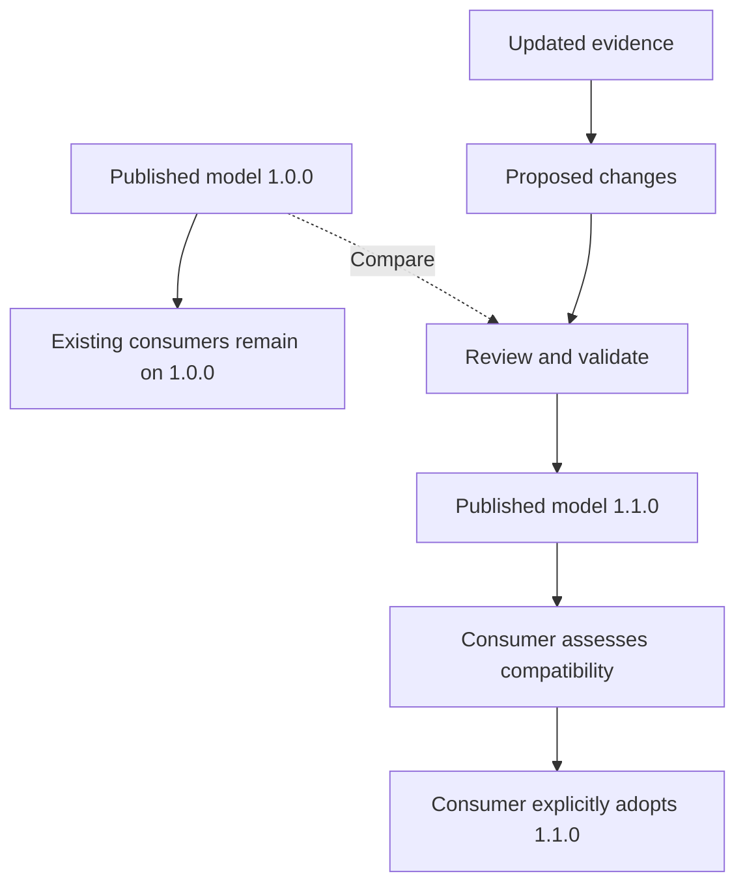
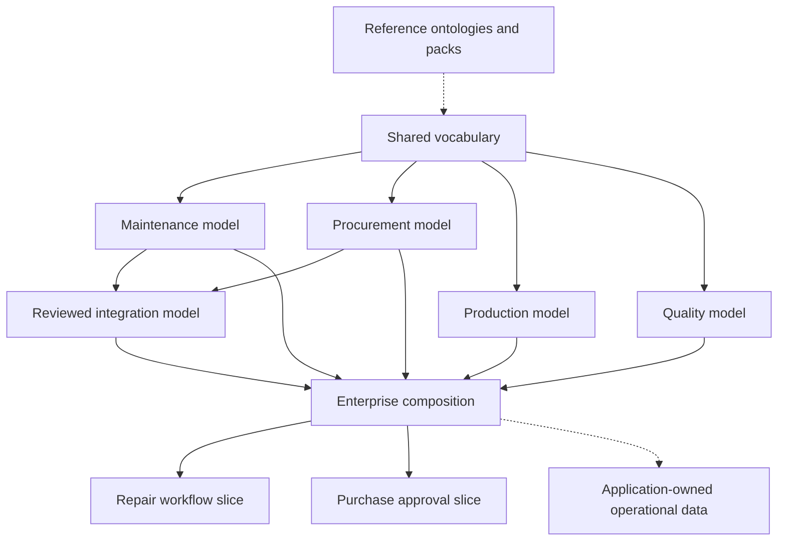
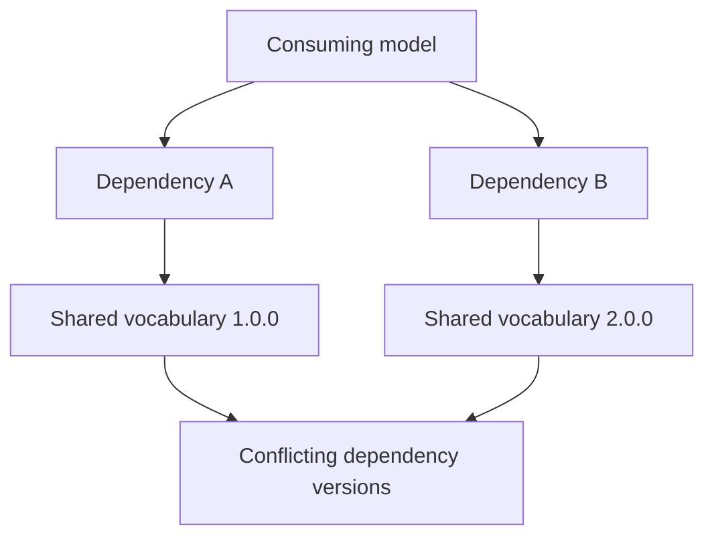

# Model Evolution and Dependencies

[Architecture overview](../../ARCHITECTURE.md) · [Contract index](README.md)

<a id="9-evolve-models-safely"></a>

Business understanding changes over time. New documents may contradict earlier interpretations, organizations may introduce new requirements, and shared definitions may need to evolve.

Domain Kernel allows authors to incorporate these changes without losing the history of earlier decisions or affecting applications that consume previously published models.

Approved definition revisions and published model versions are immutable. Changes enter the review lifecycle and, when accepted, become part of the model's evolving workspace.

## 1. Revise, Correct, or Retire Definitions

Not every change to a domain model requires new evidence or automated discovery. Authors can propose changes directly as their understanding of the business develops.

The appropriate operation depends on what needs to change.

| Intent | Operation |
|---|---|
| Rename, clarify or extend an existing definition | `propose_definition_revision()` |
| Correct an earlier source or reference alignment | `reopen_review_case()` |
| Remove a definition from active use | `propose_definition_retirement()` |
| Restore a retired definition | `propose_definition_restoration()` |
| Split a definition into distinct meanings | Create new definitions, repair affected references and mappings, and retire the original where appropriate. |
| Merge duplicate definitions | Select the surviving definition, repair references and retire duplicates with explicit replacement lineage. |

A revision preserves the existing definition ID when the reviewer determines that its underlying business meaning remains the same.

Splitting or merging concepts requires explicit identity and reference changes. Existing IDs must not be silently assigned new meanings.

### Correct earlier review decisions

Suppose a reviewer previously mapped ten occurrences of `Item` to the concept `ItemType`. New evidence reveals that two of those occurrences actually describe individual physical units.

The reviewer should be able to correct those two interpretations without invalidating the remaining eight.

`reopen_review_case()` creates a correction case linked to the original effective decision. Explicit `proposal_ids` identify the source occurrences affected by the correction.

When accepted, the correction supersedes the relevant portion of the earlier interpretation while preserving its history.

This also applies to source alignments created when accepting a definition proposal. Correcting the alignment does not revoke approval of the definition itself.

Definition-lifecycle decisions cannot be reopened without an explicit source-occurrence selection. Use revision, retirement or restoration proposals to change definition content or lifecycle.

Overlapping or stale corrections are rejected. Rejecting a correction leaves the previous interpretation effective.

Required correction work blocks publication until resolved.

### Cancel pending changes

A pending proposal or correction can be cancelled by submitting `Reject` with its current inspected case through `decide_review()`.

Cancellation remains possible when the proposed target revision has become obsolete because the operation does not apply changes to that target.

However, rejecting a proposal does not necessarily resolve the problem that caused it to be created. Required mappings, confirmations and reference-pack obligations remain outstanding until addressed.

If the change is still necessary, create a new proposal against the current revision.

### Retire and restore definitions

Retirement removes a definition from active use without deleting its history.

Retired definitions remain available through `ModelContent.retired_definitions`. Consumers working with active definitions use `content.definitions`.

A retired definition retains its revision, retirement reason and optional replacement lineage.

At the time of retirement, replacement IDs must identify active definitions within the same model. They cannot refer to the retired definition itself or introduce replacement cycles.

Historical replacement lineage may later refer to definitions that have themselves been retired. It does not automatically redirect active references.

Use `get_definition_history()` to inspect earlier revisions.

Restoration proposes reactivating the definition's last content under its original ID. Acceptance creates a new approved revision, clears replacement IDs from the active revision and preserves the retirement history.

Previous mappings and confirmations are not automatically reinstated. The restored meaning, references and applicable reference-pack obligations must be revalidated.

Further content changes follow the ordinary revision workflow.

### Preserve model integrity

Accepting a change atomically commits its effects, audit records and updated workspace revision.

A change may invalidate existing mappings, confirmations or reference-pack coverage. The SDK marks affected interpretations as stale and creates the required follow-up review work.

Existing mappings can be reused only when deterministic compatibility checks establish that their meaning, model ownership and interpretation context remain unchanged.

Where compatibility is uncertain, the interpretation requires review.

Active references to retired definitions, stale decisions and unresolved required work block publication. A workspace may therefore contain intermediate states that are not yet publishable.

Earlier publications, review history and evidence citations remain inspectable, subject to evidence retention and availability.

## 2. Incorporate New Evidence

Consider a supplier publishing an updated component catalog. The new document may introduce additional component types or reveal that existing definitions need correction.

Capture the updated document as a new revision of the existing source:

```python
from domain_kernel import Excel

catalog = await project.get_source(name="components")

updated_source = await project.ingest_source_revision(
    actor="user:model-editor",
    source_id=catalog.id,
    source=Excel(path="components-updated.xlsx"),
)

update_run = await model.discover(
    actor="user:model-editor",
    sources=[updated_source.revision],
)
```

Discovery proposes interpretations based on the new revision. It does not overwrite approved definitions.

Inspect the run status and failures separately from its pending review cases:

```python
from domain_kernel import CaseStatus

print(update_run.status.value)

for failure in update_run.failures:
    print(f"{failure.code}: {failure.message}")

async for case in model.iter_review_cases(
    run_id=update_run.id,
    status=CaseStatus.PENDING,
):
    print(f"{case.id.value}: {case.reason}")
```

An empty review queue does not establish that discovery succeeded.

After reviewing the proposed changes, compile the updated model and compare it with the earlier publication:

```python
updated_candidate = await model.compile(
    actor="user:model-editor",
)

changes = await model.diff(
    before=published,
    after=updated_candidate,
)

print(changes.compatibility.value)

for change in changes.changes:
    before = [definition.name for definition in change.before]
    after = [definition.name for definition in change.after]

    print(f"{change.kind.value}: {before} -> {after}")
```

Definition history can also be inspected using the stable identity of a previously published definition:

```python
component = published.get_concept(name="component")

history = await model.get_definition_history(
    definition_id=component.id,
)

for revision in history.items:
    print(
        revision.revision,
        revision.display_name,
        revision.status.value,
        revision.meaning,
    )
```

Continue through remaining history pages using `next_cursor` and the same definition ID.

Compilation captures reviewed content. Comparing candidates does not account for unapplied proposals or establish publication readiness.

Once the necessary changes have been reviewed, prepare and authorize a new model version.



Publishing a new version does not automatically upgrade downstream applications.

See [discovery and reconciliation](discovery-and-reconciliation.md) and [review and publication](review-and-publication.md).

<a id="coordinated-edits-in-one-reviewed-change"></a>

## 3. Review Related Changes Together

Some changes cannot be applied independently without leaving the model inconsistent.

For example, splitting `Item` into `ItemType` and `PhysicalUnit` may require creating two definitions, correcting source mappings, updating relationships and retiring the original definition.

The reviewer should be able to evaluate these changes together rather than accept several individually incomplete changes.

Domain Kernel supports this through coordinated review.

| Operation | Purpose |
|---|---|
| `propose_change_set()` | Group explicit `CaseDecision` actions from existing pending definition or alignment cases. |
| `propose_change_plan()` | Submit a builder-generated plan, creating its member proposals and reserving provisional identities atomically. |

Each member identifies the exact inspected case, version and intended action.

New definition proposals reserve local IDs before approval, allowing other members of the group to reference them.

### Coordinated review rules

A coordinated review evaluates the complete prospective model rather than applying changes in request order.

References to definitions created or restored within the group are validated against the combined resulting state.

A group must:

- Belong to a single model.
- Contain compatible pending leaf cases.
- Avoid nested groups, duplicate effects and contradictory writes.
- Respect the separate workflows for reference-pack changes, questions and confirmations.

A pending reference-pack change must be resolved or cancelled before grouping.

Creating the group checks the expected workspace and member revisions, reserves its members, advances their case versions and creates a parent case guarded by the resulting workspace revision.

Reserved members remain inspectable but cannot be decided independently or included in another group.

Subsequent unrelated workspace edits make the parent stale.

### Accept or reject the group

Accepting the parent validates the complete prospective state and atomically:

1. Applies every member's exact action.
2. Resolves the member cases.
3. Records linked parent and member decisions.
4. Advances the workspace revision once.
5. Creates required follow-up review work.

If acceptance fails, none of these effects are committed.

The affected graph must contain no unresolved references. Unrelated publication blockers may remain.

Rejecting the parent follows the origin of each member:

| Group origin | Rejection behaviour |
|---|---|
| `propose_change_set()` | Releases all reserved cases as pending with new case versions. |
| `propose_change_plan()` | Rejects generated proposals and releases any pre-existing included cases. |

No intended member action is applied. Released cases are not recorded as rejected child decisions.

Rejection remains possible when workspace or target guards are obsolete, provided the caller supplies the current inspected parent and the member reservations remain valid.

Rejection records, released cases, reservation updates and the operation outcome commit atomically.

Reload released cases before deciding them independently or including them in another group.

An accepted group has no generic undo operation. Corrections use the recorded member decisions and preserve their source scopes and history.

Audit consumers must avoid applying both aggregate and individual member effects as duplicate changes.

See [review and publication](review-and-publication.md) for decision submission and concurrency contracts.

## 4. Organize Models Across Business Domains

A large organization does not necessarily have one appropriate definition for every business concept.

Procurement might define an item as something that can be purchased. Maintenance might define an asset as something that can be serviced. These meanings may overlap, but they serve different business purposes.

Domain Kernel supports independently maintained models with explicit scope, ownership and change lifecycles.

Start with the business questions a model needs to answer. Create separate models when their meanings, ownership or change lifecycles genuinely differ, rather than automatically creating one model per document, department or application.

This follows the principles of [bounded contexts](https://martinfowler.com/bliki/BoundedContext.html) and the scope-driven modeling approach described in [Ontology Development 101](https://protege.stanford.edu/publications/ontology_development/ontology101.pdf).

A bounded context does not require its own service or database.

### Levels of domain organization

| Level | Manufacturing example | Representation |
|---|---|---|
| External knowledge | Industry terminology and equipment standards | Pinned ontologies and reference packs |
| Shared vocabulary | Common site and asset identities | Independently versioned shared model |
| Business domain | Maintenance, procurement or production | Separate reviewed models |
| Cross-domain integration | Relationships between purchased items and maintained assets | Reviewed integration model |
| Enterprise perspective | Selected versions of several domain models | `ModelComposition` |
| Workflow perspective | Definitions relevant to repairing a pump | `ModelSlice` |
| Operational data | Individual pumps, orders and events | Application-owned records or instance graphs |



The arrows represent reuse and composition, not formal inheritance or workflow execution.

The diagram describes one possible application's model landscape. Independent applications can maintain different models and versions.

### Compose published models

`compose_models()` combines supplied, verified published bundles into a read-only composition.

A composition contains exact root model pins, complete source bundles, their required dependency closure and a deterministic content hash.

Initial compositions operate within a single project, consistent with the scope of qualified model references.

Conflicting versions or hashes for the same model are rejected. Compare historical alternatives separately rather than including incompatible versions in the same composition.

Domain model dependencies must remain acyclic. This is distinct from formal OWL ontology imports, which may contain legal import cycles.

Composition preserves the identities and boundaries of the included models. It does not merge definitions or establish their logical consistency.

For example, procurement's `Item` and maintenance's `Asset` remain distinct definitions. An integration model can reference both and establish their relationship through ordinary review.

Reuse a shared definition only when its meaning is genuinely shared. Similar names are insufficient.

Cross-project reuse requires explicit portable reference assets and must preserve the relevant trust and authorization boundaries.

### Create focused model slices

A workflow spanning several domains does not necessarily need another independently maintained model.

For example, a repair workflow might need equipment, work order and selected procurement definitions without requiring the entire enterprise composition.

`slice_model()` selects a bounded view from published models using exact qualified definition references.

```python
from domain_kernel import (
    PinnedDefinitionReference,
    TraversalDirection,
    compose_models,
    slice_model,
)

composition = compose_models(
    bundles=[maintenance_bundle, procurement_bundle],
)

work_order = maintenance_bundle.get_concept(
    name="work-order",
)

repair_view = slice_model(
    composition=composition,
    seeds=[
        PinnedDefinitionReference(
            model=maintenance_bundle.model_version,
            definition_id=work_order.id,
            definition_revision=work_order.revision,
        ),
    ],
    max_hops=1,
    direction=TraversalDirection.BOTH,
)
```

A `ModelSlice` distinguishes:

- Definitions selected explicitly by the caller.
- Supporting definitions required to resolve references.
- Source model pins and selection parameters.
- Resource limits and diagnostics.

Reference closure follows typed relationships, semantic links, process and decision references, and constraints.

Referenced formal ontology modules remain complete. If required supporting content exceeds applicable size or traversal limits, slicing fails rather than silently omitting it.

Slicing is deterministic and read-only. Changes must be made through the owning model workspace, reviewed and published before generating a new slice.

A slice is not an independently approved model or an access-control boundary.

It may omit incoming constraints or entailments from the broader composition. Supporting definitions may also expand its contents beyond the initial selection, so the host must authorize everything returned before exposing it.

Initial slices contain typed SDK values. Formal semantic exports remain based on complete published bundles.

### Extract smaller formal ontology modules

A model slice selects definitions for a particular task. A formal ontology module is intended to preserve specified logical consequences of an ontology for a selected signature.

These operations have different guarantees.

`extract_ontology_module()` uses an explicitly selected optional extractor and seed terms.

Supported locality-based algorithms such as BOT, TOP or STAR may declare entailment-preservation guarantees for a particular signature and semantic regime.

Visual neighborhoods and MIREOT-style extraction cannot claim those same guarantees.

An extracted module:

- Receives a new caller-supplied ontology identity.
- Preserves the original term IRIs.
- Records the exact source closure, extraction algorithm and options.
- Reports unsupported semantics.
- Requires ordinary review before adoption or publication.

Retaining imports that bring in the complete original ontology defeats standalone extraction and must be reported.

Requests and results identify the semantic profile, algorithm version, selected graphs and resource limits. These contribute to the result fingerprint.

See [ROBOT Module Extraction](https://robot.obolibrary.org/extract) and [bundles and interoperability](bundles-and-interoperability.md).

<a id="create-separate-models-from-published-baselines"></a>

## 5. Create Separate Models from Published Baselines

Sometimes the objective is not to revise the current model but to explore a different business design.

For example, an organization may want to retain its current procurement model while developing a proposed future operating model.

Create an independent model from an exact published baseline:

```python
from domain_kernel import ModelKind

next_design = await project.create_model(
    actor="user:model-editor",
    display_name="Catalog Next Design",
    description=(
        "Proposed evolution of component types and supplier relationships in the catalog."
    ),
    kind=ModelKind.PROPOSED,
    copy_from=published,
)
```

To develop a proposed model from existing operations, first publish the corresponding `OBSERVED` model and supply its bundle as the baseline.

<a id="how-baseline-copying-works"></a>

### How copying works

`copy_from` accepts a published `DomainModelBundle`. Omitting it or supplying `None` creates a model without copying.

The SDK reloads the exact registered publication within the same project and verifies its identity, hash and integrity before creating the new model.

Live model handles, standalone `ModelVersion` references, foreign-project bundles and unregistered publications are not accepted.

The new model receives copies of the source's active definitions:

| Property | Copy behaviour |
|---|---|
| Model identity | A new independent model identity. |
| Definition identities | New local IDs. |
| Local references | Remapped to the corresponding copied definitions. |
| Baseline | Exact source `ModelVersion` recorded as an immutable provenance pin. |
| Definition lineage | `baseline_definition_id` records correspondence with the original definition. |
| Dependencies | Existing exact dependency pins are preserved. |
| Reference pack | Selected explicitly for the new model. |

Subsequent revisions preserve baseline correspondence. Newly authored definitions have no baseline correspondence.

A baseline pin records provenance. It does not, by itself, require embedding the complete source bundle.

### Reference-pack selection

The new model does not automatically inherit the source model's reference pack.

Omitting `reference_pack` or passing `None` selects no pack, clears current reference alignments and dispositions, and retains baseline provenance.

Selecting a pack requires an explicit argument and renewed validation of mapping compatibility and applicability.

The copied model follows its own review and publication lifecycle. Later publications of the source model do not update it.

## 6. Compare Reviewed Models

A model comparison helps authors and consumers understand what changed between two reviewed snapshots.

Domain Kernel supports comparisons between candidates and published versions within a model. It also supports comparison of a copied model with its exact published baseline.

For example:

```python
next_candidate = await next_design.compile(
    actor="user:model-editor",
)

changes = await next_design.diff(
    before=published,
    after=next_candidate,
)

print(changes.compatibility.value)

for change in changes.changes:
    before = [definition.name for definition in change.before]
    after = [definition.name for definition in change.after]

    print(f"{change.kind.value}: {before} -> {after}")
```

### Comparison scope

Both `before` and `after` accept a `DomainModelBundle`, `ModelVersion` reference or `Candidate`.

The asynchronous operation reloads the exact stored snapshots and verifies supplied objects against their scope, identity, hashes and complete content.

A deserialized bundle can be used when it matches a registered publication.

The SDK does not import the bundle, substitute the latest version or recompile a supplied candidate. Malformed bundles, missing publications and mismatched snapshots retain their existing typed errors.

The following scope rules apply:

| Snapshot | Required scope |
|---|---|
| `after` | Must belong to the model receiving the call. |
| `before` | Must belong to the same model or identify the exact source publication pinned by the `after` snapshot's baseline. |

A candidate from another model cannot substitute for the required baseline publication.

Arbitrary comparisons between sibling models raise `ScopeMismatchError`.

Equivalent bundle and version-reference arguments normalize to the same pins and produce the same `ChangeSet`. Compared snapshots are retained as references rather than embedded bundles.

Comparison is read-only and creates no audit entry.

### Understand the change set

A `ChangeSet` records:

- The exact compared snapshots.
- Reference-pack and dependency pins.
- Explicit definition correspondences.
- Definition revisions, retirements and replacements.
- Source-alignment changes.
- Reference-disposition changes.

Baseline comparisons use recorded lineage rather than name matching or inferred semantic similarity.

Local references are normalized through that lineage. A copied definition receiving a new local ID does not automatically mean its business meaning has changed.

Evidence and review-decision differences remain visible. Unmatched source occurrences appear as additions or removals rather than guessed correspondences.

Compatibility analysis is conservative. When compatibility cannot be established, the result is `undetermined`.

Publication preparation records changes against the latest published version, the exact baseline for a first derived publication, or an initial change set when neither exists.

A comparison does not approve pending proposals or establish publication readiness. It also does not guarantee that an ERP migration, workflow redesign or other downstream adoption will be safe.

## 7. Reference Published Dependencies

Several models may need to reuse the same business concepts.

For example, maintenance and procurement models might both depend on independently maintained definitions of sites and assets.

Rather than duplicate those definitions, a model can declare dependencies on exact published versions through `dependencies=[...]`.

The SDK distinguishes local and qualified references.

| Reference | Meaning |
|---|---|
| `DefinitionId` | A definition belonging to the current model. |
| `PinnedDefinitionReference` | A definition in a declared dependency, identified by its exact `ModelVersion`, definition ID and revision. |

Qualified references are supported in relationship endpoints, reference-valued attributes, process activity inputs and outputs, process decisions, and business decision inputs and outputs.

Process-local roles, flow endpoints and condition input names retain their local identifiers.

### Dependency boundaries

Dependencies follow these rules:

- Dependencies and `copy_from` bundles must belong to the same project.
- References resolve against published versions, never another model's editable draft.
- Candidates and bundles recursively materialize their required dependency bundles.
- Active dependency closures must be acyclic and contain no incompatible versions of the same model.
- Dependency payloads are bounded by `max_bytes`, with nesting limited to 16 edges.

Exceeding a resource limit produces an explicit failure.

When copying a model, its existing exact dependency pins carry into the new workspace. Additional explicitly selected dependencies must not conflict with those pins.

Materialized dependencies allow standalone consumers to resolve qualified references without accessing the producing database or retrieving another model over the network.

Baseline provenance remains separate from active dependencies. A baseline pin does not require materializing the old baseline bundle.

## 8. Upgrade Shared Model Dependencies Through Review

Publishing a new version of a shared model does not automatically change models that depend on it.

Suppose a maintenance model depends on version `1.0.0` of a shared asset vocabulary. Version `2.0.0` introduces a clearer distinction between equipment types and physical assets.

Automatically upgrading the maintenance model could change the meaning of existing relationships or invalidate its reviewed definitions.

Domain Kernel therefore treats dependency upgrades as explicit reviewed model changes.

### Propose a dependency upgrade

`DomainModelBuilder.change_dependencies(change=...)` adds a `DependencyChangeIntent` to an immutable `ModelChangePlan`.

The intent specifies the following values.

| Input | Purpose |
|---|---|
| Current direct dependency pins | Record the complete dependency selection that was inspected. |
| Desired direct dependency pins | Define the complete intended selection after the change. |
| `DependencyRemapping` values | Connect exact old qualified definition references to their intended replacements. |

An empty desired dependency list explicitly removes all dependencies.

The SDK does not match replacement definitions by name or automatically redirect references through replacement lineage.

Submission through `propose_change_plan()` materializes and verifies both dependency closures.

Each active closure must satisfy same-project, acyclic, conflict-free and resource-limit requirements.

Transitive upgrades may require several direct dependencies to change together. Conflicting pins reached through a diamond dependency graph are rejected.



The supplied current pins must match the inspected workspace.

The consuming model and its local definition identities remain unchanged by the upgrade itself.

### Coordinate necessary local repairs

Changing a dependency may require revising local definitions that refer to the previous version.

Dependency-bearing plans can include local definition revisions and retirements.

The initial contract excludes:

- Creating or restoring definitions.
- Including pre-existing review cases.
- Source or reference mapping corrections.
- Merging other change plans.

Additional definitions must be authored separately before proposing the dependency upgrade.

This prevents pending work from being interpreted against a dependency configuration that has not yet been accepted.

The builder validates proposed definition bodies against the target dependency pins.

Explicit revisions must supply complete final bodies containing the intended references.

For otherwise unchanged definitions, the SDK can apply explicit dependency remappings and generate one ordinary revision proposal per affected definition owner.

Unsupported reference paths and removed targets require explicit repairs or retirement. The SDK does not invent replacement structures.

### Preview and apply the upgrade

The preview identifies:

- Current and proposed dependency pins.
- Materialized dependency closures.
- Proposed definition revisions.
- Affected alignments and acceptance checks.
- Required follow-up review work.

A structurally invalid prospective graph prevents acceptance.

Changes to meaning or inherited semantics may introduce additional review and validation requirements before publication.

Acceptance checks the post-submission workspace revision and atomically commits the dependency pins, local revisions, retirements and audit records.

Previously prepared publications are invalidated. Subsequent preparation evaluates validation and applicable reasoning against the new dependency closure.

A dependency-only plan may contain no definition members, but it still requires explicit parent review.

### Reject or correct an upgrade

Rejecting a dependency-bearing parent atomically rejects all generated member proposals.

Cancellation remains possible when the workspace or target guards have become obsolete, provided the current inspected parent is supplied and the applicable cancellation contract is satisfied.

Unlike ordinary coordinated plans, dependency-bearing plans contain no pre-existing member cases to release.

Generated members cannot return to pending status for individual acceptance against obsolete dependency pins. Direct decisions on these members are prohibited.

Pending reference-pack changes and other reserved groups must be resolved or rejected before proposing an upgrade.

An accepted dependency upgrade can only be corrected through another inspected change plan. Reopening the parent does not provide a generic undo operation.

### Preserve dependency audit history

The case and decision audit records contain a `DependencyChange` with both complete materialized dependency bundle sets.

Historical closures are verified independently in their original contexts.

Old and new versions may coexist in audit records without becoming conflicting members of the active dependency closure.

Global byte and depth limits also apply to historical material.

Candidate hashes cover the exact change request and associated audit data. Portable consumers can therefore inspect the dependency upgrade without accessing the producer's database.

## 9. Keep Version Identities Separate

Domain Kernel tracks several kinds of revisions and versions because different parts of the system evolve independently.

| Identity | Changes when |
|---|---|
| Source revision | Source bytes or the canonical captured payload changes. |
| Definition revision | A reviewed change updates a definition. |
| Model version | A new immutable model bundle is published. |
| Reference-pack version or hash | Reference content or obligations change. |
| Bundle schema version | The portable serialization contract changes. |
| Semantic-mapping version | The declared projection semantics change. |

For example, publishing a new reference-pack version does not change a model that remains pinned to an earlier version.

A reviewed reference-pack change updates the working model's selection. Earlier publications retain their original materialized reference knowledge.

Bundle format compatibility is also independent of business model compatibility.

Breaking wire changes require a new major version. Additive changes require a registered minor codec and schema.

The initial supported bundle wire version is `1.0`. Consumers reject unregistered versions rather than silently migrating them.

Consuming applications remain responsible for selecting compatible model versions, migrating operational data and adopting new definitions.

## Further Reading

| Contract | Reference |
|---|---|
| Source revisions and evidence | [Sources and evidence](sources-and-evidence.md) |
| Discovery and alignment | [Discovery and reconciliation](discovery-and-reconciliation.md) |
| Typed authoring and reference packs | [Reference knowledge and domain types](reference-knowledge-and-domain-types.md) |
| Review, readiness and publication | [Review and publication](review-and-publication.md) |
| Transactions, concurrency and recovery | [Persistence and reliability](persistence-and-reliability.md) |
| Bundle consumption and semantic projections | [Bundles and interoperability](bundles-and-interoperability.md) |
| Cross-cutting verification requirements | [Guarantees and verification](guarantees-and-verification.md) |
