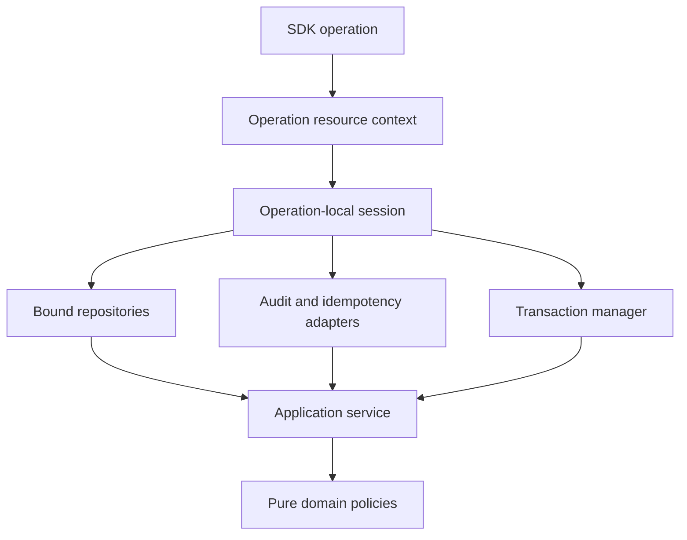
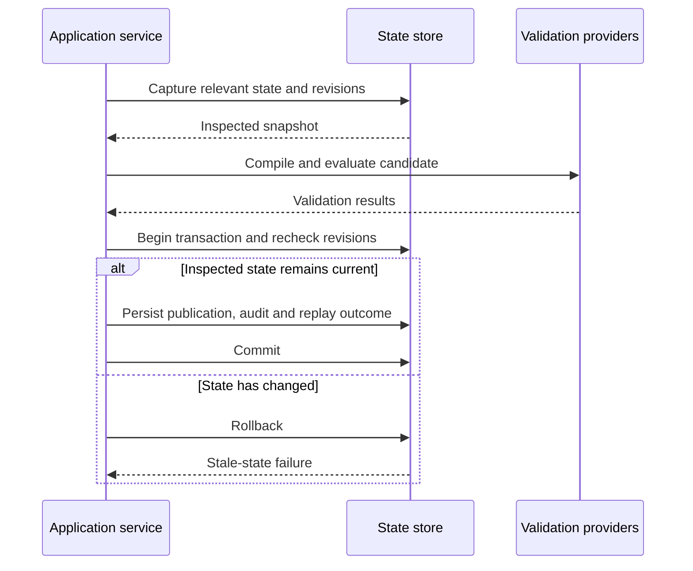
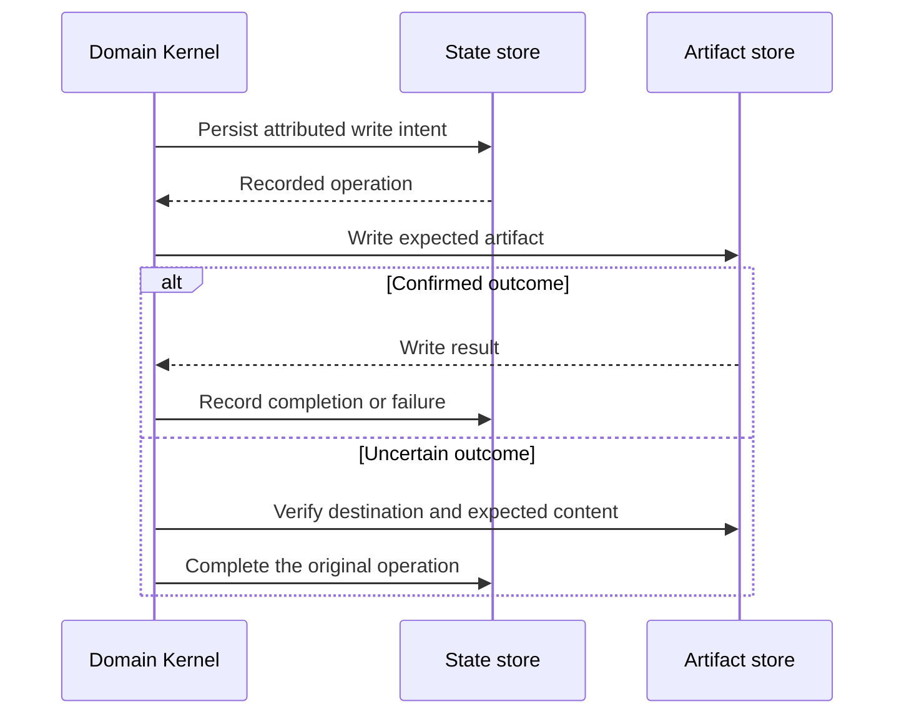

# Persistence, Reliability and Extension Points

[Architecture overview](../../ARCHITECTURE.md) · [Contract index](README.md)

<a id="11-storage-reliability-and-extension-points"></a>

Domain Kernel manages persistent model state, evidence provenance and publication history without requiring applications to adopt a particular infrastructure architecture.

The SDK provides default storage implementations and typed extension points for applications that need alternative persistence, source acquisition or processing capabilities.

## 1. State and Persistence

SQLite is the default state store, allowing applications to use Domain Kernel without provisioning a separate database.

Applications can also use PostgreSQL through the optional `postgres` extra and explicit database configuration.

Persistent state includes:

- Projects, models, definitions and source identities.
- Discovery runs, review cases and decisions.
- Candidates, publications and version history.
- Audit records, idempotency outcomes and recovery checkpoints.

The database schema is internal to the SDK. Applications should interact with persisted models through the public API and published bundles rather than querying internal tables.

The [PostgreSQL parity suite](../../tests/integration/shared/infrastructure/test_postgresql.py) requires a disposable database connection for live verification.

### Persistence implementation

Repositories expose asynchronous methods implemented using SQLAlchemy's typed ORM and expression APIs.

ORM records, sessions, queries and database-error translation remain within the infrastructure layer. Repositories return detached domain values or typed application results, never ORM records or lazy-loading relationships.

Domain code uses the Python standard library and remains independent of persistence frameworks.

Database-specific SQL is permitted only where a narrow infrastructure requirement justifies it and the behaviour is covered by tests.

| Database | Implementation |
|---|---|
| SQLite | SQLAlchemy asyncio and `aiosqlite`, installed by default. |
| PostgreSQL | Psycopg's asynchronous SQLAlchemy dialect, available through the `postgres` extra. |

Dependencies follow the repository's seven-day dependency cooldown.

Asynchronous access does not remove SQLite's locking limitations. Its asynchronous driver uses a thread per connection, so simultaneous database operations must remain bounded.

Both implementations must preserve database constraints and compare-and-swap guarantees.

See [SQLAlchemy's asynchronous programming guidance](https://docs.sqlalchemy.org/en/21/orm/extensions/asyncio.html) for session isolation and preventing implicit I/O.

### Operation-scoped resources

Each persistence operation acquires its own resource context.

`UnitOfWorkFactory` is a synchronous factory that returns an asynchronous context manager. Entering the context acquires an operation-local session and its bound adapters without starting the business transaction.

The composition boundary retrieves collaborators from the typed repository bundle and injects them individually into the application service.



Collaborators participating in an operation share the same session. Concurrent operations never share sessions or session-bound service instances.

Application services manage business transactions through the injected `TransactionManager.begin()` asynchronous context manager.

Successful exit commits once. Exceptions before commit trigger rollback and propagate to the caller.

Repositories do not commit independently. The outer resource context closes resources rather than deciding transaction outcomes.

An already active transaction must be rejected rather than silently joined or replaced with a savepoint.

All returned results must be materialized before releasing the session. Blocking storage and parser operations use bounded offloading outside database transactions.

See [components and ownership](components-and-ownership.md#internal-architecture) for dependency injection and layering requirements.

## 2. Database Initialization and Resource Ownership

### Database initialization

When no `database` configuration is supplied in Python or TOML, Domain Kernel selects its default SQLite database.

The SDK creates the required directory and initializes the schema on the first awaited database operation.

Constructing `Client()` performs no database I/O and starts no background tasks. The first operation waits for initialization to complete before proceeding with business work.

Initialization creates infrastructure metadata, not business records or audit events. It does not enable derivative retention.

| Database configuration | Initialization behaviour |
|---|---|
| Omitted | Lazy initialization of the default SQLite database. |
| Explicit `SQLite()` configuration | Operator-controlled setup through the internal `SchemaManager`. |
| Explicit PostgreSQL configuration | Operator-controlled database creation and schema management. |
| Injected transaction provider | The provider owns its initialization and overrides implicit setup. |

The initialization contract is deliberately conservative:

- Initialize only a new or empty database.
- Verify and reuse an existing compatible SDK schema.
- Reject unknown, partial, corrupt, unrelated or incompatible schemas.
- Serialize concurrent initialization across clients and processes.
- Commit schema and version metadata atomically.
- Preserve existing content when permissions, locking or disk failures occur.

Initialization must not delete existing content, silently migrate a database or fall back to another file or an in-memory database.

An invalid explicitly configured connection never falls back to the default SQLite implementation.

Database creation and schema upgrades remain explicit deployment operations where configuration is supplied. Lazy SQLite initialization does not introduce a public initialization or migration API or CLI.

### Resource ownership

Resources are released by the component that owns them.

| Resource | Owner |
|---|---|
| SDK-created database connections and sessions | Domain Kernel |
| SDK-created readers and operation task resources | Domain Kernel |
| Caller-provided gateways and transports | Host application |
| Caller-provided database pools and transaction providers | Host application |

Default SQLAlchemy engines use `NullPool` and remain operation-scoped. The SDK awaits session closure and engine disposal on every exit.

Injected transaction providers may use caller-owned connection pools. Domain Kernel does not dispose of those pools.

SDK-owned resources are released on success, failure and cancellation. The SDK does not retain client-owned pools, executors or background work requiring an undisclosed shutdown operation.

No public client open or close lifecycle is required.

Public API and domain imports remain free of database-driver and ORM imports, even when baseline persistence dependencies are installed.

Resource cleanup does not establish that an interrupted transaction was rolled back. Uncertain outcomes follow the recovery contract described below.

## 3. Evidence, Files and Artifact Storage

Domain Kernel separates acquiring a source, retaining its evidence and storing generated artifacts.

An application may read documents from SharePoint while writing published models to an S3 bucket. These operations have different permissions, credentials and retention requirements.

Source readers acquire approved inputs from filesystems, S3 or SharePoint. Artifact stores write outputs to configured filesystem or S3 destinations.

Reference-pack catalogs use registered readers. Input and output credentials remain independently configurable.

### Retention policies

Retaining a domain model does not require retaining every document used to create it.

| Data | Retention policy |
|---|---|
| Original documents | Not retained automatically. Explicit verified copying is supported. |
| Extracted content | Independently configurable and disabled by default. |
| Evidence excerpts | Independently configurable and disabled by default. |
| Attributed statements | Persisted as explicit versioned captures. |
| Adopted ontology resources | Original bytes and semantic pins retained in the portable model or reference pack. |
| Definitions, citations, decisions and publications | Persisted to preserve model integrity and history. |

Disabling document retention does not prevent the SDK from persisting derived business definitions or evidence metadata.

When the original document or extracted content has not been retained, evidence inspection must recover the exact recorded revision through an approved reader or parsed-source resolver.

Missing or changed content produces an explicit failure. A newer document cannot substitute for the evidence behind an earlier interpretation.

See [sources and evidence](sources-and-evidence.md) for source identities, capture verification and evidence retrieval.

### Retain an original document

Applications can explicitly copy an ingested file revision to a configured artifact store.

```python
from domain_kernel import CopyTo

original_copy = await project.copy_source_original(
    actor="user:model-editor",
    revision=components.revision,
    destination=CopyTo(store="artifacts"),
)

print(original_copy.verified_hash.value)
print(original_copy.artifact.store)
print(original_copy.artifact.key)
```

Alternatively, request original retention during ingestion using `retain_original=CopyTo(store=...)`.

Both operations use the same destination configuration.

The SDK verifies that the copied bytes match the exact original source revision. Provider-native copy operations must establish equivalent integrity guarantees.

Copying an original does not create another source revision or automatically retain extracted content and evidence excerpts.

Only file-based sources have original documents to copy. Attributed statements and host-parsed captures follow their own retention contracts.

### Artifact immutability

An artifact destination cannot be overwritten with different content.

Reusing an existing destination must satisfy the applicable content and metadata identity requirements.

Publication and artifact delivery are separate operations. If exporting a published bundle fails, the model remains published.

See [bundles and interoperability](bundles-and-interoperability.md) for export and artifact metadata contracts.

## 4. Resource Limits and Data Security

Document processing must remain bounded, particularly when the SDK is embedded in an application that also serves other requests.

The default limits are defined in [client configuration](../../src/domain_kernel/configuration.py).

| Resource | Default limit |
|---|---:|
| Raw source size | 64 MiB |
| Concurrent source processing | 2 sources |
| Expanded content | 256 MiB |
| Document pages | 1,000 |
| Selected files per batch | 1,000 |
| Listing entries per batch, including filtered entries | 10,000 |
| Descendant folder depth | 32 levels |
| Batch enumeration time | 60 seconds |

Inputs exceeding configured limits fail explicitly rather than spilling into temporary files.

These limits protect individual processing operations. They do not establish the total memory consumption or throughput of an application.

Reading a remote document still transfers its bytes into the host process. Disabling retention does not prevent the document from being present in memory during processing.

The host remains responsible for deployment location, process isolation, memory and swap configuration, crash dumps and inference-provider data handling.

## 5. Transactions and Concurrent Operations

Several users or workers may operate on the same model simultaneously.

Domain Kernel combines database transactions, optimistic concurrency, idempotency and persisted recovery checkpoints to preserve the consistency of these operations.

| Mechanism | Guarantee |
|---|---|
| Scoped idempotency | The same operation, key, scope and canonical request replay the recorded outcome. Changed requests conflict. |
| Persisted checkpoints | Discovery progress and failures survive worker restarts. |
| Leases and fencing | An expired worker cannot advance an owned checkpoint after another worker takes ownership. |
| Expected revisions | Stale workspace or review-case changes cannot overwrite newer work. |
| Immutable publications | An existing model version cannot be replaced with different content. |

### Transaction boundaries

Related business changes must commit together.

Accepting a review decision may update definitions, resolve mappings, append audit records and advance the workspace revision. These effects belong to the same transaction, together with the applicable idempotency outcome.

Repositories must not commit individual effects independently.

External operations remain outside database transactions. Downloading a document, parsing its contents or waiting for an inference response should not hold database locks open.

Publication preparation follows the same principle:



Both ready and blocked publication preparations are persisted.

A blocked preparation commits its complete snapshot, audit outcome and idempotency record before `prepare_publication()` raises `PublicationBlockedError`.

This allows the application to inspect the recorded blockers without losing the preparation through exception-driven rollback.

Publication revalidates the stored snapshot and atomically records its release authorization, immutable bundle, audit event and idempotency outcome.

### Uncertain transaction outcomes

Cancellation or a lost commit acknowledgement does not prove that a transaction was rolled back.

For example, a database may commit a review decision immediately before the application loses its connection. The caller cannot safely assume that submitting the same decision again constitutes new work.

The SDK retains resource ownership through transaction cleanup. The caller recovers the uncertain outcome through the original durable operation identity.

See [review and publication](review-and-publication.md) for preparation, release authorization and stale-state requirements.

## 6. Idempotency and Recovery

Idempotency distinguishes a retry of an existing operation from a request to perform new work.

This distinction matters in applications where workers can restart, requests can time out and users can submit an action more than once.

### Invocation identity

Where supported, `idempotency_key` is optional.

When omitted, the SDK generates a fresh opaque internal key at the command boundary and retains it throughout internal retries and persisted checkpoints.

The generated key does not modify the caller's input or derive from document hashes, names or request content.

Two separate unkeyed calls represent separate invocation intents. Running discovery twice against the same evidence may therefore create two discovery runs.

Existing resource uniqueness, immutable artifact identities, version checks and review guards still apply.

### Retry an existing operation

For retries across requests or workers, the host must generate and persist a request identity before the first attempt.

```python
run = await model.discover(
    actor=actor,
    sources=source_revisions,
    idempotency_key=request_id,
)
```

If the operation must be retried, supply the same request ID, canonical inputs and actor.

Generating a different key for every retry prevents the SDK from associating the retry with the earlier operation.

Once the discovery run ID is known, use `get_discovery_run()` to retrieve it or `resume_discovery()` to continue eligible failed, partially failed or cancelled work.

Resumption continues the recorded run and its checkpoints rather than creating a replacement run.

Remote provider calls are not guaranteed to execute exactly once.

### Start new work

| Situation | Required behaviour |
|---|---|
| Retry the same operation after a lost response | Reuse the original key and request. |
| Change the operation's inputs or intended effects | Omit the key or supply a new one. |
| Resubmit an existing change plan | Preserve the stable plan ID used as its default operation key. |
| Retry a generated manifest-child operation | Reuse its recorded child key. |
| Capture a new folder selection | Create a new manifest rather than implicitly resuming an earlier selection. |
| Prepare a publication after resolving blockers | Omit the previous key or supply a new one. |
| Publish after the inspected preparation becomes stale | Prepare and inspect a new publication before authorizing release. |

Replaying a preparation key returns its original ready snapshot or raises `PublicationBlockedError` carrying the original blocked snapshot, even if the workspace has subsequently changed.

See [host integration](host-integration.md) for applying these contracts across requests, workers and notebook sessions.

<a id="durable-action-audit"></a>

## 7. Audit Durable Actions

Applications need to distinguish who proposed a model change, who reviewed it and who authorized its release.

Domain Kernel preserves these distinctions through attributed audit records.

### Actor attribution

Every durable SDK business action requires a non-blank, keyword-only `actor` supplied and verified by the host.

This includes:

- Project and model creation.
- Source creation, revision ingestion, folder-manifest capture and profiling.
- Original-document copying, discovery and reconciliation.
- Proposal submission and review.
- Saved compilation and validation.
- Publication preparation, publication and exports.

Pure builders, previews, reads, serialization and in-memory projections do not create business audit entries.

Reads also do not perform derivative-retention writes. Ingestion, profiling and discovery own those writes under their supplied actor.

Recording an actor identifies the attribution supplied by the application. It does not independently authenticate that person or establish their authority.

### Audit records

Each immutable audit record captures the relevant operation context.

| Field | Purpose |
|---|---|
| Event ID | Identify the audit event. |
| Project and model scope | Identify the affected resources. |
| Typed action and outcome | Describe what happened and its result. |
| Actor and SDK timestamp | Preserve attribution and timing. |
| Reason | Retain the explanation supplied with the decision or plan, where applicable. |
| Before and after references | Identify exact affected revisions or content hashes. |
| Parent event | Connect nested and grouped operations. |

Resource references must identify retained revisions, exact creation metadata or content hashes rather than resolving to mutable latest state.

Routine creation operations do not require invented explanation text.

### Audit coordinated changes

A change plan may contain several related effects involving different definitions, attributes, keys and mappings.

Submission records the exact plan and its submitter. Subsequent review records the reviewer and the accepted or rejected outcome.

Grouping existing cases preserves their original submission attribution.

Parent and member decisions, together with the corresponding definition revisions, provide the detailed change history. Audit records link to those effects rather than applying them again.

A plan can therefore be inspected as a whole or through the history of an individual affected definition.

Operations outside plans, such as model creation, remain independently audited.

### Audit consistency and retries

Business state, corresponding audit records and idempotency outcomes commit within the same transaction.

Corrections append new history rather than modifying previous records.

Matching retries do not create duplicate business events.

Actor attribution participates in request identity. Changing the actor under the same idempotency key produces a conflict. Submitted plan IDs also bind their original submitter.

Blocked preparations record their blocked outcome before raising an error.

Work that fails before committing any state creates no successful business event. Persisted discovery failures and checkpoints retain their actual outcomes and attribution.

Nested operations inherit the initiating actor and parent event.

When a worker executes an operation, the host explicitly supplies its verified user or service identity. Resumption records the actor performing the resumption while preserving the original run attribution.

Statement speakers, recorders and confirmers remain distinct attribution roles. If the statement recorder is omitted, it defaults to the actor performing ingestion.

### Audit external artifact writes

An external artifact store cannot participate in the same transaction as the SDK's database.

Copy and export operations therefore record an attributed write intent before performing external I/O.



Completion and failure records preserve the exact destination and applicable content hash.

Recovery verifies uncertain writes before completing the original operation, avoiding duplicate successful audit events.

No database transaction remains open across the external write. A failed export does not roll back an earlier publication.

### Inspect audit history

`project.get_audit_history()` returns events within the project.

`model.get_audit_history()` returns events scoped to the selected model.

Both operations return bounded pages and perform no writes.

The portable published bundle preserves semantic provenance, review decisions and release authorization. The broader operational audit remains in the producer's state store.

## 8. Extension Points

Domain Kernel uses typed interfaces to isolate infrastructure and optional processing capabilities from the domain model.

Applications can supply implementations appropriate to their environment without introducing provider-specific dependencies into core domain records.

| Contract | Responsibility |
|---|---|
| `ModelGateway` | Provide caller-selected inference capabilities and transport. |
| `SourceReader` | Acquire content from approved source locations. |
| `ParsedSourceResolver` | Recover exact host-parsed source captures. |
| `ArtifactStore` | Persist exported artifacts and retained originals. |
| `UnitOfWorkFactory` | Acquire operation-scoped resources, bound repositories and a transaction manager. |
| Parser, matcher, validator and exporter ports | Implement supported processing and validation capabilities. |
| `SemanticProjector` / `LinkmlMapper` | Produce supported standards-based representations. |
| `NotebookRenderer` | Render loaded SDK snapshots for inspection. |

### Register application integrations

`ClientIntegrations` supplies reader, parsed-source, artifact-store and transaction implementations through `Client(integrations=...)`.

A `ParsedSourceProvider(name=..., resolver=...)` associates a stable provider name with a caller-owned resolver.

`ParsedSourceOrigin.provider` refers to that configured name.

The client and its existing project and model handles reuse the registered integrations.

These interfaces represent declared integration contracts rather than an unrestricted plugin registry.

### Adapter requirements

Returning correctly typed data is not sufficient for a conforming adapter.

For example, a custom source reader must preserve exact source identity and revision guarantees. A persistence adapter must preserve transaction, uniqueness and concurrency guarantees. A projection adapter must preserve supported meanings and report unsupported semantics.

Custom implementations must satisfy the applicable contracts for:

- Identity and scope.
- Exact revisions and content integrity.
- Resource limits.
- Persistence and transaction behaviour.
- Capability availability.
- Error handling and recovery.

Optional capabilities must be available when explicitly selected. Missing required validators or unsupported capabilities must fail rather than silently weakening validation.

See [workspace and configuration](workspace-and-configuration.md) for integration configuration and [components and ownership](components-and-ownership.md) for dependency direction.

## 9. Security Boundaries

Domain Kernel processes potentially untrusted documents, extracted text, semantic resources and generated interpretations.

Its library-level protections address the integrity of this processing and the resulting domain models.

| Protection | Purpose |
|---|---|
| Configured reader roots and prefixes | Restrict source acquisition to approved locations. |
| Explicit ontology resource resolution | Prevent implicit retrieval of external semantic resources. |
| Redacted diagnostics | Avoid exposing secrets through error messages. |
| Escaped notebook HTML | Prevent untrusted content from being interpreted as executable markup. |
| Resource limits | Bound individual processing operations. |
| Explicit capability failures | Prevent unsupported required validation from being silently disabled. |

These controls complement the security mechanisms implemented by the host.

The application remains responsible for authentication, authorization, credential handling, data-access policies, deployment isolation and inference-provider data handling.

Domain Kernel protects the integrity of its model lifecycle and processing contracts. It does not replace the security architecture of the application that embeds it.

See [SECURITY.md](../../SECURITY.md) for vulnerability reporting and supply-chain security, and [guarantees and verification](guarantees-and-verification.md) for the limits of the SDK's guarantees.
