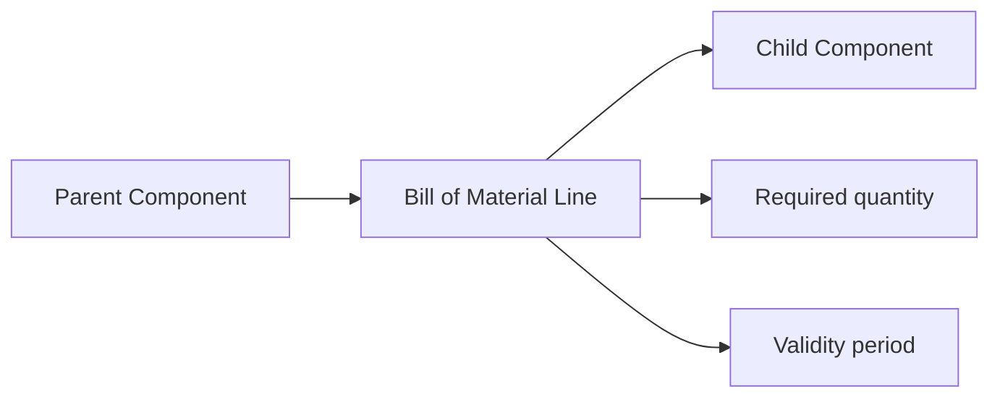

# Reference Knowledge and Domain Types

[Architecture overview](../../ARCHITECTURE.md) · [Contract index](README.md)

<a id="6-use-reference-knowledge-and-richer-definitions"></a>

Building a domain model does not always require defining every concept from scratch. Organizations can reuse industry terminology, established ontologies and modeling patterns while retaining control over how those concepts apply to their own business.

Domain Kernel supports both reusable reference knowledge and independently authored business definitions through the same typed domain model.

This document describes reference packs, ontology reuse, typed authoring, supported domain structures and model acceptance checks.

## 1. Reference Packs and Reusable Patterns

A reference pack is a versioned collection of reusable business definitions, modeling patterns and validation obligations.

Consider a manufacturer developing a procurement model. Established definitions of suppliers, purchase orders and order lines may provide a useful starting point. However, the manufacturer's own terminology, purchasing policies and business relationships may differ from the reference definitions.

A reference pack helps authors establish those relationships without automatically adopting external knowledge as company-specific truth.

### What's in a reference pack?

| Component | Purpose | Procurement example |
|---|---|---|
| Reference definitions | Provide established meanings for comparison. | Supplier, Purchase Order and Order Line. |
| Reusable patterns | Provide connected definitions that can be adapted into a local model. | A purchase order issued to a supplier and containing order lines. |
| Model obligations | Declare requirements against which the model must be evaluated. | Require a supplier relationship within the declared procurement scope. |
| Metadata and dependencies | Preserve provenance, applicability, licences and exact resource versions. | Industry standards and their supporting ontologies. |

A reference pack may combine terminology, formal semantic resources and reusable modeling structures. It is not an executable workflow template or an application configuration package.

Reference packs are optional. Manual authoring, discovery and core model integrity checks remain available when `reference_pack=None`.

### Retrieve reference knowledge

Use `client.get_reference_pack()` to retrieve an exact pack version or `client.list_reference_packs()` to inspect the configured catalog.

Reference packs are loaded only from explicitly configured catalogs. Versions, dependency hashes and selected dependency content are pinned.

Unknown resources fail explicitly. Catalog lookup does not fall back to public downloads or automatically resolve external ontology imports or JSON-LD contexts.

The host remains responsible for selecting appropriate reference standards and establishing whether they apply to its business.

### Apply a reusable pattern

A pattern provides a connected set of definitions that an author can adapt to a local model.

The following example assumes that the configured catalog contains the illustrative `example.catalog@1.0.0` pack and its `catalog-pattern`. These resources are examples, not industry packs distributed with the SDK.

```python
from domain_kernel import Accept, ModelKind

reference_pack = await client.get_reference_pack(
    key="example.catalog",
    version="1.0.0",
)

pattern = reference_pack.get_pattern(
    name="catalog-pattern",
)

reference_model = await project.create_model(
    actor="user:model-editor",
    display_name="Reference Catalog",
    description="Company catalog definitions adapted from reference knowledge.",
    kind=ModelKind.PROPOSED,
    reference_pack=reference_pack,
)

case = await reference_model.propose_pattern(
    actor="user:model-editor",
    pattern=pattern,
    reason="Adapt the reference pattern to the company catalog.",
)

impact = await reference_model.preview_changes(
    case=case,
    decision=Accept(
        reason="Inspect the proposed local definitions.",
    ),
)
```

The SDK creates proposed local definitions, assigns their identities and remaps references between them. The resulting graph enters the ordinary review lifecycle.

Optional `DefinitionBinding` values allow individual reference nodes to be connected to exact inspected revisions of existing local definitions.

Pattern adoption preserves upstream provenance and validates the scope and revision of every binding.

### Pattern identity and integrity

Patterns follow the shared `display_name`, stable `name` and generated `id` convention.

`get_pattern()` performs a synchronous lookup within the loaded pack. It accepts exactly one of `name` or `pattern_id` and raises `PatternNotFoundError` when the requested pattern does not exist.

Pattern names are unique within a materialized pack. Duplicate names fail rather than receiving automatic suffixes.

Loaded pattern snapshots retain their containing-pack pin. Standalone authored patterns must first be composed into a reference pack before they can be adopted.

`propose_pattern()` verifies the supplied pattern's identity, complete content and originating pack pin against the model's selected reference pack.

Adoption does not silently switch packs, select newer versions or introduce a namespace for generated local definitions.

Local definition-name collisions fail atomically. Reusing an existing definition requires an explicit binding rather than automatic merging.

### Map or extend reference definitions

Reference definitions remain read-only.

A local definition can use different terminology or represent a narrower, broader or otherwise distinct meaning while retaining its own identity and review history.

Reference-alignment cases provide synchronous methods for constructing these decisions:

| Method | Local meaning relative to the reference |
|---|---|
| `same_as()` | Equivalent business meaning. |
| `narrower_than()` | Every local instance fits the reference meaning, but not every reference instance fits the local meaning. |
| `broader_than()` | Every reference instance fits the local meaning, but not every local instance fits the reference meaning. |
| `related_to()` | Related meanings without asserting equivalence or inclusion. |
| `distinct_from()` | Different meanings without asserting logical disjointness. |

Each method accepts `local_definition`, `reference_definition` and `reason`.

The methods construct typed decisions and select the corresponding stored relationship. Callers do not supply a separate `relation` argument.

For example:

```python
mapping = reference_case.narrower_than(
    local_definition=car,
    reference_definition=vehicle,
    reason=("Every Car is a Vehicle, but motorcycles and trucks are not Cars."),
)
```

The decision retains both inspected definition snapshots and the exact containing-pack pin. Preview and submission verify those snapshots rather than substituting newer revisions.

The source-alignment form of `same_as()` instead accepts `definition` and `reason`. Mixed argument forms and incompatible case kinds fail explicitly.

When no suitable reference definition exists, a compatible case may be resolved through `ApproveLocalExtension`:

```python
from domain_kernel import ApproveLocalExtension

extension = ApproveLocalExtension(
    definition_id=local_definition_id,
    reason="This company category has no suitable reference definition.",
)
```

These are alternative decisions for compatible cases, submitted through `decide_review()` after inspection.

Approving a local extension resolves its alignment question. It does not waive unrelated required reference-pack obligations.

Similarly, excluding an occurrence or leaving an import undecided does not satisfy required coverage.

See [discovery and reconciliation](discovery-and-reconciliation.md) for source and reference alignment.

## 2. External Ontologies and Semantic Resources

An ontology can describe concepts, relationships and formal assumptions about a domain.

For example, a manufacturing ontology may define components, suppliers, measurement quantities and the relationships between them.

Reusing an ontology can improve consistency with external systems, but an ontology's assumptions may not match the needs of a particular organization.

Domain Kernel separates referencing external knowledge, reviewing its relationship to local meanings and formally adopting its semantics.

### 2.1 Reference, map or adopt

| Operation | Effect |
|---|---|
| Reference | Preserve an external term's original identity and source. |
| Map | Record a reviewed relationship between a local definition and external knowledge. |
| Adopt | Explicitly include a formal ontology module and its pinned dependency closure. |

Consider a local definition of `Part` and an external ontology defining `Component`.

An author may reference the external term for documentation, approve a mapping describing how the meanings relate, or adopt the ontology's formal classifications and axioms.

These operations are independent.

Referencing a term does not approve its meaning. Reviewing a mapping does not automatically activate the source ontology's axioms. Formal adoption requires its own reviewed model change.

### 2.2 Semantic standards

Domain Kernel uses established semantic standards rather than implementing a competing ontology language.

| Standard | Role |
|---|---|
| RDF | Represents knowledge through statements connecting resources and values. |
| RDFS | Defines basic class and property semantics. |
| OWL | Expresses richer formal relationships and logical axioms. |
| SKOS | Represents terminology, classifications and vocabulary mappings. |

RDF provides the graph representation. RDFS and OWL define semantic interpretations of supported statements, while SKOS provides conventions for organizing terminology.

For example, a formal subclass assertion can establish that every electrical component is also a component. A supported reasoner may infer that classification even where it is not explicitly recorded for an individual resource.

Complex ontology constructs, including restrictions, property chains, enumerations, annotations and individual axioms, remain in their original ontology documents.

The SDK does not attempt to reproduce the complete OWL language through its own definition types.

RDF 1.1 is the initial semantic baseline. RDF 1.2 features require an explicitly supported adapter or mapping version.

See [bundles and interoperability](bundles-and-interoperability.md) for formal reasoning and semantic projection contracts.

### 2.3 Preserve original ontology identities

Ontology resources use Internationalized Resource Identifiers (IRIs). An IRI identifies a resource and does not necessarily represent a location that should be downloaded.

Domain Kernel distinguishes several resource identities:

| Identifier | Identifies |
|---|---|
| Document IRI | A particular supplied ontology representation. |
| Ontology IRI | The ontology itself. |
| Version IRI | A specific release of an identified ontology. |
| Term IRI | A class, property, datatype, individual or SKOS concept. |

Two typed contracts preserve these identities:

- `OntologyTermReference` records the original absolute term IRI and entity kind.
- `OntologyDocumentPin` records the document identity, exact byte hash, selected graph and optional ontology and version IRIs.

A version IRI requires an ontology IRI. Anonymous ontologies do not need invented ontology identities.

Namespace prefixes are abbreviations rather than independent identities.

`ReferenceDefinition.ontology_terms` contains zero or more original-term bindings. Locally authored reference definitions have none by default.

Original IRIs retain their exact spelling, including case and trailing slashes. Imported terms are not renamed into a local namespace.

Matching labels, IRIs or source bytes do not merge company definitions or establish approval.

Entity kinds remain explicit because OWL permits punning, where the same IRI participates in different entity roles. Sharing an IRI does not make those roles interchangeable.

Reference-pack composition also preserves original ontology identities alongside the pack-to-pack lineage recorded in `ReferenceOrigin`.

### 2.4 Load immutable ontology resources

An `OntologyDocument` contains the original supplied bytes, declared syntax and document pin.

`load_ontology()` constructs an immutable `OntologyClosure` containing the selected root ontology and its explicitly resolved dependencies.

The SDK preserves:

- The complete supported RDF dataset.
- Original bytes and resource identities.
- Literal datatypes and language tags.
- Blank-node identities and their scope.
- Graph selection and dependency relationships.

This allows semantic resources to remain reproducible without assuming that identical meaning requires identical serialization.

Two RDF documents can contain different bytes while representing isomorphic graphs. Content hashes preserve exact representations, not graph equivalence.

### Select an RDF graph

An RDF dataset can contain a default graph and multiple named graphs.

The SDK parses the complete dataset but requires a selected graph for interpreting ontology headers, term declarations and logical imports.

| Selector | Behaviour |
|---|---|
| `ontology_graph=None` | Select the default graph only. |
| Named graph IRI | Select the identified named graph. |
| Blank-node graph selector | Select the graph through its stable document-scoped parser identity. |

Other graphs are not automatically combined with the selected graph.

Selecting a different graph from the same source bytes produces a different semantic pin. Extraction and reasoning fingerprints preserve that selection.

### 2.5 Resolve imports and dependencies explicitly

An OWL ontology may declare dependencies through `owl:imports`.

For example, a manufacturing ontology may depend on a separate ontology defining units of measurement.

Domain Kernel requires the host to supply the resources needed to resolve the reachable import closure.

Imports resolve through exact document, ontology or version IRIs. Relative IRIs resolve against the declared base or document IRI according to the source syntax.

The SDK records which import selected each resource and verifies its content hash.

Resolution fails when required resources cannot be identified unambiguously, including:

- Missing imports or JSON-LD contexts.
- Conflicting resource aliases.
- Mismatched content hashes.
- Ambiguous references to unversioned ontologies.

Different explicitly requested ontology versions may coexist. An unversioned reference that could identify several supplied versions is rejected.

The SDK preserves supplied identities even when their combined formal semantics may later prove inconsistent.

There is no automatic network retrieval, filename guessing or latest-version resolution.

### Import cycles and blank nodes

OWL import cycles are valid. The SDK traverses each verified pinned document once, producing a finite closure.

Repeated imports reuse the same resource.

This differs from dependencies between Domain Kernel models, which must remain acyclic.

Blank nodes retain their original dataset scope, including intentional sharing between named graphs in one dataset. Unrelated documents must not share blank-node identities.

Resource limits constrain closure size, document counts, parsing and reasoning.

An unresolved ontology document may remain available as source evidence, but cannot be treated as a complete semantic closure.

### 2.6 Distinguish semantic references

Not every reference to an external resource introduces formal ontology semantics.

| Construct | Effect |
|---|---|
| External term reference | Preserve the original term identity and provenance. |
| `rdfs:seeAlso` / `rdfs:isDefinedBy` | Record documentation or definition links without automatic retrieval. |
| SKOS mapping | Relate vocabulary concepts under the declared predicate's semantics. |
| `owl:imports` | Declare a formal dependency on a reachable ontology closure. |
| JSON-LD context | Supply pinned syntax-expansion rules. |
| LinkML import | Combine schemas under the separate LinkML interoperability contract. |

A SKOS mapping does not automatically establish OWL class equivalence or individual identity.

A JSON-LD context can determine how abbreviated terms expand into IRIs without importing ontology axioms.

Business alignments likewise remain separate from explicitly authored formal semantic links.

### 2.7 Adopt formal ontology modules

Loading an ontology makes its content available for inspection. It does not activate its axioms in a local model.

Formal adoption uses `OntologyModuleDefinition`, which references an immutable ontology closure and follows the ordinary proposal and review lifecycle.

A typical adoption involves:

1. Loading and inspecting the external ontology.
2. Reviewing its formal assumptions and applicability.
3. Approving a module containing the required formal content.
4. Authoring and reviewing relevant semantic links.
5. Validating the resulting model through supported semantic capabilities.

Reviewed formal links become assertions in the local ontology, together with any required endpoint declarations.

A link to an external term does not itself import the term's source axioms. Only explicit module adoption activates the closure.

Replacing a module creates a new definition revision and requires revalidation of dependent semantic links.

`ReferencePack.ontologies` contains the materialized closures referenced by the pack's definitions.

Pack validation rejects unbound terms, conflicting source-pin content and contradictory resource aliases. Composition deduplicates identical pins while preserving original IRIs and dependency relationships.

Retaining formal ontology resources does not authorize retention of unrelated business documents.

### 2.8 Preserve semantic integrity

Ontology documents included in portable packs or model bundles use strict, standard padded base64 encoding. Decoding verifies their original content hashes.

An `OntologyClosure` hash covers its canonical typed representation, including:

- Original resource bytes and document pins.
- Selected graphs and parsed semantic records.
- Parser identity.
- Import and JSON-LD context bindings.

Only the closure's own root digest is excluded.

Set-like collections are deduplicated and sorted by canonical record bytes. Blank nodes retain their source scope.

Composition and slice hashes follow the same principle, excluding their own digest and sorting exact model and definition references.

These hashes establish representation integrity. They do not prove RDF graph equivalence or logical equivalence.

Resource limits apply to both encoded and decoded sizes.

Independent structural bundle loading verifies records and hashes without executing an ontology parser or reasoner.

Reasoning reports are outputs associated with an exact publication candidate. They contribute to publication and bundle hashes, but not to the input candidate hash.

This keeps the identity of the validated input independent of its evaluation results.

## 3. Author and Compose Reference Packs

An organization may maintain several reference packs covering procurement, manufacturing and maintenance.

Composition allows an author to combine selected knowledge from those packs into a new versioned resource without modifying the originals.

Composition preserves imported identities and provenance. It does not infer equivalence or automatically inherit every source obligation.

### 3.1 Create a reference pack

Reference-pack authoring requires no client, model database or inference gateway.

Construct a `ReferencePackSpec` containing typed definitions, patterns, obligations and selected imports, then call:

```python
build = ReferencePack.compose(
    spec=spec,
    actor=actor,
    reason="Compose the selected reference knowledge.",
)
```

`ReferencePackBuild` contains the composed pack when structural composition succeeds, together with path-addressed `Issue` diagnostics.

Existing packs can be inspected through `reference_pack.validate()`.

Validation checks the declared structures and supported mapping capabilities. Suitability for a particular business or industry remains an authoring judgment.

### 3.2 Keep imported definitions distinct

Two reference packs may both define `Supplier` without assigning it the same meaning.

Each `ReferencePackImport` therefore declares a unique namespace matching:

```text
[A-Za-z][A-Za-z0-9_-]*
```

Imported definition, pattern and obligation IDs use:

```text
namespace + ":" + original_id.value
```

For example:

```text
procurement:Supplier
maintenance:Supplier
```

Both definitions can coexist without automatic merging.

Composition namespaces are distinct from local pattern adoption, which does not take a namespace.

Imported pattern names and display names remain unchanged. Duplicate pattern names in the resulting pack require an explicit authoring decision.

Body-local identifiers, including attributes, roles, activities, flows, conditions and inputs, retain their original scope.

### 3.3 Materialize selected content

Composition imports all reference definitions from each selected pack.

Patterns and obligations are included through explicit selections. Pattern selection defaults to empty, while obligation IDs must be supplied explicitly.

Typed references are remapped into the destination namespace.

`ReferenceOrigin` preserves the originating pack pin and identifier for imported content.

Composition fails on unresolved structural problems, including namespace conflicts, missing definition references, incompatible dependency pins and unsupported required semantics.

Source packs remain unchanged.

### 3.4 Select obligations explicitly

An obligation describes a requirement that applies when a reference pack is used.

For example, a procurement pack may require a model to define a supplier relationship for purchase orders.

When composing packs, the author chooses which obligations to include. An empty selection imports none from that source.

Selected obligations retain their original requiredness and validator identity. Newly authored obligations must also be included explicitly in the composition specification.

The composition manifest records:

- Selected obligations.
- Composition author and reason.
- Complete snapshots of omitted obligations, including their original requiredness and validator.

This allows warnings about intentionally omitted required obligations to remain reproducible after serialization.

A composed pack does not claim compliance with every source pack.

Once a pack is selected for a model, its active required obligations cannot be waived through ordinary review decisions.

### 3.5 Remap references safely

The composer deterministically remaps supported typed references.

It does not rewrite arbitrary prose or embedded expressions through string substitution.

Expressions containing identifiers that require translation need a supported semantic mapper. Otherwise, composition fails.

Ontology IRIs remain unchanged, blank nodes retain their import scope and external ontology resources or contexts are not fetched automatically.

The resulting pack contains its complete selected content and pinned dependency manifest.

Licences and provenance remain available for host inspection. The SDK does not determine legal licence compatibility or select industry standards on behalf of the author.

### 3.6 Serialize and distribute reference packs

Reference packs have a separate portable format.

| Property | Contract |
|---|---|
| Format | `domain-kernel.reference-pack` |
| Initial wire version | `1.0` |
| Serialize | `reference_pack.serialize()` |
| Deserialize | `ReferencePack.deserialize(payload=...)` |
| Retrieve schema | `ReferencePack.get_json_schema(schema_version="1.0")` |

The format uses canonical hashes, strict decoding and resource limits. Unknown versions and invalid payloads fail explicitly.

Pattern identities and names survive serialization.

The containing-pack pin is runtime context and is excluded from embedded pattern bytes to prevent a self-referential hash. Loading and composition attach the verified pin to immutable pattern snapshots.

Adoption request identities and provenance include that pin explicitly.

Composition, validation and codec operations remain synchronous and require no client or external I/O.

Codec and composer implementations stay at the SDK boundary without introducing standalone public aliases or optional-framework dependencies into domain records.

Catalog loading and authoring use the same codec.

The host manages distribution to approved catalogs. Domain Kernel does not publish reference packs directly to external registries or marketplaces.

A reference-pack key and version must always identify the same content. Reusing an existing version is permitted only when its content hash matches. Different content requires a new version.

## 4. Adopt and Change Reference Packs

A model can start without reference knowledge and adopt a reference pack later.

It can also replace its current pack, upgrade to another version or remove it entirely.

These are reviewed changes to the model's reference context. They do not rewrite previous publications or automatically replace local definitions.

### Propose a reference-pack change

Use `model.propose_reference_pack_change()` to create a review case guarded by the expected workspace revision.

The `reference_pack` target is required and has no default.

| Change | Target |
|---|---|
| Attach | A pack for a model currently without one. |
| Replace or upgrade | A different pack or version. |
| Remove | Explicit `reference_pack=None`. |

Unchanged selections, including `None` to `None`, are rejected.

The SDK materializes the exact proposed reference pack or its absence before review.

Changes can be proposed before or after the first publication, even when the model contains unresolved publication blockers.

### Preview the impact

A reference-pack change may affect existing mappings, confirmations, review cases and validation obligations.

| Record | Purpose |
|---|---|
| `ReferencePackChange` | Capture the previous and proposed selections and their added, removed or modified obligations. |
| `ReviewImpact` | Identify affected definitions, invalidated interpretations, obsolete cases and resulting publication blockers. |

The host presents the impact to an authorized reviewer before submitting the decision.

### Apply the change

Acceptance atomically changes the workspace's reference-pack selection, records its audit history and creates necessary follow-up review work.

The operation preserves local definition identities and meanings, evidence, historical revisions, pending authoring intent and previously published versions.

When reference metadata changes, the SDK appends definition revisions rather than overwriting existing ones.

Previous reference alignments remain available in historical revisions and audit records.

Changing a reference pack does not upgrade published model dependencies.

### Reconcile existing knowledge

Selecting a new pack requires evaluating its definitions and obligations against the existing local model.

New reference dispositions require explicit review. Matching terms or obligation names do not transfer previous approvals.

Removing a pack clears active reference alignments, dispositions and pack-specific requirements while retaining their history.

Existing source mappings can be retained or rebound only when deterministic compatibility checks establish unchanged meanings, model ownership and interpretation context.

Ambiguous interpretations and affected confirmations require renewed review.

Core integrity and evidence requirements remain active regardless of pack selection.

### Handle outstanding review work

The origin of a review requirement is represented through `ReviewRequirement`.

Requirements may originate from core model integrity, source evidence or obligations belonging to an exact reference-pack version.

When a pack change is accepted, pending or deferred generated cases that depend exclusively on the previous pack become `superseded`.

For each superseded case:

- Its case version advances.
- `superseded_by_decision_id` records the responsible decision.
- Its unanswered questions become superseded without being answered or confirmed.
- The case remains in history but cannot be decided or reopened.

Previously resolved cases remain unchanged.

Obsolete pack-specific requirements no longer affect readiness or appear as current optional exceptions. The new pack introduces fresh requirements where applicable.

Cases involving independent evidence requirements, core integrity or user-authored proposals remain active.

For mixed cases, only the obsolete pack-specific requirements cease to apply.

Pending authoring proposals remain inspectable. Where their target revisions have changed, authors may need to cancel and recreate them.

The preview and audit identify superseded cases, removed obligations and remaining work.

### Concurrency and publication

Reference-pack changes follow optimistic concurrency.

Acceptance fails if the workspace has changed since the case was created. The caller can reject the current inspected case and propose a new change against current state.

Additional coordination rules apply:

- Only one reference-pack change may be pending per model.
- Existing coordinated groups must be cancelled or released before proposing a pack change.
- New coordinated groups cannot be created while a pack change is pending.
- Independent individual review cases may remain open.

These checks are transactional.

Rejecting the case leaves the selected pack unchanged.

Accepting the change invalidates previously prepared publications. Subsequent preparation evaluates the active core requirements, evidence requirements and obligations of the newly selected pack.

Existing publication blockers do not prevent proposing or accepting a pack change. Required target capabilities and obligations must be satisfied before the next publication.

Removing an obligation records a change to the model's scope, not evidence that the obligation was satisfied.

An independent model can alternatively be created through `create_model(copy_from=bundle, ...)` when a separate observed or proposed design is needed.

A separate model is not required simply to adopt or upgrade reference knowledge.

## 5. Author Connected Domain Definitions

<a id="build-a-domain-model-with-connected-definitions"></a>
<a id="author-connected-domain-definitions"></a>

Domain Kernel represents business knowledge through typed definitions.

A manufacturer might distinguish an item type from an individual physical unit and define a relationship connecting them.

Together, these definitions form a domain graph. The graph describes business meanings and their relationships rather than individual inventory records.

A domain graph does not require a graph database.

### 5.1 Build a domain graph

`DomainModelBuilder` helps authors construct connected definitions and reviewed changes in memory.

Start from a fresh inspected model snapshot:

```python
from domain_kernel import (
    DomainModelBuilder,
    RelationshipCardinality,
)

model = await project.get_model(name=model.info.name)

builder = DomainModelBuilder(
    model_info=model.info,
)

item_type_id = builder.add_concept(
    display_name="Item Type",
    meaning="A catalog-level description of an item.",
)

physical_unit_id = builder.add_concept(
    display_name="Physical Unit",
    meaning="An individual physical instance of an item type.",
)

builder.add_relationship(
    display_name="Has Type",
    meaning="A physical unit belongs to an item type.",
    source=physical_unit_id,
    target=item_type_id,
    cardinality=RelationshipCardinality.many_to_one(),
)
```

`many_to_one()` describes how instances of two concepts relate. It is different from `narrower_than()`, which compares the coverage of two business meanings.

The builder creates ordinary typed `DefinitionBody` values rather than a second graph representation.

New definitions receive generated provisional `DefinitionId` values. These can immediately be referenced within the builder and are reserved when the plan is submitted.

Approval activates the resulting definitions.

### 5.2 Bind existing definitions

Pass inspected definition objects directly to typed reference parameters. The builder captures their exact snapshots and revision guards.

For references embedded as IDs within raw definition bodies, attributes or value-set members, supply the corresponding inspected snapshots through that operation's `referenced_definitions` parameter.

This also applies when `add_value_set()` references existing reusable units.

There is no separate registration operation or hidden lookup.

The SDK rejects undeclared draft references, foreign-model definitions and conflicting revisions. References to published dependencies retain their exact qualified pins.

Unchanged references from inspected definitions preserve their applicable concurrency guards.

### 5.3 Build and submit a change plan

```python
plan = builder.build_change_plan(
    reason="Distinguish catalog types from physical units.",
)

case = await model.propose_change_plan(
    actor="user:model-editor",
    plan=plan,
)
```

`build_change_plan()` produces an immutable `ModelChangePlan` containing:

- The target model and expected workspace revision.
- Bound snapshots of existing definitions.
- Proposed operations and their reasons.

The required reason explains the intended change and supplies the reason for newly authored operations.

Building a plan performs no database, parsing, provider or network operations.

Repeated builds of an unchanged builder with the same reason return the same plan and identity. Editing the builder or changing the reason creates a new plan ID.

Add methods return provisional IDs. Direct edit, remove and restore methods return `None`.

The builder has no separate editor or discard operation. Construct a fresh builder when replacing unsubmitted additions. Existing built plans remain immutable.

Empty or invalid plans raise `InvalidChangePlanError` with path-addressed diagnostics.

Submission performs repository-dependent checks for scope, existence and revision compatibility before creating review work.

A plan is a proposal command rather than a persistent workspace, approved model or external graph format.

### 5.4 Typed authoring helpers

<a id="typed-conveniences-without-a-second-model"></a>

Helpers reduce boilerplate while producing the existing immutable domain types.

| Helper | Result |
|---|---|
| `AttributeDefinition.string()` | String-valued attribute. |
| `AttributeDefinition.decimal()` | Decimal-valued attribute with optional facets. |
| `AttributeDefinition.reference()` | Attribute referencing a typed concept. |
| `AttributeDefinition.value_set()` | Attribute referencing a business vocabulary. |
| `DomainModelBuilder.add_unit()` | Reusable unit definition. |
| `DomainModelBuilder.add_value_set()` | Business vocabulary with typed members. |
| `DomainModelBuilder.add_quantity()` | Structured measurement with a quantity binding. |
| `DomainModelBuilder.add_process()` | Descriptive business process. |
| `DomainModelBuilder.add_definition()` | Any supported typed definition body. |

Attribute helpers accept naming, presence, collection, item bounds, nullability, constraints and terminology arguments.

Defaults remain optional, single-valued and non-null.

Helpers use the ordinary ID generation and validation contracts. They do not silently convert primitive strings or integers into typed domain identifiers or counts.

Manual authoring requires neither a reference pack nor an inference gateway.

Lower-level proposal operations remain available and follow the same review and validation contracts.

## 6. Compose Corrections Without Copying Unchanged Fields

An author should be able to clarify an existing definition without reconstructing all of its unchanged attributes, metadata and evidence.

The builder supports typed edits against inspected definitions.

### Edit an existing definition

```python
from domain_kernel import DomainModelBuilder

model = await project.get_model(name=model.info.name)
component = await model.get_concept(name="component")

builder = DomainModelBuilder(model_info=model.info)

builder.edit_concept(
    concept=component,
    display_name="Component Type",
    meaning="A catalog item type rather than an individual physical unit.",
)

plan = builder.build_change_plan(
    reason="Clarify the catalog definition.",
)

case = await model.propose_change_plan(
    actor="user:model-editor",
    plan=plan,
)
```

`edit_concept()`, `edit_relationship()` and `edit_unit()` accept changed fields directly. `edit_definition()` supports other typed definition bodies.

Edits preserve the inspected identity, stable lookup name, revision guard and omitted fields.

The `UNSET` sentinel distinguishes an omitted field from an explicitly supplied value.

Explicit empty collections replace their previous contents. For example, `aliases=[]` removes all aliases. `None` is valid only where the field is nullable.

Changing `display_name` does not regenerate the lookup name or permanent ID.

A no-effect edit produces no revision. A plan without remaining operations is invalid unless it contains a valid non-noop dependency change.

Use `propose_definition_revision()` when supplying a complete replacement revision directly.

`EditDefinition` may modify proposed content in a compatible pending case. It cannot directly mutate an approved definition.

### Coordinate related operations

A builder can combine:

- New definitions and revisions.
- Source and reference mapping corrections.
- Retirement and restoration.
- Explicit actions on pending review cases.
- Existing unsubmitted change plans.

Typed `remove_concept()`, `remove_relationship()` and `remove_unit()` helpers use the ordinary retirement lifecycle. Corresponding restoration helpers reactivate inspected retired definitions.

Generic `remove_definition()` and `restore_definition()` cover other definition bodies.

The `replacements` argument accepts inspected local definitions or IDs already represented in the plan. It records replacement lineage without automatically redirecting references.

Dependent repairs remain explicit. Restore and edit the same identity in separate reviewed changes.

`add_change_plan(plan=...)` incorporates an existing plan while preserving its identities, bindings and operation reasons.

Combined plans must share the same model scope and expected workspace revision. Duplicate or contradictory edits fail.

### Correct mappings and existing cases

`include_case()` incorporates an inspected pending case and its explicit typed action.

`correct_mapping()` requires an inspected effective case and a compatible mapping, exclusion or local-extension action.

Occurrence-specific source corrections require nonempty proposal IDs.

When a mapping refers to a definition being created, revised or restored within the plan, use `MapToPlannedDefinition`.

Submission resolves the validated final snapshot into the ordinary typed `MapToDefinition` decision under the same atomic plan guards.

Callers do not need to predict future revision numbers.

Splits and merges require explicit selection of new meanings, affected source occurrences, dependent repairs and definitions to retire.

The builder does not infer how business meanings should be split or merged.

Questions, confirmations and reference-pack changes retain their separate review workflows.

### Submit changes atomically

<a id="5-submit-changes-atomically"></a>

`propose_change_plan()` validates the complete prospective change and atomically:

1. Creates generated leaf review cases.
2. Reserves any included existing cases.
3. Creates the coordinated parent case.
4. Advances the workspace revision once.

The parent is guarded by the resulting workspace revision.

Newly authored operations become proposed member `Accept` actions. These describe the intended effects of accepting the parent and do not constitute approval.

All members and intended actions remain inspectable.

Submission failure retains no new cases, reservations or workspace changes.

Target definition and review-case versions are checked during both submission and acceptance. Provisional IDs are reserved without modification, and collisions fail explicitly.

A stale plan must be replaced with a new plan based on current inspected state. The SDK does not silently rebase it.

### Plan submission and idempotency

A plan ID identifies its canonical content and resulting parent case within the model scope.

The plan ID acts as the default idempotency key. An explicit caller key adds a replay identity without allowing the plan ID to represent different content.

The submission contract requires:

- Matching submissions to return the existing parent before checking current workspace revisions.
- Changed content under a bound identity to fail.
- Transactional uniqueness of `(scope, plan_id)`.
- Concurrent identical submissions to converge on one parent.

If a concurrent transaction loses the uniqueness race, its provisional changes must roll back before returning the stored parent.

### Review and cancellation

Coordinated plans follow the ordinary preview and review lifecycle defined in [model evolution](model-evolution.md#review-related-changes-together).

Acceptance applies all members atomically. Publication requires separate release authorization.

Rejecting a parent rejects generated member proposals and releases pre-existing included cases as pending with new versions.

Generated corrections and synthetic dependency-remapping proposals follow the same generated-member rule. Rejecting a correction preserves its original effective decision.

`generated_member_case_ids` records immutable submission provenance. It is not a caller-controlled rejection policy.

Merged plans preserve the distinction between generated operations and included cases.

Only generated members receive child rejection decisions. Released cases retain their original independent intent.

Rejecting never-approved creations releases pending name reservations while retaining their identities and history.

Cancellation requires a current inspected parent and intact reservations, even when workspace or target guards are obsolete.

Parent decisions, member decisions, releases and reservation changes commit atomically.

The parent retains the immutable plan. Review and portable decision records preserve `generated_member_case_ids`, `released_case_ids` and linked decisions.

Rejection neither deletes history nor waives required model obligations.

Dependency-bearing plans additionally follow the [reviewed dependency upgrade contract](model-evolution.md#upgrade-shared-model-dependencies-through-review).

## 7. Concepts, Relationships, Rules and Constraints

A definition has a stable identity, business meaning, model ownership and typed body.

Its meaning can contain definition-specific qualifications. The model description provides the wider business context.

### Concepts and relationships

A concept describes an identifiable business object or category.

Attributes describe its supported fields. Relationships connect concepts and declare the permitted participation at each endpoint.

For example:

```python
from domain_kernel import (
    AttributeDefinition,
    DomainModelBuilder,
    RelationshipCardinality,
)

model = await project.get_model(name=model.info.name)
component = await model.get_concept(name="component")

builder = DomainModelBuilder(model_info=model.info)

supplier_id = builder.add_concept(
    display_name="Supplier",
    meaning="An organization providing components.",
    attributes=[
        AttributeDefinition.string(
            display_name="Supplier Number",
            required=True,
        ),
    ],
)

builder.add_relationship(
    display_name="Supplies",
    meaning="A supplier provides a component.",
    source=supplier_id,
    target=component,
    cardinality=RelationshipCardinality.many_to_many(),
)
```

The new supplier is referenced through its provisional ID. The existing component is referenced through its inspected snapshot.

`required=True` requires the supplier-number field to be present. Making it a unique business identifier requires a separate key definition.

Relationship endpoints must resolve to compatible approved definitions before publication.

Relationship cardinality uses explicit outgoing and incoming `CardinalityBounds` with typed minimum and maximum counts.

Convenience factories default to zero minimum participation. Mandatory participation requires an explicit positive minimum.

### Rules and formal constraints

| Construct | Purpose |
|---|---|
| `RuleDefinition` | Describe a business rule in human-readable terms. |
| `ConstraintDefinition` | Express a requirement through a declared language and expression. |

A purchasing policy might state that every purchase order must identify a supplier.

An author can preserve that statement as a business rule. If supported formal semantics exist, the author can also represent it as a checkable constraint.

Textual rules are not automatically executable.

JSON Schema and SHACL constraints require their corresponding supported validators. Constraint expressions are never executed as arbitrary Python code.

## 8. Business Data Shapes

Domain Kernel supports common business data structures through the same typed definition graph.

These constructs describe what operational information means and how it should be structured. Applications own the actual records.

### 8.1 Attribute value types

Attributes use a discriminated union of supported value types.

| Type | Purpose |
|---|---|
| `ScalarValueType` | Scalar values such as strings and decimals. |
| `ConceptReferenceType` | References to identifiable business objects. |
| `ValueSetType` | Values belonging to a business vocabulary. |
| `StructuredValueType` | Embedded structured values. |

This prevents contradictory combinations of scalar types and reference targets.

References must resolve to compatible local definitions or exact published dependencies.

### 8.2 Business vocabularies

`ValueSetDefinition` describes business codes through typed `ValueSetMember` records.

Each member contains a stable `BusinessCode`, `LabelText` and `MeaningText`, with optional localized terminology.

A member can reference either an original ontology term or a reusable unit definition, but not both. Both may be omitted for locally described inline values.

Two membership modes are supported:

| Mode | Meaning |
|---|---|
| `CLOSED` | Only the explicitly listed codes are valid. |
| `OPEN` | Listed codes describe known values without excluding other valid strings. |

These vocabularies represent business knowledge rather than SDK control-flow enums.

Business codes are stable within their value sets. Changing a code represents removing one value and adding another, with corresponding compatibility implications.

Duplicate codes fail validation.

### 8.3 Presence, collections and nullability

Field presence, collection size and nullability are separate requirements.

For example, an application may require a field to exist while allowing its collection to be empty. It may alternatively allow the field to be absent but require at least one value whenever it is present.

Attributes express these distinctions through `required`, `collection`, `min_items`, `max_items` and their nullability setting.

| Collection kind | Meaning |
|---|---|
| `SINGLE` | One value when present. |
| `SET` | An unordered collection of distinct values. |
| `LIST` | An ordered collection that may contain duplicates. |

The defaults are `required=False`, `CollectionKind.SINGLE` and null forbidden.

Single-valued fields must have `None` for both item bounds.

For sets and lists, omitted or `None` `min_items` resolves to `Count(value=0)`. A `None` maximum means unbounded.

Finite maximums cannot be smaller than minimums.

Stored collection records contain the resolved typed minimum. Single-valued records retain `None` bounds.

Item bounds apply only when the field is present.

| Required | Minimum items | Missing field | Empty collection |
|---|---:|---|---|
| No | 0 | Allowed | Allowed |
| Yes | 0 | Rejected | Allowed |
| No | 1 | Allowed | Rejected |
| Yes | 1 | Rejected | Rejected |

A nullable single-valued field may contain explicit null. This satisfies presence even when the field is required.

Collections and their items remain non-null.

A required string does not automatically reject an empty string.

Attribute edits use `UNSET` to preserve omitted values.

Explicit `min_items=None` resets a collection minimum to zero. Explicit `max_items=None` removes the upper bound.

Switching to `SINGLE` requires explicitly clearing stored item bounds. Switching from `SINGLE` to a collection resolves inherited `None` bounds to zero and unbounded.

Validation checks the complete resulting shape. Requiredness is preserved unless explicitly changed.

### 8.4 Decimal constraints

`DecimalFacets`, `DecimalPrecision` and `DecimalScale` describe optional limits on significant and fractional digits of normalized decimal values.

The SDK does not automatically round values, convert binary floating-point numbers or infer currency and measurement semantics.

Projection support for decimal facets follows the declared target mapping.

### 8.5 Structured values

`StructuredValueDefinition` groups reusable fields without introducing an independent operational identity.

A postal address, for example, may contain a street, city and postal code without being modeled as an independently identifiable business entity.

Concept references remain references rather than embedded copies of their target records.

Recursive embedding of structured values is rejected. Ordinary relationships between identifiable concepts may be recursive.

## 9. Attributes, Keys and Identity

Attributes and business keys have permanent generated IDs, stable lookup names and editable display names.

Constructors accept `display_name` with an optional name override, or `name` alone. IDs are generated once, before attachment to a concept.

Attribute names are unique within the owning definition. Key names are unique within its key collection.

Duplicate names fail without suffixes.

Keys reference generated attribute IDs rather than guessed names or manually assigned identifiers.

Codecs and subsequent definition revisions preserve these identities.

### Inspect attributes and keys

```python
machine = await manufacturing_model.get_concept(
    name="machine",
)

asset_code = machine.get_attribute(
    name="asset-code",
)

identity = machine.get_key(
    name="site-asset-identity",
)
```

Loaded concepts also expose immutable `attributes` and `keys` collections.

Each child getter accepts exactly one lookup name or typed ID, searches only the inspected revision and performs no I/O.

Missing entries raise `AttributeNotFoundError` or `KeyNotFoundError`.

### Edit attributes and keys together

The builder provides:

| Operation | Behaviour |
|---|---|
| `add_attribute()` / `add_key()` | Attach a constructed record and return its ID. |
| `edit_attribute()` / `edit_key()` | Apply changed fields to an inspected child. |
| `remove_attribute()` / `remove_key()` | Propose removal of an inspected child. |

All operations receive the owning inspected concept.

Edit and remove operations return `None`. Omitted fields remain unchanged, while explicitly supplied collections replace their previous contents.

For example, extend an existing manufacturer identity to include a country code:

```python
from domain_kernel import AttributeDefinition

manufacturer = await model.get_concept(
    name="manufacturer",
)

registration = manufacturer.get_attribute(
    name="manufacturer-code",
)

identity = manufacturer.get_key(
    name="manufacturer-identity",
)

country_id = builder.add_attribute(
    concept=manufacturer,
    attribute=AttributeDefinition.string(
        name="country-code",
        required=True,
    ),
)

builder.edit_key(
    concept=manufacturer,
    key=identity,
    attributes=[country_id, registration.id],
)
```

Submit both changes in one immutable plan.

Related child operations combine into a single proposed concept revision and can accompany disjoint parent metadata edits.

Conflicting child writes, simultaneous parent retirement or restoration, and replacement of a collection already modified through child operations are rejected.

Removing an attribute requires explicit repair or removal of dependent keys, quantity bindings and other references.

Earlier revisions remain unchanged. Retrieve a fresh snapshot after acceptance.

### Business keys

A `KeyDefinition` identifies attributes whose combined values must uniquely identify a record within an application's dataset.

For example, an asset code might be unique only within a particular site:

```text
(site, asset_code)
```

Keys use `KeyId` and one or more `AttributeId` references.

Referenced attributes must be:

- Scalar, code or reference attributes.
- Required.
- Single-valued.
- Non-null.

An empty attribute list is invalid.

Declaring a business key does not enforce uniqueness against operational records, deduplicate instances or establish OWL identity.

The SDK preserves host-enforcement requirements through typed `ConsumerObligation` records identifying exact published definitions, keys and attributes.

These obligations remain available through export manifests and artifact metadata.

Applications must enforce them before claiming operational conformance.

Business keys are not automatically translated into `owl:hasKey`.

## 10. Localized Business Terminology

A business concept can have different labels in different languages without changing its identity.

For example, an English label of `Supplier` and a Czech label of `Dodavatel` may describe the same reviewed definition.

Localized terminology uses `Terminology`, `LocalizedLabel`, `LocalizedDescription` and `LanguageTag`.

Labels may be preferred, alternative or hidden. Language tags follow BCP 47.

The ordinary `display_name`, `meaning` and `aliases` remain untagged fields. The stable lookup name remains separate.

Localized metadata is authored explicitly rather than inferred from those fields.

Each language may have at most one preferred label and one description.

Identical text and language-tag pairs cannot carry conflicting label roles.

Language tags are compared case-insensitively and stored in canonical lowercase.

Validation checks their supported structure without downloading a language registry or assessing translation quality.

Terminology changes follow the ordinary proposal and review lifecycle, retaining applicable evidence on the owning definition.

Applications choose display languages and fallback behaviour.

See [SKOS lexical labels](https://www.w3.org/TR/skos-reference/#labels).

## 11. Quantities, Units and Association Patterns

Some business meanings require more structure than a scalar field or binary relationship.

Domain Kernel represents them through existing typed definitions rather than a separate modeling language.

### 11.1 Quantities and units

A measurement of `250` has little meaning without its unit and the quantity being measured.

A quantity is represented as a `StructuredValueDefinition` with a `QuantityBinding` identifying:

| Field | Contract |
|---|---|
| Magnitude | Required, non-null, single-valued decimal. |
| Unit | Required, non-null, single-valued reference to a closed value set. |
| Quantity kind | Optional original ontology-term reference. |

`DomainModelBuilder.add_quantity()` constructs this structure using the fixed fields `magnitude` and `unit`, with the display names `Magnitude` and `Unit`.

The helper produces an unfaceted decimal magnitude. Generated field IDs are retained in the binding and across repeated builds.

For a different structure, use `add_definition()` with a complete structured-value body.

The helper requires an existing, planned, bound or pinned closed unit value set.

It does not create the unit definitions or their value set automatically.

`quantity_kind=None` is valid. In that case, the local structured definition describes the measurement's meaning.

Builder-local validation occurs during plan construction. Reference resolution and closure checks occur during submission.

### Reusable units

`UnitDefinition` represents an independently reusable unit.

It follows the ordinary definition identity and naming contracts, with a required meaning and optional terminology.

Its body can contain a nonblank symbol and an original ontology-term reference.

Symbols need not be unique and do not determine identity.

Use `add_unit()` to author units, `get_unit()` to retrieve them, and typed or generic definition operations to manage their revisions, retirement and restoration.

For example:

```python
maintenance = await project.get_model(
    name="maintenance",
)

bar = await maintenance.get_unit(
    name="bar",
)

builder = DomainModelBuilder(
    model_info=maintenance.info,
)

builder.edit_unit(
    unit=bar,
    meaning="The bar pressure unit used for maintenance measurements.",
)
```

Editing the unit's definition does not convert or reinterpret existing operational measurements.

### Bind unit codes

A unit value-set member preserves its exact operational code, label and meaning.

Its optional `unit` reference connects it to an active reusable `UnitDefinition`. Otherwise, it remains an inline unit.

An inline member may have its own `ontology_term`. A member referencing a reusable unit cannot also declare that binding because the reusable unit owns its external semantic reference.

Vocabulary-specific labels do not change the referenced unit's identity.

Supplied quantity-kind and unit ontology references must identify individuals or SKOS concepts and resolve to compatible materialized semantic resources.

Missing optional bindings do not cause ontology lookup or validation failures.

The SDK checks structure, typed references and provenance. Dimensional compatibility requires an explicitly selected optional validator.

QUDT and UCUM integration, dimensional validation and unit conversion remain optional future capabilities.

Applications own actual measurements, conversion, precision and rounding policies.

Monetary values require separate accounting and currency semantics.

### 11.2 Associations with their own attributes

A binary relationship is sufficient when the relationship itself does not need independent descriptive fields.

A bill of materials, however, may connect a parent component to a child component while recording quantity, validity dates or other information.

Represent this through an association concept:



The association uses ordinary concepts, attributes and binary relationships.

This does not introduce native higher-arity edges or require a hypergraph database.

The model describes the association type. The consuming application manages its individual records.

See the [W3C N-ary Relationship Pattern](https://www.w3.org/TR/swbp-n-aryRelations/).

## 12. Processes and Business Decisions

Domain Kernel can describe how a business organizes its activities and makes decisions.

These definitions capture intended business behaviour rather than executing it.

### 12.1 Describe a business process

A `ProcessDefinition` can contain:

- Roles and activities.
- Start, intermediate and end events.
- Flows between process elements.
- Exclusive or parallel gateways.
- Conditions and exception paths.

For example, a catalog entry may be submitted, checked by an editor and marked as reviewed.


The following example represents that process:

```python
from domain_kernel import (
    Activity,
    DomainModelBuilder,
    Event,
    EventKind,
    Flow,
    Role,
)

model = await project.get_model(name=model.info.name)
component = await model.get_concept(name="component")

editor = Role(
    display_name="Editor",
    meaning="Maintains catalog entries.",
)

submitted = Event(
    display_name="Entry Submitted",
    kind=EventKind.START,
)

check_entry = Activity(
    display_name="Check Component Entry",
    roles=[editor],
    inputs=[component],
    outputs=[component],
)

checked = Event(
    display_name="Entry Checked",
    kind=EventKind.END,
)

builder = DomainModelBuilder(model_info=model.info)

builder.add_process(
    display_name="Catalog Entry Review",
    meaning="An editor checks a submitted component entry.",
    roles=[editor],
    activities=[check_entry],
    events=[submitted, checked],
    flows=[
        Flow(
            display_name="Begin Check",
            source=submitted,
            target=check_entry,
        ),
        Flow(
            display_name="Complete Check",
            source=check_entry,
            target=checked,
        ),
    ],
)

plan = builder.build_change_plan(
    reason="Describe the catalog review process.",
)

case = await model.propose_change_plan(
    actor="user:model-editor",
    plan=plan,
)
```

The definition describes the roles, activities, information and flow of the process.

It creates no work item, assigns no individual and modifies no operational component record.

The shared domain owns the immutable `ProcessDefinition` and checks the rules
that require the whole process. The builder assembles definitions, and Review
controls which revisions are accepted and saved. Process parts are not stored
as independent definitions.

### Process identities and references

Process children follow the ordinary display-name, stable-name and generated-ID conventions.

Their nominal identifiers are `RoleId`, `ActivityId`, `EventId`, `FlowId`, `GatewayId` and `ConditionId`.

All child kinds share one name namespace within their owning process. Duplicate names or ID wire values fail without suffixes.

Other processes may use the same local names.

The process definition itself has a model-wide unique name.

Constructors freeze supplied collections into tuples and generate IDs once.

Direct role, flow endpoint and condition objects must match children explicitly included in the process. Referencing a child does not attach it implicitly.

The [process definition](../../src/domain_kernel/shared/domain/records/process_definition.py)
freezes the parts, checks their identities and references, then validates
branches and paths. `Condition` is shared with business decisions.

Activity inputs, outputs and optional decisions accept inspected model definitions or typed IDs and pins.

The builder captures supplied snapshots without external I/O. Bare model IDs require a planned definition or explicit inspected binding.

Stored edges contain IDs or pins rather than embedded model-definition copies.

### Inspect a process

After acceptance, retrieve the approved process through its owning model:

```python
process = await model.get_process(
    name="catalog-entry-review",
)

editor = process.get_role(name="editor")

activity = process.get_activity(
    name="check-component-entry",
)

same_activity = process.get_activity(
    activity_id=activity.id,
)
```

The process view exposes its immutable child collections and corresponding `get_*` methods.

Each getter accepts exactly one lookup name or typed child ID and searches only the inspected process revision.

Missing children raise `ProcessPartNotFoundError`. Duplicate attachment raises `ProcessPartAlreadyExistsError`.

Model lookup is asynchronous. Loaded process inspection performs no I/O.

`get_definition()` and `get_process()` use the same Modeling
[query service](../../src/domain_kernel/modeling/application/services/definition_queries_service.py).
It receives a read-only definition lookup and a transaction manager for the
same session. It reads the stored revisions that Review writes, without
maintaining a separate copy or requiring a new adapter capability.

Generic authoring through `add_definition(body=ProcessDefinition(...))` remains available.

Complete bundles preserve process child identities and typed edges.

Copying or adopting a pattern generates new child IDs under the new owner and remaps local edges while preserving names.

Supported projections preserve the structure or report their limitations. Incompatible changes to released wire or mapping contracts require new versions.

### 12.2 Describe business decisions

`BusinessDecisionDefinition` represents a decision through typed inputs, outputs, conditions and rules.

Three decision-table hit policies are supported:

| Policy | Meaning |
|---|---|
| `unique` | At most one rule may match. |
| `first` | The first matching rule determines the result. |
| `collect` | Results from matching rules are collected. |

A catalog validation decision could describe whether a component identifier is present:

| Condition | Result |
|---|---|
| Component number is present | `valid` |
| Component number is absent | `invalid` |

Inputs and outputs reference business definitions. Decision-table outputs use supported scalar literals.

Reference-valued outputs are outside the initial contract.

Shared `Condition` records follow the same naming and identity rules as process conditions. Decision input and output keys and condition input symbols retain their separate contracts.

See the [process and decision integration example](../../tests/integration/modeling/test_descriptive_processes.py).

### 12.3 Validation boundaries

The SDK validates supported process and decision structures, including endpoints, roles, definition references and required branch conditions.

Invalid structures block publication readiness.

Structural validation does not establish that arbitrary textual conditions are complete, mutually exclusive or correct.

The initial contract does not provide workflow execution, decision execution or complete BPMN/DMN round-trip compatibility.

Applications remain responsible for executing operational processes and decisions.

## 13. Model Acceptance Checks

Model integrity checks establish whether definitions and references are structurally valid.

An author may also need to establish whether a model meets specific requirements associated with its intended business purpose.

For example:

- Are catalog items and physical units represented as separate definitions?
- Does a pressure measurement have a valid quantity binding?
- Does the model accurately describe the company's inventory practices?

The first two expectations have supported executable checks. The third requires business judgment.

### Define an acceptance check

`AcceptanceCheckDefinition` contains a named, reviewed expectation with:

- A descriptive statement.
- A requirement level of `REQUIRED` or `ADVISORY`.
- A typed evaluation predicate.

The initial executable predicates are deliberately bounded.

| Predicate | Verifies | Does not verify |
|---|---|---|
| `DistinctDefinitionsCheck` | Two resolved definition identities are different. | Logical disjointness or semantic difference. |
| `QuantityRequiredCheck` | A structured value has a valid quantity binding. | Dimensional compatibility or measurement correctness. |

Different definition IDs do not establish that two concepts have disjoint meanings.

A valid quantity binding does not establish that every permitted unit is appropriate.

### Manual criteria

`ManualCriterion` records competency questions or expectations that cannot be evaluated using the supported executable predicates.

Its machine evaluation result is always `UNKNOWN`.

Approving the wording of a criterion does not satisfy that criterion.

A required manual criterion blocks readiness until a reviewed revision replaces it with a supported executable predicate or explicitly reclassifies it as advisory.

Unknown or failing advisory criteria remain visible in the published validation report.

The initial SDK does not provide a separate human-attestation workflow or an arbitrary SPARQL acceptance-check language.

### Evaluate acceptance checks

Preparation produces an `AcceptanceCheckResult` for every active local acceptance check.

Each result is bound to the exact candidate and evaluator configuration through the candidate hash and evaluator fingerprint.

| Result | Meaning |
|---|---|
| `PASS` | The expectation was successfully verified. |
| `FAIL` | Evaluation completed but the expectation was not satisfied. |
| `UNKNOWN` | The available evaluation cannot determine the outcome. |
| `UNSUPPORTED` | The required evaluation capability is unavailable or unsupported. |
| `ERROR` | Evaluation failed. |

Only `PASS` satisfies a required acceptance check.

Evaluation results contribute to publication and bundle hashes, but not to the input candidate hash.

Changes to definitions, dependencies or evaluator fingerprints require fresh preparation and evaluation.

Acceptance checks belonging to dependency models retain their original scope. They do not automatically become checks of the consuming model.

### Extend acceptance requirements

Reference packs can contain reusable acceptance-check definitions and patterns.

These enter the ordinary adoption and review lifecycle. Applicable reference-pack obligations determine which checks are required.

Applications can also supply model-wide validation through `SemanticValidator`.

The initial contract does not define a portable language for unrestricted validation queries.

See [Ontology Development 101](https://protege.stanford.edu/publications/ontology_development/ontology101-noy-mcguinness.html) and [ROBOT verification](https://robot.obolibrary.org/verify) for background on competency questions and ontology verification.

## 14. Domain Integrity and Supported Semantics

Domain Kernel maintains a bounded set of modeling constructs that it can represent and validate consistently.

Model integrity rejects duplicate business codes, unresolved or incompatible type references, invalid key attributes, contradictory cardinality bounds and cyclic structured-value embedding.

Referenced value sets, units and structured definitions follow the same binding, revision, copying, dependency, slicing and retirement contracts as other definitions.

In particular, `ValueSetMember.unit` must resolve to an active compatible `UnitDefinition`. Unresolved, foreign, wrong-kind or stale references fail.

Removing a referenced unit requires explicit repair of affected active references.

Reference packs, quantity patterns and localized metadata are never created implicitly.

### Supported domain constructs

| Construct | Supported contract | Boundary |
|---|---|---|
| Concepts | Scoped identities, meanings, terminology and revisions. | Matching labels do not establish identity. |
| Attributes and values | Scalars, references, vocabularies, structured values, collections, decimal facets, keys and quantities. | Projection support varies by format. |
| Relationships | Binary typed endpoints and directional cardinality. | Associations represent relationships with their own attributes. |
| Rules and constraints | Descriptive rules and supported formal constraints. | No arbitrary code or operational transaction execution. |
| Processes and decisions | Descriptive process structures and decision tables. | No workflow or decision runtime. |
| Ontologies | Original resources, pinned terms, formal modules and reviewed semantic links. | Reasoning requires supported adapters. |
| Dependencies | Local identities and exact published qualified references. | No mutable sibling-model lookups. |
| Acceptance checks | Supported typed predicates and manual criteria. | No general-purpose validation query engine. |

The core `1.0` semantic-mapping contract applies even when no reference pack is selected.

Reference packs declare their required semantic capabilities and validator versions. Supported formal constraints still require their corresponding validators.

Importing an ontology does not extend the SDK's type system or install a reasoner.

### Handle unsupported semantics

Source knowledge may contain constructs richer than those supported by the SDK or a selected adapter.

Domain Kernel distinguishes:

| Category | Treatment |
|---|---|
| Supported semantics | Represent and evaluate through declared capabilities. |
| Unsupported required semantics | Report the limitation and block publication readiness. |
| Optional unmapped semantics | Retain identifiable source knowledge without claiming full interpretation. |

Mapping and validation operations report path-addressed `Issue` diagnostics with applicable semantic codes.

Unsupported constructs must not be silently converted into weaker representations.

An unsupported export format does not invalidate an otherwise publishable model unless the capability is required by an active constraint, reference pack or validator.

However, a requested projection must fail if it cannot preserve the required meaning.

`model.export()` reports such failures through `ProjectionBlockedError`, an `UnsupportedCapabilityError` subclass carrying the full assessment.

Exported limitations remain available through `Artifact.projection_limits`.

The complete JSON bundle remains the authoritative portable representation.

See [bundles and interoperability](bundles-and-interoperability.md) for projection assessment, format-specific mappings and consumer obligations.

### Consumer responsibilities

A published model describes business meanings and requirements. It does not automatically enforce those requirements inside another application.

Consumers must bind their integrations to exact definition identities and model versions, declare supported capabilities, expose or reject unsupported constructs before activation, and enforce applicable operational constraints.

For example, a model may define stock and describe a rule preventing negative inventory balances.

An ERP consuming that model must enforce the rule against its live inventory records and transactions.

Domain Kernel preserves the reviewed business knowledge. The consuming application determines how that knowledge becomes operational behaviour.

## Further Reading

| Contract | Reference |
|---|---|
| Workspace configuration and identity | [Workspace and configuration](workspace-and-configuration.md) |
| Source evidence | [Sources and evidence](sources-and-evidence.md) |
| Discovery and reference alignment | [Discovery and reconciliation](discovery-and-reconciliation.md) |
| Review and publication | [Review and publication](review-and-publication.md) |
| Definition evolution and dependency upgrades | [Model evolution](model-evolution.md) |
| Semantic reasoning and interoperability | [Bundles and interoperability](bundles-and-interoperability.md) |
| Transactions and idempotency | [Persistence and reliability](persistence-and-reliability.md) |
| Architectural verification | [Guarantees and verification](guarantees-and-verification.md) |
