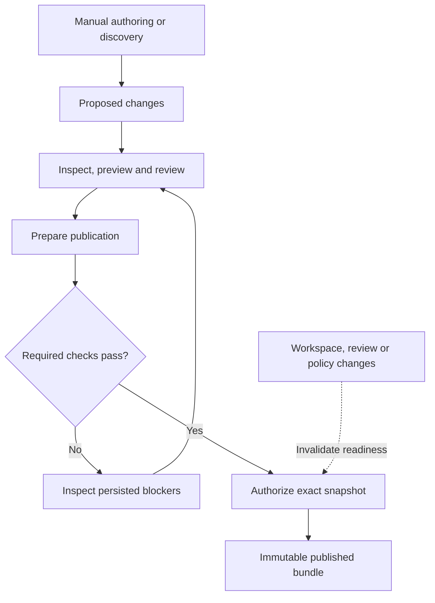
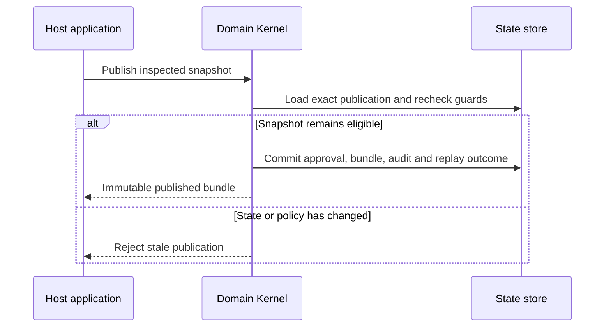

# Review, Validation and Publication

[Architecture overview](../../ARCHITECTURE.md) · [Contract index](README.md)

<a id="7-review-validate-and-publish"></a>

Discovery and manual authoring produce proposed changes to a domain model. Before those changes become part of the reviewed model, someone must establish whether they accurately represent the intended business meaning.

Domain Kernel separates three stages of this lifecycle:

- **Review** establishes which definitions, mappings and corrections are accepted.
- **Preparation** captures reviewed content and evaluates whether it satisfies the requirements for publication.
- **Publication** authorizes an exact prepared snapshot and releases it as an immutable model version.

This separation allows authors to develop a model without affecting existing consumers or publishing content that has not passed its required checks.



The SDK manages model integrity, review history and publication records. The host application manages reviewer authentication, authorization, task assignment and business judgment.

## 1. Review Proposed Changes

A review case represents a proposed definition, mapping, correction or unresolved question.

The reviewer examines the proposed meaning and its supporting evidence before choosing an appropriate decision.

A review interaction consists of three separate actions: inspect the case, preview the intended decision and explicitly submit it.

### Preview a decision

Use `preview_changes()` to inspect the consequences of a decision before applying it.

```python
impact = await model.preview_changes(
    case=case,
    decision=decision,
)
```

The supplied `case` must be the immutable `ReviewCase` snapshot that the reviewer inspected.

The SDK derives the case identity, scope and expected version from that object and verifies them against stored state. Modified or stale snapshots are rejected.

The resulting `ReviewImpact` contains:

| Information | Purpose |
|---|---|
| `ChangeSet` | Describe the proposed changes to definitions and alignments. |
| Affected definitions and cases | Identify other parts of the model affected by the decision. |
| Invalidated decisions | Identify interpretations requiring renewed review. |
| Publication blockers | Identify requirements that would remain or become unresolved. |
| Workspace revision | Identify the model state against which the decision was evaluated. |

The `definition_changes`, `source_alignment_changes`, `reference_disposition_changes` and `compatibility` properties are read-only views of the existing change set. They perform no I/O, create no copies and introduce no additional serialized fields.

When previewing rejection of a coordinated change, `affected_case_ids` includes both rejected and released cases. The parent's `generated_member_case_ids` identifies which members will be rejected.

Previewing a decision does not apply changes or reserve resources.

Public review operations are exposed through `model.preview_changes()` and `model.decide_review()`. Synchronous factories such as `case.same_as()` construct typed decisions. Case-local state transition helpers remain private.

### Record the review decision

After the reviewer has inspected the proposed effects and authorized the decision, submit it using the same case snapshot.

For example, submit a previously prepared [source-alignment decision](discovery-and-reconciliation.md#review-a-proposed-alignment):

```python
receipt = await model.decide_review(
    case=case,
    decision=mapping,
    actor="user:catalog-owner",
)

print(f"Decision: {receipt.decision_id.value}")
print(f"Workspace revision: {receipt.workspace_revision}")
```

The SDK rechecks the case version, referenced definition revisions and resulting impact before committing the decision and its effects atomically.

If another operation has changed the relevant state, submission fails rather than applying the decision to a different interpretation.

A matching successful idempotent retry returns the recorded receipt before stale-state checks. Changing the request under the same key produces a conflict.

Without a matching replay, a stale case must be reloaded and inspected before constructing a new decision.

Creating a proposal or correction does not apply its intended effects. Independent pending cases require their own decisions. For coordinated changes, decide the parent case rather than its reserved members.

See [model evolution](model-evolution.md) for coordinated review, corrections and cancellation.

### Inspect review history

Review decisions remain available after subsequent changes to the model.

```python
history = await model.get_review_history(
    case_id=case.id,
    limit=50,
)

for record in history.items:
    print(
        record.id.value,
        record.action.kind,
        record.actor,
        record.recorded_at,
        record.action.reason,
    )
```

Continue through remaining pages using `history.next_cursor` and the same case ID.

Review history preserves earlier interpretations and decisions, including those that have subsequently been corrected or superseded.

### Supported review decisions

Domain Kernel uses typed decisions rather than generic approval flags. Each decision describes the reviewer's intended action and must be compatible with the selected case.

| Reviewer intent | Decision |
|---|---|
| Accept or correct proposed content | `Accept`, `EditDefinition` |
| Map a source occurrence to an existing definition | `case.same_as(definition=..., reason=...)` |
| Relate local and reference definitions | `same_as()`, `narrower_than()`, `broader_than()`, `related_to()`, `distinct_from()` |
| Approve a company-specific meaning without a suitable reference | `ApproveLocalExtension` |
| Reject a proposal or exclude an occurrence from scope | `Reject`, `Exclude` |
| Defer or answer a question | `Defer`, `AnswerQuestion` |
| Retain an optional unresolved question | `KeepNonblockingQuestion` |
| Record separately captured confirmation evidence | `ConfirmStatement.from_statement(source=..., authority=..., reason=...)` |

Reference-alignment methods accept the inspected `local_definition`, `reference_definition` and `reason`. See [reference knowledge and domain types](reference-knowledge-and-domain-types.md) for their individual semantics.

Required gaps remain publication blockers.

A nonblocking question must retain its scope, rationale and attribution. It cannot waive required definitions, confirmations or reference-pack obligations.

Reviewers should correct, reject or exclude unsupported interpretations rather than accept them simply to clear the review queue.

Accepting a hypothesis establishes its reviewed status. It does not establish that the hypothesis is a documented business fact.

## 2. Record Attributed Confirmations

Some business meanings require confirmation from a person with appropriate knowledge or authority.

For example, a component catalog may contain product identifiers without explaining whether those identifiers refer to catalog entries or individual physical units.

A catalog owner can clarify that distinction. The clarification becomes additional evidence supporting the model, rather than an undocumented assumption introduced by the reviewer.

Domain Kernel preserves the original statement, its attribution and the subsequent confirmation decision separately.

### Capture the confirmation as evidence

A recorded confirmation begins with an attributed statement.

```python
from datetime import datetime, timezone

from domain_kernel import (
    Person,
    PersonId,
    Statement,
    StatementForm,
    StatementIntent,
)

owner = Person(
    id=PersonId(value="person:catalog-owner"),
    name="Catalog owner",
    role="Catalog owner",
)

response = await project.ingest_source(
    actor="user:model-editor",
    display_name="Component identifier confirmation",
    source=Statement(
        text=("I confirm that component numbers identify catalog entries, not physical units."),
        speaker=owner,
        recorded_by="user:recorder",
        stated_at=datetime(
            year=2026,
            month=11,
            day=2,
            tzinfo=timezone.utc,
        ),
        context="Confirmation of the component identifier meaning",
        form=StatementForm.QUOTATION,
        intent=StatementIntent.ASSERTION,
    ),
)
```

The statement identifies who supplied the information, when it was stated and who recorded it.

Here, the recorder differs from the actor performing ingestion, so both identities are supplied explicitly.

See [sources and evidence](sources-and-evidence.md) for statement capture and attribution contracts.

### Prepare a confirmation decision

Use the captured statement to construct a typed confirmation:

```python
from domain_kernel import ConfirmStatement

confirmation = ConfirmStatement.from_statement(
    source=response,
    authority="Owner of the catalog identifier definition",
    reason="Preserve the catalog owner's recorded confirmation.",
)
```

The factory creates an ordinary `ConfirmStatement` decision using the captured source.

| Confirmation field | Source |
|---|---|
| `confirmed_by` | Statement speaker. |
| `confirmed_at` | Original statement time. |
| Recorder and capture timestamp | Recorded source attribution. |
| Evidence | Citations belonging to the captured statement revision. |
| `method` | `ConfirmationMethod.RECORDED`. |
| `authenticated_actor` | `None`. |
| Authority and reason | Explicit caller-supplied values. |

The later review decision records its own actor and audit timestamp.

Constructing the confirmation performs no I/O, reads no clock, retrieves no evidence and persists no changes.

The caller explicitly selects the source as confirmation evidence. The SDK does not infer confirmation from the wording of a statement or derive authority from the speaker's role.

### Confirmation integrity

Both `authority` and `reason` must be non-blank.

The factory raises `InvalidDecisionError` for incompatible or incomplete confirmation evidence, including:

- A source that is not an attributed statement.
- An unknown original statement time.
- Missing evidence.
- Citations inconsistent with the captured source revision.
- Invalid attribution or timestamps.

An ordinary statement may have an unknown original time. However, ingestion time cannot substitute for that missing information when constructing a recorded confirmation.

The public factory adapts `IngestedSource` at the SDK boundary. Its domain helper receives the captured `SourceRevision`, evidence, authority and reason, and owns the confirmation invariants.

Domain code must not import sources API types, including typing-only imports.

The existing `Confirmation` payload and decision discriminator remain unchanged. Direct constructors continue to support explicitly supplied confirmation records, including the authenticated confirmation path.

### Review the confirmation

Open a separate confirmation case through:

```python
case = await model.propose_confirmation(
    actor=actor,
    subject=subject,
    reason="Confirm the meaning of the component identifier.",
)

impact = await model.preview_changes(
    case=case,
    decision=confirmation,
)
```

The `subject` is the inspected definition or source review case requiring confirmation.

After an authorized reviewer inspects the confirmation and its effects, submit it through `decide_review()`.

Submission verifies the project scope, exact stored statement capture, evidence citations, applicable evidence requirements and case compatibility.

### Attribution and authority

Several people may participate in establishing a reviewed business meaning.

| Role | Responsibility |
|---|---|
| Speaker | Provides the original business statement. |
| Confirmer | Confirms a particular business meaning. |
| Recorder | Captures the statement or confirmation. |
| Reviewer | Reviews and accepts the confirmation decision. |
| Publisher | Authorizes release of the prepared model. |

These roles may belong to different people.

A recorded confirmation remains distinguishable from a directly authenticated confirmation. The host verifies identity and authority and may enforce stricter approval policies.

Domain Kernel verifies the declared evidence and review requirements. It does not establish a person's business authority independently.

<a id="from-a-workspace-to-a-fixed-snapshot"></a>

## 3. Compile, Prepare, and Publish

A model can contain individually accepted definitions while still being unsuitable for publication.

For example, every relationship might reference an existing definition, but some business meanings may still require confirmation or reference-pack alignment.

Domain Kernel therefore separates compiling reviewed content, evaluating its integrity, determining readiness and authorizing its release.

| Operation | Result | Purpose |
|---|---|---|
| `compile(actor=...)` | `Candidate` | Capture a fixed snapshot of reviewed content and provenance. |
| `validate(candidate=..., actor=...)` | `ValidationReport` | Evaluate model integrity and supported semantic constraints. |
| `prepare_publication(actor=...)` | `Publication` | Compile, validate, assess readiness and persist the result. |
| `publish(publication=..., version=..., actor=..., reason=...)` | `DomainModelBundle` | Authorize and release the exact prepared snapshot atomically. |

All four operations are asynchronous.

For most applications, `prepare_publication()` is the appropriate starting point. Granular compilation and validation remain available when the application needs to inspect intermediate results.

### Prepare the publication

Preparation coordinates compilation, validation and readiness evaluation.

A Business Analysis Platform, for example, can use this operation to determine whether an analyst's reviewed model is ready for release and present any remaining requirements.

```python
from domain_kernel import PublicationBlockedError

try:
    publication = await model.prepare_publication(
        actor="user:model-editor",
    )
except PublicationBlockedError as error:
    print(f"Publication blocked: {error.publication.id.value}")

    for issue in error.issues:
        print(f"{issue.code}: {issue.message}")
else:
    print(f"Publication prepared: {publication.id.value}")

    for check in publication.checks:
        print(
            check.code,
            check.passed,
            check.required,
            check.message,
        )

    for question in publication.nonblocking_questions:
        print(f"Nonblocking question: {question.text}")
```

Preparation returns normally only when its required readiness checks pass. The `else` branch therefore needs no additional readiness check.

Publishing remains a separate operation.

Both successful and blocked preparations are persisted. Applications can reopen an exact preparation in a later request or notebook session:

```python
publication = await model.get_publication(
    publication_id=publication_id,
)
```

This allows a reviewer to inspect the same candidate and validation results that the publisher will eventually authorize.

### Evaluate publication readiness

`ModelReadinessEvaluator` is a pure domain policy operating on the captured candidate, validation results, review state, selected reference pack and applicable publication rules.

It determines which unresolved requirements block release.

Application services coordinate validators and persistence, and verify that the relevant model state remains current when saving or publishing a preparation.

Historical readiness is not sufficient to authorize a changed workspace.

### Checks performed during preparation

Readiness considers the requirements applicable to the model and its selected validation contract.

| Area | Required checks |
|---|---|
| Definition integrity | Required definitions and typed references resolve correctly. |
| Dependency integrity | Required reference and dependency closures are complete. |
| Reconciliation | Required source and reference alignments have been reviewed. |
| Processes and decisions | Supported structural requirements are satisfied. |
| Evidence | Required citations and confirmations are present and valid. |
| Reference obligations | Applicable required reference-pack obligations are satisfied. |
| Semantic validation | Required supported semantic and acceptance checks pass. |

Structural consistency and evidence sufficiency are evaluated independently.

For example, a relationship between `Supplier` and `Component` may contain valid endpoints and cardinality bounds while still lacking sufficient evidence to justify its business meaning.

Both structural and evidence requirements must be satisfied where applicable.

Pending required changes, stale interpretations and unresolved required cases prevent publication. Optional questions may remain open when they have been explicitly reviewed as nonblocking.

See [model acceptance checks](reference-knowledge-and-domain-types.md#model-acceptance-checks) for supported predicates and evaluation outcomes.

### Inspect a blocked publication

A blocked preparation is useful information, not a failed transaction that should discard its results.

`PublicationBlockedError` carries the persisted `Publication` snapshot. Its `issues` property exposes the same immutable tuple as `error.publication.blockers`.

The snapshot includes the applicable check results rather than stopping at the first blocker.

Its inspection properties read stored readiness information without additional I/O or recomputation.

Failures that prevent a complete snapshot from being produced retain their own typed errors. The SDK must not fabricate a blocked publication when preparation itself could not complete.

After receiving a blocked preparation, the application presents its diagnostics, resolves the outstanding work and prepares a new snapshot.

Retrying the original preparation identity returns its recorded outcome. Preparing again after resolving blockers constitutes new work and requires a new idempotency key or omission of the previous key.

See [persistence and reliability](persistence-and-reliability.md) for transaction and replay guarantees.

## 4. Publish the Exact Snapshot

Publication releases a specific prepared model rather than the latest available workspace state.

This matters when several authors are working concurrently. A publisher might inspect a validated model while another reviewer accepts additional changes.

Publishing the newer state would release content that the publisher had not inspected.

Domain Kernel prevents this by binding release authorization to the exact prepared publication.

### Authorize and publish

After the publisher has inspected a ready preparation and explicitly authorized its release:

```python
bundle = await model.publish(
    publication=publication,
    version="1.0.0",
    actor="user:catalog-owner",
    reason="Release the reviewed component catalog.",
)

print(f"Published version: {bundle.version}")
```

The supplied publication must be the exact snapshot that the publisher inspected.

The SDK creates an `Approval` record internally, binding the actor, reason and timestamp to the candidate, validation results, review state and applicable policy.

There is no separate public approval operation or independently publishable approval token.

### Publication guards

Before committing the release, the SDK reloads the stored publication and verifies:

- Publication identity and model scope.
- Candidate and publication hashes.
- Current workspace and review versions.
- Applicable publication policy requirements.
- Model version uniqueness.

Forged, modified or cross-model objects are rejected.

If the workspace, review state or relevant policy has changed, the application must prepare and inspect a fresh publication.

### Atomic release

Release authorization, the immutable bundle, audit records and the idempotency outcome commit in one transaction.

If publication fails, none of these effects are committed.

A matching retry returns the original bundle without creating duplicate records. Changing the actor, reason, version or supplied snapshot under the same idempotency key produces a conflict.



Once released, the bundle remains unchanged regardless of subsequent edits to the model.

Publication also preserves the model's declared kind. Publishing a `PROPOSED` model does not establish that the proposed business design has been implemented, nor does it convert the model into an `OBSERVED` model.

## 5. Integration and Ownership

Applications can distribute review, preparation and publication across separate requests and workers.

A Business Analysis Platform might schedule discovery in a background worker, present review cases through its collaboration interface and allow an authorized business owner to release a reviewed version.

A Graph RAG application might use the same lifecycle to develop and publish the domain definitions used by its knowledge extraction processes.

Neither application needs a separate review engine or publication service.

| Domain Kernel owns | Host application owns |
|---|---|
| Typed review decisions and their effects | Reviewer interfaces and task assignment |
| Evidence and confirmation contracts | Identity verification and business authority |
| Candidate compilation and validation | Selection of applicable business requirements |
| Publication readiness and concurrency guards | Authorization to release a model |
| Immutable bundles and release history | Distribution, downstream adoption and operational enforcement |

For backend and notebook integrations, see [host integration](host-integration.md).

For revision history, corrections and coordinated changes, see [model evolution](model-evolution.md).

For consuming released models independently, see [bundles and interoperability](bundles-and-interoperability.md).
