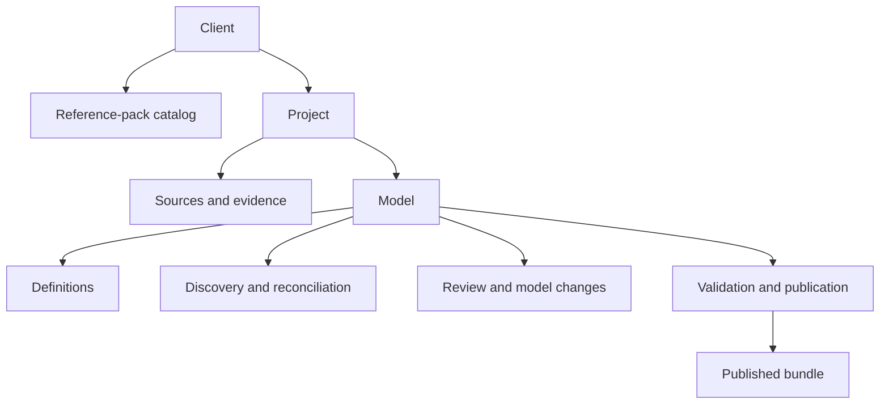
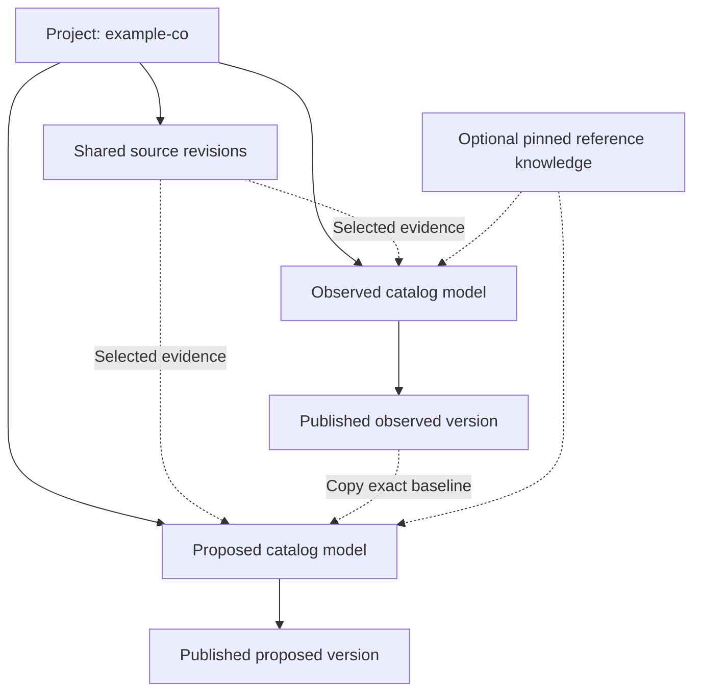

# Workspace and Configuration

[Architecture overview](../../ARCHITECTURE.md) · [Contract index](README.md)

<a id="3-configure-and-create-a-model-workspace"></a>

Domain Kernel organizes business knowledge into projects, sources and independently maintained domain models. Applications interact with these resources through a typed Python API and configure the infrastructure required by their particular use case.

This document defines the public API conventions, configuration lifecycle, workspace boundaries and identity contracts.

The architecture examples use an illustrative `example-co/component-catalog` workspace, with a published version `1.0.0` where required. They demonstrate individual operations rather than forming a single executable script. For an end-to-end introduction, see the [README quickstart](../../README.md#quickstart).

<a id="flat-public-api"></a>

## 1. Scoped Handles and Direct Operations

The public API is organized around three handles: `Client`, `Project` and `Model`.

Each handle exposes the operations belonging to its scope.



| Handle | Responsibility |
|---|---|
| `Client` | Configuration, project management and reference-pack access. |
| `Project` | Model management, source acquisition, source revisions and evidence retrieval. |
| `Model` | Definition management, discovery, reconciliation, review, validation and publication. |

Operations are exposed as direct methods rather than through nested service objects.

For example, `model.get_definition()` retrieves a definition and `model.decide_review()` records a review decision.

Each operation has one public method name, with no aliases or grouped service properties. Methods use keyword-only parameters and concrete return types to support IDE completion and static type checking.

### Model operations

The principal model capabilities are:

| Capability | Operations |
|---|---|
| Definitions | `get_definition`, `get_unit`, `list_definitions`, `get_definition_history`, `propose_definition`, `propose_definition_revision`, `propose_definition_retirement`, `propose_definition_restoration`, `propose_pattern` |
| Changes and review | `propose_change_plan`, `propose_change_set`, `get_review_case`, `list_review_cases`, `iter_review_cases`, `preview_changes`, `decide_review`, `reopen_review_case`, `get_review_history` |
| Discovery and reconciliation | `discover`, `extract_proposals`, `propose_alignment`, `get_alignment`, `get_discovery_run`, `list_discovery_runs`, `resume_discovery` |
| Validation and evolution | `propose_reference_pack_change`, `compile`, `get_candidate`, `validate`, `diff` |
| Publication and export | `prepare_publication`, `publish`, `export`, `get_version`, `list_versions`, `get_publication`, `list_publications` |
| Audit | `get_audit_history`, also available at project scope. |

Some related operations serve different purposes:

- `extract_proposals()` creates a discovery draft, while `propose_alignment()` reconciles it and opens review work. `discover()` coordinates both.
- `propose_change_plan()` submits an immutable builder-generated plan, while `propose_change_set()` coordinates decisions from existing pending cases.
- `prepare_publication()` captures and validates a fixed snapshot, while `publish()` authorizes its release.

For implemented signatures and return types, consult the generated API reference.

### Implementation boundaries

Public handles are thin façades over the application services responsible for each operation.

They do not contain independent implementations of domain rules. Cross-slice changes are coordinated through application services and shared transaction boundaries rather than chains of public API calls.

Case-local transitions belong to `ReviewCase`. Pure review-domain policies determine coordinated acceptance, rejection, member release, corrections and required follow-up review.

Application services supply the inspected state and persist the resulting effects atomically. Repositories enforce storage guarantees without independently interpreting business decisions.

Approved definitions cannot be mutated directly. Operations that create proposals do not implicitly accept them or publish the model.

See [components and ownership](components-and-ownership.md) and [persistence and reliability](persistence-and-reliability.md).

### Synchronous and asynchronous operations

Operations that access persistence or external providers are asynchronous. Operations working exclusively with supplied values remain synchronous.

| Asynchronous | Synchronous |
|---|---|
| Resource creation and lookup | Client construction and configuration loading |
| Persistence-backed lists and history | Loaded snapshot properties and getters |
| Discovery and source acquisition | In-memory builders and decision factories |
| Review previews and model comparisons | Configuration inspection |
| Review, validation and publication | Bundle serialization and in-memory projections |
| Artifact export | Pure composition and schema helpers |

Both SQLite and PostgreSQL follow the same asynchronous persistence contract.

Properties such as `model.info`, `model.scope`, `case.definitions` and `bundle.content.definitions` expose loaded typed values without hidden queries.

Use an asynchronous lookup to retrieve current state.

`iter_review_cases()` is a synchronous factory returning a lazy asynchronous iterator. Persistence reads occur during iteration.

See [host integration](host-integration.md) for pagination, iteration and application integration.

## 2. Defaults and Explicit Intent

Domain Kernel provides defaults for infrastructure and optional capabilities, while requiring callers to supply information that establishes business meaning, authority or intended changes.

For example, a model can use SQLite without explicit database configuration. However, the SDK cannot choose whether that model describes current business operations or a proposed future design.

| Input | Default or requirement |
|---|---|
| Project, model and source names | Supply `display_name`, `name`, or both. |
| `Client.config` | Load the conventional configuration file when present, otherwise use fresh defaults. |
| Database configuration | Omission selects lazy initialization of default SQLite. Explicit configuration remains operator-managed. |
| Model gateway, integrations and reference catalog | Absent unless configured. |
| `create_model.reference_pack` | `None`, including when copying a model that uses a pack. |
| `create_model.copy_from` | `None`, creating a model without a baseline copy. |
| Dependencies, aliases, evidence and pattern bindings | Empty collections. |
| Reference-pack metadata | Empty exclusions, experimental maturity and the supported `1.0` semantic mapping. Identity, applicability, provenance and licence remain required. |
| Imported patterns | No patterns selected by default. |
| Imported obligations | `obligation_ids` must be explicitly supplied, even when empty. |
| Model kind | Required. |
| Actor, applicable decision and release reasons, publication version and concurrency guards | Required according to the operation's contract. |
| `idempotency_key` | Fresh invocation identity when omitted, subject to the documented plan and manifest-child defaults. |
| Existing reference-pack changes | Explicit target required. `None` requests removal. |

Defaults apply to authoring inputs. Persisted snapshots preserve their complete state, including explicit nullable fields.

Edit operations use `UNSET` to distinguish an omitted field from a supplied replacement.

For example, omitting an alias collection preserves it during a typed edit, while supplying `aliases=[]` removes its contents.

Full-replacement revisions follow a different contract. Omitted collections become empty rather than inheriting their previous contents.

## 3. Python Type Conventions

Domain Kernel uses typed, immutable records to preserve domain invariants and prevent unrelated values from being used interchangeably.

Python callers use the declared domain types directly. Configuration and serialization codecs translate between those types and their portable representations.

### Collections and immutable snapshots

Public collection inputs accept `Sequence[T]`, including lists and tuples.

Construction validates every element and captures the supplied sequence as an immutable tuple, including nested sequences.

For example:

```python
aliases = ["Part", "Catalog Item"]
```

Changing the caller's list after constructing a definition must not change the definition, builder draft or previously built plan.

The following rules apply throughout the SDK:

- Collection order is preserved.
- Unordered sets and one-shot iterators require explicit materialization by the caller.
- Strings and byte sequences cannot substitute for typed collections.
- Optional collection defaults use `()`, never mutable `[]` defaults.
- Fixed-position records, such as `(output_id, value)` pairs, remain tuples.

A record may expose a field through the read-only `Sequence[T]` interface, while its captured runtime value remains a tuple.

Frozen dataclasses and configuration models must perform this validation and copying explicitly. Freezing the containing object alone does not make a supplied list immutable.

Invalid inputs must not leave partially modified SDK state.

### Enums and discriminated records

Closed choices use named `StrEnum` members with stable wire values.

Examples include:

```python
ModelKind.PROPOSED
DataType.DECIMAL
CollectionKind.SET
CaseStatus.PENDING
```

The same convention applies to formats, semantic categories and operation statuses.

Definition bodies use fixed discriminators such as `Literal[DefinitionKind.CONCEPT]`. `DefinitionKind` is a `StrEnum`, while its serialized value remains a string such as `"concept"`.

Other fixed record discriminators retain their single-value `Literal` tags.

See Python's [`StrEnum`](https://docs.python.org/3.13/library/enum.html#enum.StrEnum) and [`Literal`](https://docs.python.org/3.13/library/typing.html#typing.Literal) documentation.

### Strongly typed identifiers

A definition ID and a review-case ID may both be represented as strings in an external application, but they identify different kinds of resources.

Domain Kernel represents them through distinct immutable value objects.

Examples include `DefinitionId`, `ReviewCaseId`, `PublicationId` and `ReferenceDefinitionId`.

SDK results already contain these types. Callers can pass them directly to subsequent operations.

When reconstructing an identifier from external data:

```python
from domain_kernel import ReviewCaseId

case_id = ReviewCaseId(
    value=received_case_id,
)

case = await model.get_review_case(
    case_id=case_id,
)

transport_id = case_id.value
```

Identifier constructors validate their spelling. Persistence-facing operations independently verify existence, ownership, scope and applicable revisions. The host establishes the caller's authority.

Additional identity rules apply:

| Type or context | Requirement |
|---|---|
| `ContentHash`, `SourceRevisionId` | Validate SHA-256 spelling. |
| `PageCursor` | Opaque pagination token bound to its query, not a resource identifier. |
| `ReadinessCheck.resource_labels` | Human-readable display text, not lookup identifiers. |
| Body-local keys | Unique and reference-closed within their containing body. |
| Extension identifiers | Resolve to explicitly supported capabilities. |

Human-readable names, prose, version labels, provider model names, actor identifiers, diagnostic labels and extensible registry identifiers remain strings where no closed vocabulary exists.

### Typed business values

Business data structures use immutable nominal values, closed unions and enums to express their requirements.

Examples include:

- `AttributeId` and `KeyId`.
- `BusinessCode` and `Count`.
- `LanguageTag`, `LabelText` and `MeaningText`.

Their constructors enforce the applicable invariants. Their underlying scalar values remain available for serialization.

Callers must supply the declared types rather than relying on implicit primitive conversion.

For example, `RelationshipCardinality.many_to_one()` constructs a value with explicit directional bounds rather than returning a string category.

### Reference integrity

Company definitions use `DefinitionId` or explicitly pinned dependency references.

Reference-pack definitions use `ReferenceDefinitionId`.

Both contexts share compatible definition-body contracts, but references must belong to the correct context.

A local definition ID cannot substitute for a reference-definition ID, even when their serialized values happen to match.

See [reference knowledge and domain types](reference-knowledge-and-domain-types.md) for typed definitions and [model evolution](model-evolution.md) for qualified dependencies.

### Runtime and wire validation

Type annotations support static analysis but do not establish runtime validity.

Public Python APIs validate the declared types, bounds and invariants without silently coercing primitive values into domain objects.

Configuration and wire codecs perform the explicit conversion of recognized serialized values into nominal identifiers and enums. Unknown or invalid values fail.

Portable representations remain simple. Identifiers and enum members serialize as ordinary JSON strings rather than additional wrapper objects.

### Decision-table values

`DecisionValue(value=...)` supports a bounded set of scalar outputs.

| Python type | Requirement |
|---|---|
| `str` | String value. |
| `bool` | Boolean value. |
| `int` | Integer value. |
| `Decimal` | Finite decimal value. |
| `date` | Calendar date. |
| `datetime` | Timezone-aware timestamp. |

`DataType` is derived from the supplied value rather than specified independently.

Floating-point and null outputs are outside the initial contract.

Supported values serialize as exact, tagged lexical strings.

## 4. Typed Configuration

Applications configure Domain Kernel once when creating a client.

Configuration determines which database, source readers, artifact stores, parsers and optional capabilities the client uses. Existing project and model handles reuse that configuration.

Every `ClientConfiguration` field has a default, so applications only need to override the settings relevant to their use case.

### Configure the SDK in Python

The simplest local setup is:

```python
from domain_kernel import Client

client = Client()
```

Configuration selection follows these rules:

| Client construction | Behaviour |
|---|---|
| `Client()` or `Client(config=None)` | Load `domain-kernel.toml` from the captured working directory, or use fresh defaults if the file is absent. |
| `Client(config="config/production.toml")` | Load that exact configuration file. `Path` inputs are also supported. |
| `Client(config=ClientConfiguration(...))` | Use the supplied configuration without discovering or merging files. |

Conventional file discovery checks only the captured working directory. It does not search parent directories, the Git repository root or global configuration locations.

An invalid, unreadable or explicitly selected missing configuration file raises `ConfigurationError`.

Use the following to select built-in defaults explicitly, regardless of whether a conventional configuration file exists:

```python
from domain_kernel import Client, ClientConfiguration

client = Client(
    config=ClientConfiguration(),
)
```

### Default infrastructure

| Setting | Default |
|---|---|
| Database | `.domain-kernel/state.sqlite3` |
| Input reader | `inputs`, rooted at `.` |
| Artifact store | `artifacts`, rooted at `.domain-kernel/artifacts` |
| Model gateway | `None` |
| Reference-pack catalog | `None` |
| Environment file | None |
| Original-document retention | Disabled |
| Extracted-content retention | Disabled |
| Evidence-excerpt retention | Disabled |

Omitting database configuration selects lazy initialization of the default SQLite database. Explicitly supplying database configuration retains operator-controlled initialization.

Parser settings may be omitted. The applicable format default is selected when used, and its optional dependencies must already be installed.

CSV and Excel processing use the Docling adapter provided by the `documents` extra.

See [persistence and reliability](persistence-and-reliability.md) for database initialization and retention.

### Configure inference

AI-assisted discovery requires an application-provided model gateway.

```python
from domain_kernel import Client, ClientConfiguration

client = Client(
    config=ClientConfiguration(
        model_gateway=gateway,
    ),
)
```

The application constructs and configures `gateway` before passing it to Domain Kernel.

Manual authoring and deterministic modeling operations do not require a gateway.

The `inference` configuration controls SDK timeout and retry policies. Provider selection, credentials, model selection and transport remain host responsibilities.

### Configure readers and integrations

Applications can configure several source readers, a reference-pack catalog and caller-owned integrations on the same client.

The following example assumes that `gateway` and `parsed_source_resolver` have been constructed by the application:

```python
from domain_kernel import (
    Client,
    ClientConfiguration,
    ClientIntegrations,
    ParsedSourceProvider,
)

from domain_kernel.configuration import (
    FilesystemReader,
    ReferencePackCatalog,
)

inputs = FilesystemReader(
    name="inputs",
    root="./data",
)

references = FilesystemReader(
    name="references",
    root="./reference-packs",
)

configuration = ClientConfiguration(
    model_gateway=gateway,
    readers=[inputs, references],
    reference_packs=ReferencePackCatalog(
        reader=references,
    ),
)

integrations = (
    ClientIntegrations(
        parsed_source_providers=[
            ParsedSourceProvider(
                name="content-platform",
                resolver=parsed_source_resolver,
            ),
        ],
    )
    if parsed_source_resolver is not None
    else None
)

client = Client(
    config=configuration,
    integrations=integrations,
)
```

Existing resources can then be reopened through that client:

```python
project = await client.get_project(
    name="example-co",
)

model = await project.get_model(
    name="component-catalog",
)
```

Python configuration composes typed provider-specific objects directly. S3 readers accept the supported AWS credential types, while SharePoint readers accept supported Microsoft Entra credentials.

Reader and artifact-store names provide stable identifiers for serialized references. Python credential objects do not require a separate string-based registry.

See the [configuration recipes](../../examples/config/README.md) for provider-specific examples and advanced processing settings.

### Configure the SDK with TOML

Applications that manage deployment configuration separately from their source code can use TOML.

For example:

```toml
schema_version = 1
env_file = ".env"

[database]
type = "postgresql"
dsn = { env = "DK_DATABASE_DSN" }

[readers.inputs]
type = "filesystem"
root = "./data"
```

Load the configuration and attach the application's runtime gateway:

```python
from domain_kernel import Client, ClientConfiguration

configuration = ClientConfiguration.from_toml(
    model_gateway=gateway,
)

client = Client(
    config=configuration,
    integrations=integrations,
)
```

`from_toml()` defaults to `path="domain-kernel.toml"` and accepts an explicit alternative path.

Unlike conventional discovery through `Client()`, it always requires the selected file to exist and be valid. Missing, unreadable or invalid files raise `ConfigurationError`.

TOML contains serializable settings. A `model_gateway` entry is rejected rather than interpreted as a provider name, executable import path or service identifier.

The class method validates the file and preserves its directory as `base_dir`. Environment-secret references are resolved later by the client.

See [configuration choices](../../examples/config/README.md#configuration-choices) for other storage and provider configurations.

## 5. Configuration Validation and Lifecycle

Configuration is captured at startup and remains stable for the lifetime of the client and its associated handles.

Changing a configuration file while the application is running does not silently alter how existing operations acquire sources, resolve paths or connect to external providers.

### Configuration validation

Configuration uses strict, immutable Pydantic models.

Validation rejects unknown fields, invalid values and inconsistent cross-references.

Pydantic remains a boundary-validation dependency. It does not replace the SDK's pure domain records.

The model gateway is a runtime-only exception to serializable configuration.

`ClientConfiguration.model_gateway` accepts a caller-owned `ModelGateway` instance or `None`.

The SDK retains the exact gateway instance without copying, constructing or closing it.

The gateway is excluded from:

- Configuration serialization.
- Generated configuration JSON schemas.
- Representations and sanitized diagnostics.
- Published bundles and policy fingerprints.

Serialized input cannot supply a runtime gateway.

Serializable inference policies and actual model-response provenance remain part of their respective recorded contracts.

### Environment variables and secrets

Environment resolution uses controlled Pydantic Settings sources.

Only explicitly declared `Env` references are resolved.

The lookup order is:

1. Process environment.
2. The explicitly selected `.env` file.
3. `ConfigurationError` if the required value cannot be resolved.

There is no implicit environment-variable interpolation or automatic search for `.env` files in parent directories.

Deployments using only process environment variables can omit `env_file`.

Secrets, credentials and connection strings must remain excluded from diagnostic representations.

### Resolve paths predictably

Relative paths are resolved against a captured base directory.

| Configuration source | Resolution |
|---|---|
| TOML configuration-file path | Captured working directory. |
| Relative paths inside TOML | Directory containing the configuration file. |
| Python configuration paths | Explicit `base_dir`, or the captured working directory when omitted. |

Subsequent changes to the process working directory do not rebase existing configuration.

### Inspect effective configuration

Applications can inspect the client's captured settings without connecting to external infrastructure.

```python
report = client.inspect_configuration()
```

`inspect_configuration()` returns a detached `ConfigurationReport` containing:

- Configuration origin and file, where applicable.
- Resolved base directory.
- Database initialization mode.
- Allowlisted setting summaries.
- Configured integration names.

Inspection is synchronous and performs no file reads, database operations, connection probes, inference or optional adapter imports.

The report describes configured settings, not runtime health or verified dependency availability.

Secrets, DSNs, credential objects and provider objects remain excluded, including from representations.

Configuration origin and whether database settings were explicitly supplied must be captured before applying defaults. That metadata survives TOML loading and client snapshot construction.

### Client initialization

Client construction loads the selected configuration once, validates and captures its settings, and binds the configured integrations.

It does not:

- Create projects or models.
- Initialize or migrate database schemas.
- Acquire source documents.
- Invoke inference.
- Start background processing.

Later configuration edits or gateway replacement do not reconfigure existing handles.

A missing explicitly selected adapter produces an error. Remote authentication occurs when the corresponding capability is used.

Database initialization and resource ownership follow the [persistence contract](persistence-and-reliability.md).

## 6. Projects, Models and Reference Packs

A project provides a namespace for shared source knowledge and independently managed domain models.

For example, a manufacturer might keep procurement policies, component catalogs and maintenance manuals in one project while developing separate procurement and maintenance models.

Both models can use the same source revisions, but each retains its own definitions, discovery runs, review decisions and published versions.

Sharing evidence does not require sharing interpretations.

### Create a project and model

```python
from domain_kernel import ModelKind

project = await client.create_project(
    actor="user:model-editor",
    display_name="Example Co",
)

model = await project.create_model(
    actor="user:model-editor",
    display_name="Component Catalog",
    description=(
        "Catalog item types and their relationships to suppliers, "
        "excluding individual inventory records."
    ),
    kind=ModelKind.PROPOSED,
)
```

The model's description establishes the business area it represents, its intended use and relevant scope boundaries.

Models require a non-blank description. Discovery and reconciliation receive it as context, and published snapshots preserve it.

The description is not an executable constraint.

Definition-specific qualifications belong in each definition's `meaning`. Definitions do not copy or override the model description and have no separate `scope_text` field.

`ModelScope` identifies project and model ownership.

Statement context and review-question scope describe their respective evidence or review circumstances independently.

### Observed and proposed models

`ModelKind` distinguishes existing business behaviour from intended business behaviour.

| Kind | Purpose |
|---|---|
| `OBSERVED` | Describe how a business currently operates, based on available evidence. |
| `PROPOSED` | Describe an intended or future business design. |

Publishing a proposed model does not establish that the business has implemented it.

An application can create a proposed design from an exact published observed baseline using `copy_from=bundle`.



The two models remain independent. Approval and publication do not change their declared kinds.

### Reference packs and model independence

Reference packs are optional.

When selected, they provide exact pinned reference definitions, patterns and declared obligations.

Without a reference pack:

- Core model validation remains active.
- Source-to-model reconciliation remains available.
- Model-to-reference reconciliation is skipped.
- Active reference alignments and dispositions remain empty.
- Accepting a local definition does not create a synthetic reference disposition.

Model copying requires an explicit published bundle. Dependencies require exact published-version pins.

See [reference knowledge and domain types](reference-knowledge-and-domain-types.md) for reference-pack selection and reviewed changes, and [model evolution](model-evolution.md) for copying and dependencies.

## 7. Resource Names and Identity

Human-readable labels can change as a model develops. Resource identities must remain stable so that those changes do not break existing references.

Domain Kernel distinguishes three naming properties:

| Property | Purpose |
|---|---|
| `id` | Permanent SDK-generated resource identity. |
| `name` | Stable lookup name within the resource's owning scope. |
| `display_name` | Human-readable label. |

For example:

| Property | Example |
|---|---|
| `id` | SDK-generated `ModelId` |
| `name` | `component-catalog` |
| `display_name` | `Component Catalog` |

Changing the display name does not regenerate the lookup name or resource ID.

### Project and model names

Display names accept non-blank Unicode text and need not be unique.

Lookup names must fully match:

```text
[a-z][a-z0-9]*(?:-[a-z0-9]+)*
```

Names begin with a lowercase ASCII letter and consist of lowercase letters and numbers separated by single hyphens.

Creation accepts:

- A `display_name` from which the lookup name is generated.
- A `display_name` with an explicit `name` override.
- A `name` alone, which also becomes the display name.

When generating a name, the SDK lowercases the display name, replaces runs of whitespace or ASCII punctuation with hyphens, and removes leading and trailing hyphens.

For example:

| Display name | Generated name |
|---|---|
| `Component Catalog` | `component-catalog` |
| `Equipment / Maintenance` | `equipment-maintenance` |
| `Supplier Management 2` | `supplier-management-2` |

If the generated result does not satisfy the naming contract, the caller must provide a valid explicit name.

The SDK does not invent fallback names or transliterate unsupported characters.

Explicit names are validated unchanged. Empty names and blank display names are rejected.

### Naming scopes

| Resource | Uniqueness scope |
|---|---|
| Project | SDK project catalog. |
| Model | Owning project. |
| Source | Project source catalog, independently of model names. |
| Definition | Owning model, across all top-level definition kinds. |
| Attribute | Owning definition's attribute collection. |
| Business key | Owning definition's key collection. |

Duplicate project and model names raise `ProjectAlreadyExistsError` and `ModelAlreadyExistsError`, respectively.

These guarantees also apply to concurrent creation.

Creation does not silently return an existing resource or generate a suffixed name.

Retrieve an existing resource explicitly through its corresponding lookup method.

Published snapshots preserve the naming information captured when they were created.

### Definition names and reservations

Definitions follow the same generated-ID, stable-name and display-name conventions.

Names are unique across concepts, relationships, value sets, units and other top-level definition kinds within a model. Other models may reuse those names.

Submitting authored additions reserves their names atomically.

Duplicate names raise `DefinitionAlreadyExistsError`. The SDK does not resolve collisions through automatic suffixes, merging or retrieval.

Name reservations follow the definition lifecycle:

| State | Name reservation |
|---|---|
| Submitted creation proposal | Reserved for the proposed identity. |
| Approved definition | Reserved for its permanent identity. |
| Retired definition | Retained. Restoration reuses the same identity and name. |
| Rejected creation that was never approved | Released for a future proposal using a new ID. |

Rejected proposal identities and their history remain available after their name reservations are released.

Display-name edits preserve the stable lookup name and ID.

Repeated evidence occurrences and competing discovery proposals may contain identical labels or provisional candidate names. They do not independently reserve catalog names.

Review establishes whether those proposals refer to existing definitions or require explicitly named new ones.

Reference packs and external ontologies retain their original identities and namespaces. Adapting their knowledge into a local model follows the local naming contract.

Model boundaries should follow business meaning, ownership and change lifecycle rather than naming collisions alone.

## 8. Definition Lookups

Definition lookups retrieve exact immutable snapshots from the owning model.

`get_definition()` accepts exactly one of `name` or `definition_id`.

Typed getters provide convenient access to particular definition kinds.

| Getter | Supported selectors |
|---|---|
| `get_concept()` | `name` or `concept_id` |
| `get_relationship()` | `name` or `relationship_id` |
| `get_unit()` | `name` or `unit_id` |

For example:

```python
component = await model.get_concept(
    name="component",
)

attributes = component.attributes
keys = component.keys
```

`get_concept()` returns a typed `Concept` snapshot with direct access to attributes, keys and their corresponding lookup methods.

These conveniences preserve the existing stored body and wire representation. Callers do not need to traverse `.body` or perform manual kind assertions.

An explicit `revision` selects a historical definition revision. Without it, the operation returns the current revision, including a retired definition when needed for restoration.

Lookups use exact names or typed IDs. They do not search aliases, display labels or dependency names automatically.

Missing definitions raise `DefinitionNotFoundError`. Incompatible definition kinds raise `DefinitionKindMismatchError`.

Cross-model references use explicit published-version pins rather than local name resolution.

### Look up definitions in a published bundle

A published bundle contains its own immutable definition snapshots.

```python
component = bundle.get_concept(
    name="component",
)
```

Bundle lookup is synchronous and requires no client, database or additional evidence retrieval.

It also supports exact typed-ID lookup:

```python
same_component = bundle.get_concept(
    concept_id=component.id,
)
```

The operation searches the selected published snapshot, including its retired definitions.

It does not accept a historical `revision` selector because the bundle already represents a fixed model version.

Projection roots must refer to active definitions.

See [bundles and interoperability](bundles-and-interoperability.md) for independent consumption and projection contracts.

## Further Reading

| Contract | Reference |
|---|---|
| Public API ownership and dependency direction | [Components and ownership](components-and-ownership.md) |
| Infrastructure and provider configuration | [Configuration recipes](../../examples/config/README.md) |
| Source identities, revisions and acquisition | [Sources and evidence](sources-and-evidence.md) |
| Typed authoring and reference knowledge | [Reference knowledge and domain types](reference-knowledge-and-domain-types.md) |
| Review and release authorization | [Review and publication](review-and-publication.md) |
| Model copying and dependencies | [Model evolution](model-evolution.md) |
| Transactions, initialization and recovery | [Persistence and reliability](persistence-and-reliability.md) |
| Notebook and backend integration | [Host integration](host-integration.md) |
