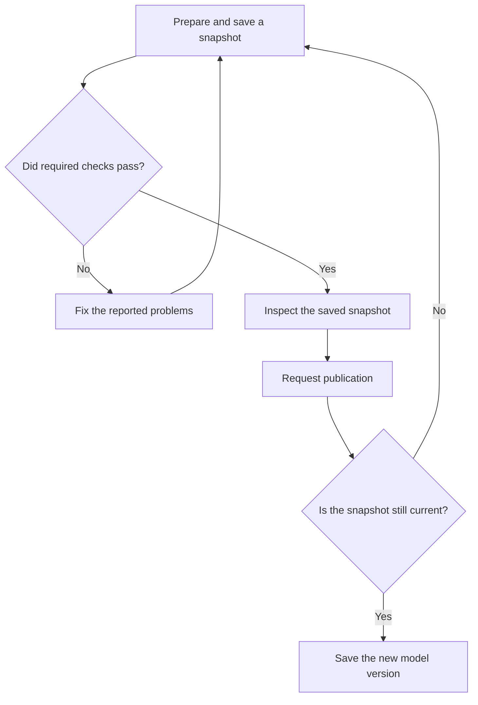

# Maintainer documentation research

A developer who knows Python and has just opened Domain Kernel on GitHub should be
able to explain what the SDK does, follow one model change through the code, and
find the rule and test they would check before modifying it. An architect can
use the same page to see which parts depend on each other, who owns each
decision, and which rules a change must preserve. Explain the project's
vocabulary and its storage and model providers when they first matter. This
reader definition applies Google's advice to identify the reader's role,
prior knowledge, and task before drafting. [Google Technical Writing on audience](https://developers.google.com/tech-writing/one/audience)

Use a short entry path through `ARCHITECTURE.md` and link from it to the
details needed for a change. Include one concrete scenario, a code map, and
the rules that hold across paths. Keep design intent and implementation
status visible together wherever readers could confuse the two. The
recommendations draw on technical writing guides, published research, and
architecture documents written by the projects' maintainers. The final reader
tasks give Domain Kernel a way to test the recommendations.

## Plain language for a technical reader

- Start a section with what happens. Use concrete subjects and verbs that
  identify who calls, checks, writes, or returns something. Name the condition
  and outcome when they affect a maintainer's decision. Use `Client` or
  “the host application” when that distinction matters. A phrase like “preserves
  integrity” leaves work for the reader. Spell out what the code checks and what
  it does when the check fails. Read a paragraph aloud and listen for places
  where a colleague would ask “Who does that?” or “What happens next?”
  [Google on clear sentences](https://developers.google.com/tech-writing/one/clear-sentences),
  [Google on voice and tone](https://developers.google.com/style/tone)
- Put the point of the paragraph in its first sentence. Cut sentences that
  announce what the heading already says or repeat a point in more abstract
  words. Replace broad claims with a condition, an outcome, or an example
  from this SDK. Read the first sentence of each paragraph in order to see
  whether the argument is easy to follow.
  [Google Technical Writing on paragraphs](https://developers.google.com/tech-writing/one/paragraphs)
- Introduce an unfamiliar term with a short definition or example where it
  first matters. Use the same term in prose, headings, tables, and diagrams.
  Keep exact identifiers in code font where readers need to look them up. For a
  standalone section reachable from GitHub search, repeat the few words that
  let the reader understand the term there. A glossary can hold the complete
  definition and distinctions. Domain Kernel already has a glossary for terms
  such as *domain model*, *schema discovery*, and *reference pack*.
  [Google on terminology](https://developers.google.com/tech-writing/one/words),
  [Domain Kernel glossary](../../GLOSSARY.md)
- Give headings a subject readers can recognize on their own. Use sentence
  case and visible hierarchy. “Publication and stored versions” names a
  topic. “Find the publication code” names a task. Use meaningful link text
  and place each link where the reader needs to follow it. Explain essential
  terms and rules on the page where the reader encounters them.
  [Google on headings](https://developers.google.com/style/headings),
  [Google on cross-references](https://developers.google.com/style/cross-references)

GitHub resolves repository-relative links against the branch being viewed and
creates section links from headings. Alex Kladov recommends searchable
module and symbol names because direct file links can become stale. For Domain
Kernel, use branch-relative links to durable starting points and give precise,
searchable identifiers for the next jump. Favor a file or directory over a
line number in a standing guide. Use a revision-pinned link when the exact
historical text matters. When renaming a linked heading, check callers and
retain a custom anchor if the old link still needs to work.
[GitHub on section links](https://docs.github.com/en/get-started/writing-on-github/getting-started-with-writing-and-formatting-on-github/basic-writing-and-formatting-syntax#section-links),
[GitHub on relative links](https://docs.github.com/en/get-started/writing-on-github/getting-started-with-writing-and-formatting-on-github/basic-writing-and-formatting-syntax#relative-links),
[Kladov on architecture files](https://matklad.github.io/2021/02/06/ARCHITECTURE.md.html)

## What makes the current architecture hard to read?

In the 25 November 2026 working copy, the architecture reference starts on
line 641 of a 7,321-line file. The opening quickstart teaches API use before the
page explains where the SDK runs and where to find its code. The supplier
catalog example gives readers a reason to care about the design. A spreadsheet
and a policy can use `Part` for different things. Bring that example forward
and use it to explain what discovery, review, and publication each do.
[Architecture reference](../../ARCHITECTURE.md#architecture-reference),
[supplier catalog example](../../ARCHITECTURE.md#1-the-problem-domain-kernel-solves)

| What the reader encounters | What a rewrite could do |
| --- | --- |
| The [opening](../../ARCHITECTURE.md) asks the reader to interpret “versioned business domain models with traceable provenance” before seeing one. | Show the result. A reviewed catalog defines what the company means by a part, points to the passages behind that definition, and can be saved as a named version. Introduce *provenance* when explaining what the SDK records. |
| [Five Architectural Slices, One Model Contract](../../ARCHITECTURE.md#five-slices-one-model-contract) makes the reader translate *slice* and *contract* before finding the package map. | Use a heading such as “Where to find the code.” Explain what each package owns, name one file to start with for each common change, and preserve exact searchable code names. |
| The [internal architecture diagram](../../ARCHITECTURE.md#internal-architecture) uses arrows for both workflow order and dependencies. The text below explains that the five packages need not run in sequence. | Give the package map and the document-to-publication flow their own views. Name dependencies with verbs such as “calls” and workflow edges with verbs such as “proposes” or “records.” |
| The [architecture quickstart](../../ARCHITECTURE.md#quickstart-create-review-and-publish-a-model) labels its API as proposed. The [site's quickstart](../../apps/docs/src/app/quickstart/page.mdx) teaches a runnable workflow, and the checkout implements several calls shared by both. | Mark proposed behavior beside the specific passage. Give claims about current behavior a source or test link, especially where an invariant would be easy to misread. |

## What the architecture page needs to cover

Kladov's architecture-file proposal starts with the problem, then maps the
main modules, highlights boundaries and invariants, and covers concerns that
span modules. The C4 model offers views at different levels of detail and
recommends choosing the ones that answer readers' questions. For Domain
Kernel, the following questions define coverage for the main reading path.
[Kladov on architecture files](https://matklad.github.io/2021/02/06/ARCHITECTURE.md.html),
[C4 model diagram levels](https://c4model.com/diagrams)

| Reader question | Recommended coverage |
| --- | --- |
| What runs where? | Start with the application that imports the Python SDK. Name what that application supplies and owns, which systems the configured adapters contact, and what another application can consume from a published bundle. |
| What happens to a change? | Trace one recognizable library call or workflow from input to output. At each major handoff, identify the value passed along, who owns it, and what gets saved. Introduce other ways into or through the SDK where they diverge. |
| Where do I start in the code? | Link the public entry point, the service that coordinates the operation, the rule or contract, and a test that shows a consequential outcome. Map the major packages at the same level of detail. |
| What must a change preserve? | State the invariant in observable terms, name the responsible boundary, and give the reason when it affects maintenance. Include cases such as stale state, partial failure, or retries when a change could violate the rule. |
| What can I verify at this revision? | Check implementation claims against public exports, source, and behavior tests. Identify design-only behavior next to the relevant contract. Link the rationale or supporting design detail where available. |

A complete architecture map covers each major boundary and the paths that
change how a reader understands the SDK. Keep common terms, entry points,
state changes, and guarantees in the initial reading path. Add depth where
readers need to check a contract or change a component. A small code fragment
can connect the path in the prose to a public symbol. A runnable lesson can
live with the existing quickstart or notebook. These are proposed editorial
boundaries. The current architecture retains authority for design and
invariants under the repository's content ownership rules.
[Domain Kernel documentation ownership](../documentation.md#content-ownership)

## Patterns in open-source architecture guides

| Example | What the maintainers show | What Domain Kernel can borrow |
| --- | --- | --- |
| rust-analyzer | The opening explains source text going in and a semantic model coming out. The “Entry Points” section names functions and consumer-facing types. Its code map places invariants alongside the crates that own them, including the syntax crate's independence. | Give readers an initial symbol to find and place dependency rules beside the module that enforces them. [rust-analyzer architecture](https://github.com/rust-lang/rust/blob/main/src/tools/rust-analyzer/docs/book/src/contributing/architecture.md) |
| SQLite | The introduction names readers interested in modifying the library. The overview follows SQL text through preparation and execution. Component sections point to interface functions and source files. | Trace an embedded library call across its internal steps, using the actual names readers will see in the source. [SQLite architecture](https://sqlite.org/arch.html) |
| Pydantic | Its internals explain how Python model definition passes a core schema to the validation and serialization package. Its Models guide teaches readers how to build and validate a model using the library. | Describe the same operation from the public caller's perspective on the website and from the viewpoint of component ownership in architecture. [Pydantic internals](https://pydantic.dev/docs/validation/latest/internals/architecture/), [Pydantic Models guide](https://pydantic.dev/docs/validation/latest/concepts/models/) |
| Rust compiler | The compiler guide explains its query-based design, then qualifies the simplified model with concrete places where compilation still behaves differently. | Mark important exceptions beside the overview and point to the relevant code or deeper explanation. [Rust Compiler Development Guide on queries](https://rustc-dev-guide.rust-lang.org/overview.html#queries) |

## GitHub architecture and official SDK documentation

The same vocabulary and voice serve both audiences. The decision each reader
needs to make determines the detail to include. Diátaxis distinguishes
learning a skill, completing a task, looking up facts, and building understanding.
It provides a way to check what a page should help its reader do.
[Diátaxis overview](https://diataxis.fr/start-here/)

| Location | Reader question | What belongs there |
| --- | --- | --- |
| GitHub `ARCHITECTURE.md` | Where would I change the SDK, and what would I need to preserve? | Entry points, components, dependency direction, runtime and state flows, implementation status, invariants, and pointers to source and tests. |
| Official MDX pages in `apps/docs` | How do I use the SDK in my Python application and interpret the result? | Supported tasks, prerequisites, small examples, expected results and errors, public concepts, and links to API reference and the tour. |
| Generated SDK reference | What does this revision expose, and which arguments and results does it declare? | Implemented Python exports and types, generated by the existing source reader. |
| Canonical developer tour | How does a complete workflow run, and what do I inspect at each step? | The notebook's runnable workflow and its saved reading artifact, including visible labels for simulated results. |

Use `ARCHITECTURE.md` as the single standing guide to the SDK's design on
GitHub. Give public tutorials and usage recipes a home on the site or in
the canonical notebook. Where the repository already assigns a guide to
an SDK task, moving it would mean transferring useful content and updating
the incoming links. The current ownership rules name those files explicitly.
[Domain Kernel content ownership](../documentation.md#content-ownership)

For example, the [worked maintainer passage](#why-publication-rejects-an-older-snapshot)
explains why the release check exists and where to change it. An SDK page
could use an error and recovery instruction at the point the reader needs it.
“If `publish()` raises `StaleStateError` because the model changed, call
`prepare_publication()` again and inspect the new snapshot before publishing.”
The later MDX skill can require checking examples against the supported SDK
and verifying page links in the site's authoring workflow.
[Publication tests](../../tests/integration/test_publication.py),
[MDX authoring and checks](../documentation.md#author-and-verify)

## Mermaid diagrams on GitHub

GitHub renders Mermaid in `mermaid` fences in repository Markdown. Its
documentation shows an `info` diagram for checking the renderer version.
Mermaid supports separate node IDs and visible labels, labeled edges, and
the `accTitle` and `accDescr` fields used in the generated SVG. Verify the
diagram on GitHub when publishing since the syntax you can use depends on
its renderer. [GitHub on Mermaid diagrams](https://docs.github.com/en/get-started/writing-on-github/working-with-advanced-formatting/creating-diagrams),
[Mermaid flowcharts](https://mermaid.js.org/syntax/flowchart),
[Mermaid accessibility](https://mermaid.js.org/config/accessibility.html)

Give each diagram one question. A system diagram can show what runs in
the host process and what talks to external systems. A code view can show
what imports what. A sequence diagram can show who checks the change and
when state is stored. Split the drawing when an arrow would have to mean
different things in different places. Include a clear title and scope. Use one
name consistently for a given actor or object. Label meaningful arrows with a
verb or short phrase such as “loads the case” or “stores the decision.” Match
the phrase to the arrow direction. Add a legend when shape, line style, or
color carries meaning. [C4 diagram levels](https://c4model.com/diagrams),
[C4 diagram review checklist](https://c4model.com/diagrams/checklist)

For Domain Kernel, start with simple GitHub-supported flowcharts and sequence
diagrams. Keep labels short enough to read at the page's normal width. Use
familiar role names and introduce any indispensable domain term in nearby
prose. Put exact class names and details outside the boxes when the reader
can follow the drawing without them. Keep a short prose equivalent beside
the diagram, including its main consequence. Add the Mermaid accessibility
fields and check whether GitHub retains and exposes them in the rendered output.
Inspect the result at narrow widths and in both themes. Check clipped text,
confusing crossings, and any meaning that depends on color.
[C4 on diagram notation](https://c4model.com/diagrams/notation),
[Mermaid accessibility](https://mermaid.js.org/config/accessibility.html)

## Why publication rejects an older snapshot

The current text explains the split between preparing and publishing with
“validation, readiness, and release authorization remain traceable.” Start
with a change that happened after someone prepared a release.
[Compile, Prepare, and Publish](../../ARCHITECTURE.md#compile-prepare-and-publish)

> Suppose you prepare a release of the supplier catalog and a reviewer then
> accepts a change to what counts as a component. Your preparation saved a
> snapshot, a copy of the model as it stood then. When you try to publish
> that snapshot as a new version, the SDK raises `StaleStateError`. Prepare
> and inspect a new snapshot before you try again.
>
> `prepare_publication()` saves the model snapshot and its check results.
> `publish()` checks that the saved snapshot still matches the model, review
> state, and release rules. It saves the version, its approval, and the audit
> record in one transaction. The application that calls the SDK verifies the
> publisher's identity and permission to release the model.

To change this rule, start at `Model.publish()`, follow it to
`PublicationService.publish()`, and look for `require_current_publication()`.
The test `test_preparation_and_exact_releases_replay_across_clients` shows what
happens when someone tries to release an old snapshot as a new version.
[Public model API](../../src/domain_kernel/modeling/api/model.py),
[publication service](../../src/domain_kernel/modeling/application/publication.py),
[publication guard](../../src/domain_kernel/modeling/domain/publications.py),
[publication tests](../../tests/integration/test_publication.py),
[design rules](../../ARCHITECTURE.md#3-publish-the-exact-snapshot)

### Show the decision in Mermaid

Preparation saves the snapshot and check results even when checks fail. If
the model, review state, or release rules change before you publish, prepare
a fresh snapshot. The diagram follows a request to release a new version.

## Test the page with a newcomer

Ask a Python developer unfamiliar with Domain Kernel and a reviewer
interested in its design to work from the GitHub page. Give each a short
scenario, observe how they find the information, and ask them to explain
their conclusion in their own words. Record where they hesitate, which
links they follow, and any incorrect assumptions the document encouraged.
Digital.gov describes this use of short scenarios, think-aloud observation,
and neutral follow-up. [Digital.gov on usability testing](https://digital.gov/guides/plain-language/test/usability-testing)

Sillito, Murphy, and De Volder observed programmers changing existing code
in two qualitative studies. Newcomers asked where to start. Programmers also
asked how different parts of the code fit together. Those are two jobs for
the architecture guide. Give readers an entry point they can search for
and explain how the parts work together.
[Asking and Answering Questions during a Programming Change Task, section 4](https://hiper.cis.udel.edu/lp/lib/exe/fetch.php/courses/tse08-askingqmaint.pdf)

Accessibility Standards Canada distinguishes asking readers to explain a
passage in their own words from asking them to complete a task. It also
cautions against using reading-level formulas to judge whether a document
is usable. Use the following tasks to check what the reader can find and
explain with the page open.
[CAN-ASC-3.1:2025 Plain Language, sections 11.1 and 11.4](https://accessible.canada.ca/standards-and-technical-guides/standards-and-technical-guides-database/can-asc-312025-plain-language)

| Scenario to give the reader | What to look for |
| --- | --- |
| A supplier document describes a kind of part. How does that wording become part of a published model? | The reader follows the proposal through review and can point to who decides whether to accept it. |
| You prepared a publication and a reviewer then accepted a change. Can you release the old snapshot as a new version? | The reader explains why it fails and finds the guard and a test that demonstrates the rule. |
| An application already has a published model bundle. A second application wants to use it. What does the second application need to run? | The reader explains which part of the SDK can consume a bundle and finds its entry point. |
| Two people inspect the same proposed change. One records a decision before the other submits theirs. What do you expect to happen next? | The reader finds the contract that handles the second submission and can point to the rule or test they would check. |
| You found a Python call in a design walkthrough. Can you use it in the revision you are reading? | The reader can identify the example's status and verify the call against the implemented exports or generated SDK reference. |

Repeat the same review questions after changes and compare what the readers
could find and correctly explain. In code review, verify the artifact against
the checked-out repository, check its links and rendered diagrams, and trace any
example that makes a behavior claim. The table proposes workshop tasks. Its
outcomes remain to be tested with readers.

## Decisions for the grilling session

| Decision | Recommended starting point |
| --- | --- |
| Which reader is the first version for? | A Python developer new to this repository, with headings and direct links that also let an architect audit a boundary or guarantee. |
| What should the prose sound like? | Address the reader as “you” when they take an action. Name the SDK, the application, or the reviewer when describing what each does. Let a concrete example carry the explanation. |
| Which technical terms should stay? | Keep terms that name a real distinction, such as review and publication. Explain them when readers first need them. Include exact code names where readers can use them to find the implementation. |
| How much should the opening cover? | Context, one representative workflow, and the code map. Link detailed design sections from the place readers first need them. |
| Which workflow should explain the architecture? | Follow one manual change through explicit review and publication. Add a short branch for document discovery where its inputs and proposed changes differ. |
| Which design details belong in the single architecture guide? | Keep rules that a maintainer must preserve and rationale that the code cannot explain on its own. Link to implementation and tests for detail a reader can verify there. |
| How should design status appear? | Use a visible label beside a design-only example or guarantee, with a path to supported behavior from the same section. |
| How should the diagrams be scoped and labeled? | Start with an overview of the SDK in the application that calls it. Add a diagram when a handoff or decision needs its own explanation. Use plain words inside boxes and put code names in the prose nearby. |
| What should count as acceptance? | A reviewer can verify claims against evidence, and unfamiliar readers can complete the find, explain, and trace tasks from the rendered page. |
