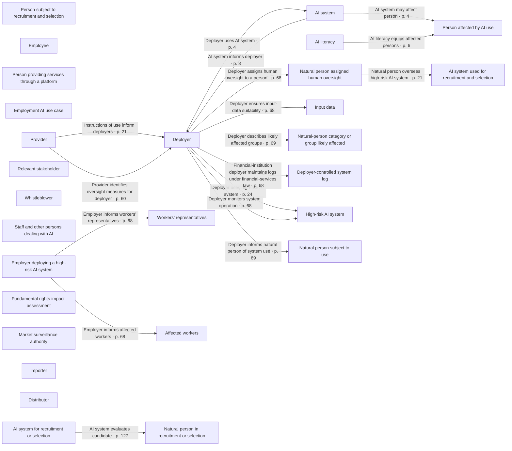

# What Luna discovered in the English AI Act

On 18 November 2026 the recruitment model received 28 concept proposals and 17 directed relationships. All 45 remained pending human review. The business scope asked how AI is used in recruitment and selection, who is involved, and what responsibilities they have. The stage prompts supplied no expected entity names or recruitment-specific rules. [Pinned publisher PDF](https://eur-lex.europa.eu/eli/reg/2024/1689/oj/eng/pdf)

Docling hybrid chunking produced 60 native chunks from the complete 144-page PDF. The executor processed 15 batches. The final check withheld 17 prospective edges after inspecting the subject and object meanings. The graph has 14 weakly connected components including 11 isolated concepts. Separate components and all supported alternatives remain visible in the local audit.

An independent pypdf read located all 71 quotation occurrences (65 distinct page/quotation pairs) on their cited publisher pages after Unicode normalization, whitespace removal, soft-hyphen removal and folding typographic apostrophes. Rebuilding from the recorded responses reproduced the same claims and findings without provider access. Across development passes and the final endpoint audit the campaign made 112 paid calls using 842,926 input tokens and 69,818 output tokens.

## Directed graph

The labels below are the proposed meanings. Page numbers include supporting conditions and exceptions. Every node, including each isolated concept, appears in the diagram.

## Concepts

| Lookup name | Proposed meaning | Evidence |
|---|---|---|
| `deployer` | A natural or legal person, including a public authority, agency or other body, that uses an AI system under its authority. | [p. 4](https://eur-lex.europa.eu/eli/reg/2024/1689/oj/eng/pdf#page=4) |
| `affected-person` | A person other than the deployer who may be affected by use of an AI system. | [p. 4](https://eur-lex.europa.eu/eli/reg/2024/1689/oj/eng/pdf#page=4) |
| `ai-system` | A machine-based system designed to operate with varying levels of autonomy, which may exhibit adaptiveness after deployment and infers outputs from inputs or data. | [p. 4](https://eur-lex.europa.eu/eli/reg/2024/1689/oj/eng/pdf#page=4) |
| `person-subject-to-recruitment-and-selection` | A person involved in recruitment and selection as its subject; the source does not specify whether that person is an applicant or another category of person. | [p. 16](https://eur-lex.europa.eu/eli/reg/2024/1689/oj/eng/pdf#page=16) |
| `ai-system-for-recruitment-and-selection` | An AI system used for the recruitment and selection of persons is an employment use that should be classified as high-risk. | [p. 16](https://eur-lex.europa.eu/eli/reg/2024/1689/oj/eng/pdf#page=16) |
| `employee` | An employee is one of the categories that relevant work-related contractual relationships should meaningfully involve. | [p. 16](https://eur-lex.europa.eu/eli/reg/2024/1689/oj/eng/pdf#page=16) |
| `platform-service-provider` | A person providing services through a platform is one of the categories that relevant work-related contractual relationships should meaningfully involve. | [p. 16](https://eur-lex.europa.eu/eli/reg/2024/1689/oj/eng/pdf#page=16) |
| `employment-ai-use-case` | Employment AI uses include recruitment and selection of persons; decisions affecting terms of work-related relationships; promotion and termination of work-related contractual relationships; task allocation based on individual behaviour, personal traits or characteristics; and monitoring or evaluation of persons in work-related contractual relationships. | [p. 16](https://eur-lex.europa.eu/eli/reg/2024/1689/oj/eng/pdf#page=16) |
| `provider` | The provider of a high-risk AI system should identify appropriate human-oversight measures for that system. | [p. 21](https://eur-lex.europa.eu/eli/reg/2024/1689/oj/eng/pdf#page=21) |
| `natural-person-human-oversight-assignee` | A natural person assigned human oversight is to have the competence, training and authority necessary to carry out that role. | [p. 21](https://eur-lex.europa.eu/eli/reg/2024/1689/oj/eng/pdf#page=21) |
| `relevant-stakeholder` | A party that may be involved by a deployer in an impact assessment, including representatives of likely affected groups, independent experts, and civil society organisations. | [p. 26](https://eur-lex.europa.eu/eli/reg/2024/1689/oj/eng/pdf#page=26) |
| `whistleblower` | A person who reports an infringement of the Regulation and is protected under Union law. | [p. 43](https://eur-lex.europa.eu/eli/reg/2024/1689/oj/eng/pdf#page=43) |
| `staff-and-other-persons-dealing-with-ai` | Staff and other persons who deal with the operation and use of AI systems on behalf of providers or deployers. | [p. 51](https://eur-lex.europa.eu/eli/reg/2024/1689/oj/eng/pdf#page=51) |
| `ai-literacy` | Skills, knowledge, and understanding that allow providers, deployers, and affected persons, taking account of their respective rights and obligations, to make an informed deployment of AI systems and gain awareness of AI opportunities, risks, and possible harms. | [p. 49](https://eur-lex.europa.eu/eli/reg/2024/1689/oj/eng/pdf#page=49) |
| `employer` | A deployer that is an employer; before putting a high-risk AI system into service or using it at the workplace, it has an information duty toward workers’ representatives and affected workers. | [p. 68](https://eur-lex.europa.eu/eli/reg/2024/1689/oj/eng/pdf#page=68) |
| `workers-representatives` | Representatives of workers whom an employer-deployer must inform before putting a high-risk AI system into service or using it at the workplace. | [p. 68](https://eur-lex.europa.eu/eli/reg/2024/1689/oj/eng/pdf#page=68) |
| `affected-workers` | Workers who will be subject to use of a high-risk AI system at the workplace and whom an employer-deployer must inform before putting it into service or using it. | [p. 68](https://eur-lex.europa.eu/eli/reg/2024/1689/oj/eng/pdf#page=68) |
| `input-data` | Data supplied as input to a high-risk AI system. | [p. 68](https://eur-lex.europa.eu/eli/reg/2024/1689/oj/eng/pdf#page=68) |
| `fundamental-rights-impact-assessment` | An assessment of the impact that use of a high-risk AI system may produce on fundamental rights. | [p. 69](https://eur-lex.europa.eu/eli/reg/2024/1689/oj/eng/pdf#page=69) |
| `natural-person-category-or-group-likely-affected` | A category of natural persons or group likely to be affected by use of a high-risk AI system in the specific context. | [p. 69](https://eur-lex.europa.eu/eli/reg/2024/1689/oj/eng/pdf#page=69) |
| `deployer-controlled-system-log` | A log automatically generated by a high-risk AI system, to the extent it is under the deployer's control. | [p. 68](https://eur-lex.europa.eu/eli/reg/2024/1689/oj/eng/pdf#page=68) |
| `high-risk-ai-system` | An AI system classified as high-risk under the Regulation. | [p. 66](https://eur-lex.europa.eu/eli/reg/2024/1689/oj/eng/pdf#page=66) |
| `natural-person-subject` | A natural person whom a deployer informs that they are subject to the use of a high-risk AI system referred to in Annex III that makes or assists in making decisions related to natural persons. | [p. 69](https://eur-lex.europa.eu/eli/reg/2024/1689/oj/eng/pdf#page=69) |
| `market-surveillance-authority` | An authority notified by a deployer of the results of a fundamental rights impact assessment. | [p. 70](https://eur-lex.europa.eu/eli/reg/2024/1689/oj/eng/pdf#page=70) |
| `importer` | An actor referred to as an importer in the supplied provisions. | [p. 66](https://eur-lex.europa.eu/eli/reg/2024/1689/oj/eng/pdf#page=66) |
| `distributor` | An actor referred to as a distributor in the supplied provisions. | [p. 66](https://eur-lex.europa.eu/eli/reg/2024/1689/oj/eng/pdf#page=66) |
| `ai-recruitment-or-selection-system` | An AI system intended to be used for recruiting or selecting natural persons, including to place targeted job advertisements, analyse and filter job applications, or evaluate candidates. | [p. 127](https://eur-lex.europa.eu/eli/reg/2024/1689/oj/eng/pdf#page=127) |
| `natural-person-candidate` | A natural person who is subject to recruitment or selection by an AI system. | [p. 127](https://eur-lex.europa.eu/eli/reg/2024/1689/oj/eng/pdf#page=127) |

## Relationships

| Proposed endpoints | Predicate | Evidence |
|---|---|---|
| `deployer` → `ai-system` | A deployer uses an AI system under the deployer's authority. | [p. 4](https://eur-lex.europa.eu/eli/reg/2024/1689/oj/eng/pdf#page=4) |
| `ai-system` → `affected-person` | Use of an AI system may affect a person other than the deployer. | [p. 4](https://eur-lex.europa.eu/eli/reg/2024/1689/oj/eng/pdf#page=4) |
| `ai-literacy` → `affected-person` | AI literacy equips affected persons with notions needed to make informed decisions regarding AI systems. | [p. 6](https://eur-lex.europa.eu/eli/reg/2024/1689/oj/eng/pdf#page=6) |
| `ai-system` → `deployer` | An AI system informs a deployer of its capabilities and limitations. | [p. 8](https://eur-lex.europa.eu/eli/reg/2024/1689/oj/eng/pdf#page=8) |
| `natural-person-human-oversight-assignee` → `ai-system-for-recruitment-and-selection` | A natural person assigned human oversight oversees the functioning of a high-risk AI system. | [p. 21](https://eur-lex.europa.eu/eli/reg/2024/1689/oj/eng/pdf#page=21) |
| `provider` → `deployer` | Providers should ensure that instructions of use for high-risk AI systems contain meaningful, comprehensive, accessible and understandable information; the instructions should assist deployers and support their informed decision-making. | [p. 21](https://eur-lex.europa.eu/eli/reg/2024/1689/oj/eng/pdf#page=21) |
| `deployer` → `high-risk-ai-system` | A deployer uses a high-risk AI system in accordance with its instructions for use. | [p. 24](https://eur-lex.europa.eu/eli/reg/2024/1689/oj/eng/pdf#page=24) |
| `provider` → `deployer` | The provider identifies measures before placing the high-risk AI system on the market or putting it into service that are appropriate for the deployer to implement. | [p. 60](https://eur-lex.europa.eu/eli/reg/2024/1689/oj/eng/pdf#page=60) |
| `deployer` → `natural-person-human-oversight-assignee` | The deployer assigns human oversight of the high-risk AI system to a natural person. | [p. 68](https://eur-lex.europa.eu/eli/reg/2024/1689/oj/eng/pdf#page=68) |
| `employer` → `workers-representatives` | The employer-deployer informs workers’ representatives that they will be subject to use of the high-risk AI system. | [p. 68](https://eur-lex.europa.eu/eli/reg/2024/1689/oj/eng/pdf#page=68) |
| `employer` → `affected-workers` | The employer-deployer informs affected workers that they will be subject to use of the high-risk AI system. | [p. 68](https://eur-lex.europa.eu/eli/reg/2024/1689/oj/eng/pdf#page=68) |
| `deployer` → `natural-person-subject` | The deployer informs a natural person that they are subject to use of the high-risk AI system. | [p. 69](https://eur-lex.europa.eu/eli/reg/2024/1689/oj/eng/pdf#page=69) |
| `deployer` → `high-risk-ai-system` | The deployer monitors operation of the high-risk AI system on the basis of its instructions for use. | [p. 68](https://eur-lex.europa.eu/eli/reg/2024/1689/oj/eng/pdf#page=68) |
| `deployer` → `input-data` | The deployer ensures that input data is relevant and sufficiently representative in view of the intended purpose of the high-risk AI system. | [p. 68](https://eur-lex.europa.eu/eli/reg/2024/1689/oj/eng/pdf#page=68) |
| `deployer` → `natural-person-category-or-group-likely-affected` | In the fundamental rights impact assessment, the deployer describes the categories of natural persons and groups likely to be affected by the system's use in the specific context. | [p. 69](https://eur-lex.europa.eu/eli/reg/2024/1689/oj/eng/pdf#page=69) |
| `deployer` → `deployer-controlled-system-log` | A deployer that is a financial institution subject to internal-governance, arrangement or process requirements under Union financial services law maintains the logs as part of documentation kept under that law. | [p. 68](https://eur-lex.europa.eu/eli/reg/2024/1689/oj/eng/pdf#page=68) |
| `ai-recruitment-or-selection-system` → `natural-person-candidate` | The AI system evaluates a natural-person candidate. | [p. 127](https://eur-lex.europa.eu/eli/reg/2024/1689/oj/eng/pdf#page=127) |

## Attached qualifications

| Claim | Kind | Proposed qualification | Evidence |
|---|---|---|---|
| `deployer` | condition | The AI system is not used in the course of a personal non-professional activity. | [p. 4](https://eur-lex.europa.eu/eli/reg/2024/1689/oj/eng/pdf#page=4) |
| `deployer-uses-ai-system` | condition | The AI system is not used in the course of a personal non-professional activity. | [p. 4](https://eur-lex.europa.eu/eli/reg/2024/1689/oj/eng/pdf#page=4) |
| `ai-system-may-affect-person` | condition | The possibility of affecting a person other than the deployer depends on the type of AI system. | [p. 4](https://eur-lex.europa.eu/eli/reg/2024/1689/oj/eng/pdf#page=4) |
| `natural-person-oversees-high-risk-ai-system` | condition | The system is a high-risk AI system. | [p. 21](https://eur-lex.europa.eu/eli/reg/2024/1689/oj/eng/pdf#page=21) |
| `provider-provides-instructions-to-deployer` | condition | Instructions of use should include system characteristics, capabilities and performance limitations. | [p. 21](https://eur-lex.europa.eu/eli/reg/2024/1689/oj/eng/pdf#page=21) |
| `provider-provides-instructions-to-deployer` | condition | Where appropriate, illustrative examples should be included. | [p. 21](https://eur-lex.europa.eu/eli/reg/2024/1689/oj/eng/pdf#page=21) |
| `provider-provides-instructions-to-deployer` | condition | Instructions should be available in a language easily understood by target deployers, as determined by the Member State concerned. | [p. 21](https://eur-lex.europa.eu/eli/reg/2024/1689/oj/eng/pdf#page=21) |
| `deployer-assigns-human-oversight-to-person` | condition | The assigned person must have the necessary competence, training, authority, and support. | [p. 68](https://eur-lex.europa.eu/eli/reg/2024/1689/oj/eng/pdf#page=68) |
| `employer-informs-workers-representatives` | condition | The information must be given before putting the system into service or using it at the workplace. | [p. 68](https://eur-lex.europa.eu/eli/reg/2024/1689/oj/eng/pdf#page=68) |
| `employer-informs-workers-representatives` | condition | Where applicable, the information is provided in accordance with rules and procedures under Union and national law and practice on information of workers and their representatives. | [p. 68](https://eur-lex.europa.eu/eli/reg/2024/1689/oj/eng/pdf#page=68) |
| `employer-informs-affected-workers` | condition | The information must be given before putting the system into service or using it at the workplace. | [p. 68](https://eur-lex.europa.eu/eli/reg/2024/1689/oj/eng/pdf#page=68) |
| `employer-informs-affected-workers` | condition | Where applicable, the information is provided in accordance with rules and procedures under Union and national law and practice on information of workers and their representatives. | [p. 68](https://eur-lex.europa.eu/eli/reg/2024/1689/oj/eng/pdf#page=68) |
| `deployer-informs-natural-person-of-system-use` | condition | The duty applies to an Annex III high-risk AI system that makes or assists in making decisions related to natural persons. | [p. 69](https://eur-lex.europa.eu/eli/reg/2024/1689/oj/eng/pdf#page=69) |
| `deployer-informs-natural-person-of-system-use` | exception | For high-risk AI systems used for law enforcement purposes, Article 13 of Directive (EU) 2016/680 applies. | [p. 69](https://eur-lex.europa.eu/eli/reg/2024/1689/oj/eng/pdf#page=69) |
| `deployer-monitors-high-risk-ai-system` | condition | Where relevant, the deployer informs the provider in accordance with Article 72. | [p. 68](https://eur-lex.europa.eu/eli/reg/2024/1689/oj/eng/pdf#page=68) |
| `deployer-monitors-high-risk-ai-system` | exception | For financial-institution deployers subject to internal-governance requirements under Union financial services law, the monitoring obligation is deemed fulfilled by complying with the applicable internal-governance rules. | [p. 68](https://eur-lex.europa.eu/eli/reg/2024/1689/oj/eng/pdf#page=68) |
| `deployer-ensures-input-data-suitability` | condition | Only to the extent the deployer exercises control over the input data. | [p. 68](https://eur-lex.europa.eu/eli/reg/2024/1689/oj/eng/pdf#page=68) |
| `deployer-maintains-financial-institution-logs-under-financial-services-law` | condition | The deployer is a financial institution subject to requirements regarding its internal governance, arrangements or processes under Union financial services law. | [p. 68](https://eur-lex.europa.eu/eli/reg/2024/1689/oj/eng/pdf#page=68) |
| `natural-person-subject` | condition | The system is referred to in Annex III and makes decisions or assists in making decisions related to natural persons. | [p. 69](https://eur-lex.europa.eu/eli/reg/2024/1689/oj/eng/pdf#page=69) |
| `natural-person-subject` | exception | For high-risk AI systems used for law enforcement purposes, Article 13 of Directive (EU) 2016/680 shall apply. | [p. 69](https://eur-lex.europa.eu/eli/reg/2024/1689/oj/eng/pdf#page=69) |

## Review of this run

**7/10 for assisted extraction.** The source lineage and offline repeatability are strong. A reviewer has access to every retained qualification and can see what was withheld. This rating is an engineering assessment of one source and scope. It is not a measured precision or recall score.

- Annex III describes *intended use*. The proposed candidate edge says the system evaluates a candidate. A reviewer should restore that distinction. The draft also refers to two similar recruitment-system concepts. [Annex III, point 4(a)](https://eur-lex.europa.eu/eli/reg/2024/1689/oj/eng/pdf#page=127)
- One proposal assigns high-risk status to recruitment systems without carrying the Article 6(3) derogation and profiling override. The classification needs additional evidence and review before publication. [Article 6](https://eur-lex.europa.eu/eli/reg/2024/1689/oj/eng/pdf#page=54)
- The verifier accepted an edge making the AI system the party that informs deployers. The cited transparency discussion describes information deployers should receive. Actor attribution still needs human review. [Recital 27](https://eur-lex.europa.eu/eli/reg/2024/1689/oj/eng/pdf#page=8)
- The endpoint check caught the proposal that aimed application filtering at a candidate. It withheld the edge, leaving the relationship to job applications to be recovered during review. [Annex III, point 4(a)](https://eur-lex.europa.eu/eli/reg/2024/1689/oj/eng/pdf#page=127)
- Establish cross-domain quality and reviewer burden on a blind adjudicated set before switching the SDK default. Evaluate deployment-specific storage, concurrency and retention policies separately.
